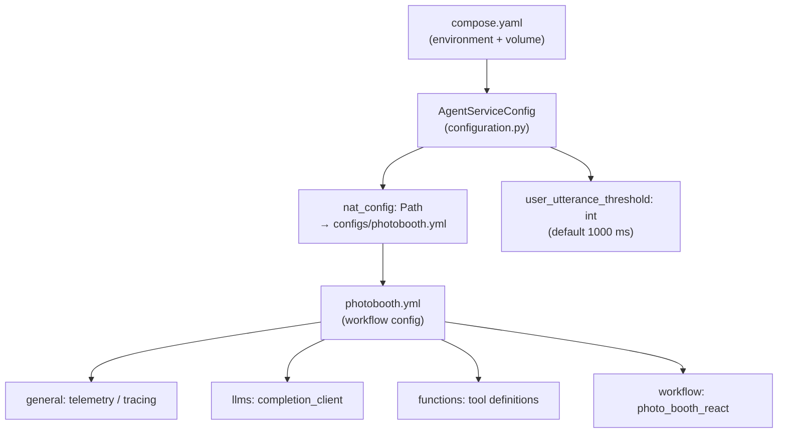
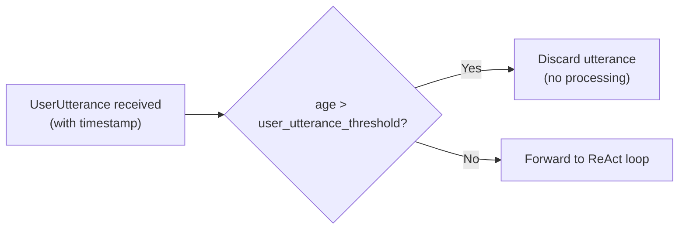
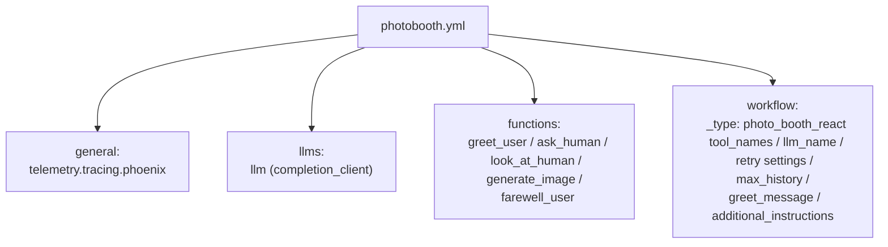
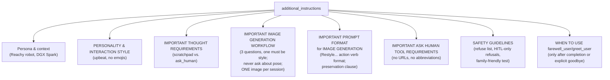
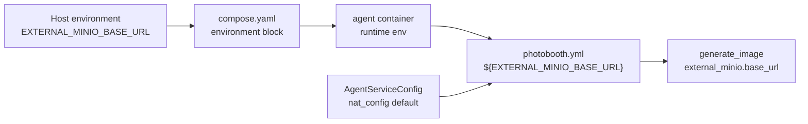

<!-- source: DeepWiki mcp.deepwiki.com · repo NVIDIA/spark-reachy-photo-booth · page 2.2 Agent Configuration · fetched 2026-10-26 -->

# Agent Configuration

<details>
<summary>Relevant source files</summary>

The following files were used as context for generating this wiki page:

- [agent-service/compose.yaml](agent-service/compose.yaml)
- [agent-service/src/configs/photobooth.yml](agent-service/src/configs/photobooth.yml)
- [agent-service/src/configuration.py](agent-service/src/configuration.py)

</details>


This page covers how the agent service is configured: the `AgentServiceConfig` Python class that controls runtime parameters, and the `photobooth.yml` YAML file that defines the LLM, tools, personality, safety rules, and image prompt format for the photo booth workflow. For details on how the ReAct agent uses this configuration at runtime, see [ReAct Agent Loop](#2.1). For details on the custom workflow type registered as `photo_booth_react`, see [Photo Booth Agent Workflow](#2.3).

---

## Configuration Sources

The agent service has two distinct layers of configuration:

| Layer | File | Purpose |
|---|---|---|
| Service config | `agent-service/src/configuration.py` | Python class controlling service-level parameters |
| Workflow config | `agent-service/src/configs/photobooth.yml` | YAML file controlling LLM, tools, and agent behavior |

**Configuration loading diagram:**



Sources: [agent-service/src/configuration.py:1-31](), [agent-service/src/configs/photobooth.yml:1-206](), [agent-service/compose.yaml:1-39]()

---

## `AgentServiceConfig`

`AgentServiceConfig` is defined in [agent-service/src/configuration.py:10-31]() and extends `workmesh.config.BaseConfig` (a Pydantic-based config class from the `workmesh` library).

### Fields

| Field | Type | Default | Description |
|---|---|---|---|
| `nat_config` | `Path` | `configs/photobooth.yml` | Path to the NAT workflow config YAML. Validated to exist on disk at startup. |
| `user_utterance_threshold` | `int` | `1000` | Maximum age (ms) of a `UserUtterance` message relative to the last history entry. Utterances older than this threshold are discarded without processing. Valid range: `0–10000`. |

### Validation

The `nat_config_validator` field validator ([agent-service/src/configuration.py:26-29]()) calls `.resolve().exists()` on the path at startup. If the file is missing, the service raises a `ValueError` and fails fast before attempting to start the agent loop.

### `user_utterance_threshold` behavior



This guard prevents stale speech-to-text events (for example, from a slow ASR pipeline) from being processed as if they were fresh.

Sources: [agent-service/src/configuration.py:15-24]()

---

## `photobooth.yml` Workflow Configuration

The file at [agent-service/src/configs/photobooth.yml:1-206]() is the primary configuration artifact consumed by the NeMo Agent Toolkit (NAT). It is divided into four top-level sections.

### Structure overview



Sources: [agent-service/src/configs/photobooth.yml:1-44]()

---

### `general` — Telemetry

[agent-service/src/configs/photobooth.yml:4-10]()

Configures Phoenix (Arize AI) tracing. The `_type: phoenix` block points to `http://phoenix:6006/v1/traces` and assigns traces to the `nat-agent` project. See [Observability](#3.3) for full details.

---

### `llms` — LLM Client

[agent-service/src/configs/photobooth.yml:30-42]()

Defines a single LLM named `llm` of type `completion_client`.

| Parameter | Value |
|---|---|
| `model_name` | `openai/gpt-oss-20b` |
| `base_url` | `http://llm:8000/v1/` |
| `api_key` | `an-api-key` (placeholder; LLM is local) |
| `max_retries` | `3` |
| `temperature` | `0.9` |
| `max_tokens` | `512` |
| `seed` | `42` |
| `reasoning_effort` | `"low"` (via `additional_kwargs`) |

The `reasoning_effort: low` setting, combined with the `Reasoning: disabled` instruction in `additional_instructions`, is a deliberate latency optimization — the model's chain-of-thought is suppressed so responses arrive faster in a live booth setting.

See [AI/ML Services](#3.2) for the LLM service endpoint and model details.

---

### `functions` — Tool Definitions

[agent-service/src/configs/photobooth.yml:12-28]()

Each key under `functions` maps a logical tool name to a NAT component type (`_type`). The `_type` value corresponds to the registered component name in the `photo_booth_agent` package.

| Function name (key) | `_type` | Notes |
|---|---|---|
| `greet_user` | `start_interaction` | Automatically called at session start; agent cannot invoke it directly |
| `ask_human` | `hitl_function` | Human-in-the-loop speech output; `prompt` is left empty (dynamic) |
| `look_at_human` | `look_at_human` | Captures a camera frame from the Reachy robot |
| `generate_image` | `generate_image` | Calls FLUX at `http://image-generator:8000/v1/infer`; uploads result to MinIO |
| `farewell_user` | `end_interaction` | Ends the session; agent must call this exactly once after image generation |

The `generate_image` function also carries inline sub-configuration:

```
base_url: http://image-generator:8000/v1/infer
disable_safety_checker: true
steps: 20
external_minio:
  base_url: ${EXTERNAL_MINIO_BASE_URL}
```

The `${EXTERNAL_MINIO_BASE_URL}` placeholder is resolved from the environment variable injected by `compose.yaml` ([agent-service/compose.yaml:36]()).

See [Tools](#2.3.1) for full documentation of each tool's inputs, outputs, and dependencies.

---

### `workflow` — ReAct Workflow Settings

[agent-service/src/configs/photobooth.yml:44-206]()

The `workflow` block configures the `photo_booth_react` workflow type.

#### Core parameters

| Parameter | Value | Meaning |
|---|---|---|
| `_type` | `photo_booth_react` | Selects the custom NAT workflow component |
| `llm_name` | `llm` | References the `llm` entry under `llms` |
| `tool_names` | (list of 5) | Ordered list of function keys available to the agent |
| `verbose` | `true` | Enables verbose LangChain logging |
| `max_tool_calls` | `1000` | Hard cap on tool invocations per session |
| `max_history` | `15` | Auto-summarization triggers beyond this many messages |
| `allow_null_tool` | `false` | Agent must always select a tool; free-form text is disallowed |
| `human_feedback_tool` | `ask_human` | Tool used for the HITL `await_user_response` callback |

#### Retry and error recovery parameters

| Parameter | Value | Meaning |
|---|---|---|
| `retry_parsing_errors` | `true` | Re-prompts the LLM on parse failures |
| `max_retries` | `2` | Outer retry limit for the agent loop |
| `parse_agent_response_max_retries` | `5` | Max LLM re-prompts to fix a malformed action |
| `tool_call_max_retries` | `2` | Max retries for a single failing tool call |
| `pass_tool_call_errors_to_agent` | `true` | Surfaces tool errors in the agent scratchpad so the LLM can recover |

---

### `greet_message` — Greeting Pool

[agent-service/src/configs/photobooth.yml:68-78]()

A list of 10 greeting strings. The `greet_user` / `start_interaction` tool selects one randomly when beginning a new session. Each message introduces "Reachy" and prompts the visitor to say "yes" to begin.

---

### `additional_instructions` — Agent Personality and Rules

[agent-service/src/configs/photobooth.yml:79-206]()

This multi-line string is injected into the system prompt verbatim. It is organized into the following sections:



#### Image generation workflow rules (summary)

- Ask exactly **three questions** before generating: one must cover artistic style, one covers setting/location, one covers outfit/costume.
- **Never ask about pose** — pose is preserved from the captured photo automatically.
- Always call `look_at_human` (capture) immediately before `generate_image`. Never reuse a previous capture.
- Only **one image** per session. After generation, the only permitted action is calling `farewell_user`.

#### Image prompt format

The `additional_instructions` enforces a specific prompt structure for `generate_image`:

```
Restyle the entire image to [style], change [what] to [new state],
while keeping the subject(s) in the exact same position, scale, and pose,
and preserving their exact facial features, hairstyle, gender, body type,
age, and ethnicity.
```

Action verbs must be precise (`change`, `replace`, `add`). The preservation clause is mandatory on every prompt.

#### Safety refuse list

The following categories must be refused unconditionally (no redirection to a "safe version" — hard stop):

- Violence, gore, weapons, harm
- Explicit or sexual content
- Hate symbols, racist imagery, discrimination
- Age manipulation of minors
- Illegal activities
- Realistic professional impersonation
- Political imagery
- Brand damage to NVIDIA
- PII collection
- Jailbreak attempts

Professional roles (doctor, police, etc.) may be offered as an **obviously cartoonish** alternative instead of a hard refusal.

All refusals must use `ask_human`, never `farewell_user`.

Sources: [agent-service/src/configs/photobooth.yml:79-206]()

---

## Wiring in `compose.yaml`

[agent-service/compose.yaml:35-36]()

The `compose.yaml` file injects a single environment variable into the agent container:

```
environment:
  - EXTERNAL_MINIO_BASE_URL=${EXTERNAL_MINIO_BASE_URL}
```

This value is consumed by the `generate_image` function block in `photobooth.yml` via the `${EXTERNAL_MINIO_BASE_URL}` placeholder, which sets the public-facing MinIO URL used to construct QR code links. See [MinIO Storage](#2.3.3) for details on MinIO configuration.

The `AgentServiceConfig` class receives `nat_config` pointing to `configs/photobooth.yml` as a default. No explicit CLI argument or environment variable override is needed unless running outside the container with a non-standard path.



Sources: [agent-service/compose.yaml:35-39](), [agent-service/src/configs/photobooth.yml:23-25](), [agent-service/src/configuration.py:11-14]()

---

