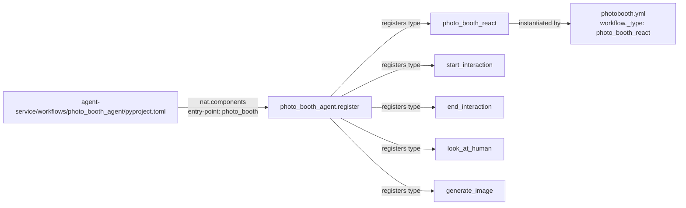
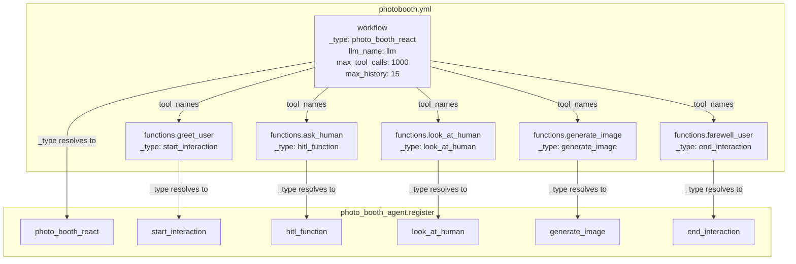
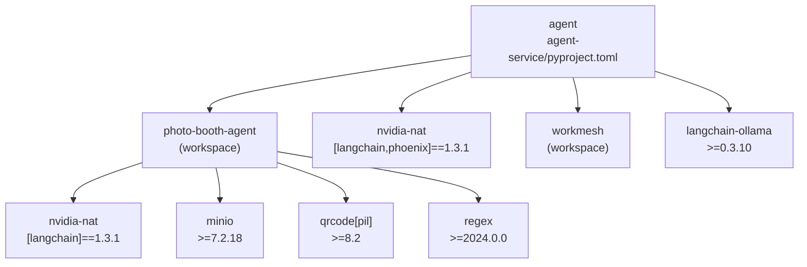

<!-- source: DeepWiki mcp.deepwiki.com · repo NVIDIA/spark-reachy-photo-booth · page 2.3 Photo Booth Agent Workflow · fetched 2026-10-26 -->

# Photo Booth Agent Workflow

<details>
<summary>Relevant source files</summary>

The following files were used as context for generating this wiki page:

- [agent-service/pyproject.toml](agent-service/pyproject.toml)
- [agent-service/src/configs/photobooth.yml](agent-service/src/configs/photobooth.yml)
- [agent-service/workflows/photo_booth_agent/pyproject.toml](agent-service/workflows/photo_booth_agent/pyproject.toml)
- [agent-service/workflows/photo_booth_agent/src/photo_booth_agent/__init__.py](agent-service/workflows/photo_booth_agent/src/photo_booth_agent/__init__.py)

</details>


This page covers the `photo-booth-agent` Python package: its role as a custom NeMo Agent Toolkit (NAT) component, how it registers its workflow type with the NAT framework via Python entry points, and the top-level configuration parameters that govern the `photo_booth_react` workflow. For details on individual tools, see [Tools](#2.3.1). For the Kafka callback handler, see [Kafka Callbacks](#2.3.2). For MinIO storage configuration, see [MinIO Storage](#2.3.3). For how the agent service invokes the workflow at runtime, see [ReAct Agent Loop](#2.1).

---

## Package Overview

The `photo-booth-agent` package is a self-contained Python workspace package located at `agent-service/workflows/photo_booth_agent/`. It is described as a "Custom NeMo Agent Toolkit Workflow" and extends NAT by registering new component types that the agent service resolves at startup.

The top-level agent service package (`agent`) declares `photo-booth-agent` as a workspace dependency:

[agent-service/pyproject.toml:1-26]()

The `photo-booth-agent` package itself is declared at:

[agent-service/workflows/photo_booth_agent/pyproject.toml:1-23]()

---

## NAT Component Registration

NAT (nvidia-nat) uses Python's [entry points](https://packaging.python.org/en/latest/specifications/entry-points/) mechanism to discover plugins and component types at import time. The `photo-booth-agent` package registers under the `nat.components` group, exposing the `photo_booth_react` workflow type:

[agent-service/workflows/photo_booth_agent/pyproject.toml:21-23]()

The entry point name is `photo_booth`, pointing to the `photo_booth_agent.register` module. When NAT loads components, it imports this module and discovers all workflow and tool types it defines. The `agent-service` package separately registers an Ollama LLM plugin under the `nat.plugins` group — a distinct entry point group used for LLM integrations rather than workflow types.

**Diagram: Entry Point Registration Flow**



Sources: [agent-service/workflows/photo_booth_agent/pyproject.toml:21-23](), [agent-service/pyproject.toml:15-16]()

---

## Workflow Type: `photo_booth_react`

The workflow type string `photo_booth_react` is specified in the agent's configuration file under the `workflow` key:

[agent-service/src/configs/photobooth.yml:44-66]()

When NAT processes this configuration, it resolves `_type: photo_booth_react` to the class registered by `photo_booth_agent.register`, then instantiates it with the remaining YAML fields as constructor parameters.

**Diagram: Configuration to Workflow Instantiation**



Sources: [agent-service/src/configs/photobooth.yml:44-66](), [agent-service/workflows/photo_booth_agent/pyproject.toml:22-23]()

---

## Workflow Configuration Parameters

The following parameters are passed to the `photo_booth_react` workflow constructor via `photobooth.yml`:

| Parameter | Value | Description |
|---|---|---|
| `_type` | `photo_booth_react` | NAT component type identifier |
| `llm_name` | `llm` | References the LLM defined under `llms.llm` |
| `verbose` | `true` | Enables verbose logging in the ReAct loop |
| `retry_parsing_errors` | `true` | Retry on agent output parse failures |
| `max_retries` | `2` | Maximum workflow-level retries |
| `max_tool_calls` | `1000` | Hard cap on total tool invocations per session |
| `parse_agent_response_max_retries` | `5` | Retries when parsing the LLM response fails |
| `tool_call_max_retries` | `2` | Retries per individual tool call on failure |
| `pass_tool_call_errors_to_agent` | `true` | Feeds tool errors back into the agent context |
| `max_history` | `15` | Maximum message history length before summarization |
| `allow_null_tool` | `false` | Disallows the agent from taking no action |
| `human_feedback_tool` | `ask_human` | Designates the HITL tool for user interaction |

Sources: [agent-service/src/configs/photobooth.yml:44-67]()

---

## Package Dependencies

The `photo-booth-agent` package has the following direct dependencies, separate from the parent `agent-service` package:

[agent-service/workflows/photo_booth_agent/pyproject.toml:7-12]()

| Dependency | Version Constraint | Purpose |
|---|---|---|
| `minio` | `>=7.2.18` | S3-compatible object storage client for uploading generated images |
| `qrcode[pil]` | `>=8.2` | QR code generation so users can download their images |
| `regex` | `>=2024.0.0` | Enhanced regular expression support for response parsing |
| `nvidia-nat[langchain]` | `==1.3.1` | Core NeMo Agent Toolkit with LangChain integration |

Note that the parent `agent-service` package pins `nvidia-nat[langchain,phoenix]==1.3.1`, which adds Phoenix tracing on top of the base `langchain` extras required here.

**Diagram: Dependency Graph**



Sources: [agent-service/pyproject.toml:4-25](), [agent-service/workflows/photo_booth_agent/pyproject.toml:4-18]()

---

## Photo Booth Interaction Flow

The `photo_booth_react` workflow enforces a structured conversation flow through the sequence of tools available to the agent. The `additional_instructions` in `photobooth.yml` define the expected order of tool invocations:

[agent-service/src/configs/photobooth.yml:79-206]()

**Diagram: Photo Booth Session State Machine**

```mermaid
stateDiagram-v2
    [*] --> "greet_user\n(start_interaction)"
    "greet_user\n(start_interaction)" --> "ask_human\n(ask Q1: setting)"
    "ask_human\n(ask Q1: setting)" --> "ask_human\n(ask Q2: outfit)"
    "ask_human\n(ask Q2: outfit)" --> "ask_human\n(ask Q3: style)"
    "ask_human\n(ask Q3: style)" --> "look_at_human\n(capture image)"
    "look_at_human\n(capture image)" --> "generate_image\n(FLUX via image-generator)"
    "generate_image\n(FLUX via image-generator)" --> "farewell_user\n(end_interaction)"
    "farewell_user\n(end_interaction)" --> [*]
    "ask_human\n(ask Q1: setting)" --> "ask_human\n(safety refusal)" : "unsafe request"
    "ask_human\n(safety refusal)" --> "ask_human\n(ask Q1: setting)"
```

Key constraints enforced by `additional_instructions`:
- Exactly **three questions** are asked before capture: setting/location, outfit/costume, and artistic style.
- `look_at_human` must always be called immediately before `generate_image` — no cached images.
- Only **one image** is generated per interaction; editing or regeneration is refused.
- `farewell_user` is called exactly once at the end with the image description, QR code prompt, and farewell message combined.

Sources: [agent-service/src/configs/photobooth.yml:97-132](), [agent-service/src/configs/photobooth.yml:195-206]()

---

## Python Compatibility

The `photo-booth-agent` package requires Python `>=3.11,<3.13`, while the parent `agent-service` requires `>=3.12`. In practice the package runs on Python 3.12 as specified by the `agent-service` runtime.

[agent-service/workflows/photo_booth_agent/pyproject.toml:11](), [agent-service/pyproject.toml:7]()

---

