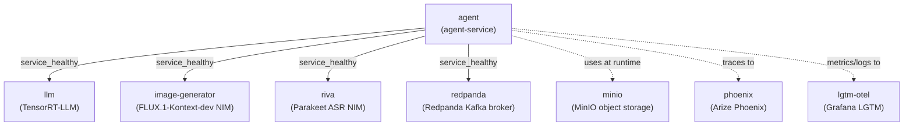
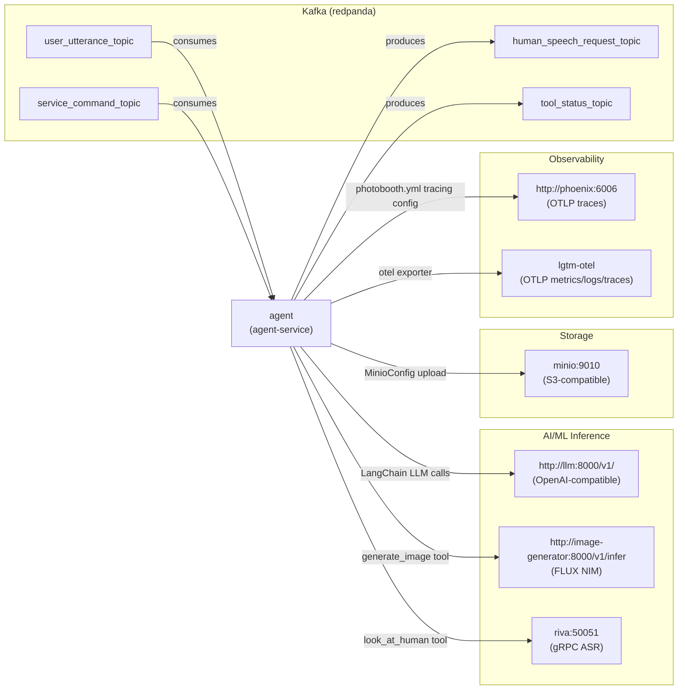

<!-- source: DeepWiki mcp.deepwiki.com · repo NVIDIA/spark-reachy-photo-booth · page 3 Infrastructure Services · fetched 2026-10-26 -->

# Infrastructure Services

Relevant source files

The following files were used as context for generating this wiki page:

- [.env.example](.env.example)
- [README.md](README.md)
- [agent-service/compose.yaml](agent-service/compose.yaml)

This page is an overview of the infrastructure services that the agent service depends on. It describes each service at a high level and links to sub-pages for detailed documentation. For information about the agent itself and its internal workflow, see the [Agent Service](#2) page.

---

## Purpose and Scope

The `agent-service` is not self-contained. It relies on a set of supporting services that provide event messaging, AI/ML inference, object storage, and observability. These services are declared as explicit health-checked dependencies in [agent-service/compose.yaml:13-20]() and must be running and healthy before the agent starts.

This page covers:

| Category | Services | Detail Page |
|---|---|---|
| Event Backbone | Redpanda (Kafka-compatible broker) | [Kafka Messaging (Redpanda)](#3.1) |
| AI/ML Inference | LLM (TensorRT-LLM), image-generator (FLUX NIM), RIVA (Parakeet ASR) | [AI/ML Services](#3.2) |
| Object Storage | MinIO | [MinIO Storage](#2.3.3) |
| Observability | Phoenix (Arize AI), Grafana LGTM (otel-lgtm) | [Observability](#3.3) |

---

## Service Dependency Graph

The following diagram shows the startup dependency chain for the agent service, with service names exactly as they appear in `compose.yaml`.

**Diagram: Agent Service Startup Dependencies**

Sources: [agent-service/compose.yaml:13-20]()

---

## Infrastructure Services Summary

### Redpanda (Kafka Event Backbone)

Redpanda is a Kafka-compatible message broker that acts as the event backbone for the entire system. All inter-service communication — including user speech input, agent tool status updates, and robot control commands — flows through Kafka topics on this broker.

The agent service is both a consumer (reads `user_utterance_topic`) and a producer (writes to `human_speech_request_topic`, `tool_status_topic`, and others).

Container image: `docker.redpanda.com/redpandadata/redpanda`

→ See [Kafka Messaging (Redpanda)](#3.1) for the full topic and message type reference.

---

### AI/ML Inference Services

Three AI/ML services provide inference capabilities to the agent:

| Service Name | Container Image | Role |
|---|---|---|
| `llm` | `nvcr.io/nvidia/tensorrt-llm/release` | LLM inference for the ReAct agent loop (model: `gpt-oss-20b`) |
| `image-generator` | `nvcr.io/nim/black-forest-labs/flux.1-kontext-dev` | Text-to-image generation (model: `FLUX.1-Kontext-dev`) |
| `riva` | `nvcr.io/nim/nvidia/parakeet-1-1b-ctc-en-us` | Automatic speech recognition (model: `Parakeet 1.1B CTC`) |

All three must report `service_healthy` before the agent container starts [agent-service/compose.yaml:13-20]().

> **Note:** `FLUX.1-Kontext-dev` is released for non-commercial use. A valid `HF_TOKEN` with the correct Hugging Face permissions is required, set via [.env.example:2](). An `NVIDIA_API_KEY` is required for NIM containers [.env.example:1]().

→ See [AI/ML Services](#3.2) for endpoints, model details, and how the agent calls each service.

---

### MinIO Object Storage

MinIO provides S3-compatible object storage used by the `generate_image` tool to store generated photos and serve them via public URL. The agent uploads images to a bucket named `photo-booth-agent` and returns a presigned or publicly accessible URL.

Container image: `minio/minio`

Connection is configured via environment variables from [.env.example:3-5]():

| Variable | Default | Purpose |
|---|---|---|
| `MINIO_ROOT_USER` | `minioadmin` | Admin username |
| `MINIO_ROOT_PASSWORD` | `minioadmin` | Admin password |
| `EXTERNAL_MINIO_BASE_URL` | `127.0.0.1:9010` | URL for external access (e.g., QR codes) |

The agent-internal base URL defaults to `minio:9010` as documented in the `MinioConfig` class.

→ See [MinIO Storage](#2.3.3) for the `MinioConfig` class, bucket policy, and retry settings.

---

### Observability Services

Two observability services capture different aspects of system behavior:

| Service Name | Container Image | Purpose |
|---|---|---|
| `phoenix` | `arizephoenix/phoenix` | LLM-specific tracing and evaluation (Arize AI Phoenix) |
| `lgtm-otel` | `docker.io/grafana/otel-lgtm` | General OpenTelemetry metrics, traces, and logs (Grafana LGTM) |

Phoenix data is persisted using the named Docker volume `phoenix_data` declared in [agent-service/compose.yaml:38-39]().

→ See [Observability](#3.3) for UI access URLs and what telemetry data is captured.

---

## Runtime Communication Map

The diagram below maps each infrastructure service to the specific code-level interface or endpoint the agent uses to reach it.

**Diagram: Agent-to-Infrastructure Interface Map**

Sources: [agent-service/compose.yaml:1-39](), [README.md:22-54](), [.env.example:1-5]()

---

