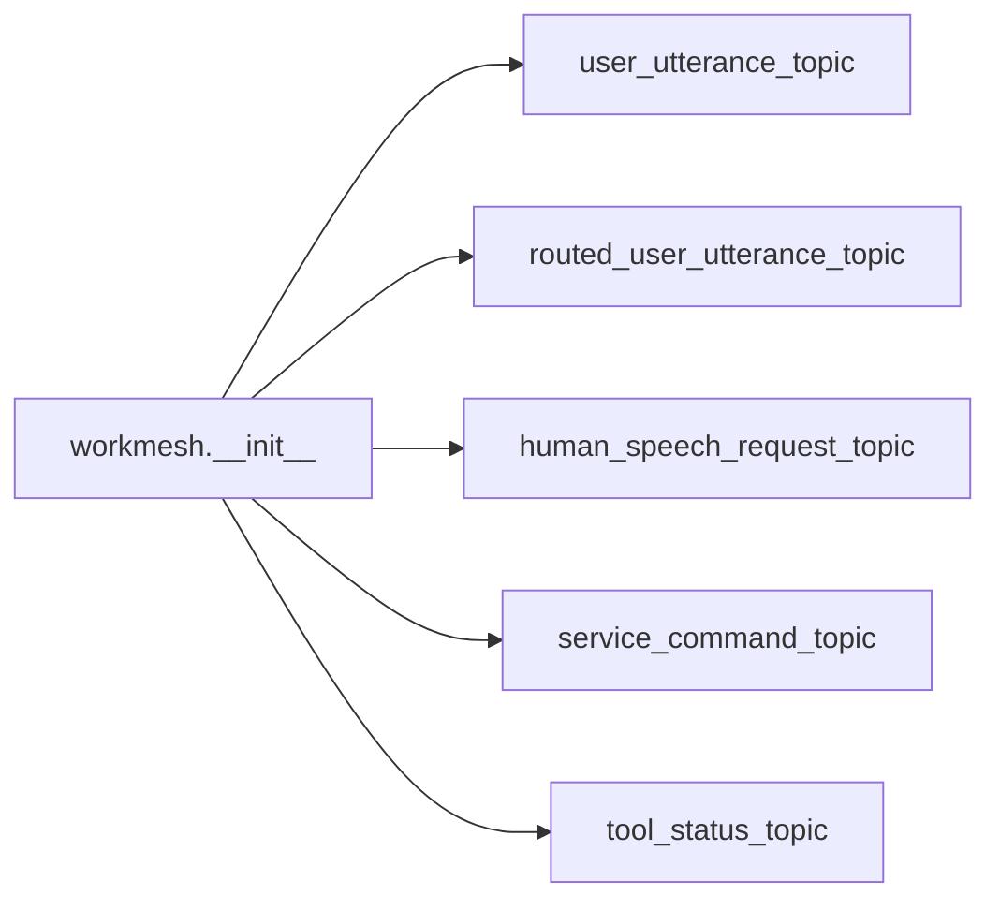
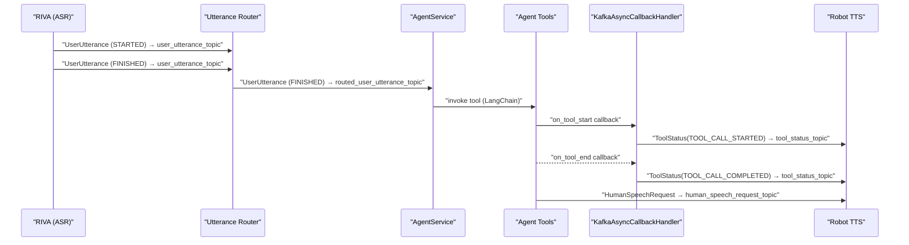

<!-- source: DeepWiki mcp.deepwiki.com · repo NVIDIA/spark-reachy-photo-booth · page 3.1 Kafka Messaging (Redpanda) · fetched 2026-10-26 -->

# Kafka Messaging (Redpanda)

Relevant source files

The following files were used as context for generating this wiki page:

- [agent-service/README.md](agent-service/README.md)
- [agent-service/scripts/mock_user.py](agent-service/scripts/mock_user.py)
- [agent-service/scripts/trigger_agent_restart.py](agent-service/scripts/trigger_agent_restart.py)
- [agent-service/src/main.py](agent-service/src/main.py)
- [agent-service/workflows/photo_booth_agent/src/photo_booth_agent/callbacks/kafka.py](agent-service/workflows/photo_booth_agent/src/photo_booth_agent/callbacks/kafka.py)

This page documents the Redpanda message broker that acts as the event backbone for the photo booth system. It covers every Kafka topic, every message type, and which services produce and consume each topic. For the agent-side logic that reacts to these messages, see the [Agent Service](#2) and [ReAct Agent Loop](#2.1) pages. For the development scripts that interact with these topics directly, see [Development Scripts](#4.2).

---

## Role of Redpanda

Redpanda is a Kafka-compatible streaming broker. In this system it is the sole inter-service communication channel: every service exchanges data by publishing to and subscribing from named topics rather than calling each other directly. The `workmesh` Python package (`workmesh.service.Producer`, `workmesh.service.Consumer`, `workmesh.service.subscribe`) abstracts the raw Kafka client. All messages are serialized with Protocol Buffers; message types live in `workmesh.messages`.

In Docker Compose the broker is the `redpanda` service. During local development it is reachable at `kafka://localhost:19092`.

Sources: [agent-service/README.md:13-18](), [agent-service/scripts/mock_user.py:36-38](), [agent-service/src/main.py:29-33]()

---

## Topics

All topic names are module-level constants exported from the `workmesh` package and imported directly wherever they are used.

| Constant name | Description |
|---|---|
| `user_utterance_topic` | Raw transcribed speech from the ASR pipeline |
| `routed_user_utterance_topic` | Filtered/routed utterances forwarded to the agent |
| `human_speech_request_topic` | Text the agent wants the robot to speak aloud |
| `service_command_topic` | Control commands targeting named services (enable, disable, restart) |
| `tool_status_topic` | Real-time lifecycle events for individual tool calls |

Sources: [agent-service/scripts/mock_user.py:22-28](), [agent-service/src/main.py:32-33](), [agent-service/workflows/photo_booth_agent/src/photo_booth_agent/callbacks/kafka.py:14]()

---

## Message Types

### `UserUtterance`

Carries a fragment of transcribed speech. Published in pairs: one message with status `USER_UTTERANCE_STARTED` and one with `USER_UTTERANCE_FINISHED`.

| Field | Type | Notes |
|---|---|---|
| `action_uuid` | string | Ties the start/finish pair together |
| `status` | `UserUtteranceStatus` | `USER_UTTERANCE_STARTED` or `USER_UTTERANCE_FINISHED` |
| `timestamp` | int (ms epoch) | Used by the agent to discard stale messages |
| `text` | string | The transcribed words |

The agent only processes `USER_UTTERANCE_FINISHED` messages whose timestamp is within `user_utterance_threshold` milliseconds of the current time.

Sources: [agent-service/scripts/mock_user.py:101-119](), [agent-service/src/main.py:103-117]()

---

### `HumanSpeechRequest`

Carries text that the robot's TTS subsystem should speak.

| Field | Type | Notes |
|---|---|---|
| `robot_id` | `Robot` | Identifies the target robot |
| `script` | string | The words to be spoken |

Sources: [agent-service/scripts/mock_user.py:221-223](), [agent-service/scripts/mock_user.py:72-76]()

---

### `ServiceCommand`

A control message sent to a named service to change its operating state.

| Field | Type | Notes |
|---|---|---|
| `command` | `Command` | `ENABLE`, `DISABLE`, or `RESTART` |
| `target_service` | `Service` | `Service.AGENT`, `Service.STT`, etc. |

Examples: `trigger_agent_restart.py` sends `Command.RESTART` to `Service.AGENT`; the agent itself sends `Command.ENABLE` / `Command.DISABLE` to `Service.STT` to gate speech input while interacting with the user.

Sources: [agent-service/scripts/trigger_agent_restart.py:24-29](), [agent-service/scripts/mock_user.py:61-70]()

---

### `ToolStatus`

Published by `KafkaAsyncCallbackHandler` to report the lifecycle of a single LangChain tool invocation.

| Field | Type | Notes |
|---|---|---|
| `robot_id` | `Robot` | Identifies the originating robot/agent |
| `action_uuid` | string | Matches the triggering `UserUtterance` |
| `timestamp` | int (epoch seconds) | Time of the event |
| `status` | `ToolStatus.Status` | `TOOL_CALL_STARTED`, `TOOL_CALL_COMPLETED`, or `TOOL_CALL_FAILED` |
| `name` | string | Tool name (e.g. `ask_human`, `generate_image`) |
| `input` | protobuf map | Key-value pairs of tool inputs |
| `response` | string | Tool output or error string |

Sources: [agent-service/workflows/photo_booth_agent/src/photo_booth_agent/callbacks/kafka.py:65-76](), [agent-service/workflows/photo_booth_agent/src/photo_booth_agent/callbacks/kafka.py:96-112](), [agent-service/workflows/photo_booth_agent/src/photo_booth_agent/callbacks/kafka.py:132-148]()

---

## Producer / Consumer Matrix

The table below shows which logical service produces (P) or consumes (C) each topic.

| Topic | RIVA (ASR) | Utterance Router | `AgentService` | Agent Tools | `KafkaAsyncCallbackHandler` | Robot TTS | `mock_user.py` |
|---|:---:|:---:|:---:|:---:|:---:|:---:|:---:|
| `user_utterance_topic` | P | C | — | — | — | — | P |
| `routed_user_utterance_topic` | — | P | C | — | — | — | — |
| `human_speech_request_topic` | — | — | — | P | — | C | C |
| `service_command_topic` | — | — | C | P | — | — | C / P |
| `tool_status_topic` | — | — | — | — | P | — | C |

Sources: [agent-service/src/main.py:82-117](), [agent-service/scripts/mock_user.py:44-59](), [agent-service/workflows/photo_booth_agent/src/photo_booth_agent/callbacks/kafka.py:65-148](), [agent-service/scripts/trigger_agent_restart.py:18-33]()

---

## Topic and Code-Entity Mapping

**Topic constants and their import paths**

Sources: [agent-service/scripts/mock_user.py:22-28](), [agent-service/src/main.py:32-33](), [agent-service/workflows/photo_booth_agent/src/photo_booth_agent/callbacks/kafka.py:14]()

---

**Message types and their consuming / producing code entities**

```mermaid
flowchart TD
    subgraph "workmesh.messages"
        UserUtterance["UserUtterance"]
        HumanSpeechRequest["HumanSpeechRequest"]
        ServiceCommand["ServiceCommand"]
        ToolStatus["ToolStatus"]
    end

    subgraph "agent-service/src/main.py"
        AgentService["AgentService"]
        on_user_utterance["on_user_utterance()"]
        on_service_command["on_service_command()"]
    end

    subgraph "photo_booth_agent/callbacks/kafka.py"
        KafkaAsyncCallbackHandler["KafkaAsyncCallbackHandler"]
        on_tool_start["on_tool_start()"]
        on_tool_end["on_tool_end()"]
        on_tool_error["on_tool_error()"]
    end

    subgraph "agent-service/scripts/mock_user.py"
        MockUserService["MockUserService"]
        send_text["send_text()"]
        on_text_received["on_text_received()"]
        on_tool_status_received["on_tool_status_received()"]
        on_service_command_received["on_service_command_received()"]
    end

    UserUtterance -->|"consumed via routed_user_utterance_topic"| on_user_utterance
    UserUtterance -->|"produced via user_utterance_topic"| send_text
    HumanSpeechRequest -->|"consumed via human_speech_request_topic"| on_text_received
    ServiceCommand -->|"consumed via service_command_topic"| on_service_command
    ServiceCommand -->|"consumed via service_command_topic"| on_service_command_received
    ToolStatus -->|"produced via tool_status_topic"| on_tool_start
    ToolStatus -->|"produced via tool_status_topic"| on_tool_end
    ToolStatus -->|"produced via tool_status_topic"| on_tool_error
    ToolStatus -->|"consumed via tool_status_topic"| on_tool_status_received
```

Sources: [agent-service/src/main.py:82-117](), [agent-service/scripts/mock_user.py:61-93](), [agent-service/workflows/photo_booth_agent/src/photo_booth_agent/callbacks/kafka.py:17-148]()

---

## End-to-End Message Flow

The diagram below traces a single user utterance from speech input through the agent loop to a spoken response.

**Speech → Agent → Response flow**

Sources: [agent-service/src/main.py:103-117](), [agent-service/workflows/photo_booth_agent/src/photo_booth_agent/callbacks/kafka.py:24-76](), [agent-service/scripts/mock_user.py:72-76]()

---

## `ServiceCommand` Control Flow

`ServiceCommand` is the only topic used to change the runtime behavior of a service. Two target services are observed in the code:

| `target_service` | `command` | Effect |
|---|---|---|
| `Service.AGENT` | `Command.RESTART` | Cancels the current agent task and starts a new greeting interaction |
| `Service.STT` | `Command.ENABLE` | Allows `MockUserService` to forward user input |
| `Service.STT` | `Command.DISABLE` | Suppresses forwarding of user input in `MockUserService` |

The `trigger_agent_restart.py` script is the canonical way to issue a `RESTART` command from the command line.

Sources: [agent-service/scripts/trigger_agent_restart.py:24-33](), [agent-service/src/main.py:82-101](), [agent-service/scripts/mock_user.py:61-70]()

---

## Serialization

All messages published to or consumed from Kafka use Protocol Buffers. Two helper utilities from `workmesh` handle conversion between Python dicts and protobuf map fields:

- `dict_to_protobuf_map` — converts a `dict` to a protobuf map (used when publishing `ToolStatus.input`)
- `protobuf_map_to_dict` — converts a protobuf map back to a `dict` (used when reading `ToolStatus.input` in `mock_user.py`)

Sources: [agent-service/workflows/photo_booth_agent/src/photo_booth_agent/callbacks/kafka.py:14](), [agent-service/scripts/mock_user.py:24]()

---

