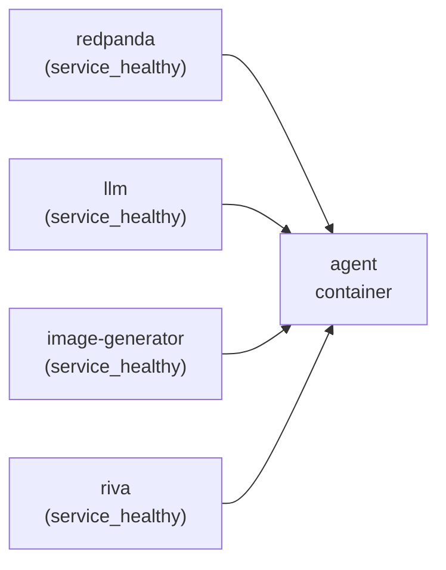
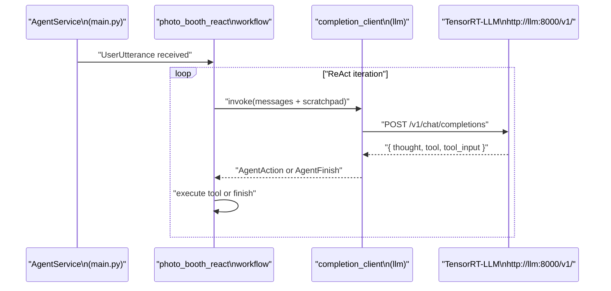
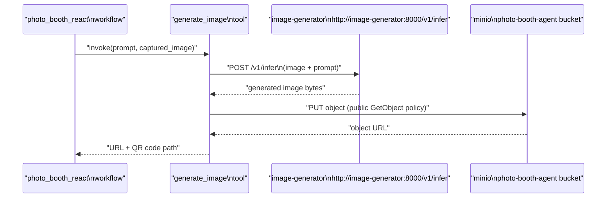
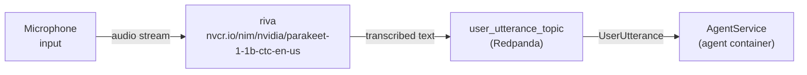

<!-- source: DeepWiki mcp.deepwiki.com · repo NVIDIA/spark-reachy-photo-booth · page 3.2 AI/ML Services · fetched 2026-10-26 -->

# AI/ML Services

<details>
<summary>Relevant source files</summary>

The following files were used as context for generating this wiki page:

- [README.md](README.md)
- [agent-service/README.md](agent-service/README.md)
- [agent-service/compose.yaml](agent-service/compose.yaml)
- [agent-service/src/configs/photobooth.yml](agent-service/src/configs/photobooth.yml)

</details>


This page documents the three AI/ML inference services that the agent depends on: the language model (LLM), the image generator, and the speech-to-text (ASR) service. These services are external to the agent's own code and are consumed via HTTP or SDK calls.

For how the agent orchestrates calls to these services within its reasoning loop, see the [ReAct Agent Loop](#2.1). For infrastructure services such as Kafka messaging, see [Kafka Messaging (Redpanda)](#3.1).

---

## Service Overview

All three AI/ML services must be healthy before the agent container will start. The agent's `depends_on` block enforces this at compose startup time.

Sources: [agent-service/compose.yaml:13-20]()

| Service Name | Role | Container Image | Endpoint |
|---|---|---|---|
| `llm` | Language model inference | `nvcr.io/nvidia/tensorrt-llm/release` | `http://llm:8000/v1/` |
| `image-generator` | Text-to-image generation | `nvcr.io/nim/black-forest-labs/flux.1-kontext-dev` | `http://image-generator:8000/v1/infer` |
| `riva` | Automatic speech recognition | `nvcr.io/nim/nvidia/parakeet-1-1b-ctc-en-us` | SDK (internal) |

Sources: [README.md:22-26](), [agent-service/src/configs/photobooth.yml:20-35]()

---

## Service Dependency and Startup

**Diagram: Agent Startup Dependency Chain**



Sources: [agent-service/compose.yaml:13-20]()

---

## LLM Service

### Role

The LLM service is the reasoning engine for the ReAct agent loop. At each iteration of the loop, the agent sends the current conversation history and tool results to the LLM and receives a structured response indicating the next thought, tool, and tool input.

### Model

| Property | Value |
|---|---|
| Model identifier | `openai/gpt-oss-20b` |
| HuggingFace reference | `openai/gpt-oss-20b` |
| Serving framework | TensorRT-LLM |
| Container | `nvcr.io/nvidia/tensorrt-llm/release` |

Sources: [README.md:22-26](), [README.md:58-61]()

### Configuration

The LLM is configured under the `llms.llm` key in `photobooth.yml`. The agent references it by the logical name `llm` via the `llm_name` field in the workflow block.

| Parameter | Value | Notes |
|---|---|---|
| `_type` | `completion_client` | NAT component type |
| `base_url` | `http://llm:8000/v1/` | OpenAI-compatible API |
| `model_name` | `openai/gpt-oss-20b` | Must match what TensorRT-LLM is serving |
| `api_key` | `"an-api-key"` | Placeholder; not validated by local server |
| `temperature` | `0.9` | |
| `max_tokens` | `512` | |
| `seed` | `42` | |
| `reasoning_effort` | `"low"` | Passed via `additional_kwargs` |
| `max_retries` | `3` | Client-side retry count |

Sources: [agent-service/src/configs/photobooth.yml:31-43]()

### Interaction Pattern

**Diagram: LLM Call Flow in ReAct Loop (code entities)**



Sources: [agent-service/src/configs/photobooth.yml:31-43](), [agent-service/README.md:68-100]()

---

## Image Generator Service

### Role

The image generator transforms a captured photograph of the user into an AI-generated stylized image. It is invoked by the `generate_image` tool, which is defined in the `photo_booth_agent` package.

### Model

| Property | Value |
|---|---|
| Model | FLUX.1-Kontext-dev |
| HuggingFace reference | `black-forest-labs/FLUX.1-Kontext-dev` |
| ONNX variant | `black-forest-labs/FLUX.1-Kontext-dev-onnx` |
| Container | `nvcr.io/nim/black-forest-labs/flux.1-kontext-dev` |
| License | Non-commercial use only |

> **License notice:** FLUX.1-Kontext-dev is released for non-commercial use. For commercial terms, contact sales@blackforestlabs.ai. You are responsible for accepting the applicable License Agreements and an HF token with the correct permissions is required.

Sources: [README.md:22-29](), [README.md:58-65]()

### Configuration

The `generate_image` function is configured under `functions.generate_image` in `photobooth.yml`.

| Parameter | Value | Notes |
|---|---|---|
| `_type` | `generate_image` | NAT component type |
| `base_url` | `http://image-generator:8000/v1/infer` | NIM inference endpoint |
| `disable_safety_checker` | `true` | NIM-level safety filter bypassed |
| `steps` | `20` | Diffusion sampling steps |
| `external_minio.base_url` | `${EXTERNAL_MINIO_BASE_URL}` | Where the QR code URL points |

Sources: [agent-service/src/configs/photobooth.yml:19-24]()

### Interaction Pattern

**Diagram: generate_image Tool Data Flow (code entities)**



Sources: [agent-service/src/configs/photobooth.yml:19-24]()

For details on MinIO storage, bucket policy, and QR code generation, see [MinIO Storage](#2.3.3).

### Prompt Format

The agent is instructed to format prompts using an action-based structure that instructs the model to restyle the captured image while preserving subject identity:

```
Restyle the entire image to [style], change [what] to [new state],
while keeping the subject(s) in the exact same position, scale, and pose,
and preserving their exact facial features, hairstyle, gender, body type,
age, and ethnicity.
```

This prompt format is enforced via `additional_instructions` in `photobooth.yml`.

Sources: [agent-service/src/configs/photobooth.yml:145-152]()

---

## RIVA ASR Service

### Role

RIVA provides automatic speech recognition (ASR). It converts microphone input from the booth visitor into text, which becomes a `UserUtterance` message published to the Kafka topic `user_utterance_topic`. The agent never calls RIVA directly; a separate upstream component handles audio capture and publishes to Kafka.

### Model

| Property | Value |
|---|---|
| Model | Parakeet 1.1B CTC EN-US |
| Container | `nvcr.io/nim/nvidia/parakeet-1-1b-ctc-en-us` |
| Language | English |

Sources: [README.md:22-26]()

### Interaction Pattern

**Diagram: Speech-to-Text Pipeline (code entities)**



Sources: [README.md:22-26](), [agent-service/compose.yaml:16-19]()

The agent container waits for RIVA to report `service_healthy` before starting. If RIVA is unavailable, the agent will not start.

For the Kafka topic and message schema details, see [Kafka Messaging (Redpanda)](#3.1).

---

## Model Licenses Summary

| Model | License Type | Commercial Use |
|---|---|---|
| `openai/gpt-oss-20b` | See HuggingFace page | Review terms before use |
| `FLUX.1-Kontext-dev` | Non-commercial | Contact sales@blackforestlabs.ai |
| `FLUX.1-Kontext-dev-onnx` | Non-commercial | Contact sales@blackforestlabs.ai |
| `parakeet-1-1b-ctc-en-us` | NVIDIA NIM terms | Review NGC catalog terms |

Sources: [README.md:56-65]()

You are responsible for accepting the applicable License Agreements before pulling and running these containers and models.

---

