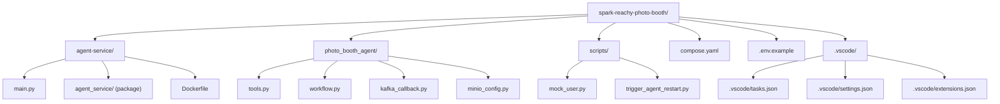
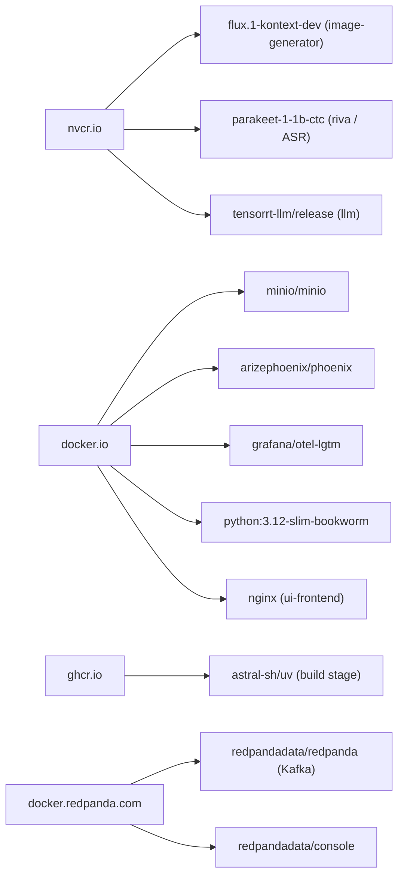

<!-- source: DeepWiki mcp.deepwiki.com · repo NVIDIA/spark-reachy-photo-booth · page 4 Development Guide · fetched 2026-10-26 -->

# Development Guide

Relevant source files

The following files were used as context for generating this wiki page:

- [.env.example](.env.example)
- [.gitignore](.gitignore)
- [.python-version](.python-version)
- [README.md](README.md)

This page covers the prerequisites and tooling required to work on the `spark-reachy-photo-booth` codebase. It serves as the entry point for developers who want to run, modify, or extend the system locally.

- For step-by-step environment setup, see [Local Setup](#4.1).
- For helper scripts used during development, see [Development Scripts](#4.2).
- For editor configuration, see [VS Code Configuration](#4.3).
- For container build and service orchestration details, see [Deployment](#5).

---

## Prerequisites

The following tools and credentials must be in place before working with this repository.

### Runtime Requirements

| Requirement | Minimum Version | Notes |
|---|---|---|
| Python | 3.12 | Enforced by [.python-version:1-1]() |
| Docker + Compose | Current stable | Multi-service stack runs via `docker compose` |
| uv | Current stable | Python package manager; used in Dockerfile and VS Code tasks |
| DGX Spark | — | Target hardware; intended for local deployment only |

### Required API Keys and Credentials

The project reads secrets from a `.env` file at the repository root. The template is provided at [.env.example:1-5]().

| Variable | Description | Where Used |
|---|---|---|
| `NVIDIA_API_KEY` | NVIDIA API key (`nvapi-…`) | LLM and NIM service authentication |
| `HF_TOKEN` | Hugging Face token (`hf_…`) | Downloading gated models (FLUX, gpt-oss-20b) |
| `MINIO_ROOT_USER` | MinIO admin username | MinIO service startup |
| `MINIO_ROOT_PASSWORD` | MinIO admin password | MinIO service startup and agent bucket creation |
| `EXTERNAL_MINIO_BASE_URL` | Host-accessible MinIO address | QR code URL generation for generated images |

The `.env` file itself is excluded from version control via [.gitignore:11-12]().

---

## Repository Layout (Developer View)

The diagram below maps the major development-facing components to their locations in the repository.

**Repository Component Map**

Sources: [.env.example:1-5](), [.gitignore:1-19](), [.python-version:1-1](), [README.md:1-6]()

---

## Third-Party Container Dependencies

The stack pulls containers from multiple registries. Developers must be authenticated with each registry that serves images they intend to use.

**Container Registry Map**

Sources: [README.md:21-54]()

---

## Model License Obligations

Two models used in this stack are licensed for **non-commercial use only**. Developers must accept the applicable license agreements before downloading or running them.

| Model | Registry | License Restriction |
|---|---|---|
| `FLUX.1-Kontext-dev` | Hugging Face / nvcr.io | Non-commercial; contact `sales@blackforestlabs.ai` for commercial terms |
| `FLUX.1-Kontext-dev-onnx` | Hugging Face | Non-commercial; same terms |
| `gpt-oss-20b` | Hugging Face | Review HF model card for terms |

Your `HF_TOKEN` must have the required permissions granted on Hugging Face before model weights can be pulled.

Sources: [README.md:28-66]()

---

## Security Notice

This stack is intended for **local DGX Spark deployment only** and is explicitly marked as not production-ready. No services should be exposed beyond a trusted local development network. See [Security Policy](#6.3) for the vulnerability reporting process.

Sources: [README.md:71-73]()

---

## Sub-Pages

| Page | Topic |
|---|---|
| [Local Setup](#4.1) | Copying `.env`, filling in credentials, running `docker compose up`, and what each variable controls |
| [Development Scripts](#4.2) | `mock_user.py` (interactive and listen modes) and `trigger_agent_restart.py` |
| [VS Code Configuration](#4.3) | Recommended extensions, editor settings, `build app` and `run app` tasks |

---

