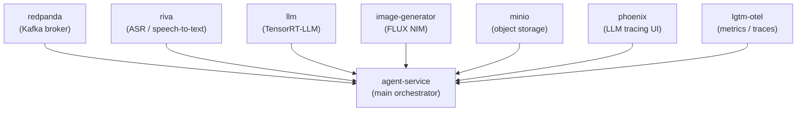
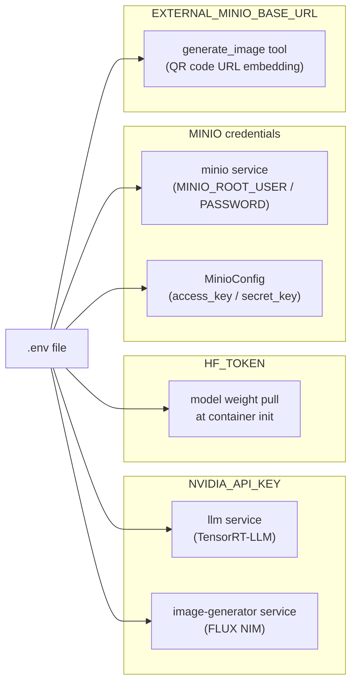

<!-- source: DeepWiki mcp.deepwiki.com · repo NVIDIA/spark-reachy-photo-booth · page 4.1 Local Setup · fetched 2026-10-26 -->

# Local Setup

<details>
<summary>Relevant source files</summary>

The following files were used as context for generating this wiki page:

- [.dockerignore](.dockerignore)
- [.env.example](.env.example)
- [.gitignore](.gitignore)
- [.python-version](.python-version)
- [.vscode/tasks.json](.vscode/tasks.json)

</details>


This page covers the steps required to configure and run the spark-reachy-photo-booth stack on a local machine, from installing prerequisites to launching all services with Docker Compose. It focuses on environment configuration and first-run startup.

For details on individual development scripts available after the stack is running, see [Development Scripts](#4.2). For VS Code workspace configuration, see [VS Code Configuration](#4.3). For the containerized build and service orchestration details, see [Docker Build](#5.1) and [Service Orchestration](#5.2).

---

## Prerequisites

| Requirement | Version / Notes |
|---|---|
| Python | 3.12 (enforced by [`.python-version:1`]()) |
| Docker & Docker Compose | Required to run the full service stack |
| `uv` | Used for Python package management and task running |
| NVIDIA API Key | Required for LLM and image-generation services |
| Hugging Face Token | Required to pull gated model weights |

---

## Environment Variables

The stack is configured entirely through a `.env` file in the repository root. A template is provided at [`.env.example`]().

**Step 1:** Copy the example file.

```
cp .env.example .env
```

**Step 2:** Open `.env` and fill in every placeholder value (anything reading `FIXME`).

The `.env` file is listed in [`.gitignore:12`]() and will never be committed to source control.

### Variable Reference

The following table describes every variable defined in [`.env.example:1-5`]().

| Variable | Default in Example | Purpose |
|---|---|---|
| `NVIDIA_API_KEY` | `nvapi-FIXME` | Authenticates requests to NVIDIA NIM endpoints (LLM, image generator). See [AI/ML Services](#3.2). |
| `HF_TOKEN` | `hf_FIXME` | Hugging Face token used to pull gated model weights at container startup. |
| `MINIO_ROOT_USER` | `minioadmin` | Root username for the MinIO object storage service. See [MinIO Storage](#2.3.3). |
| `MINIO_ROOT_PASSWORD` | `minioadmin` | Root password for the MinIO object storage service. |
| `EXTERNAL_MINIO_BASE_URL` | `127.0.0.1:9010` | The host:port that browsers (and QR codes) use to reach MinIO from outside Docker. |

> **Note:** `MINIO_ROOT_USER` and `MINIO_ROOT_PASSWORD` should be changed from their defaults before running in any environment accessible to other users.

The `EXTERNAL_MINIO_BASE_URL` variable controls the publicly accessible URL embedded in generated QR codes. When running locally, `127.0.0.1:9010` is correct. When deploying to a remote host, set this to the externally reachable address of that host.

Sources: [`.env.example:1-5`](), [`.gitignore:12`]()

---

## Starting the Stack

**Step 3:** Start all services with Docker Compose.

```
docker compose up --build
```

For hot-reload during development (watches source files and rebuilds on change), use the command from the VS Code run task:

```
docker compose up --build --watch
```

This is the same command configured in [`.vscode/tasks.json:26`]().

**Diagram: Startup Dependency Flow**



All arrows indicate a `depends_on: service_healthy` dependency; `agent-service` will not start until each upstream service passes its healthcheck. See [Service Orchestration](#5.2) for the full compose configuration.

Sources: [`.vscode/tasks.json:26`]()

---

## Environment Variable Flow Diagram

The diagram below maps each `.env` variable to the service or code component that consumes it.



Sources: [`.env.example:1-5`]()

---

## What Gets Excluded from Docker Builds

The [`.dockerignore`]() file prevents the following from being sent to the Docker build context, keeping image builds fast and reproducible:

| Excluded Pattern | Reason |
|---|---|
| `.git/`, `.ruff_cache/`, `**/__pycache__/` | Version control and build artifacts |
| `.venv/` | Local virtual environment; dependencies are installed inside the image |
| `**/*.egg-info` | Python packaging artifacts |
| `compose.yaml`, `Dockerfile`, `docker-bake.hcl` | Not needed inside the image |
| `docs/` | Documentation only |
| `**/assets/blenderScripts`, `**/assets/doc` | Large binary/doc assets |
| `**/*.gif`, `**/*.mp4`, `**/*.mp3` | Binary media files |

Sources: [`.dockerignore:1-23`]()

---

## Verifying the Stack is Running

After `docker compose up`, the following service UIs are accessible from a browser:

| Service | Default URL | Purpose |
|---|---|---|
| Redpanda Console | `http://localhost:8080` | Browse Kafka topics and messages |
| Phoenix | `http://localhost:6006` | LLM trace and evaluation UI |
| Grafana (LGTM) | `http://localhost:3000` | Metrics, traces, and logs |
| MinIO Console | `http://localhost:9001` | Object storage browser |

For detailed information on the observability stack, see [Observability](#3.3).

---

