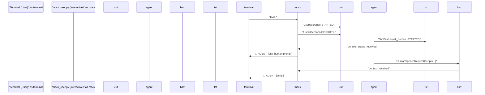
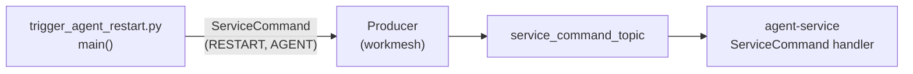
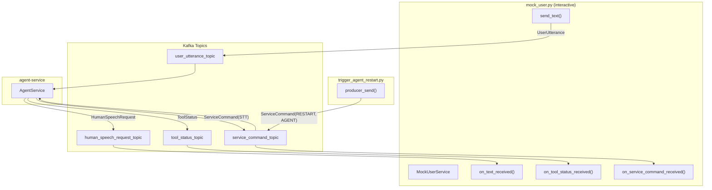

<!-- source: DeepWiki mcp.deepwiki.com · repo NVIDIA/spark-reachy-photo-booth · page 4.2 Development Scripts · fetched 2026-10-26 -->

# Development Scripts

<details>
<summary>Relevant source files</summary>

The following files were used as context for generating this wiki page:

- [agent-service/scripts/mock_user.py](agent-service/scripts/mock_user.py)
- [agent-service/scripts/trigger_agent_restart.py](agent-service/scripts/trigger_agent_restart.py)
- [agent-service/service-debug.override.yaml](agent-service/service-debug.override.yaml)

</details>


This page documents the two development helper scripts located in `agent-service/scripts/`. These scripts interact directly with the Kafka message bus and are intended for local development and debugging workflows — they are not part of the deployed service stack.

For background on the Kafka topics and message types referenced here, see [Kafka Messaging (Redpanda)](#3.1). For local environment setup (broker URL, ports), see [Local Setup](#4.1).

---

## Overview

| Script | Purpose | Kafka Role |
|---|---|---|
| `mock_user.py` | Simulates a human user interacting with the agent | Producer (`user_utterance_topic`), Consumer (`human_speech_request_topic`, `tool_status_topic`, `service_command_topic`) |
| `trigger_agent_restart.py` | Sends a `RESTART` command to the agent service | Producer (`service_command_topic`) |

Both scripts use the `workmesh` library for Kafka producer/consumer plumbing, which is the same library used by the agent service itself.

---

## `mock_user.py`

[agent-service/scripts/mock_user.py:1-241]()

This script replaces the RIVA speech-to-text pipeline and the physical robot presence during development. It provides two sub-commands: `interactive` and `listen`.

### Class: `MockUserService`

[agent-service/scripts/mock_user.py:33-175]()

`MockUserService` is the core class. On instantiation it connects to the Kafka broker (default: `kafka://localhost:19092`) and subscribes to three topics.

**Subscriptions:**

| Topic constant | Message type | Handler method |
|---|---|---|
| `service_command_topic` | `ServiceCommand` | `on_service_command_received` |
| `human_speech_request_topic` | `HumanSpeechRequest` | `on_text_received` |
| `tool_status_topic` | `ToolStatus` | `on_tool_status_received` |

**Topic constant → handler wiring** is done in `setup()` [agent-service/scripts/mock_user.py:44-59]().

#### `on_service_command_received`

[agent-service/scripts/mock_user.py:61-70]()

Filters for messages targeting `Service.STT`. Toggles `stt_service_enabled` based on `Command.ENABLE` / `Command.DISABLE`. When the agent disables the STT service, `send_text` will refuse to publish new utterances, matching the behavior of the real STT service.

#### `on_text_received`

[agent-service/scripts/mock_user.py:72-76]()

Prints any `HumanSpeechRequest.script` to the terminal prefixed with `🤖 AGENT:` and sets `waiting_for_input = True` to unblock the terminal input loop.

#### `on_tool_status_received`

[agent-service/scripts/mock_user.py:78-92]()

Prints tool lifecycle events from `ToolStatus`. For the `ask_human` tool specifically, it extracts the `prompt` field from `message.input` using `protobuf_map_to_dict` and prints it as an agent message, then sets `waiting_for_input = True`.

#### `send_text`

[agent-service/scripts/mock_user.py:94-120]()

Publishes a `UserUtterance` pair to `user_utterance_topic`:
1. One message with `status=USER_UTTERANCE_STARTED`
2. One message with `status=USER_UTTERANCE_FINISHED`

Both carry the same `action_uuid` (a fresh `uuid4`) and millisecond `timestamp`. After publishing, `waiting_for_input` is set to `False`.

---

### Sub-command: `interactive`

[agent-service/scripts/mock_user.py:178-206]()

Registered as the `interactive` Typer command. Runs two concurrent asyncio tasks:

- `run_consumer()` — polls `consumer.consume()` in a loop
- `read_terminal_input()` — blocks on `input()` in a thread executor; only prompts when `waiting_for_input` is `True`

The two tasks race via `asyncio.wait(..., return_when=FIRST_COMPLETED)`. When either completes (e.g., user types `quit`), remaining tasks are cancelled and `service.stop()` is called.

**Interaction flow diagram:**



Sources: [agent-service/scripts/mock_user.py:178-206](), [agent-service/scripts/mock_user.py:72-92]()

---

### Sub-command: `listen`

[agent-service/scripts/mock_user.py:209-237]()

A passive, read-only listener. Creates a standalone `Consumer` with `consumer_group="text_listener"` and subscribes only to `human_speech_request_topic`. Prints each `HumanSpeechRequest` with its `robot_id` prefix. Does not produce any messages or handle `ToolStatus`.

**Usage:**

```sh
# Interactive mode (two-way conversation)
uv run python scripts/mock_user.py interactive

# Listen-only mode (passive monitor)
uv run python scripts/mock_user.py listen
```

---

## `trigger_agent_restart.py`

[agent-service/scripts/trigger_agent_restart.py:1-37]()

Publishes a single `ServiceCommand` message targeting `Service.AGENT` with `Command.RESTART` to `service_command_topic`, then exits. The agent service consumes this message and reinitializes its internal state.

### Structure

| Symbol | Role |
|---|---|
| `producer_send(topic, message)` | Async helper; uses `Producer` as async context manager |
| `main()` | Constructs `ServiceCommand(RESTART, AGENT)` and calls `asyncio.run(producer_send(...))` |
| `typer.run(main)` | CLI entry point |

**Message flow diagram:**



Sources: [agent-service/scripts/trigger_agent_restart.py:18-33]()

**Usage:**

```sh
uv run python scripts/trigger_agent_restart.py
```

No arguments are required. The broker URL defaults to the value configured in the `workmesh` `Producer` default (`kafka://localhost:19092`).

---

## Kafka Topic Interaction Summary

The following diagram maps both scripts to the specific Kafka topics they read from and write to, using the topic constant names from `workmesh`.



Sources: [agent-service/scripts/mock_user.py:44-59](), [agent-service/scripts/trigger_agent_restart.py:23-33]()

---

