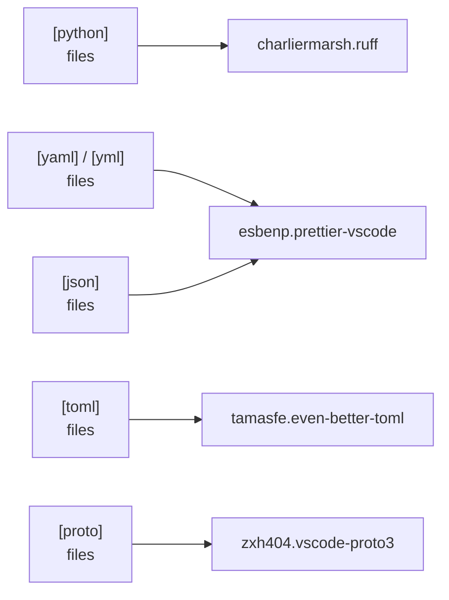

<!-- source: DeepWiki mcp.deepwiki.com · repo NVIDIA/spark-reachy-photo-booth · page 4.3 VS Code Configuration · fetched 2026-10-26 -->

# VS Code Configuration

<details>
<summary>Relevant source files</summary>

The following files were used as context for generating this wiki page:

- [.prettierrc](.prettierrc)
- [.vscode/extensions.json](.vscode/extensions.json)
- [.vscode/launch.json](.vscode/launch.json)
- [.vscode/settings.json](.vscode/settings.json)
- [.vscode/tasks.json](.vscode/tasks.json)

</details>


This page documents the VS Code workspace configuration for the `spark-reachy-photo-booth` repository: recommended extensions, editor settings, formatter assignments, and the built-in tasks for building and running the application. For information on the local environment prerequisites (Python version, `.env` setup, Docker Compose), see [Local Setup](#4.1). For the development helper scripts (`mock_user.py`, `trigger_agent_restart.py`), see [Development Scripts](#4.2).

---

## Recommended Extensions

The workspace declares eight recommended extensions in [.vscode/extensions.json:1-12]().

| Extension ID | Display Name | Purpose |
|---|---|---|
| `charliermarsh.ruff` | Ruff | Python linting and formatting |
| `esbenp.prettier-vscode` | Prettier | Formatting for JSON, YAML, and Markdown |
| `tamasfe.even-better-toml` | Even Better TOML | Syntax and formatting for `.toml` files |
| `drblury.protobuf-vsc` | Protobuf VSC | Syntax highlighting for `.proto` files |
| `humao.rest-client` | REST Client | Send HTTP requests from `.http` files |
| `ms-azuretools.vscode-containers` | Containers | Docker container management panel |
| `mikestead.dotenv` | DotEnv | Syntax highlighting for `.env` files |
| `arturodent.launch-config` | Launch Config | Bind keyboard shortcuts to launch configurations |

VS Code will prompt you to install these when you first open the workspace.

Sources: [.vscode/extensions.json:1-12]()

---

## Editor Settings

Settings are defined in [.vscode/settings.json:1-73](). They apply workspace-wide with per-language overrides for formatter assignment.

### Global Settings

| Setting | Value | Effect |
|---|---|---|
| `editor.trimAutoWhitespace` | `true` | Removes trailing whitespace added by auto-indent |
| `editor.tabSize` | `2` | Default indentation width |
| `files.trimTrailingWhitespace` | `true` | Strips trailing whitespace on save |

### Per-Language Formatter Assignments

**Title: Formatter Dispatch by Language**



Sources: [.vscode/settings.json:7-33]()

Python files have two additional on-save actions configured:

```json
"[python]": {
  "editor.defaultFormatter": "charliermarsh.ruff",
  "editor.codeActionsOnSave": {
    "source.organizeImports": "explicit"
  },
  "editor.formatOnSave": true
}
```

This means saving a `.py` file will automatically:
1. Reorder and remove unused imports via Ruff's `organizeImports` action.
2. Re-format the file with `ruff format`.

Sources: [.vscode/settings.json:27-33]()

### Prettier Configuration

Prettier's behavior is controlled by [.prettierrc:1-9]():

| Option | Value |
|---|---|
| `tabWidth` | `2` |
| `useTabs` | `false` |
| `singleQuote` | `false` |
| `trailingComma` | `"none"` |
| `bracketSpacing` | `true` |
| `printWidth` | `80` |
| `proseWrap` | `"preserve"` |

Sources: [.prettierrc:1-9]()

### Even Better TOML Formatter Settings

Configured in [.vscode/settings.json:61-66]():

| Setting | Value |
|---|---|
| `evenBetterToml.formatter.arrayAutoExpand` | `false` |
| `evenBetterToml.formatter.arrayAutoCollapse` | `false` |
| `evenBetterToml.formatter.columnWidth` | `80` |
| `evenBetterToml.formatter.trailingNewline` | `true` |
| `evenBetterToml.formatter.allowedBlankLines` | `2` |
| `evenBetterToml.formatter.arrayTrailingComma` | `true` |

> **Note:** The settings file includes a comment that you may need to run `Developer: Restart Extension Host` to reload these TOML settings.

Sources: [.vscode/settings.json:61-66]()

---

## Tasks

Two tasks are defined in [.vscode/tasks.json:1-52](). They can be triggered via the VS Code task runner (`Terminal → Run Task`) or via the launch configurations described in the next section.

**Title: Task and Tool Relationships**

```mermaid
flowchart TD
  buildtask["\"build app\" task\n(.vscode/tasks.json)"] --> ruffformat["uv run ruff format ."]
  buildtask --> ruffcheck["uv run ruff check ."]
  buildtask --> pyright["uv run pyright"]

  runtask["\"run app\" task\n(.vscode/tasks.json)"] --> dockercompose["docker compose up\n--build --watch"]
  dockercompose -->|"--no-attach"| redpanda["redpanda"]
  dockercompose -->|"--no-attach"| redpandaconsole["redpanda-console"]
  dockercompose -->|"--no-attach"| lgtmotel["lgtm-otel"]
```

Sources: [.vscode/tasks.json:1-52]()

### `build app`

Defined at [.vscode/tasks.json:4-21]().

**Shell command:**
```
uv run ruff format . && uv run ruff check . && uv run pyright
```

| Step | Tool | Role |
|---|---|---|
| 1 | `ruff format .` | Auto-formats all Python files |
| 2 | `ruff check .` | Runs linting rules, reports violations |
| 3 | `pyright` | Static type-checks the entire workspace |

All three tools are invoked through `uv run`, which resolves them from the project's virtual environment. The task runs in the workspace root (`${workspaceFolder}`) and uses the `$python` problem matcher so errors appear in the VS Code Problems panel.

Sources: [.vscode/tasks.json:4-21]()

### `run app`

Defined at [.vscode/tasks.json:22-51]().

**Shell command:**
```
docker compose up --build --watch --no-attach redpanda --no-attach redpanda-console --no-attach lgtm-otel
```

| Flag | Effect |
|---|---|
| `--build` | Rebuilds service images before starting |
| `--watch` | Enables Docker Compose hot-reload (syncs source changes into containers) |
| `--no-attach redpanda` | Suppresses Redpanda broker logs from the VS Code terminal |
| `--no-attach redpanda-console` | Suppresses Redpanda Console logs |
| `--no-attach lgtm-otel` | Suppresses LGTM/OpenTelemetry collector logs |

The task is marked `"isBackground": true` with a custom `problemMatcher` that considers the task "started" once a line matching `^.*started.*$` appears in output. This allows VS Code to treat it as a long-running background process.

For details on what services are started and the hot-reload watch configuration, see [Service Orchestration](#5.2).

Sources: [.vscode/tasks.json:22-51]()

---

## Launch Configurations

Two launch configurations are defined in [.vscode/launch.json:1-21](). Both use `debugpy` as the type but delegate their actual work entirely to their `preLaunchTask`, making them convenient one-click wrappers for the tasks above.

**Title: Launch Config to Task Mapping**

```mermaid
flowchart LR
  buildlaunch["\"Build app\"\nlaunch config\n(launch.json)"] -->|"preLaunchTask"| buildtask2["\"build app\"\ntask (tasks.json)"]
  runlaunch["\"Run app\"\nlaunch config\n(launch.json)"] -->|"preLaunchTask"| runtask2["\"run app\"\ntask (tasks.json)"]
```

Sources: [.vscode/launch.json:1-21]()

The `arturodent.launch-config` extension (listed in `extensions.json`) enables binding these configurations to keyboard shortcuts. The `launches` mapping in [.vscode/settings.json:69-72]() wires the display names used by that extension:

```json
"launches": {
  "Build app": "Build app",
  "Run app": "Run app"
}
```

Sources: [.vscode/settings.json:69-72](), [.vscode/launch.json:1-21]()

---

