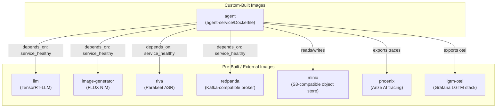
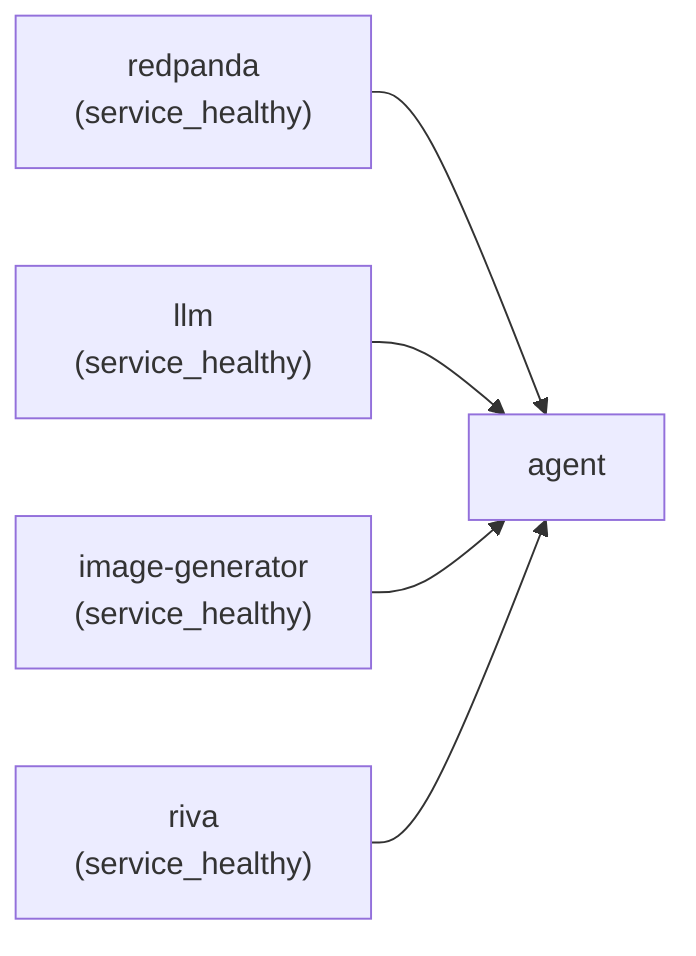
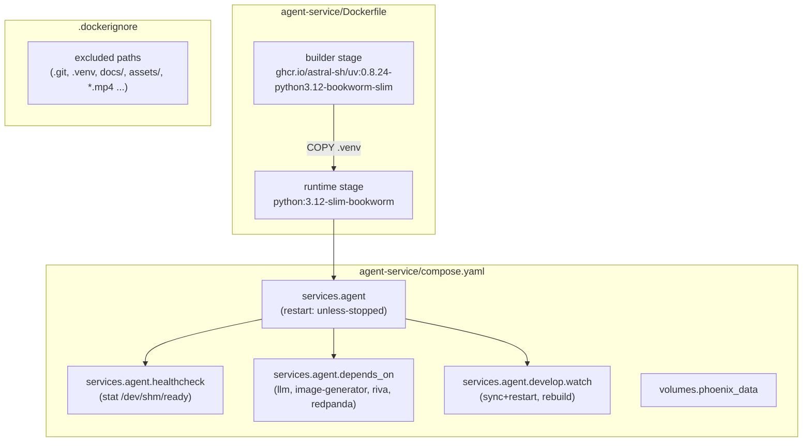

<!-- source: DeepWiki mcp.deepwiki.com · repo NVIDIA/spark-reachy-photo-booth · page 5 Deployment · fetched 2026-10-26 -->

# Deployment

Relevant source files

The following files were used as context for generating this wiki page:

- [.dockerignore](.dockerignore)
- [agent-service/Dockerfile](agent-service/Dockerfile)
- [agent-service/compose.yaml](agent-service/compose.yaml)

This page describes the containerized deployment model for the spark-reachy-photo-booth system and summarizes how the multi-service Docker Compose stack is assembled. Detailed coverage of the Docker image build process is in [Docker Build](#5.1); the full `compose.yaml` service definitions, health checks, and hot-reload configuration are in [Service Orchestration](#5.2). For the local developer setup (environment variables, API keys) see [Local Setup](#4.1).

---

## Deployment Model

The entire stack runs as a set of Docker containers, coordinated by Docker Compose. The `agent-service` is the only service that has a custom-built image; all other services (LLM, image generator, RIVA, Redpanda, MinIO, Phoenix, LGTM) are pulled from pre-built images.

The `agent-service` image is built with a **multi-stage Dockerfile** ([agent-service/Dockerfile]()) that separates the dependency-installation environment from the lean runtime image. The build context is the repository root so that shared local packages (`photo_booth_agent`, `workmesh`) are available during the build.

**Deployment stack overview:**

Sources: [agent-service/compose.yaml:1-39]()

---

## Image Build Summary

The `agent-service` image is built in two stages defined in [agent-service/Dockerfile]():

| Stage | Base Image | Key Action |
|---|---|---|
| `builder` | `ghcr.io/astral-sh/uv:0.8.24-python3.12-bookworm-slim` | Runs `uv sync --frozen` to install all dependencies into `/app/.venv` |
| runtime | `python:3.12-slim-bookworm` | Copies `.venv` from builder; runs as non-root `app` user |

The build context is set to the repository root (`context: ..`) so `uv sync` can resolve local path dependencies `photo_booth_agent` and `workmesh` [agent-service/compose.yaml:32-34]().

The `.dockerignore` file [.dockerignore:1-23]() excludes artifacts that must not appear in the build context:

| Category | Examples |
|---|---|
| VCS / cache | `.git`, `.ruff_cache`, `__pycache__`, `*.egg-info` |
| Dev tooling | `.vscode`, `compose.yaml`, `Dockerfile`, `docker-bake.hcl` |
| Documentation | `docs/`, `templates/` |
| Virtual env | `.venv/` |
| Large binary assets | `*.gif`, `*.mp4`, `*.mp3`, `reachy_anim.blend` |

For the full multi-stage Dockerfile walkthrough, see [Docker Build](#5.1).

---

## Service Orchestration Summary

Services are composed through the `agent-service/compose.yaml` file. The `agent` service is the only one with a custom build and an explicit startup-dependency chain.

**Startup dependency chain:**

Sources: [agent-service/compose.yaml:13-21]()

The `agent` container's own health is determined by the presence of the file `/dev/shm/ready`, written by `main.py` once initialization completes [agent-service/compose.yaml:9-12]().

**Key runtime environment variable:**

| Variable | Purpose |
|---|---|
| `EXTERNAL_MINIO_BASE_URL` | Public URL for MinIO, used when generating QR codes for image download |

Sources: [agent-service/compose.yaml:35-37]()

The `compose.yaml` also declares a named volume `phoenix_data` [agent-service/compose.yaml:38-39]() for persisting Phoenix LLM traces across container restarts.

A `develop.watch` block enables hot-reload during development — source file changes trigger either a `sync+restart` (Python source files) or a full `rebuild` (dependency manifest changes). This is documented fully in [Service Orchestration](#5.2).

---

## File Reference Map

**Diagram: Code entities involved in deployment**

Sources: [agent-service/Dockerfile:1-38](), [agent-service/compose.yaml:1-39](), [.dockerignore:1-23]()

---

