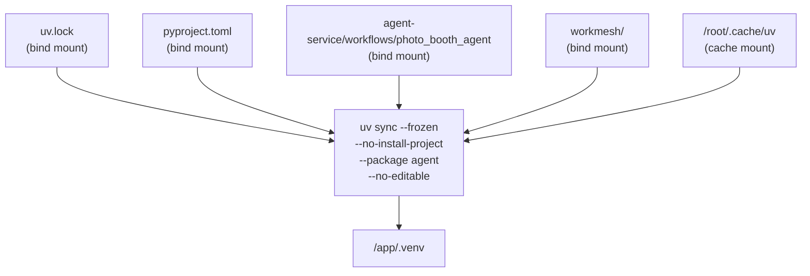
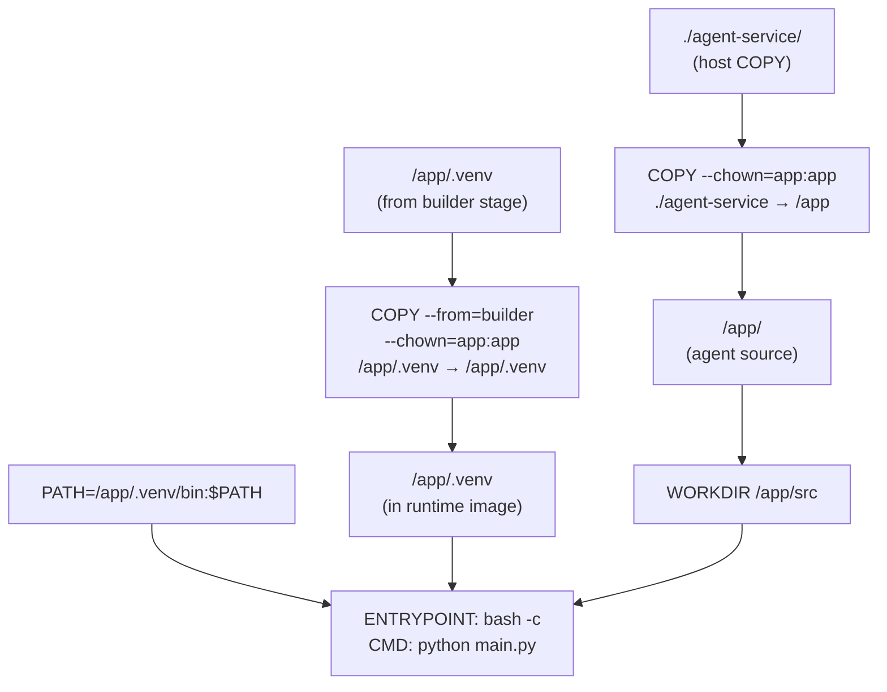
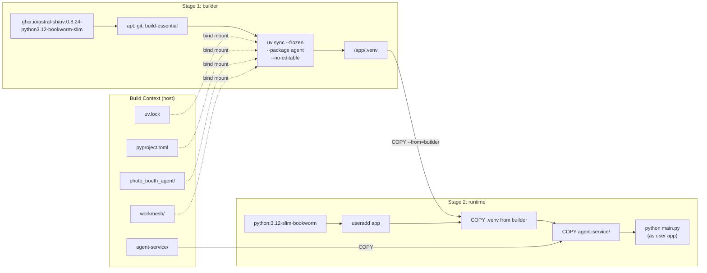

<!-- source: DeepWiki mcp.deepwiki.com · repo NVIDIA/spark-reachy-photo-booth · page 5.1 Docker Build · fetched 2026-10-26 -->

# Docker Build

<details>
<summary>Relevant source files</summary>

The following files were used as context for generating this wiki page:

- [.dockerignore](.dockerignore)
- [agent-service/Dockerfile](agent-service/Dockerfile)
- [agent-service/pyproject.toml](agent-service/pyproject.toml)

</details>


This page documents the multi-stage `Dockerfile` for the `agent-service` container: its two build stages, the dependency installation strategy, the runtime environment, and what the `.dockerignore` file excludes from the build context.

For how this image is run and orchestrated alongside other services, see [Service Orchestration](#5.2). For the Python package structure being packaged here, see [Agent Service](#2).

---

## Overview

The `agent-service` image is built from a single `Dockerfile` located at [`agent-service/Dockerfile`](). It uses a **two-stage build**:

1. **`builder` stage** — installs all Python dependencies into a virtual environment using `uv`.
2. **Runtime stage** — copies only the virtual environment and source into a lean Python image and runs the app as a non-root user.

**Build stages summary:**

| Stage | Base Image | Primary Role |
|---|---|---|
| `builder` | `ghcr.io/astral-sh/uv:0.8.24-python3.12-bookworm-slim` | Dependency resolution and installation |
| runtime (unnamed) | `python:3.12-slim-bookworm` | Minimal runtime environment |

Sources: [`agent-service/Dockerfile:1-38`]()

---

## Stage 1: Builder

**Diagram: Builder Stage File Flow**



Sources: [`agent-service/Dockerfile:15-20`]()

### Base Image and UV Environment

The builder stage starts from `ghcr.io/astral-sh/uv:0.8.24-python3.12-bookworm-slim`, which bundles `uv` — the fast Python package manager — along with Python 3.12.

Three environment variables control `uv` behavior:

| Variable | Value | Effect |
|---|---|---|
| `UV_COMPILE_BYTECODE` | `1` | Pre-compiles `.py` files to `.pyc` at install time, speeding up cold starts |
| `UV_LINK_MODE` | `copy` | Copies files instead of hardlinking; required when the cache and venv are on different filesystems |
| `UV_PYTHON_DOWNLOADS` | `0` | Prevents `uv` from downloading a Python interpreter; uses the one already in the image |

Sources: [`agent-service/Dockerfile:6-7`]()

### System Dependencies

`git` and `build-essential` are installed via `apt-get` before running `uv sync`. These are needed at build time for packages with C extensions or those fetched directly from Git.

Sources: [`agent-service/Dockerfile:11-13`]()

### Dependency Installation via `uv sync`

The `uv sync` command uses **bind mounts** for all source files rather than `COPY`, so none of the source code is written into the builder layer — only the compiled virtual environment at `/app/.venv` persists.

```
uv sync --frozen --no-install-project --package agent --no-editable
```

| Flag | Meaning |
|---|---|
| `--frozen` | Uses `uv.lock` exactly; fails if lock file is out of date |
| `--no-install-project` | Installs dependencies but not the `agent` package itself (source is `COPY`-ed in the runtime stage) |
| `--package agent` | Targets the `agent` package within the workspace |
| `--no-editable` | Installs local path dependencies (`workmesh`, `photo-booth-agent`) as regular packages, not editable installs |

The `agent` package's dependencies (from [`agent-service/pyproject.toml:8-13`]()) are:

| Dependency | Type | Source |
|---|---|---|
| `workmesh` | Local workspace package | `workmesh/` directory |
| `langchain-ollama` | PyPI | ≥ 0.3.10 |
| `nvidia-nat[langchain,phoenix]` | PyPI | 1.3.1 |
| `photo-booth-agent` | Local workspace package | `agent-service/workflows/photo_booth_agent/` |

Sources: [`agent-service/Dockerfile:15-20`](), [`agent-service/pyproject.toml:8-25`]()

---

## Stage 2: Runtime

**Diagram: Runtime Stage Layout**



Sources: [`agent-service/Dockerfile:22-38`]()

### Base Image

The runtime stage uses `python:3.12-slim-bookworm` — a Debian Bookworm image with only the Python runtime and minimal system packages, keeping the final image small.

### Non-Root User

A dedicated non-root user `app` is created with `useradd -ms /bin/bash app`. Both the virtual environment and source files are owned by `app:app` via `--chown` flags on every `COPY` instruction. The `USER app` directive ensures the process runs without root privileges.

Sources: [`agent-service/Dockerfile:26-35`]()

### Virtual Environment Activation

Rather than using `source activate`, the venv is activated by prepending it to `PATH`:

```
ENV PATH="/app/.venv/bin:$PATH"
```

This means all invocations of `python`, `pip`, and any installed scripts resolve to `/app/.venv/bin/` automatically.

Sources: [`agent-service/Dockerfile:30`]()

### Working Directory and Entrypoint

| Setting | Value | Notes |
|---|---|---|
| `WORKDIR` | `/app/src` | The agent source is under `/app` (copied from `./agent-service`), so `src/` contains the Python modules |
| `ENTRYPOINT` | `bash -c` | Allows the CMD to be a shell string |
| `CMD` | `python main.py` | Starts the agent service; can be overridden (e.g., `sleep infinity` in debug mode — see [Service Orchestration](#5.2)) |

Sources: [`agent-service/Dockerfile:29-38`]()

---

## Build Context and `.dockerignore`

The `.dockerignore` at the repository root controls what is sent to the Docker daemon as the build context. Because `uv sync` uses bind mounts rather than relying on context files, the `.dockerignore` mainly reduces context size and prevents accidental inclusion of generated or binary artifacts.

**Excluded categories:**

| Category | Patterns | Reason |
|---|---|---|
| Version control | `.git` | Not needed; can expose sensitive history |
| Python caches | `**/__pycache__`, `**/*.py[codz]`, `**/*$py.class`, `**/*.egg-info` | Generated artifacts; rebuilt inside the image |
| Editor config | `**/.vscode`, `**/.dockerignore` | Developer tooling, not runtime |
| Compose/Docker files | `**/compose.yaml`, `**/Dockerfile`, `docker-bake.hcl`, `docker-compose.yaml` | Not needed inside the image |
| Documentation | `docs/` | Not runtime |
| Nix files | `flake.lock`, `flake.nix` | Alternative build system, not used in Docker |
| Local venv | `.venv/` | Rebuilt by `uv sync`; host venv must not contaminate image |
| Large binary assets | `**/*.gif`, `**/*.mp4`, `**/*.mp3`, `**/assets/blenderScripts`, `**/assets/doc`, `**/reachy_anim.blend` | Large media files not required by the service |
| Templates | `templates` | Not runtime |
| Ruff cache | `.ruff_cache` | Linter cache, not runtime |

Sources: [`.dockerignore:1-23`]()

---

## End-to-End Build Flow

**Diagram: Full Two-Stage Build Pipeline**



Sources: [`agent-service/Dockerfile:1-38`](), [`.dockerignore:1-23`](), [`agent-service/pyproject.toml:1-25`]()

---

