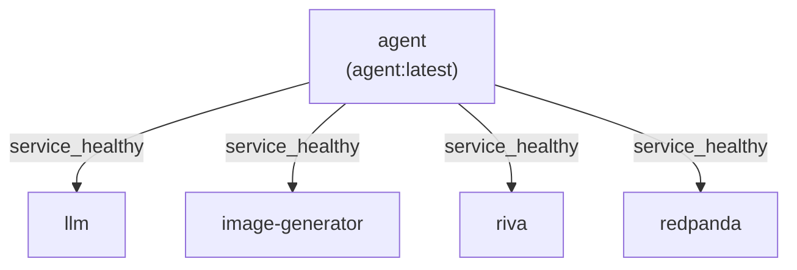
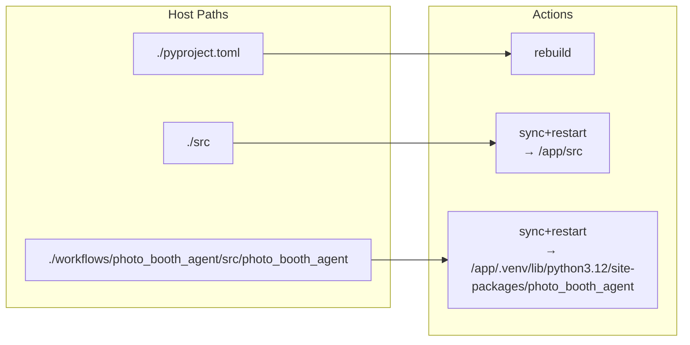

<!-- source: DeepWiki mcp.deepwiki.com · repo NVIDIA/spark-reachy-photo-booth · page 5.2 Service Orchestration · fetched 2026-10-26 -->

# Service Orchestration

<details>
<summary>Relevant source files</summary>

The following files were used as context for generating this wiki page:

- [.vscode/tasks.json](.vscode/tasks.json)
- [agent-service/compose.yaml](agent-service/compose.yaml)
- [agent-service/service-debug.override.yaml](agent-service/service-debug.override.yaml)

</details>


This page documents the Docker Compose service definitions that wire the photo booth stack together: the `agent` service configuration, its startup dependency chain, the healthcheck mechanism, the hot-reload watch configuration, and the debug override. For information about how the agent container image is built, see [Docker Build](#5.1). For information about how the agent communicates with other services at runtime, see [Kafka Messaging (Redpanda)](#3.1).

---

## Overview

The orchestration layer is defined across two files:

| File | Purpose |
|---|---|
| `agent-service/compose.yaml` | Primary service definition for the `agent` container and the `phoenix_data` named volume |
| `agent-service/service-debug.override.yaml` | Debug override that replaces the agent entrypoint and mounts source directly |

The VS Code "run app" task (`docker compose up --build --watch`) is the standard way to bring up the stack during development. See [VS Code Configuration](#4.3) for details.

Sources: `agent-service/compose.yaml`, `agent-service/service-debug.override.yaml`, `.vscode/tasks.json`

---

## Service Startup Dependency Chain

The `agent` service declares `depends_on` conditions for all four of its upstream dependencies. Docker Compose will not start the `agent` container until each dependency reports `service_healthy`.

**Dependency graph (compose.yaml `depends_on`)**



Sources: [agent-service/compose.yaml:13-21]()

---

## Agent Service Definition

The full `agent` service block ([agent-service/compose.yaml:5-37]()) configures the following:

### Restart Policy

```
restart: unless-stopped
```

The container is automatically restarted on failure or after a host reboot, and remains stopped only if it was explicitly stopped with `docker compose stop` or `docker compose down`.

### Healthcheck

```
test: ["CMD-SHELL", "if stat /dev/shm/ready; then exit 0; else exit 1; fi"]
start_period: 1m
start_interval: 5s
```

The healthcheck polls for the existence of the file `/dev/shm/ready` every 5 seconds, starting 1 minute after the container starts. The agent's Python process ([agent-service/src/main.py]()) is responsible for creating this file once it has successfully initialized. Until the file exists, Docker Compose considers the container unhealthy.

This `stat`-based mechanism avoids requiring any network listener for readiness signaling; the shared-memory filesystem (`/dev/shm`) is fast and always available inside the container.

Sources: [agent-service/compose.yaml:9-12]()

### Environment Variables

| Variable | Source | Purpose |
|---|---|---|
| `EXTERNAL_MINIO_BASE_URL` | Host environment / `.env` | Public base URL for MinIO, used when generating QR-code links to generated images |

Sources: [agent-service/compose.yaml:35-37]()

### Named Volume: `phoenix_data`

```yaml
volumes:
  phoenix_data: {}
```

A named Docker volume `phoenix_data` is declared at the compose project level ([agent-service/compose.yaml:38-39]()). It persists Phoenix (Arize AI) LLM trace data across container restarts. See [Observability](#3.3) for details on the Phoenix tracing service.

---

## Hot-Reload Watch Configuration

The `develop.watch` block enables Docker Compose Watch (`docker compose up --watch`), which monitors source paths on the host and synchronizes or rebuilds the container in response to changes.

**Watch action diagram**



| Host Path | Action | Container Target |
|---|---|---|
| `./pyproject.toml` | `rebuild` | *(full image rebuild)* |
| `./src` | `sync+restart` | `/app/src` |
| `./workflows/photo_booth_agent/src/photo_booth_agent` | `sync+restart` | `/app/.venv/lib/python3.12/site-packages/photo_booth_agent` |

- **`rebuild`**: Triggered by `pyproject.toml` changes (e.g., dependency additions). Runs a full `docker build` before restarting the container.
- **`sync+restart`**: Copies changed files into the running container at the specified target path, then restarts the container process — no image rebuild required. This is the fast path for Python source edits.

The `photo_booth_agent` watch target syncs directly into the venv's `site-packages` directory, allowing the installed package to reflect local edits without reinstallation.

Sources: [agent-service/compose.yaml:22-31]()

---

## Debug Override

`agent-service/service-debug.override.yaml` provides a Compose override for interactive debugging:

```yaml
services:
  agent:
    command:
      - /bin/sleep infinity
    volumes:
      - ./agent-service/src:/app/src
```

### What it does

| Change | Effect |
|---|---|
| `command: /bin/sleep infinity` | Replaces the default `bash -c 'python main.py'` entrypoint with a no-op sleep. The container stays alive without running the agent. |
| `volumes: ./agent-service/src:/app/src` | Bind-mounts the host source directory into `/app/src`, so edits are immediately visible inside the container without any sync or rebuild. |

### How to use it

Activate the override by passing both files to `docker compose`:

```
docker compose -f agent-service/compose.yaml -f agent-service/service-debug.override.yaml up agent
```

Once the container is running, attach a shell:

```
docker exec -it agent bash
```

From inside the container, you can invoke `python main.py` (or any individual module) manually. Because `/app/src` is bind-mounted, changes saved on the host are reflected immediately.

Sources: [agent-service/service-debug.override.yaml:1-10]()

---

## Full Compose Service Reference

The table below summarizes every field in the `agent` service definition for quick reference.

| Field | Value |
|---|---|
| `container_name` | `agent` |
| `image` | `agent:latest` |
| `restart` | `unless-stopped` |
| `healthcheck.test` | `stat /dev/shm/ready` |
| `healthcheck.start_period` | `1m` |
| `healthcheck.start_interval` | `5s` |
| `depends_on` | `llm`, `image-generator`, `riva`, `redpanda` (all `service_healthy`) |
| `build.context` | `..` (repo root) |
| `build.dockerfile` | `agent-service/Dockerfile` |
| `environment` | `EXTERNAL_MINIO_BASE_URL` |
| `develop.watch` (rebuild) | `./pyproject.toml` |
| `develop.watch` (sync+restart) | `./src`, `./workflows/photo_booth_agent/src/photo_booth_agent` |

Sources: [agent-service/compose.yaml:5-37]()

---

