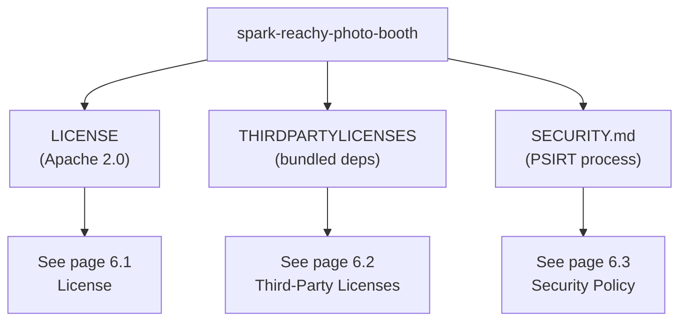
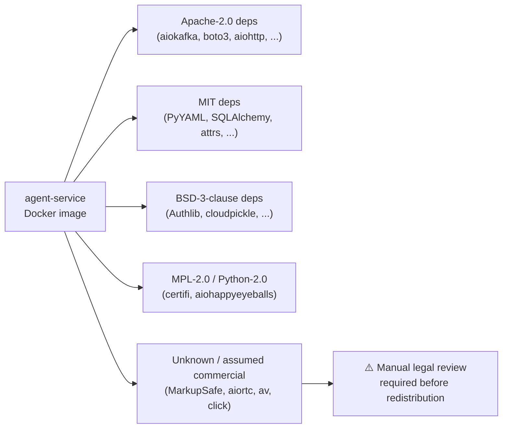
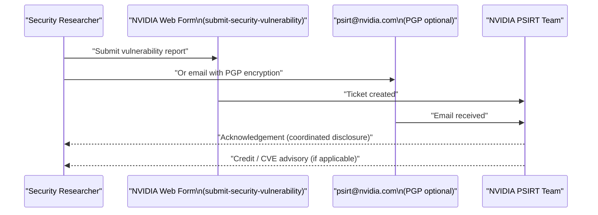

<!-- source: DeepWiki mcp.deepwiki.com · repo NVIDIA/spark-reachy-photo-booth · page 6 Legal & Compliance · fetched 2026-10-26 -->

# Legal & Compliance

Relevant source files

The following files were used as context for generating this wiki page:

- [LICENSE](LICENSE)
- [SECURITY.md](SECURITY.md)
- [THIRDPARTYLICENSES](THIRDPARTYLICENSES)

This page covers the legal obligations and security policies that apply to the `spark-reachy-photo-booth` repository. It addresses the repository's own license, the obligations imposed by bundled third-party Python packages, and the process for reporting security vulnerabilities. It does not cover model licenses for the AI/ML services (FLUX, TensorRT-LLM, RIVA) consumed at runtime — those are governed by their respective upstream terms.

---

## Overview

The repository ships three files that carry legal weight:

| File | Purpose |
|---|---|
| [LICENSE]() | Apache License 2.0 text governing the repository source |
| [THIRDPARTYLICENSES]() | License texts for all bundled Python dependencies |
| [SECURITY.md]() | NVIDIA PSIRT vulnerability reporting instructions |

**Legal document map**

Sources: [LICENSE](), [THIRDPARTYLICENSES](), [SECURITY.md]()

---

## Repository License

The repository source code is released under the **Apache License 2.0**. The full text is in [LICENSE]().

Key points:

- **Permitted**: use, copy, modify, sublicense, and distribute in source or object form.
- **Patent grant**: contributors grant a perpetual, royalty-free patent license for their contributions. This license terminates automatically if you initiate patent litigation against the work.
- **Redistribution conditions**: you must include a copy of the `LICENSE` file, mark any modified files, and preserve all existing copyright/patent/trademark/attribution notices.
- **No warranty**: the work is provided "AS IS" with no warranties of any kind ([LICENSE:143-151]()).
- **No liability**: contributors are not liable for any direct, indirect, or consequential damages ([LICENSE:153-163]()).
- **Trademark restriction**: the license does not grant permission to use NVIDIA trade names or trademarks ([LICENSE:138-141]()).

For the complete terms, see [License (6.1)](#6.1).

---

## Third-Party Dependency Licenses

All Python packages installed into the agent-service container are catalogued in [THIRDPARTYLICENSES](). The table below summarises the license types found across all entries.

**License type breakdown**

| License Type | Representative Packages |
|---|---|
| Apache-2.0 | `aioboto3`, `aiobotocore`, `aiofiles`, `aiokafka`, `aiosignal`, `aiohttp`, `async-timeout`, `boto3`, `botocore`, `coverage`, `cryptography`, `Cython` |
| MIT | `Mako`, `Markdown`, `PyAudio`, `PyYAML`, `SQLAlchemy`, `addict`, `aioice`, `aioitertools`, `alembic`, `anyio`, `appdirs`, `attrs`, `beautifulsoup4`, `cffi`, `charset-normalizer`, `colorama`, `colorlog` |
| BSD-3-clause | `Authlib`, `antlr4-python3-runtime`, `asgiref`, `blis`, `cloudpickle`, `colorama`, `contourpy` |
| MPL-2.0 | `certifi` |
| Python-2.0 | `aiohappyeyeballs` |
| **Unknown / assumed commercial** ⚠️ | `MarkupSafe`, `aiortc`, `av`, `click` |

> **Action required**: packages listed as `Unknown (assumed commercial)` in [THIRDPARTYLICENSES]() were flagged because their license file was missing at scan time. These require manual legal review before redistribution. The auto-generated note in each entry reads: *"This package is under a commercial license; be extremely careful."*

**Dependency license flow**

Sources: [THIRDPARTYLICENSES:1-214](), [THIRDPARTYLICENSES:2298-2930]()

For full per-package license texts and a detailed breakdown, see [Third-Party Licenses (6.2)](#6.2).

---

## Security Vulnerability Reporting

NVIDIA operates a Product Security Incident Response Team (PSIRT). The reporting process for this repository is documented in [SECURITY.md]().

**Do not open a public GitHub issue for security vulnerabilities.**

### Submission channels

| Channel | Details |
|---|---|
| Web form | NVIDIA Security Vulnerability Submission Form (see [SECURITY.md:10]()) |
| Email | `psirt@nvidia.com` |
| PGP | NVIDIA public PGP key is available from the NVIDIA security portal |

### Required information

When submitting a report, include:

1. Product/driver name and version or branch containing the vulnerability
2. Type of vulnerability (e.g., code execution, denial of service, buffer overflow)
3. Steps to reproduce
4. Proof-of-concept or exploit code
5. Potential impact and how an attacker could exploit it

([SECURITY.md:13-19]())

### Policy notes

- **No bug bounty program** currently exists, but NVIDIA does provide acknowledgement for externally reported issues addressed under coordinated disclosure.
- The coordinated vulnerability disclosure policy is described on the NVIDIA PSIRT policies page.
- All security concerns can also be directed to the NVIDIA Product Security portal.

**Security reporting flow**

Sources: [SECURITY.md:1-25]()

For full PSIRT policy details, see [Security Policy (6.3)](#6.3).

---

