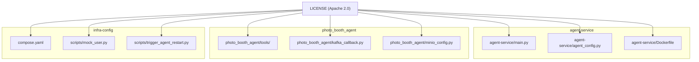
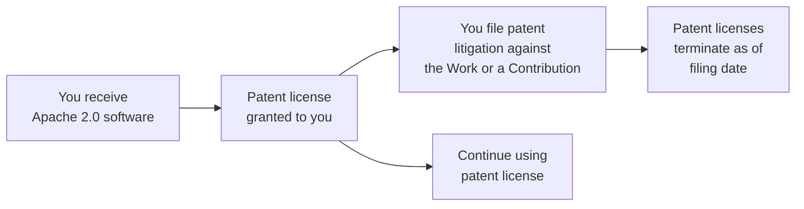
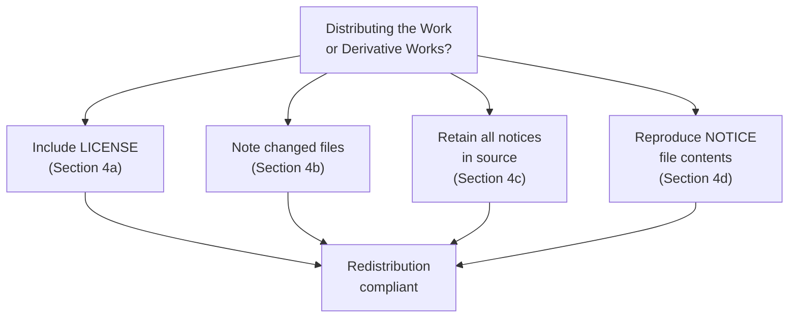

<!-- source: DeepWiki mcp.deepwiki.com · repo NVIDIA/spark-reachy-photo-booth · page 6.1 License · fetched 2026-10-26 -->

# License

<details>
<summary>Relevant source files</summary>

The following files were used as context for generating this wiki page:

- [LICENSE](LICENSE)

</details>


This page describes the license governing the `spark-reachy-photo-booth` source code itself. For information about the licenses of third-party Python packages bundled with the project, see [Third-Party Licenses](#6.2). For the security vulnerability reporting process, see [Security Policy](#6.3).

---

## Repository License

The `spark-reachy-photo-booth` repository is released under the **Apache License, Version 2.0**. The full license text is located at [LICENSE:1-202]().

| Property | Value |
|---|---|
| License | Apache License 2.0 |
| License file | `LICENSE` |
| Effective date | January 2004 (license version date) |
| Licensor | NVIDIA |

---

## What Is Covered

The Apache 2.0 license applies to all original source files in this repository, including:

- The `agent-service` Python package and its entrypoint
- The `photo_booth_agent` NAT component package
- Infrastructure configuration files (`compose.yaml`, `Dockerfile`, etc.)
- Development and tooling scripts

It does not automatically cover the third-party packages and models that the system depends on (Redpanda, FLUX, RIVA, TensorRT-LLM, etc.). Those are governed by their own separate licenses.

**Coverage diagram — license scope by codebase artifact:**



Sources: [LICENSE:1-202]()

---

## Permissions Granted

Under Apache 2.0, any recipient of this software is granted a **perpetual, worldwide, non-exclusive, royalty-free, irrevocable** license to:

| Permission | Description |
|---|---|
| Use | Run the software for any purpose |
| Reproduce | Make copies of the source or object form |
| Prepare Derivative Works | Modify, extend, or build upon the code |
| Publicly display and perform | Show or execute the work publicly |
| Sublicense | Grant the same rights to others |
| Distribute | Share the work or derivative works in any medium |

These permissions are defined in Section 2 of the license [LICENSE:66-71]().

---

## Patent Grant

Section 3 [LICENSE:73-87]() grants a **patent license** alongside the copyright license. Key points:

- Each contributor grants you rights to any patent claims they hold that are **necessarily infringed** by their contribution(s) to this work.
- This patent grant is perpetual, royalty-free, and irrevocable **unless** you initiate patent litigation.

**Patent termination trigger:**



Sources: [LICENSE:73-87]()

---

## Redistribution Conditions

If you redistribute the work (in source or object form, modified or unmodified), all four of the following conditions must be met [LICENSE:89-128]():

| Condition | Requirement |
|---|---|
| (a) Include the license | Provide a copy of `LICENSE` to every recipient |
| (b) Note modifications | Modified files must carry prominent notices stating that changes were made |
| (c) Retain notices | All copyright, patent, trademark, and attribution notices from the original must be preserved in distributed Derivative Works |
| (d) NOTICE file | If the original work includes a `NOTICE` file, include its contents in any distributed Derivative Works |

**Redistribution checklist diagram:**



Sources: [LICENSE:89-128]()

---

## Contribution Submissions

Per Section 5 [LICENSE:130-136](), any contribution intentionally submitted for inclusion in the work is automatically licensed under Apache 2.0, unless the contributor explicitly states otherwise in writing.

---

## What Is Not Granted

| Restriction | Detail |
|---|---|
| Trademark use | Section 6 [LICENSE:138-141]() — the license does not permit use of NVIDIA trade names, trademarks, service marks, or product names, except for reasonable descriptive use |
| Warranty | Section 7 [LICENSE:143-151]() — the work is provided "AS IS" with no warranties of any kind |
| Contributor liability | Section 8 [LICENSE:153-163]() — contributors are not liable for any direct, indirect, incidental, or consequential damages |

---

## Applying This License to Derivative Works

If you create a derivative of `spark-reachy-photo-booth`, the Apache 2.0 Appendix [LICENSE:178-201]() recommends attaching the following boilerplate to source files:

```
Copyright [yyyy] [name of copyright owner]

Licensed under the Apache License, Version 2.0 (the "License");
you may not use this file except in compliance with the License.
You may obtain a copy of the License at

    http://www.apache.org/licenses/LICENSE-2.0

Unless required by applicable law or agreed to in writing, software
distributed under the License is distributed on an "AS IS" BASIS,
WITHOUT WARRANTIES OR CONDITIONS OF ANY KIND, either express or implied.
See the License for the specific language governing permissions and
limitations under the License.
```

Sources: [LICENSE:178-201]()

---

