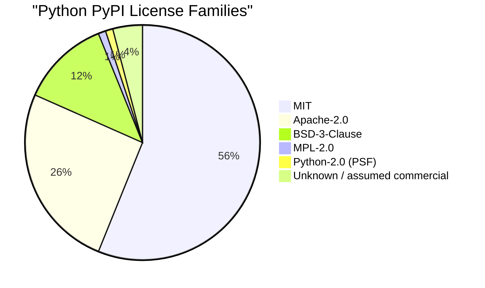
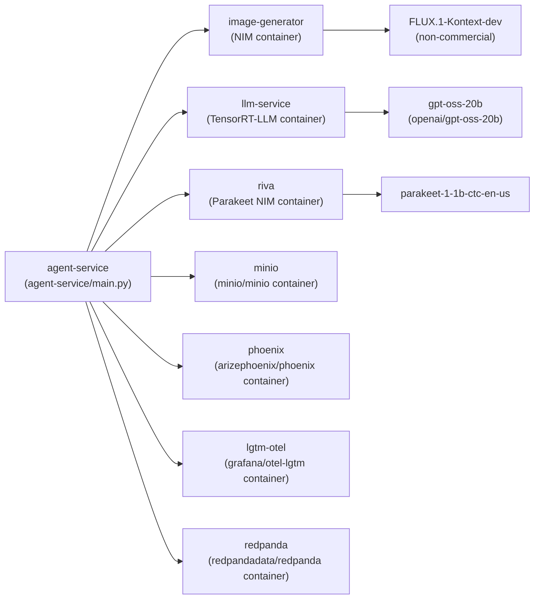

<!-- source: DeepWiki mcp.deepwiki.com · repo NVIDIA/spark-reachy-photo-booth · page 6.2 Third-Party Licenses · fetched 2026-10-26 -->

# Third-Party Licenses

Relevant source files

The following files were used as context for generating this wiki page:

- [README.md](README.md)
- [THIRDPARTYLICENSES](THIRDPARTYLICENSES)

This page summarizes the third-party software components bundled or deployed by this project, their license types, and any packages that require manual legal review before redistribution or commercial use. The project's own source code is released under Apache License 2.0; for details on that license, see [License](#6.1). For security reporting, see [Security Policy](#6.3).

Full license texts for Python PyPI dependencies are available in [THIRDPARTYLICENSES](), and JavaScript/npm dependencies in `ui-frontend/THIRDPARTYLICENSES`. Container and model dependencies are governed by the terms of their respective registries and model cards.

---

## Python PyPI Packages

The complete license text for every Python dependency is recorded in [THIRDPARTYLICENSES](). The table below summarizes the license families present across the dependency tree.

| License | Representative Packages |
|---------|--------------------------|
| MIT | `Mako`, `PyAudio`, `PyYAML`, `SQLAlchemy`, `addict`, `aioice`, `aioitertools`, `alembic`, `annotated-types`, `anyio`, `appdirs`, `argon2-cffi`, `attr`, `attrs`, `beautifulsoup4`, `black`, `catalogue`, `cffi`, `charset-normalizer`, `cloudpathlib`, `cloudpickle`, `colorlog`, `confection`, `curated-tokenizers`, ... |
| Apache-2.0 | `Cython`, `absl-py`, `aioboto3`, `aiobotocore`, `aiofiles`, `aiohttp`, `aiokafka`, `aiosignal`, `async-timeout`, `boto3`, `botocore`, `coverage`, `cryptography`, ... |
| BSD-3-Clause | `Authlib`, `Markdown`, `antlr4-python3-runtime`, `asgiref`, `blis`, `cloudpickle`, `colorama`, `contourpy`, ... |
| MPL-2.0 | `certifi` |
| Python-2.0 (PSF) | `aiohappyeyeballs` |
| **Unknown / assumed commercial** ⚠️ | `MarkupSafe`, `aiortc`, `av`, `click` |

Sources: [THIRDPARTYLICENSES:1-3531]()

### Packages Requiring Manual Review

The following four packages were recorded as **Unknown (assumed commercial)** in [THIRDPARTYLICENSES]() because their license file was absent from the distribution despite a license name being declared. These require independent verification before any redistribution.

> **Note:** The automated license scanner used during build could not resolve a license file for these packages, so a commercial-license stub was generated in their place as a conservative fallback. Verify the actual SPDX identifier for each package on PyPI before proceeding.

**Flagged package inventory:**

| Package | Declared SPDX | Requires | Location in THIRDPARTYLICENSES |
|---------|--------------|----------|-------------------------------|
| `MarkupSafe` | Unknown | _(none)_ | [THIRDPARTYLICENSES:204-213]() |
| `aiortc` | Unknown | `aioice`, `av`, `cryptography`, `google-crc32c`, `pyee`, `pylibsrtp`, `pyopenssl` | [THIRDPARTYLICENSES:1756-1765]() |
| `av` | Unknown | _(none)_ | [THIRDPARTYLICENSES:2298-2307]() |
| `click` | Unknown | _(none)_ | [THIRDPARTYLICENSES:2920-2929]() |

Sources: [THIRDPARTYLICENSES:204-213](), [THIRDPARTYLICENSES:1756-1765](), [THIRDPARTYLICENSES:2298-2307](), [THIRDPARTYLICENSES:2920-2929]()

**Python PyPI license distribution diagram:**

Sources: [THIRDPARTYLICENSES:1-3531]()

---

## Container Image Dependencies

The project deploys containers from four registries. Each registry's images are subject to its own terms of service, and individual container images may impose additional restrictions.

**Container image registry map:**

```mermaid
graph TD
    nvcr["nvcr.io (NVIDIA Container Registry)"]
    dockerhub["docker.io (Docker Hub)"]
    ghcr["ghcr.io (GitHub Container Registry)"]
    redpanda_reg["docker.redpanda.com (Redpanda Registry)"]

    nvcr --> flux["nvcr.io/nim/black-forest-labs/flux.1-kontext-dev"]
    nvcr --> parakeet["nvcr.io/nim/nvidia/parakeet-1-1b-ctc-en-us"]
    nvcr --> trtllm["nvcr.io/nvidia/tensorrt-llm/release"]

    dockerhub --> minio["minio/minio"]
    dockerhub --> phoenix["arizephoenix/phoenix"]
    dockerhub --> lgtm["grafana/otel-lgtm"]
    dockerhub --> python_img["python (python:3.12-slim-bookworm)"]
    dockerhub --> node_img["node"]
    dockerhub --> nginx_img["nginx"]
    dockerhub --> busybox_img["busybox"]

    ghcr --> uv_img["ghcr.io/astral-sh/uv"]

    redpanda_reg --> rp["docker.redpanda.com/redpandadata/redpanda"]
    redpanda_reg --> rp_console["docker.redpanda.com/redpandadata/console"]
```

Sources: [README.md:22-54]()

**Container image license summary:**

| Registry | Image | Purpose in System | License Notes |
|----------|-------|------------------|---------------|
| `nvcr.io` | `flux.1-kontext-dev` | Image generation NIM (see [AI/ML Services](#3.2)) | **Non-commercial use only.** Contact `sales@blackforestlabs.ai` for commercial terms. |
| `nvcr.io` | `parakeet-1-1b-ctc-en-us` | Speech-to-text / RIVA ASR (see [AI/ML Services](#3.2)) | NVIDIA NIM terms apply |
| `nvcr.io` | `tensorrt-llm/release` | LLM inference (see [AI/ML Services](#3.2)) | NVIDIA NIM terms apply |
| `docker.io` | `minio/minio` | Object storage (see [MinIO Storage](#2.3.3)) | AGPL-3.0 (open source) |
| `docker.io` | `arizephoenix/phoenix` | LLM tracing UI (see [Observability](#3.3)) | Elv2 license |
| `docker.io` | `grafana/otel-lgtm` | Metrics/logging stack (see [Observability](#3.3)) | Apache-2.0 |
| `docker.io` | `python`, `node`, `nginx`, `busybox` | Base images for services | Various open source |
| `ghcr.io` | `ghcr.io/astral-sh/uv` | Python build tool (see [Docker Build](#5.1)) | MIT |
| `docker.redpanda.com` | `redpandadata/redpanda` | Kafka-compatible broker (see [Kafka Messaging](#3.1)) | BSL 1.1 |
| `docker.redpanda.com` | `redpandadata/console` | Redpanda management UI (see [Kafka Messaging](#3.1)) | Redpanda Community License |

Sources: [README.md:22-54]()

---

## Model Dependencies

The project downloads and uses the following models from Hugging Face. Model licenses are separate from the code licenses and are accepted at runtime via `HF_TOKEN`.

| Model | HuggingFace Path | License Class | Commercial Use |
|-------|-----------------|---------------|----------------|
| `gpt-oss-20b` | `openai/gpt-oss-20b` | OpenAI terms | Check model card |
| `FLUX.1-Kontext-dev` | `black-forest-labs/FLUX.1-Kontext-dev` | FLUX.1-dev Non-Commercial | **No.** Contact `sales@blackforestlabs.ai` |
| `FLUX.1-Kontext-dev-onnx` | `black-forest-labs/FLUX.1-Kontext-dev-onnx` | FLUX.1-dev Non-Commercial | **No.** Contact `sales@blackforestlabs.ai` |

> ⚠️ **FLUX.1-Kontext-dev and FLUX.1-Kontext-dev-onnx are released for non-commercial use only.** You must accept the model license agreement on Hugging Face and your `HF_TOKEN` must have the required access permissions before the image-generator service will function. See [Local Setup](#4.1) for `HF_TOKEN` configuration.

Sources: [README.md:56-66]()

**Model and container dependency flow (service → dependency):**

Sources: [README.md:22-66]()

---

## JavaScript Dependencies

JavaScript/npm dependencies used by `ui-frontend` are listed separately in `ui-frontend/THIRDPARTYLICENSES`. As stated in [README.md:18](), you are responsible for reviewing and accepting those terms when the frontend is deployed.

---

## Responsibility Notice

As stated in [README.md:10]():

> This application allows you to deploy various third-party Python, JavaScript, model, and container dependencies. **You are responsible for your use and acceptance of any accompanying terms.**

This applies in particular to:

- The `MarkupSafe`, `aiortc`, `av`, and `click` Python packages, whose licenses could not be automatically resolved and are flagged as requiring manual verification.
- The `FLUX.1-Kontext-dev` and `FLUX.1-Kontext-dev-onnx` models, which explicitly prohibit commercial use without a separate commercial license from Black Forest Labs.
- Redpanda's Business Source License (BSL 1.1), which restricts use in competing database or streaming products.

Sources: [README.md:8-14](), [README.md:28-29](), [README.md:64-66]()

---

