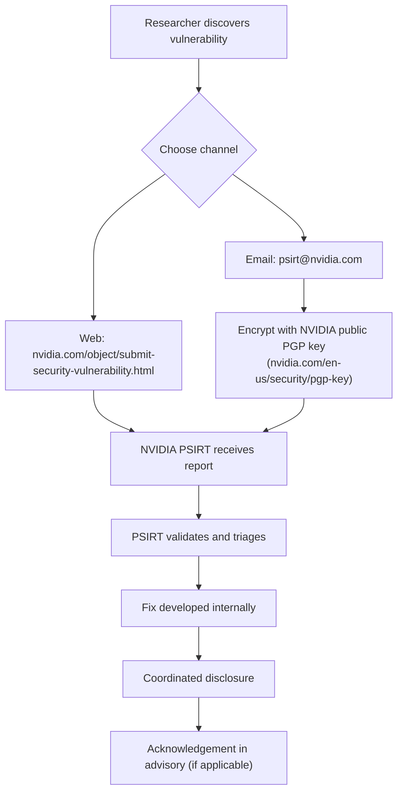
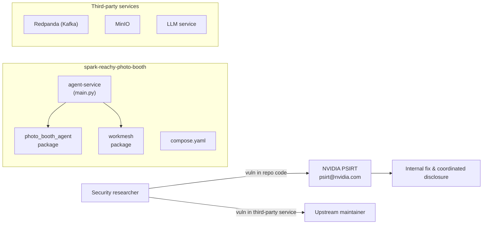

<!-- source: DeepWiki mcp.deepwiki.com · repo NVIDIA/spark-reachy-photo-booth · page 6.3 Security Policy · fetched 2026-10-26 -->

# Security Policy

Relevant source files

The following files were used as context for generating this wiki page:

- [SECURITY.md](SECURITY.md)

This page documents the procedures for reporting security vulnerabilities in the `spark-reachy-photo-booth` repository. The policy is governed by NVIDIA's Product Security Incident Response Team (PSIRT) and applies to all source code in this repository.

For information about the Apache 2.0 license governing this repository, see [License](#6.1). For third-party dependency license obligations, see [Third-Party Licenses](#6.2).

---

## Scope

This security policy applies to vulnerabilities discovered in:

- The `agent-service` application and its Python packages (`photo_booth_agent`, `workmesh`)
- The Docker Compose service definitions and infrastructure configuration
- Any NVIDIA-managed component in this repository

It does **not** govern vulnerabilities in third-party dependencies (e.g., Redpanda, MinIO, RIVA, or FLUX model weights). Those should be reported to their respective upstream maintainers.

Sources: [SECURITY.md:1-5]()

---

## Do Not Report via GitHub

> **Do not open GitHub Issues to report security vulnerabilities.**

Public GitHub issues expose vulnerability details before a fix is available. Use one of the two private channels described below.

Sources: [SECURITY.md:5]()

---

## Reporting Channels

Two channels are available for submitting a vulnerability report.

| Channel | Details |
|---|---|
| **Web Form** | NVIDIA Security Vulnerability Submission Form (nvidia.com) |
| **Email** | `psirt@nvidia.com` — PGP-encrypted email recommended |

**Diagram: Vulnerability Reporting Flow**

Sources: [SECURITY.md:9-20]()

---

## Required Information for Email Reports

When reporting via `psirt@nvidia.com`, include all of the following fields. Incomplete reports may delay triage.

| Field | Description |
|---|---|
| **Product/Driver name and version/branch** | For this repo: `spark-reachy-photo-booth` and the relevant branch or commit SHA |
| **Type of vulnerability** | e.g., code execution, denial of service, buffer overflow, injection |
| **Reproduction instructions** | Step-by-step steps to trigger the vulnerability |
| **Proof-of-concept or exploit code** | Minimal working example demonstrating the issue |
| **Potential impact** | How an attacker could exploit this; affected components and data |

Sources: [SECURITY.md:13-18]()

---

## Bug Bounty Policy

NVIDIA does **not** operate a bug bounty program. Externally reported vulnerabilities that result in a fix may receive **acknowledgement** in NVIDIA's coordinated vulnerability disclosure advisory, but no monetary reward is offered.

Sources: [SECURITY.md:20]()

---

## Coordinated Disclosure

NVIDIA follows a coordinated vulnerability disclosure model: the reporter and NVIDIA work privately to develop and release a fix before the vulnerability details are made public. The timeline and publication process are governed by NVIDIA PSIRT policies.

**Diagram: Repository Security Perimeter and Reporting Path**

Sources: [SECURITY.md:1-25]()

---

## PSIRT Contact Summary

| Item | Value |
|---|---|
| **Email** | `psirt@nvidia.com` |
| **PGP Key** | Available at nvidia.com/en-us/security/pgp-key |
| **Web submission** | nvidia.com/object/submit-security-vulnerability.html |
| **PSIRT policy page** | nvidia.com/en-us/security/psirt-policies/ |
| **Product Security portal** | nvidia.com/en-us/security |

Sources: [SECURITY.md:11-24]()