# Page: Overview

# Overview

<details>
<summary>Relevant source files</summary>

The following files were used as context for generating this wiki page:

- [.env.example](.env.example)
- [README.md](README.md)
- [agent-service/README.md](agent-service/README.md)

</details>


This page introduces the `spark-reachy-photo-booth` repository: what the system is, what it is not, its major components, and how to navigate this wiki. For implementation details on any specific component, follow the links to the relevant sub-pages.

---

## What This Is

`spark-reachy-photo-booth` is a **reference implementation** of an AI-powered photo booth application. It is designed to run locally on an NVIDIA DGX Spark and integrates with a [Reachy Mini](https://pollen-robotics.com/) robot as the physical interaction surface.

> **This is not production-ready software.** It is intended for local DGX Spark deployment only. Do not expose any of its services beyond your trusted local development environment.

The application lets a user walk up, speak with the robot, and receive an AI-generated image based on the conversation. All major functions — speech recognition, language reasoning, image generation, and robot control — are implemented as distinct services that communicate over a Kafka-compatible message broker (Redpanda).

---

## Major Capabilities

| Capability | Implementation |
|---|---|
| Conversational AI agent | `agent-service`, ReAct loop via LangChain + `photo_booth_agent` |
| Speech-to-text | NVIDIA RIVA (Parakeet 1.1B CTC) |
| Language model inference | TensorRT-LLM serving `gpt-oss-20b` |
| AI image generation | FLUX.1-Kontext-dev NIM |
| Object storage (generated images) | MinIO |
| Event backbone | Redpanda (Kafka-compatible) |
| LLM tracing | Arize Phoenix |
| General observability | Grafana LGTM (OpenTelemetry) |

---

## What This Is Not

- **Not a production service.** There is no authentication, no rate limiting, and services are not hardened for public exposure.
- **Not a general-purpose robot SDK.** Reachy Mini integration is specific to this photo booth workflow.
- **Not accepting external contributions** at this time ([README.md:69]()).

---

## High-Level Data Flow

The diagram below shows how a user's spoken words become a generated image.

**Diagram: End-to-End Request Flow**

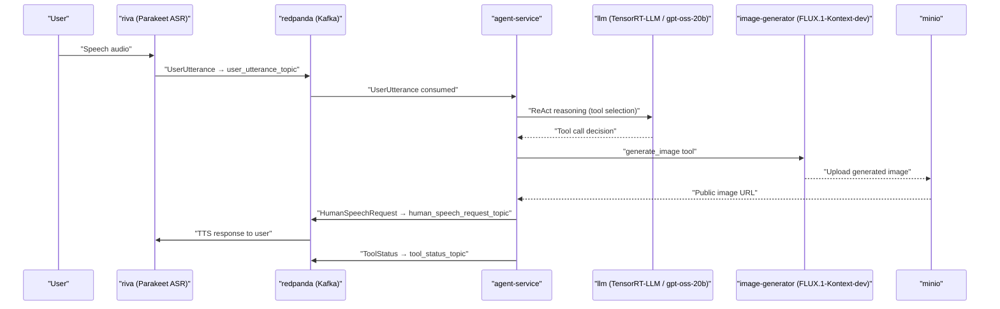

Sources: [README.md:1-74](), [agent-service/README.md:1-144]()

---

## Service Map

The table below maps each service name (as used in `compose.yaml`) to its role and technology.

| Service Name | Role | Technology |
|---|---|---|
| `agent` | Central orchestrator; runs the ReAct agent loop | Python, LangChain, `photo_booth_agent` |
| `redpanda` | Kafka-compatible event backbone | Redpanda |
| `llm` | LLM inference | TensorRT-LLM, `gpt-oss-20b` |
| `image-generator` | Text-to-image generation | FLUX.1-Kontext-dev NIM |
| `riva` | Speech-to-text (ASR) | NVIDIA Parakeet 1.1B CTC |
| `minio` | Object storage for generated images | MinIO |
| `phoenix` | LLM trace collection and UI | Arize Phoenix |
| `lgtm-otel` | Metrics, traces, logs | Grafana LGTM + OpenTelemetry |

Sources: [README.md:22-54](), [agent-service/README.md:13-18]()

---

## Component Dependency Graph

**Diagram: Service Startup Dependencies**

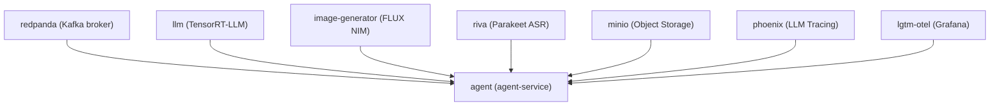

Sources: [agent-service/README.md:13-18]()

---

## Key Code Entry Points

**Diagram: Code Entity Map**

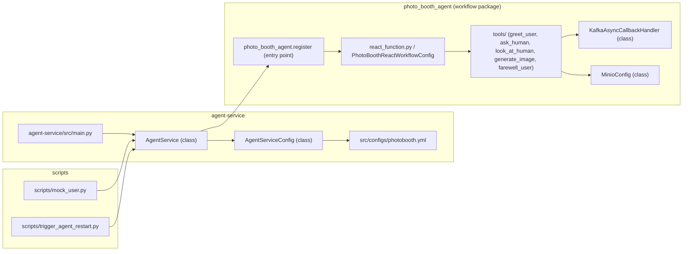

Sources: [agent-service/README.md:68-144]()

---

## Required Environment Variables

The file [.env.example:1-5]() lists all secrets needed to run the stack:

| Variable | Description |
|---|---|
| `NVIDIA_API_KEY` | NVIDIA API key (prefix `nvapi-`) |
| `HF_TOKEN` | Hugging Face token (required to pull FLUX model weights) |
| `MINIO_ROOT_USER` | MinIO admin username |
| `MINIO_ROOT_PASSWORD` | MinIO admin password |
| `EXTERNAL_MINIO_BASE_URL` | Host-accessible MinIO address (e.g., `127.0.0.1:9010`) |

Sources: [.env.example:1-5]()

---

## Third-Party Model Licensing Note

Two models used in this system carry **non-commercial** license restrictions:

- **FLUX.1-Kontext-dev** and **FLUX.1-Kontext-dev-onnx** — for non-commercial use only. Contact `sales@blackforestlabs.ai` for commercial terms.
- **gpt-oss-20b** — served via TensorRT-LLM; review Hugging Face model card for terms.

You are responsible for accepting all applicable License Agreements before use. See [Legal & Compliance](#6) for full details.

Sources: [README.md:28-65]()

---

## Wiki Navigation

| Page | What It Covers |
|---|---|
| [System Architecture](#1.1) | Full service topology diagram, Kafka topics, startup order, and message flow |
| [Agent Service](#2) | `agent-service` package structure, orchestration role, key dependencies |
| [ReAct Agent Loop](#2.1) | Step-by-step ReAct reasoning loop, tool selection, HITL, summarization |
| [Agent Configuration](#2.2) | `AgentServiceConfig`, `photobooth.yml`, LLM settings, personality |
| [Photo Booth Agent Workflow](#2.3) | `photo_booth_agent` NAT component, entry points, tools |
| [Infrastructure Services](#3) | Kafka, AI/ML services, observability — all supporting services |
| [Development Guide](#4) | Prerequisites, local setup, dev scripts, VS Code config |
| [Deployment](#5) | Docker build, Docker Compose orchestration |
| [Legal & Compliance](#6) | License (Apache 2.0), third-party licenses, security policy |

---

# Page: System Architecture

# System Architecture

<details>
<summary>Relevant source files</summary>

The following files were used as context for generating this wiki page:

- [.vscode/tasks.json](.vscode/tasks.json)
- [README.md](README.md)
- [agent-service/README.md](agent-service/README.md)
- [agent-service/compose.yaml](agent-service/compose.yaml)
- [agent-service/src/main.py](agent-service/src/main.py)

</details>


This page describes the overall architecture of the spark-reachy-photo-booth system: the services involved, how they communicate, the startup dependency chain, and how a spoken user utterance flows through the system to produce a generated image. For detail on any specific component, see the linked sub-pages throughout.

---

## Services at a Glance

The application runs as a multi-container stack defined across the repository. The following table lists every service, its Docker image or source, and its role.

| Service | Image / Source | Role |
|---|---|---|
| `agent` | `agent-service/` (built locally) | Central orchestrator; runs the `AgentService` ReAct loop |
| `llm` | `nvcr.io/nvidia/tensorrt-llm/release` (gpt-oss-20b) | LLM inference endpoint at `http://llm:8000/v1/` |
| `image-generator` | `nvcr.io/nim/black-forest-labs/flux.1-kontext-dev` | FLUX image synthesis at `http://image-generator:8000/v1/infer` |
| `riva` | `nvcr.io/nim/nvidia/parakeet-1-1b-ctc-en-us` | Parakeet ASR; converts speech to `UserUtterance` messages |
| `redpanda` | `docker.redpanda.com/redpandadata/redpanda` | Kafka-compatible event broker; the system's message backbone |
| `redpanda-console` | `docker.redpanda.com/redpandadata/console` | Web UI for inspecting Kafka topics |
| `minio` | `minio/minio` | S3-compatible object store; holds generated images |
| `phoenix` | `arizephoenix/phoenix` | Arize Phoenix; LLM trace viewer at `http://phoenix:6006` |
| `lgtm-otel` | `docker.io/grafana/otel-lgtm` | Grafana + OpenTelemetry collector for metrics/logs/traces |

Sources: [README.md:1-65](), [agent-service/compose.yaml:1-39](), [.vscode/tasks.json:25-25]()

---

## Service Topology

**Diagram 1 — Service Topology (code-level names)**

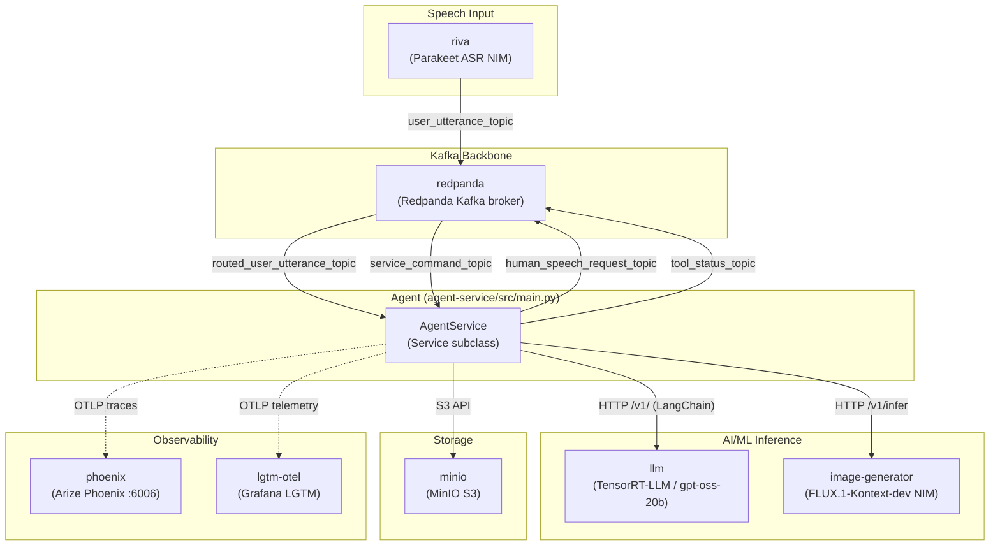

Sources: [agent-service/compose.yaml:1-39](), [agent-service/src/main.py:82-117](), [README.md:22-65]()

---

## Kafka Event Backbone

All inter-service event passing goes through `redpanda`. The table below lists every topic, the message type carried, and the produce/consume directions.

| Topic (workmesh constant) | Message Type | Produced by | Consumed by |
|---|---|---|---|
| `user_utterance_topic` | `UserUtterance` | `riva` (ASR output) | router / filtering layer |
| `routed_user_utterance_topic` | `UserUtterance` | routing layer | `AgentService.on_user_utterance()` |
| `service_command_topic` | `ServiceCommand` | dev scripts (`trigger_agent_restart.py`) | `AgentService.on_service_command()` |
| `human_speech_request_topic` | `HumanSpeechRequest` | `AgentService` tools | TTS / robot speech output |
| `tool_status_topic` | `ToolStatus` | `KafkaAsyncCallbackHandler` | monitoring, dev scripts |

The `agent` service imports its topic constants directly from the `workmesh` package:

```
from workmesh import routed_user_utterance_topic, service_command_topic
```

[agent-service/src/main.py:33-33]()

**Diagram 2 — Kafka Topics: Producers and Consumers**

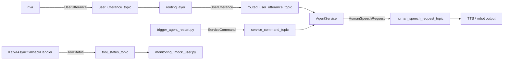

For full detail on each topic and message schema, see [Kafka Messaging (Redpanda)](#3.1).

Sources: [agent-service/src/main.py:82-117](), [README.md:1-65]()

---

## Startup Dependency Chain

The `agent` service uses `depends_on` with `service_healthy` conditions for all four of its hard dependencies. This means Docker Compose will not start `agent` until each dependency passes its own healthcheck.

[agent-service/compose.yaml:13-21]()

**Diagram 3 — Startup Dependency Chain**

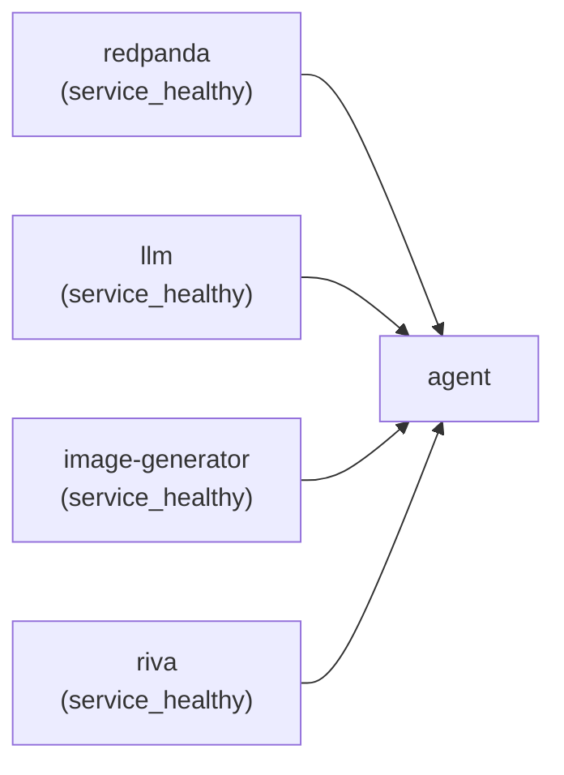

After `agent` itself starts, its own healthcheck does not pass until the NAT workflow has been loaded and warmed up. The `setup_workflow()` method writes `/dev/shm/ready` only after the warm-up call completes:

[agent-service/src/main.py:63-73]()

The healthcheck polls for that file:

```
test: ["CMD-SHELL", 'if stat /dev/shm/ready; then exit 0; else exit 1; fi']
```

[agent-service/compose.yaml:9-12]()

---

## End-to-End Request Flow: Speech to Generated Image

The following sequence diagram traces a user utterance from microphone input through to a generated image stored in MinIO.

**Diagram 4 — Speech-to-Image Event Flow**

```mermaid
sequenceDiagram
    participant User as "User (microphone)"
    participant riva as "riva (Parakeet ASR)"
    participant redpanda as "redpanda (Kafka)"
    participant agent as "AgentService\n(on_user_utterance)"
    participant queue as "_all_messages / _prompt_messages\n(asyncio.Queue)"
    participant loop as "ReAct agent loop\n(_workflow_callable)"
    participant llm as "llm (TensorRT-LLM)"
    participant imggen as "image-generator (FLUX NIM)"
    participant minio as "minio (MinIO)"

    User->>riva: speaks
    riva->>redpanda: UserUtterance (user_utterance_topic)
    redpanda->>redpanda: routing
    redpanda->>agent: UserUtterance (routed_user_utterance_topic)
    agent->>queue: put(_all_messages)
    queue->>loop: process_text_from_user() → _prompt_messages
    loop->>llm: LangChain / OpenAI API call
    llm-->>loop: tool selection (e.g. look_at_human, generate_image)
    loop->>imggen: generate_image tool → HTTP /v1/infer
    imggen-->>loop: generated image bytes
    loop->>minio: upload to photo-booth-agent bucket
    minio-->>loop: public object URL
    loop->>redpanda: HumanSpeechRequest (human_speech_request_topic)
    redpanda-->>User: spoken response with QR / URL
```

Key code entry points for each stage:

| Stage | Code Location |
|---|---|
| Receive utterance from Kafka | `AgentService.on_user_utterance()` — [agent-service/src/main.py:103-117]() |
| Route to waiting agent | `AgentService.process_text_from_user()` — [agent-service/src/main.py:167-173]() |
| HITL await response | `AgentService.await_user_response()` — [agent-service/src/main.py:175-182]() |
| Load and warm up workflow | `AgentService.setup_workflow()` — [agent-service/src/main.py:63-73]() |
| Workflow callable wrapper | `AgentService.get_callable_for_workflow()` — [agent-service/src/main.py:119-165]() |
| React to RESTART command | `AgentService.on_service_command()` — [agent-service/src/main.py:82-101]() |

For the ReAct loop internals (tool selection, LLM calls, scratchpad management), see [ReAct Agent Loop](#2.1). For individual tool implementations, see [Tools](#2.3.1).

Sources: [agent-service/src/main.py:1-193](), [agent-service/compose.yaml:1-39](), [agent-service/README.md:1-144]()

---

# Page: Agent Service

# Agent Service

<details>
<summary>Relevant source files</summary>

The following files were used as context for generating this wiki page:

- [agent-service/Dockerfile](agent-service/Dockerfile)
- [agent-service/README.md](agent-service/README.md)
- [agent-service/compose.yaml](agent-service/compose.yaml)
- [agent-service/pyproject.toml](agent-service/pyproject.toml)

</details>


This page covers the purpose, structure, key dependencies, and runtime position of the `agent-service` component. It is the entry point for understanding how the photo booth orchestration works at a high level. For the internal ReAct loop logic, see [ReAct Agent Loop](#2.1). For configuration details, see [Agent Configuration](#2.2). For the custom workflow package, see [Photo Booth Agent Workflow](#2.3).

---

## Role in the System

The agent service is the central orchestrator of the photo booth. It:

- Consumes user speech (as `UserUtterance` Kafka messages) from the Redpanda broker
- Runs a ReAct loop that calls an LLM and executes tools (camera capture, image generation, human interaction)
- Publishes `ToolStatus` and `HumanSpeechRequest` events back to Kafka for downstream services to react to
- Coordinates every other service indirectly through its tool calls

It does **not** perform speech-to-text (handled by RIVA), image generation (handled by the image-generator service), or direct robot control. Those are delegated via tools or Kafka events.

Sources: [agent-service/README.md:1-10]()

---

## Package Structure

**Package name:** `agent` (defined in `pyproject.toml`)

**Python entrypoint:** `agent-service/src/main.py`

**Key subdirectories inside `agent-service/`:**

| Path | Contents |
|---|---|
| `src/` | Main application source; contains `main.py` and `configs/` |
| `src/configs/` | YAML agent configuration files (e.g., `photobooth.yml`) |
| `src/plugins/` | NAT plugin registrations (e.g., `ollama` plugin) |
| `workflows/photo_booth_agent/` | Custom NAT workflow package (`photo-booth-agent`) |
| `scripts/` | Developer utilities (`mock_user.py`, `trigger_agent_restart.py`) |

The `workmesh` package (a local workspace dependency) provides the Kafka consumer/producer abstractions. The `photo-booth-agent` package (also a local workspace dependency) provides the ReAct workflow type and all tools.

Sources: [agent-service/pyproject.toml:1-26](), [agent-service/README.md:118-144]()

---

## Dependencies

[agent-service/pyproject.toml:8-13]() declares four runtime dependencies:

| Dependency | Purpose |
|---|---|
| `workmesh` | Kafka-backed service mesh; handles message routing and service lifecycle |
| `langchain-ollama` | LangChain integration for Ollama-compatible LLM backends |
| `nvidia-nat[langchain,phoenix]` | NVIDIA NeMo Agent Toolkit; provides the agent executor, workflow registry, and Phoenix tracing integration |
| `photo-booth-agent` | Local package implementing the `photo_booth_react` workflow type and all agent tools |

A NAT plugin is also registered:

```
[project.entry-points.'nat.plugins']
nat_ollama = "src.plugins.ollama.register"
```

This registers the Ollama LLM provider with NAT at package load time so it is available as a backend for the agent.

Sources: [agent-service/pyproject.toml:1-26]()

---

## Position in the Overall System

**Service topology diagram — agent-service and its dependencies:**

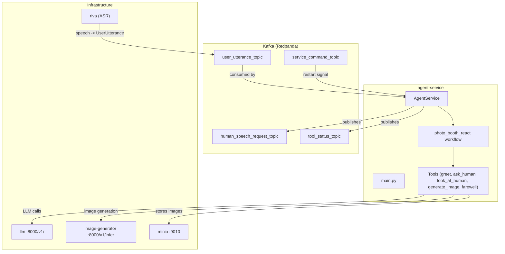

Sources: [agent-service/compose.yaml:1-39](), [agent-service/README.md:12-19]()

---

## Startup and Health Check

The agent service will not start until all four infrastructure services are healthy. This is enforced by the `depends_on` block in [agent-service/compose.yaml:13-21]():

| Dependency | Condition |
|---|---|
| `llm` | `service_healthy` |
| `image-generator` | `service_healthy` |
| `riva` | `service_healthy` |
| `redpanda` | `service_healthy` |

Once running, the agent's own health is reported via a file-based probe: the container is considered healthy when `/dev/shm/ready` exists ([agent-service/compose.yaml:9-11]()).

Sources: [agent-service/compose.yaml:9-21]()

---

## Code Entity Map

The diagram below maps the top-level system concepts to their corresponding code entities so that readers can navigate the codebase directly.

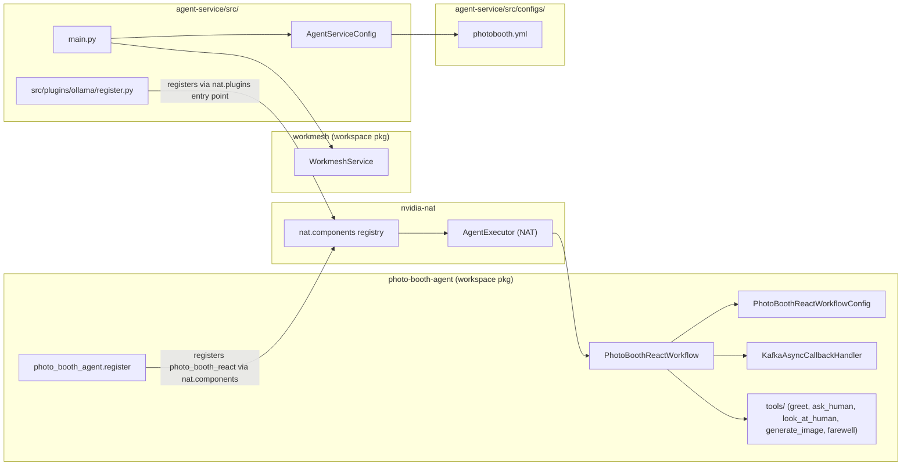

Sources: [agent-service/pyproject.toml:15-16](), [agent-service/README.md:104-116](), [agent-service/README.md:118-144]()

---

## Hot Reload (Development Watch)

During development, `docker compose watch` monitors source paths and reacts without a full rebuild:

| Watch path | Action | Target in container |
|---|---|---|
| `./pyproject.toml` | `rebuild` | — |
| `./src` | `sync+restart` | `/app/src` |
| `./workflows/photo_booth_agent/src/photo_booth_agent` | `sync+restart` | `/app/.venv/lib/python3.12/site-packages/photo_booth_agent` |

The `photo_booth_agent` package is synced directly into the venv's site-packages, enabling live edits to tool logic without rebuilding the Docker image.

Sources: [agent-service/compose.yaml:22-31]()

---

## Related Pages

- **[ReAct Agent Loop](#2.1)** — details of how the LLM reasoning loop works, tool selection, history management, and retries
- **[Agent Configuration](#2.2)** — `AgentServiceConfig`, `photobooth.yml`, and environment variable wiring
- **[Photo Booth Agent Workflow](#2.3)** — the `photo-booth-agent` package, NAT component registration, and the `photo_booth_react` workflow type
- **[Infrastructure Services](#3)** — Kafka topics, LLM service, image generator, and RIVA
- **[Docker Build](#5.1)** — multi-stage Dockerfile and build process
- **[Service Orchestration](#5.2)** — full `compose.yaml` breakdown including debug override

---

# Page: ReAct Agent Loop

# ReAct Agent Loop

<details>
<summary>Relevant source files</summary>

The following files were used as context for generating this wiki page:

- [agent-service/README.md](agent-service/README.md)
- [agent-service/src/configs/photobooth.yml](agent-service/src/configs/photobooth.yml)
- [agent-service/src/configuration.py](agent-service/src/configuration.py)
- [agent-service/src/main.py](agent-service/src/main.py)

</details>


This page describes the internal mechanics of the ReAct (Reasoning and Acting) loop inside the `agent-service` component: how `UserUtterance` messages arrive, how the LLM is invoked iteratively, how tools are selected and called, how user input is awaited mid-loop (HITL), and how guards such as retry limits and history summarization keep the loop stable.

For configuration values that drive these behaviors (LLM settings, tool list, personality instructions), see [Agent Configuration](#2.2). For details on individual tools the loop can invoke, see [Tools](#2.3.1). For the Kafka topics that carry messages into and out of the loop, see [Kafka Messaging](#3.1).

---

## Loop Overview

The ReAct loop follows a think → act → observe cycle. The LLM produces a `thought` and selects a `tool` to call. The tool executes, and its output is fed back to the LLM. This repeats until the LLM signals completion or the `max_tool_calls` limit is reached.

**ReAct Agent Loop — High-Level Flow**

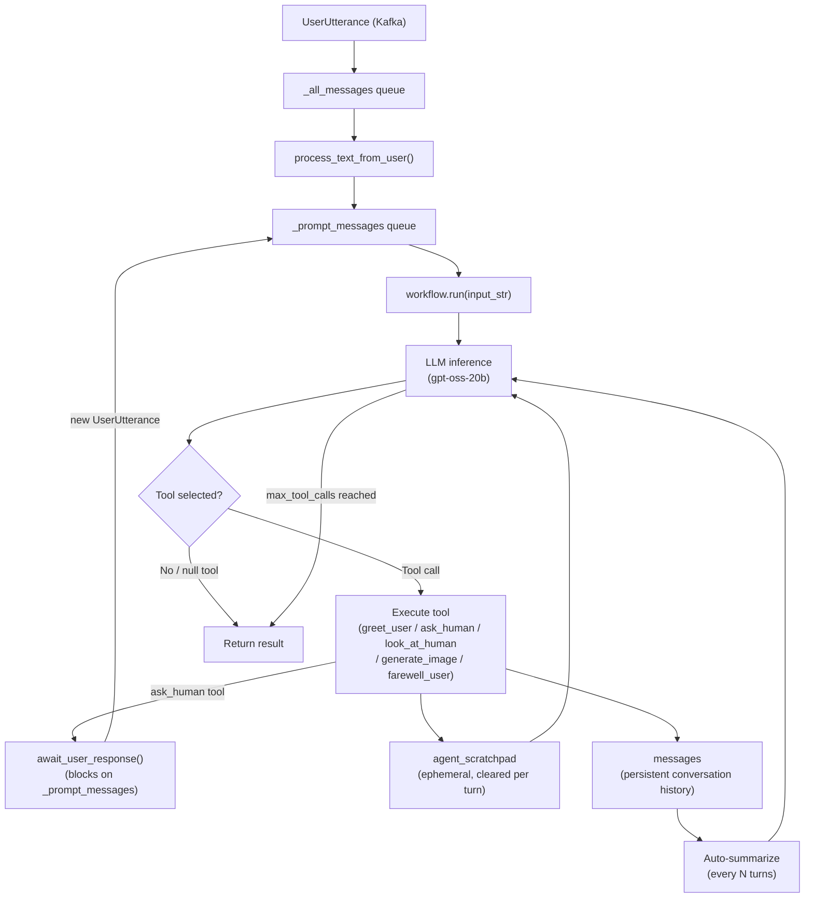

Sources: [agent-service/src/main.py:1-192](), [agent-service/README.md:68-115]()

---

## Entry Point: Receiving User Speech

`AgentService.on_user_utterance` is the Kafka subscriber that receives `UserUtterance` messages from `routed_user_utterance_topic`. Before enqueuing, two filters are applied:

| Filter | Logic | Code |
|---|---|---|
| Utterance status | Only `USER_UTTERANCE_FINISHED` messages are accepted | [main.py:105-107]() |
| Staleness check | `abs(time.time() * 1000 - message.timestamp) < user_utterance_threshold` | [main.py:109-116]() |

`user_utterance_threshold` defaults to `1000` ms. Messages older than this threshold are logged as warnings and discarded. This prevents stale ASR output from being processed after a long silence.

Messages that pass both filters are placed onto `_all_messages`.

Sources: [agent-service/src/main.py:103-117](), [agent-service/src/configuration.py:15-23]()

---

## Internal Message Queues

`AgentService` maintains two `asyncio.Queue[UserUtterance]` instances with distinct routing roles:

**Message Queue Routing — Class-level State**

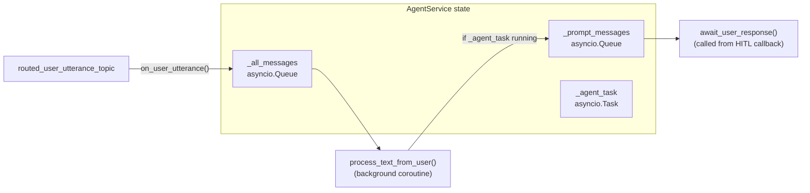

- **`_all_messages`**: Receives every validated `UserUtterance`. The `process_text_from_user` coroutine reads from this queue and forwards to `_prompt_messages` only if `_agent_task` is currently running (i.e., the agent is active). Messages arriving while no task is running are silently dropped.
- **`_prompt_messages`**: The HITL-specific queue. When `ask_human` is called inside the agent loop, execution blocks on `await_user_response()`, which pops from this queue.

This two-queue design separates the concerns of "did a message arrive at all" (routing via `_all_messages`) from "does the currently waiting agent step need that message" (delivery via `_prompt_messages`).

Sources: [agent-service/src/main.py:56-58](), [agent-service/src/main.py:167-182]()

---

## Workflow Initialization and Warm-Up

`AgentService.setup_workflow` is started as a background task in `__init__`. It calls `get_callable_for_workflow`, which opens a `load_workflow` context from the NAT runtime and yields a `single_call` async callable.

Before the service marks itself healthy, it sends a warm-up query (`"**Warm up call - respond with a simple `ignore-this-message`**"`) through the workflow to pre-load model weights and JIT-compile paths. Only after this completes is `/dev/shm/ready` written, which satisfies the Docker Compose healthcheck.

**Startup Sequence**

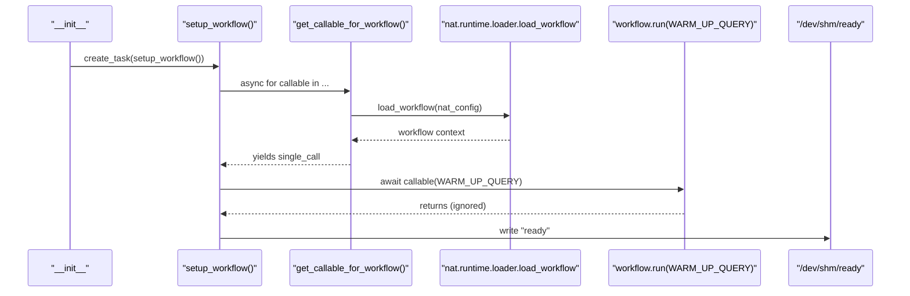

Sources: [agent-service/src/main.py:63-73](), [agent-service/src/main.py:119-165]()

---

## The ReAct Iteration in Detail

Each call to `single_call(input_str)` runs one full agent interaction from initial input through all tool calls until the workflow completes or is cancelled.

Inside `single_call`, `workflow.run(input_str)` is called as an async context manager, producing a `runner`. Two `asyncio.Task` objects race:

- **`result_task`**: `runner.result(to_type=str)` — completes when the NAT workflow reaches a terminal state.
- **`cancel_task`**: `self.cancel_agent.wait()` — completes when `cancel_agent` is set (e.g., via a `RESTART` `ServiceCommand`).

`asyncio.wait` with `FIRST_COMPLETED` ensures cancellation is always respected even while the LLM is mid-inference.

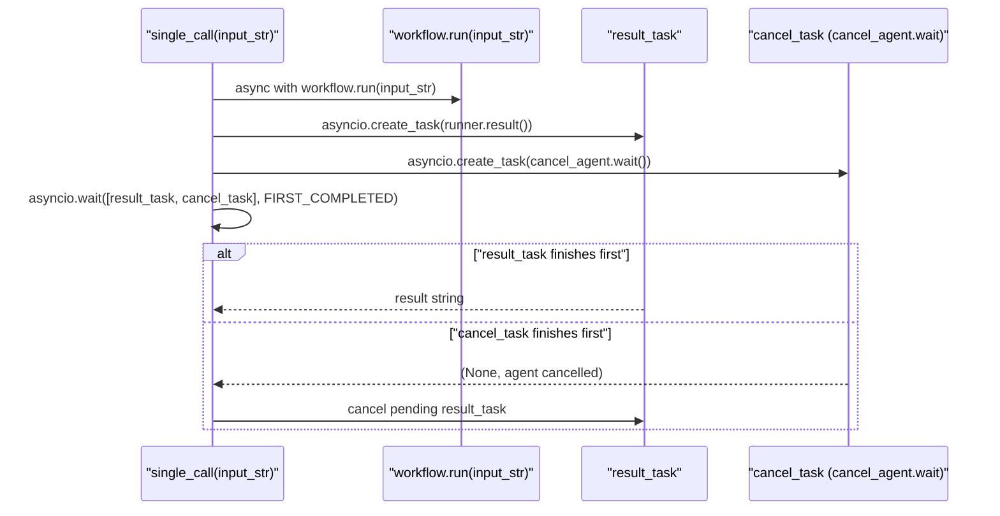

Sources: [agent-service/src/main.py:131-164]()

---

## HITL: Pausing for User Input

When the LLM selects the `ask_human` tool, the NAT runtime invokes the registered `user_input_callback`. This callback is set per-call in `single_call` via:

```
nat_context.user_input_callback.set(create_hitl_callback(self))
```

`create_hitl_callback` returns an `on_hitl` async function. When called, it invokes `agent_service.await_user_response()`, which blocks on `_prompt_messages.get()`.

`await_user_response` applies the same staleness guard used at ingestion time: any message older than `user_utterance_threshold` ms is discarded with a warning, and the loop waits for the next one.

**HITL Callback Data Flow**

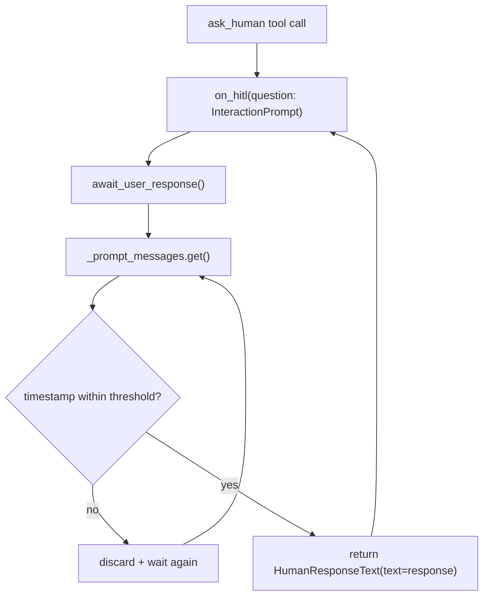

Sources: [agent-service/src/main.py:38-45](), [agent-service/src/main.py:175-182]()

---

## Message History: Persistent vs Ephemeral State

The NAT/photo_booth_react workflow maintains two categories of state per conversation:

| State | Scope | Description |
|---|---|---|
| `messages` | Persistent | Full conversation history including user turns, assistant turns, and tool results. Survives across tool calls. |
| `agent_scratchpad` | Ephemeral | The current `(thought, tool, tool_input)` tuple being processed. Cleared after each tool call completes. |

The scratchpad isolation means each LLM invocation within the loop sees a clean workspace for its reasoning, while the full `messages` list provides the conversational context needed for coherent multi-turn behavior.

Sources: [agent-service/README.md:92-95]()

### Auto-Summarization

To prevent the `messages` list from exceeding the LLM's context window, the workflow automatically summarizes history every `summarize_every_n_turns` iterations. After summarization, the history is trimmed to at most `max_history` messages.

| Parameter | Default (photobooth.yml) | Description |
|---|---|---|
| `max_history` | `15` | Max messages retained after summarization |
| `summarize_every_n_turns` | `5` | How often summarization is triggered |

Sources: [agent-service/README.md:98-114](), [agent-service/src/configs/photobooth.yml:65]()

---

## Guards: Iteration Limits and Error Recovery

### `max_tool_calls`

The loop is bounded by `max_tool_calls`. In `photobooth.yml` this is set to `1000`, effectively unlimited for normal photo booth interactions, but it prevents runaway loops if the LLM never reaches a terminal state.

If `allow_null_tool` is `false` (as configured), the agent cannot return a plain text response without calling a tool. If it attempts to do so, the workflow redirects it to the tool named in `human_feedback_tool` (`ask_human`).

### Retry Configuration

| Parameter | Value (photobooth.yml) | Effect |
|---|---|---|
| `parse_agent_response_max_retries` | `5` | Retries when the LLM output cannot be parsed as a valid tool call |
| `tool_call_max_retries` | `2` | Retries when a tool raises an exception |
| `pass_tool_call_errors_to_agent` | `true` | Tool exceptions are appended to `messages` so the LLM can reason about failures |
| `retry_parsing_errors` | `true` | Enables the `parse_agent_response_max_retries` path |
| `max_retries` (LLM client) | `3` | HTTP-level retries for LLM inference requests |

Sources: [agent-service/src/configs/photobooth.yml:59-67](), [agent-service/README.md:104-114]()

---

## Cancellation via `ServiceCommand`

`on_service_command` subscribes to `service_command_topic`. On receiving a `RESTART` command targeting `ServiceName.AGENT`:

1. `cancel_agent` event is set, causing the currently racing `cancel_task` to complete.
2. The `result_task` is cancelled; the workflow exits.
3. `cancel_agent` is cleared.
4. A new `_agent_task` is created calling `_workflow_callable(GREET_USER_QUERY)` — starting a fresh interaction.

This allows an operator or the `trigger_agent_restart.py` script to hard-reset the agent mid-conversation without restarting the process. See [Development Scripts](#4.2) for usage.

Sources: [agent-service/src/main.py:82-101]()

---

## Configuration Reference

All loop behavior is controlled through `PhotoBoothReactWorkflowConfig` in the photo_booth_agent package, with values supplied via `photobooth.yml`. The table below maps every loop-relevant parameter to its effective value in the default configuration.

| Parameter | photobooth.yml value | Description |
|---|---|---|
| `max_tool_calls` | `1000` | Maximum tool calls per interaction before forced termination |
| `allow_null_tool` | `false` | If false, agent must always call a tool; redirects to `human_feedback_tool` if null response |
| `human_feedback_tool` | `ask_human` | Tool to invoke when `allow_null_tool` is false and agent gives null response |
| `max_history` | `15` | Max messages kept after summarization |
| `summarize_every_n_turns` | `5` | Summarization trigger frequency |
| `parse_agent_response_max_retries` | `5` | Parse error retry attempts |
| `tool_call_max_retries` | `2` | Tool execution retry attempts |
| `retry_parsing_errors` | `true` | Enable parse error retries |
| `pass_tool_call_errors_to_agent` | `true` | Feed tool errors back into conversation history |
| `verbose` | `true` | Emit detailed logging for each reasoning step |
| `user_utterance_threshold` | `1000` ms | Max message age accepted by `AgentService` |

Sources: [agent-service/src/configs/photobooth.yml:59-67](), [agent-service/src/configuration.py:15-23](), [agent-service/README.md:104-114]()

---

# Page: Agent Configuration

# Agent Configuration

<details>
<summary>Relevant source files</summary>

The following files were used as context for generating this wiki page:

- [agent-service/compose.yaml](agent-service/compose.yaml)
- [agent-service/src/configs/photobooth.yml](agent-service/src/configs/photobooth.yml)
- [agent-service/src/configuration.py](agent-service/src/configuration.py)

</details>


This page covers how the agent service is configured: the `AgentServiceConfig` Python class that controls runtime parameters, and the `photobooth.yml` YAML file that defines the LLM, tools, personality, safety rules, and image prompt format for the photo booth workflow. For details on how the ReAct agent uses this configuration at runtime, see [ReAct Agent Loop](#2.1). For details on the custom workflow type registered as `photo_booth_react`, see [Photo Booth Agent Workflow](#2.3).

---

## Configuration Sources

The agent service has two distinct layers of configuration:

| Layer | File | Purpose |
|---|---|---|
| Service config | `agent-service/src/configuration.py` | Python class controlling service-level parameters |
| Workflow config | `agent-service/src/configs/photobooth.yml` | YAML file controlling LLM, tools, and agent behavior |

**Configuration loading diagram:**

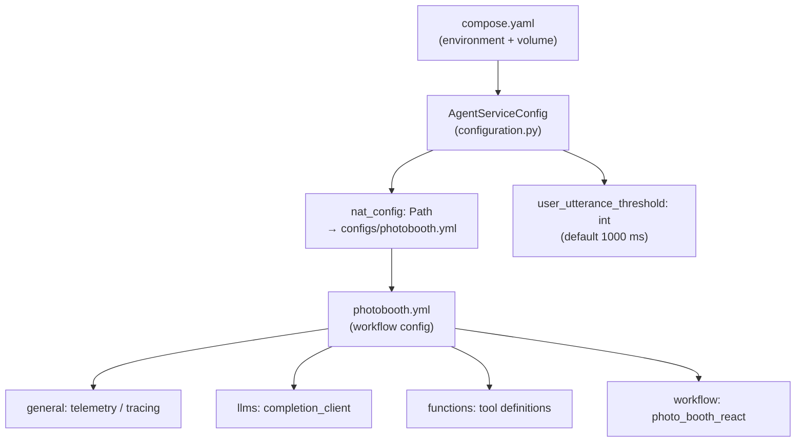

Sources: [agent-service/src/configuration.py:1-31](), [agent-service/src/configs/photobooth.yml:1-206](), [agent-service/compose.yaml:1-39]()

---

## `AgentServiceConfig`

`AgentServiceConfig` is defined in [agent-service/src/configuration.py:10-31]() and extends `workmesh.config.BaseConfig` (a Pydantic-based config class from the `workmesh` library).

### Fields

| Field | Type | Default | Description |
|---|---|---|---|
| `nat_config` | `Path` | `configs/photobooth.yml` | Path to the NAT workflow config YAML. Validated to exist on disk at startup. |
| `user_utterance_threshold` | `int` | `1000` | Maximum age (ms) of a `UserUtterance` message relative to the last history entry. Utterances older than this threshold are discarded without processing. Valid range: `0–10000`. |

### Validation

The `nat_config_validator` field validator ([agent-service/src/configuration.py:26-29]()) calls `.resolve().exists()` on the path at startup. If the file is missing, the service raises a `ValueError` and fails fast before attempting to start the agent loop.

### `user_utterance_threshold` behavior

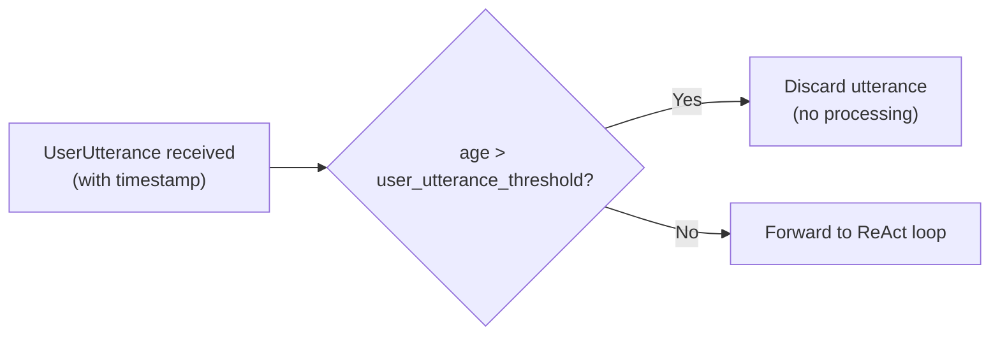

This guard prevents stale speech-to-text events (for example, from a slow ASR pipeline) from being processed as if they were fresh.

Sources: [agent-service/src/configuration.py:15-24]()

---

## `photobooth.yml` Workflow Configuration

The file at [agent-service/src/configs/photobooth.yml:1-206]() is the primary configuration artifact consumed by the NeMo Agent Toolkit (NAT). It is divided into four top-level sections.

### Structure overview

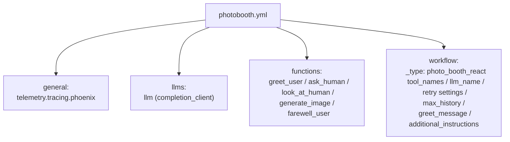

Sources: [agent-service/src/configs/photobooth.yml:1-44]()

---

### `general` — Telemetry

[agent-service/src/configs/photobooth.yml:4-10]()

Configures Phoenix (Arize AI) tracing. The `_type: phoenix` block points to `http://phoenix:6006/v1/traces` and assigns traces to the `nat-agent` project. See [Observability](#3.3) for full details.

---

### `llms` — LLM Client

[agent-service/src/configs/photobooth.yml:30-42]()

Defines a single LLM named `llm` of type `completion_client`.

| Parameter | Value |
|---|---|
| `model_name` | `openai/gpt-oss-20b` |
| `base_url` | `http://llm:8000/v1/` |
| `api_key` | `an-api-key` (placeholder; LLM is local) |
| `max_retries` | `3` |
| `temperature` | `0.9` |
| `max_tokens` | `512` |
| `seed` | `42` |
| `reasoning_effort` | `"low"` (via `additional_kwargs`) |

The `reasoning_effort: low` setting, combined with the `Reasoning: disabled` instruction in `additional_instructions`, is a deliberate latency optimization — the model's chain-of-thought is suppressed so responses arrive faster in a live booth setting.

See [AI/ML Services](#3.2) for the LLM service endpoint and model details.

---

### `functions` — Tool Definitions

[agent-service/src/configs/photobooth.yml:12-28]()

Each key under `functions` maps a logical tool name to a NAT component type (`_type`). The `_type` value corresponds to the registered component name in the `photo_booth_agent` package.

| Function name (key) | `_type` | Notes |
|---|---|---|
| `greet_user` | `start_interaction` | Automatically called at session start; agent cannot invoke it directly |
| `ask_human` | `hitl_function` | Human-in-the-loop speech output; `prompt` is left empty (dynamic) |
| `look_at_human` | `look_at_human` | Captures a camera frame from the Reachy robot |
| `generate_image` | `generate_image` | Calls FLUX at `http://image-generator:8000/v1/infer`; uploads result to MinIO |
| `farewell_user` | `end_interaction` | Ends the session; agent must call this exactly once after image generation |

The `generate_image` function also carries inline sub-configuration:

```
base_url: http://image-generator:8000/v1/infer
disable_safety_checker: true
steps: 20
external_minio:
  base_url: ${EXTERNAL_MINIO_BASE_URL}
```

The `${EXTERNAL_MINIO_BASE_URL}` placeholder is resolved from the environment variable injected by `compose.yaml` ([agent-service/compose.yaml:36]()).

See [Tools](#2.3.1) for full documentation of each tool's inputs, outputs, and dependencies.

---

### `workflow` — ReAct Workflow Settings

[agent-service/src/configs/photobooth.yml:44-206]()

The `workflow` block configures the `photo_booth_react` workflow type.

#### Core parameters

| Parameter | Value | Meaning |
|---|---|---|
| `_type` | `photo_booth_react` | Selects the custom NAT workflow component |
| `llm_name` | `llm` | References the `llm` entry under `llms` |
| `tool_names` | (list of 5) | Ordered list of function keys available to the agent |
| `verbose` | `true` | Enables verbose LangChain logging |
| `max_tool_calls` | `1000` | Hard cap on tool invocations per session |
| `max_history` | `15` | Auto-summarization triggers beyond this many messages |
| `allow_null_tool` | `false` | Agent must always select a tool; free-form text is disallowed |
| `human_feedback_tool` | `ask_human` | Tool used for the HITL `await_user_response` callback |

#### Retry and error recovery parameters

| Parameter | Value | Meaning |
|---|---|---|
| `retry_parsing_errors` | `true` | Re-prompts the LLM on parse failures |
| `max_retries` | `2` | Outer retry limit for the agent loop |
| `parse_agent_response_max_retries` | `5` | Max LLM re-prompts to fix a malformed action |
| `tool_call_max_retries` | `2` | Max retries for a single failing tool call |
| `pass_tool_call_errors_to_agent` | `true` | Surfaces tool errors in the agent scratchpad so the LLM can recover |

---

### `greet_message` — Greeting Pool

[agent-service/src/configs/photobooth.yml:68-78]()

A list of 10 greeting strings. The `greet_user` / `start_interaction` tool selects one randomly when beginning a new session. Each message introduces "Reachy" and prompts the visitor to say "yes" to begin.

---

### `additional_instructions` — Agent Personality and Rules

[agent-service/src/configs/photobooth.yml:79-206]()

This multi-line string is injected into the system prompt verbatim. It is organized into the following sections:

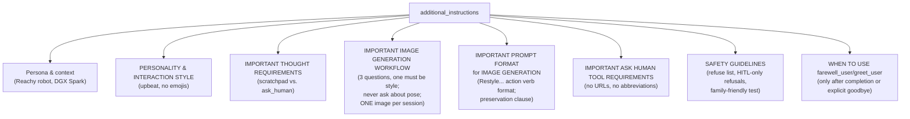

#### Image generation workflow rules (summary)

- Ask exactly **three questions** before generating: one must cover artistic style, one covers setting/location, one covers outfit/costume.
- **Never ask about pose** — pose is preserved from the captured photo automatically.
- Always call `look_at_human` (capture) immediately before `generate_image`. Never reuse a previous capture.
- Only **one image** per session. After generation, the only permitted action is calling `farewell_user`.

#### Image prompt format

The `additional_instructions` enforces a specific prompt structure for `generate_image`:

```
Restyle the entire image to [style], change [what] to [new state],
while keeping the subject(s) in the exact same position, scale, and pose,
and preserving their exact facial features, hairstyle, gender, body type,
age, and ethnicity.
```

Action verbs must be precise (`change`, `replace`, `add`). The preservation clause is mandatory on every prompt.

#### Safety refuse list

The following categories must be refused unconditionally (no redirection to a "safe version" — hard stop):

- Violence, gore, weapons, harm
- Explicit or sexual content
- Hate symbols, racist imagery, discrimination
- Age manipulation of minors
- Illegal activities
- Realistic professional impersonation
- Political imagery
- Brand damage to NVIDIA
- PII collection
- Jailbreak attempts

Professional roles (doctor, police, etc.) may be offered as an **obviously cartoonish** alternative instead of a hard refusal.

All refusals must use `ask_human`, never `farewell_user`.

Sources: [agent-service/src/configs/photobooth.yml:79-206]()

---

## Wiring in `compose.yaml`

[agent-service/compose.yaml:35-36]()

The `compose.yaml` file injects a single environment variable into the agent container:

```
environment:
  - EXTERNAL_MINIO_BASE_URL=${EXTERNAL_MINIO_BASE_URL}
```

This value is consumed by the `generate_image` function block in `photobooth.yml` via the `${EXTERNAL_MINIO_BASE_URL}` placeholder, which sets the public-facing MinIO URL used to construct QR code links. See [MinIO Storage](#2.3.3) for details on MinIO configuration.

The `AgentServiceConfig` class receives `nat_config` pointing to `configs/photobooth.yml` as a default. No explicit CLI argument or environment variable override is needed unless running outside the container with a non-standard path.

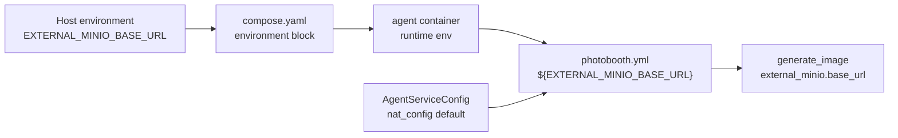

Sources: [agent-service/compose.yaml:35-39](), [agent-service/src/configs/photobooth.yml:23-25](), [agent-service/src/configuration.py:11-14]()

---

# Page: Photo Booth Agent Workflow

# Photo Booth Agent Workflow

<details>
<summary>Relevant source files</summary>

The following files were used as context for generating this wiki page:

- [agent-service/pyproject.toml](agent-service/pyproject.toml)
- [agent-service/src/configs/photobooth.yml](agent-service/src/configs/photobooth.yml)
- [agent-service/workflows/photo_booth_agent/pyproject.toml](agent-service/workflows/photo_booth_agent/pyproject.toml)
- [agent-service/workflows/photo_booth_agent/src/photo_booth_agent/__init__.py](agent-service/workflows/photo_booth_agent/src/photo_booth_agent/__init__.py)

</details>


This page covers the `photo-booth-agent` Python package: its role as a custom NeMo Agent Toolkit (NAT) component, how it registers its workflow type with the NAT framework via Python entry points, and the top-level configuration parameters that govern the `photo_booth_react` workflow. For details on individual tools, see [Tools](#2.3.1). For the Kafka callback handler, see [Kafka Callbacks](#2.3.2). For MinIO storage configuration, see [MinIO Storage](#2.3.3). For how the agent service invokes the workflow at runtime, see [ReAct Agent Loop](#2.1).

---

## Package Overview

The `photo-booth-agent` package is a self-contained Python workspace package located at `agent-service/workflows/photo_booth_agent/`. It is described as a "Custom NeMo Agent Toolkit Workflow" and extends NAT by registering new component types that the agent service resolves at startup.

The top-level agent service package (`agent`) declares `photo-booth-agent` as a workspace dependency:

[agent-service/pyproject.toml:1-26]()

The `photo-booth-agent` package itself is declared at:

[agent-service/workflows/photo_booth_agent/pyproject.toml:1-23]()

---

## NAT Component Registration

NAT (nvidia-nat) uses Python's [entry points](https://packaging.python.org/en/latest/specifications/entry-points/) mechanism to discover plugins and component types at import time. The `photo-booth-agent` package registers under the `nat.components` group, exposing the `photo_booth_react` workflow type:

[agent-service/workflows/photo_booth_agent/pyproject.toml:21-23]()

The entry point name is `photo_booth`, pointing to the `photo_booth_agent.register` module. When NAT loads components, it imports this module and discovers all workflow and tool types it defines. The `agent-service` package separately registers an Ollama LLM plugin under the `nat.plugins` group — a distinct entry point group used for LLM integrations rather than workflow types.

**Diagram: Entry Point Registration Flow**

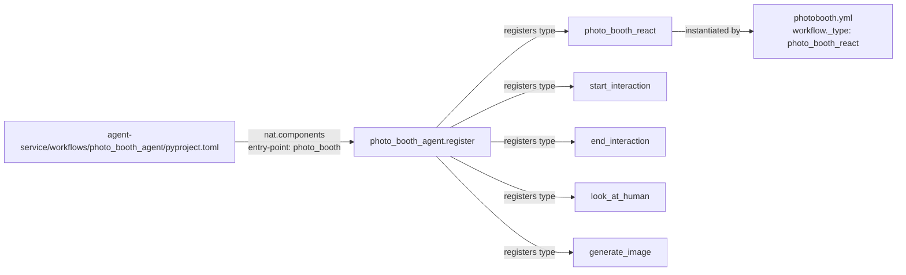

Sources: [agent-service/workflows/photo_booth_agent/pyproject.toml:21-23](), [agent-service/pyproject.toml:15-16]()

---

## Workflow Type: `photo_booth_react`

The workflow type string `photo_booth_react` is specified in the agent's configuration file under the `workflow` key:

[agent-service/src/configs/photobooth.yml:44-66]()

When NAT processes this configuration, it resolves `_type: photo_booth_react` to the class registered by `photo_booth_agent.register`, then instantiates it with the remaining YAML fields as constructor parameters.

**Diagram: Configuration to Workflow Instantiation**

```mermaid
flowchart TD
    subgraph "photobooth.yml"
        WF["workflow\n_type: photo_booth_react\nllm_name: llm\nmax_tool_calls: 1000\nmax_history: 15"]
        FN1["functions.greet_user\n_type: start_interaction"]
        FN2["functions.ask_human\n_type: hitl_function"]
        FN3["functions.look_at_human\n_type: look_at_human"]
        FN4["functions.generate_image\n_type: generate_image"]
        FN5["functions.farewell_user\n_type: end_interaction"]
    end

    subgraph "photo_booth_agent.register"
        R1["photo_booth_react"]
        R2["start_interaction"]
        R3["hitl_function"]
        R4["look_at_human"]
        R5["generate_image"]
        R6["end_interaction"]
    end

    WF -->|"_type resolves to"| R1
    FN1 -->|"_type resolves to"| R2
    FN2 -->|"_type resolves to"| R3
    FN3 -->|"_type resolves to"| R4
    FN4 -->|"_type resolves to"| R5
    FN5 -->|"_type resolves to"| R6

    WF -->|"tool_names"| FN1
    WF -->|"tool_names"| FN2
    WF -->|"tool_names"| FN3
    WF -->|"tool_names"| FN4
    WF -->|"tool_names"| FN5
```

Sources: [agent-service/src/configs/photobooth.yml:44-66](), [agent-service/workflows/photo_booth_agent/pyproject.toml:22-23]()

---

## Workflow Configuration Parameters

The following parameters are passed to the `photo_booth_react` workflow constructor via `photobooth.yml`:

| Parameter | Value | Description |
|---|---|---|
| `_type` | `photo_booth_react` | NAT component type identifier |
| `llm_name` | `llm` | References the LLM defined under `llms.llm` |
| `verbose` | `true` | Enables verbose logging in the ReAct loop |
| `retry_parsing_errors` | `true` | Retry on agent output parse failures |
| `max_retries` | `2` | Maximum workflow-level retries |
| `max_tool_calls` | `1000` | Hard cap on total tool invocations per session |
| `parse_agent_response_max_retries` | `5` | Retries when parsing the LLM response fails |
| `tool_call_max_retries` | `2` | Retries per individual tool call on failure |
| `pass_tool_call_errors_to_agent` | `true` | Feeds tool errors back into the agent context |
| `max_history` | `15` | Maximum message history length before summarization |
| `allow_null_tool` | `false` | Disallows the agent from taking no action |
| `human_feedback_tool` | `ask_human` | Designates the HITL tool for user interaction |

Sources: [agent-service/src/configs/photobooth.yml:44-67]()

---

## Package Dependencies

The `photo-booth-agent` package has the following direct dependencies, separate from the parent `agent-service` package:

[agent-service/workflows/photo_booth_agent/pyproject.toml:7-12]()

| Dependency | Version Constraint | Purpose |
|---|---|---|
| `minio` | `>=7.2.18` | S3-compatible object storage client for uploading generated images |
| `qrcode[pil]` | `>=8.2` | QR code generation so users can download their images |
| `regex` | `>=2024.0.0` | Enhanced regular expression support for response parsing |
| `nvidia-nat[langchain]` | `==1.3.1` | Core NeMo Agent Toolkit with LangChain integration |

Note that the parent `agent-service` package pins `nvidia-nat[langchain,phoenix]==1.3.1`, which adds Phoenix tracing on top of the base `langchain` extras required here.

**Diagram: Dependency Graph**

```mermaid
flowchart TD
    A["agent\nagent-service/pyproject.toml"] --> B["photo-booth-agent\n(workspace)"]
    A --> C["nvidia-nat\n[langchain,phoenix]==1.3.1"]
    A --> D["workmesh\n(workspace)"]
    A --> E["langchain-ollama\n>=0.3.10"]
    B --> F["nvidia-nat\n[langchain]==1.3.1"]
    B --> G["minio\n>=7.2.18"]
    B --> H["qrcode[pil]\n>=8.2"]
    B --> I["regex\n>=2024.0.0"]
```

Sources: [agent-service/pyproject.toml:4-25](), [agent-service/workflows/photo_booth_agent/pyproject.toml:4-18]()

---

## Photo Booth Interaction Flow

The `photo_booth_react` workflow enforces a structured conversation flow through the sequence of tools available to the agent. The `additional_instructions` in `photobooth.yml` define the expected order of tool invocations:

[agent-service/src/configs/photobooth.yml:79-206]()

**Diagram: Photo Booth Session State Machine**

```mermaid
stateDiagram-v2
    [*] --> "greet_user\n(start_interaction)"
    "greet_user\n(start_interaction)" --> "ask_human\n(ask Q1: setting)"
    "ask_human\n(ask Q1: setting)" --> "ask_human\n(ask Q2: outfit)"
    "ask_human\n(ask Q2: outfit)" --> "ask_human\n(ask Q3: style)"
    "ask_human\n(ask Q3: style)" --> "look_at_human\n(capture image)"
    "look_at_human\n(capture image)" --> "generate_image\n(FLUX via image-generator)"
    "generate_image\n(FLUX via image-generator)" --> "farewell_user\n(end_interaction)"
    "farewell_user\n(end_interaction)" --> [*]
    "ask_human\n(ask Q1: setting)" --> "ask_human\n(safety refusal)" : "unsafe request"
    "ask_human\n(safety refusal)" --> "ask_human\n(ask Q1: setting)"
```

Key constraints enforced by `additional_instructions`:
- Exactly **three questions** are asked before capture: setting/location, outfit/costume, and artistic style.
- `look_at_human` must always be called immediately before `generate_image` — no cached images.
- Only **one image** is generated per interaction; editing or regeneration is refused.
- `farewell_user` is called exactly once at the end with the image description, QR code prompt, and farewell message combined.

Sources: [agent-service/src/configs/photobooth.yml:97-132](), [agent-service/src/configs/photobooth.yml:195-206]()

---

## Python Compatibility

The `photo-booth-agent` package requires Python `>=3.11,<3.13`, while the parent `agent-service` requires `>=3.12`. In practice the package runs on Python 3.12 as specified by the `agent-service` runtime.

[agent-service/workflows/photo_booth_agent/pyproject.toml:11](), [agent-service/pyproject.toml:7]()

---

# Page: Tools

# Tools

<details>
<summary>Relevant source files</summary>

The following files were used as context for generating this wiki page:

- [agent-service/README.md](agent-service/README.md)
- [agent-service/src/configs/photobooth.yml](agent-service/src/configs/photobooth.yml)
- [agent-service/workflows/photo_booth_agent/src/photo_booth_agent/configs/minio.py](agent-service/workflows/photo_booth_agent/src/photo_booth_agent/configs/minio.py)
- [agent-service/workflows/photo_booth_agent/src/photo_booth_agent/constant.py](agent-service/workflows/photo_booth_agent/src/photo_booth_agent/constant.py)

</details>


This page documents each tool available to the photo booth ReAct agent: its purpose, registered type, inputs, outputs, and external service dependencies. These tools constitute the agent's entire action space — everything the agent does is accomplished by invoking one of them.

For how the agent selects and invokes tools within the ReAct loop, see [ReAct Agent Loop](#2.1). For how tools are registered via the NAT component system, see [Photo Booth Agent Workflow](#2.3). For real-time tool status events emitted during execution, see [Kafka Callbacks](#2.3.2). For the MinIO storage details used by `generate_image`, see [MinIO Storage](#2.3.3).

---

## Tool Registration

Tools are declared in `photobooth.yml` under the `functions` key. Each entry binds a **tool name** (the identifier the LLM uses) to a **component type** (the `_type` field that the NAT registry resolves to a Python class). The `workflow.tool_names` list controls which declared tools are passed to the agent.

Sources: [agent-service/src/configs/photobooth.yml:12-28](), [agent-service/src/configs/photobooth.yml:46-56]()

**Tool Name to Component Type Mapping**

| Tool Name | `_type` | Order in Workflow |
|---|---|---|
| `greet_user` | `start_interaction` | 1 |
| `ask_human` | `hitl_function` | 2 |
| `look_at_human` | `look_at_human` | 3 |
| `generate_image` | `generate_image` | 4 |
| `farewell_user` | `end_interaction` | 5 |

The `_type` values are the keys the NAT component registry resolves at startup. They map to Python classes in `agent-service/workflows/photo_booth_agent/src/photo_booth_agent/tools/`.

---

## Typical Interaction Sequence

The following diagram shows the canonical order in which the agent invokes tools during a complete photo booth session. Not all paths are linear — the agent may loop on `ask_human` multiple times.

**Tool Invocation Flow: Photo Booth Session**

```mermaid
sequenceDiagram
    participant U as "User"
    participant A as "Agent (ReAct Loop)"
    participant GU as "greet_user\n(start_interaction)"
    participant AH as "ask_human\n(hitl_function)"
    participant LAH as "look_at_human"
    participant GI as "generate_image"
    participant FU as "farewell_user\n(end_interaction)"

    A->>GU: "called automatically on session start"
    GU-->>A: "greet message returned"
    loop "Q&A: setting, outfit, style (3 questions)"
        A->>AH: "question text"
        AH-->>U: "speaks question, awaits response"
        U-->>AH: "spoken answer (UserUtterance)"
        AH-->>A: "transcribed answer"
    end
    A->>LAH: "capture user image"
    LAH-->>A: "image reference"
    A->>GI: "prompt + image reference"
    GI-->>A: "MinIO URL + QR code URL"
    A->>FU: "description + farewell text"
    FU-->>U: "spoken farewell, displays QR code"
```

Sources: [agent-service/src/configs/photobooth.yml:46-56](), [agent-service/src/configs/photobooth.yml:116-143](), [agent-service/README.md:118-121]()

---

## Tool Reference

### `greet_user` — `start_interaction`

**Purpose:** Initiates a new photo booth session. Emits a greeting message to the user and performs any session-open setup. This tool is called automatically by the workflow at the start of each interaction — the agent cannot and should not call it manually.

**Configuration:**

```yaml
greet_user:
  _type: start_interaction
```

The `greet_message` list in `photobooth.yml` (lines 68–78) provides ten randomized welcome messages that `start_interaction` selects from when greeting a new visitor.

**Inputs:** None (invoked by the workflow engine, not the LLM).

**Outputs:** A greeting string delivered via the speech/display system.

**External dependencies:** None beyond the Kafka topic for emitting speech requests.

Sources: [agent-service/src/configs/photobooth.yml:25-26](), [agent-service/src/configs/photobooth.yml:68-78](), [agent-service/src/configs/photobooth.yml:195-201]()

---

### `ask_human` — `hitl_function`

**Purpose:** Human-in-the-Loop (HITL) callback. When the agent calls this tool, it suspends the ReAct loop and publishes a `HumanSpeechRequest` to Kafka, causing the system to speak the provided text and wait for the user's next `UserUtterance`. Execution resumes once the user responds.

This is the primary tool through which the agent communicates with the user: asking questions, describing results, refusing inappropriate requests, or providing status updates.

**Configuration:**

```yaml
ask_human:
  _type: hitl_function
  prompt: ""
```

The `prompt` field is intentionally empty; the agent supplies the actual text at call time.

**Inputs:**

| Parameter | Type | Description |
|---|---|---|
| `input` | `string` | Text to speak to the user |

**Outputs:** The user's transcribed response (from Riva ASR via the `UserUtterance` Kafka message).

**External dependencies:**
- **Kafka** — publishes to `human_speech_request_topic`, awaits `user_utterance_topic`
- **Riva ASR** — processes the user's speech into text upstream of this tool

**Notes:** When `allow_null_tool` is `false` (as configured in `photobooth.yml` line 66), the workflow falls back to this tool (`human_feedback_tool: ask_human`) if the LLM produces a null tool call. This prevents the agent from silently stalling.

Sources: [agent-service/src/configs/photobooth.yml:13-15](), [agent-service/src/configs/photobooth.yml:66-67](), [agent-service/src/configs/photobooth.yml:154-160]()

---

### `look_at_human` — `look_at_human`

**Purpose:** Captures a still image of the person currently in front of the Reachy robot's camera. The captured image becomes the input frame for subsequent `generate_image` calls. The instructions in `photobooth.yml` mandate that `look_at_human` must always be called immediately before `generate_image` — previously captured frames must never be reused.

**Configuration:**

```yaml
look_at_human:
  _type: look_at_human
```

**Inputs:** None (the camera is the implicit input source).

**Outputs:** An image reference (file path or object identifier) passed to the agent and used as input to `generate_image`.

**External dependencies:**
- **Reachy robot camera** — the physical USB/embedded camera on the robot

Sources: [agent-service/src/configs/photobooth.yml:17-18](), [agent-service/src/configs/photobooth.yml:116-116](), [agent-service/README.md:118-121]()

---

### `generate_image` — `generate_image`

**Purpose:** Sends the captured image and a text prompt to the FLUX.1 image generation NIM, retrieves the generated result, uploads it to MinIO object storage, and returns a public URL and QR code URL for the user to download their photo.

**Configuration:**

```yaml
generate_image:
  _type: generate_image
  base_url: http://image-generator:8000/v1/infer
  disable_safety_checker: true
  steps: 20
  external_minio:
    base_url: ${EXTERNAL_MINIO_BASE_URL}
```

| Config Key | Value | Description |
|---|---|---|
| `base_url` | `http://image-generator:8000/v1/infer` | FLUX NIM inference endpoint |
| `disable_safety_checker` | `true` | Bypasses the model's built-in safety filter (safety is handled at the agent prompt level) |
| `steps` | `20` | Number of diffusion steps |
| `external_minio.base_url` | `${EXTERNAL_MINIO_BASE_URL}` | Publicly-reachable MinIO URL for QR code generation |

**Inputs:**

| Parameter | Type | Description |
|---|---|---|
| `prompt` | `string` | Image transformation instruction (see prompt format below) |
| `image` | `reference` | Image captured by `look_at_human` |

**Prompt format:** The agent is instructed to use an action-based format:

```
Restyle the entire image to [style], change [what] to [new state],
while keeping the subject(s) in the exact same position, scale, and pose,
and preserving their exact facial features, hairstyle, gender, body type, age, and ethnicity.
```

**Outputs:**
- Internal MinIO object URL (not spoken aloud)
- Public-facing URL for QR code display
- QR code image reference

**External dependencies:**

```mermaid
flowchart LR
    GT["generate_image\ntool"] --> FN["image-generator service\nhttp://image-generator:8000/v1/infer\n(FLUX.1-Kontext-dev NIM)"]
    GT --> MC["MinioClient\n(MinioConfig)"]
    MC --> MB["photo-booth-agent bucket\n(minio:9010)"]
    GT --> QR["qrcode library\n(QR code generation)"]
    FN --> RES["generated image bytes"]
    RES --> MC
    MB --> EXTURL["EXTERNAL_MINIO_BASE_URL\n(public download URL)"]
```

MinIO bucket and connection details are governed by `MinioConfig` in [agent-service/workflows/photo_booth_agent/src/photo_booth_agent/configs/minio.py:23-59]().

**Constraints enforced by agent instructions:**
- Exactly one image per interaction; no edits or re-generations
- The URL is never spoken aloud; only a human-friendly description is given
- `look_at_human` must precede every call — no cached frames

Sources: [agent-service/src/configs/photobooth.yml:19-24](), [agent-service/src/configs/photobooth.yml:116-133](), [agent-service/src/configs/photobooth.yml:145-152](), [agent-service/workflows/photo_booth_agent/src/photo_booth_agent/configs/minio.py:23-59]()

---

### `farewell_user` — `end_interaction`

**Purpose:** Closes the photo booth session. In a single call, the agent provides: (1) an entertaining description of the generated image, (2) an invitation to download via QR code, and (3) a farewell message. The tool then resets session state so the booth is ready for the next visitor.

**Configuration:**

```yaml
farewell_user:
  _type: end_interaction
```

**Inputs:**

| Parameter | Type | Description |
|---|---|---|
| `input` | `string` | Combined farewell text: image description + QR code prompt + goodbye |

**Outputs:** Emits a session-end event; the spoken farewell text is routed through the speech system.

**Usage constraints:**
- Must be called exactly once, after `generate_image` completes
- Must NOT be used to refuse inappropriate requests (use `ask_human` for refusals)
- Cannot be called before an image has been generated (unless the user explicitly asks to leave early)

**External dependencies:** None beyond Kafka for emitting session-end signals.

Sources: [agent-service/src/configs/photobooth.yml:27-28](), [agent-service/src/configs/photobooth.yml:118-130](), [agent-service/src/configs/photobooth.yml:195-200]()

---

## Tool Dependency Map

The following diagram maps each tool to its registered type and external service dependencies, bridging tool names (as the LLM sees them) to the code and infrastructure entities they touch.

**Tool → Type → External Dependency Map**

```mermaid
flowchart TD
    subgraph "photobooth.yml functions"
        GU["greet_user"]
        AH["ask_human"]
        LAH["look_at_human"]
        GI["generate_image"]
        FU["farewell_user"]
    end

    subgraph "NAT _type (component registry)"
        SI["start_interaction"]
        HF["hitl_function"]
        LA["look_at_human (type)"]
        GITY["generate_image (type)"]
        EI["end_interaction"]
    end

    subgraph "External Services"
        KF["Kafka / Redpanda\nhuman_speech_request_topic\nuser_utterance_topic"]
        RIVA["Riva ASR"]
        CAM["Reachy Camera"]
        FLUX["image-generator\nhttp://image-generator:8000/v1/infer"]
        MINIO["MinIO\nminio:9010\nbucket: photo-booth-agent"]
        QRC["qrcode library"]
    end

    GU --> SI
    AH --> HF
    LAH --> LA
    GI --> GITY
    FU --> EI

    HF --> KF
    KF --> RIVA
    LA --> CAM
    GITY --> FLUX
    GITY --> MINIO
    GITY --> QRC
    SI --> KF
    EI --> KF
```

Sources: [agent-service/src/configs/photobooth.yml:12-56](), [agent-service/workflows/photo_booth_agent/src/photo_booth_agent/configs/minio.py:23-59](), [agent-service/README.md:118-121]()

---

# Page: Kafka Callbacks

# Kafka Callbacks

<details>
<summary>Relevant source files</summary>

The following files were used as context for generating this wiki page:

- [agent-service/README.md](agent-service/README.md)
- [agent-service/workflows/photo_booth_agent/src/photo_booth_agent/callbacks/__init__.py](agent-service/workflows/photo_booth_agent/src/photo_booth_agent/callbacks/__init__.py)
- [agent-service/workflows/photo_booth_agent/src/photo_booth_agent/callbacks/kafka.py](agent-service/workflows/photo_booth_agent/src/photo_booth_agent/callbacks/kafka.py)

</details>


This page covers the `KafkaAsyncCallbackHandler` class in the `photo_booth_agent` package — specifically, how it hooks into LangChain's callback system to publish tool lifecycle events onto the Kafka `tool_status_topic`. For context on the topics themselves and which services consume them, see [Kafka Messaging (Redpanda)](#3.1). For the tools whose execution this handler monitors, see [Tools](#2.3.1).

---

## Purpose

The agent executes tools asynchronously inside a ReAct loop. External services (e.g., the robot controller, monitoring dashboards) need to know when a tool starts, finishes, or fails — without polling the agent. `KafkaAsyncCallbackHandler` bridges this gap by translating LangChain's internal callback events into structured `ToolStatus` Protobuf messages that are published to the Kafka `tool_status_topic`.

---

## Class Overview

`KafkaAsyncCallbackHandler` is defined in [agent-service/workflows/photo_booth_agent/src/photo_booth_agent/callbacks/kafka.py]() and exported from [agent-service/workflows/photo_booth_agent/src/photo_booth_agent/callbacks/__init__.py]().

| Attribute / Method | Type | Description |
|---|---|---|
| `robot_id` | `Robot` | Identifies which robot instance is publishing events |
| `action_uuid_per_tool_call` | `dict[UUID, dict]` | In-flight tool state, keyed by LangChain `run_id` |
| `on_tool_start(...)` | `async` callback | Publishes `TOOL_CALL_STARTED` |
| `on_tool_end(...)` | `async` callback | Publishes `TOOL_CALL_COMPLETED`, clears state |
| `on_tool_error(...)` | `async` callback | Publishes `TOOL_CALL_FAILED`, clears state |

Sources: [agent-service/workflows/photo_booth_agent/src/photo_booth_agent/callbacks/kafka.py:17-21](), [agent-service/workflows/photo_booth_agent/src/photo_booth_agent/callbacks/__init__.py:1-6]()

---

## Inheritance and Dependencies

**Class hierarchy diagram: `KafkaAsyncCallbackHandler`**

```mermaid
classDiagram
    class BaseCallbackHandler {
        <<langchain_core.callbacks.base>>
        +on_tool_start()
        +on_tool_end()
        +on_tool_error()
    }

    class KafkaAsyncCallbackHandler {
        <<photo_booth_agent.callbacks.kafka>>
        +robot_id: Robot
        +action_uuid_per_tool_call: dict
        +on_tool_start()
        +on_tool_end()
        +on_tool_error()
    }

    class Producer {
        <<workmesh.service>>
        +publish(topic, message)
    }

    class ToolStatus {
        <<workmesh.messages>>
        +robot_id
        +action_uuid
        +timestamp
        +status: Status
        +name
        +input
        +response
    }

    class Robot {
        <<workmesh.messages>>
    }

    BaseCallbackHandler <|-- KafkaAsyncCallbackHandler
    KafkaAsyncCallbackHandler --> Producer : "uses async context"
    KafkaAsyncCallbackHandler --> ToolStatus : "constructs and publishes"
    KafkaAsyncCallbackHandler --> Robot : "stores as robot_id"
```

Sources: [agent-service/workflows/photo_booth_agent/src/photo_booth_agent/callbacks/kafka.py:1-17]()

---

## Event Flow

**Sequence diagram: tool execution → Kafka event lifecycle**

```mermaid
sequenceDiagram
    participant LangChain as "LangChain ReAct Loop"
    participant Handler as "KafkaAsyncCallbackHandler"
    participant State as "action_uuid_per_tool_call"
    participant Producer as "workmesh.service.Producer"
    participant Kafka as "tool_status_topic"

    LangChain->>Handler: "on_tool_start(serialized, input_str, run_id)"
    Handler->>Handler: "parse input_str → tool_input_dict"
    Handler->>Handler: "extract action_uuid from tool_input_dict"
    Handler->>State: "store {action_uuid, tool_name, tool_input} at run_id"
    Handler->>Producer: "publish ToolStatus(TOOL_CALL_STARTED)"
    Producer->>Kafka: "ToolStatus message"

    alt "Tool succeeds"
        LangChain->>Handler: "on_tool_end(output, run_id)"
        Handler->>State: "read action_uuid, tool_name, tool_input at run_id"
        Handler->>State: "delete entry at run_id"
        Handler->>Producer: "publish ToolStatus(TOOL_CALL_COMPLETED, response=output)"
        Producer->>Kafka: "ToolStatus message"
    else "Tool fails"
        LangChain->>Handler: "on_tool_error(error, run_id)"
        Handler->>State: "read action_uuid, tool_name, tool_input at run_id"
        Handler->>State: "delete entry at run_id"
        Handler->>Producer: "publish ToolStatus(TOOL_CALL_FAILED, response=str(error))"
        Producer->>Kafka: "ToolStatus message"
    end
```

Sources: [agent-service/workflows/photo_booth_agent/src/photo_booth_agent/callbacks/kafka.py:24-148]()

---

## State Tracking: `action_uuid_per_tool_call`

Because `on_tool_start`, `on_tool_end`, and `on_tool_error` are separate callback invocations, the handler uses a dict to persist context across them. The key is LangChain's `run_id` (`UUID`), which is stable for the lifetime of a single tool call.

| Dict Key | Value Field | Source |
|---|---|---|
| `run_id` | `action_uuid` | Extracted from `tool_input_dict` in `on_tool_start` |
| `run_id` | `tool_name` | `serialized["name"]` from `on_tool_start` |
| `run_id` | `tool_input` | Parsed `input_str` from `on_tool_start` |
| `run_id` | `tool_response` | Initialized as `""`, used in `on_tool_end`/`on_tool_error` |

The entry is deleted immediately after `on_tool_end` or `on_tool_error` constructs the outgoing `ToolStatus` message, preventing stale state.

Sources: [agent-service/workflows/photo_booth_agent/src/photo_booth_agent/callbacks/kafka.py:57-64](), [agent-service/workflows/photo_booth_agent/src/photo_booth_agent/callbacks/kafka.py:96-112](), [agent-service/workflows/photo_booth_agent/src/photo_booth_agent/callbacks/kafka.py:132-148]()

---

## Input Parsing in `on_tool_start`

LangChain passes `input_str` as a raw string. The handler attempts to deserialize it in order, falling back gracefully:

1. If `input_str` is already a `dict`, use it directly.
2. Try `json.loads(input_str)`.
3. Fall back to `ast.literal_eval(input_str)`.

This makes the handler tolerant of both JSON-formatted and Python-repr-formatted tool inputs.

Sources: [agent-service/workflows/photo_booth_agent/src/photo_booth_agent/callbacks/kafka.py:49-55]()

---

## `ToolStatus` Message Fields

Every published `ToolStatus` message includes the following fields:

| Field | Value | Notes |
|---|---|---|
| `robot_id` | `self.robot_id` | Set at handler construction |
| `action_uuid` | Extracted from tool input | Links the event to a specific agent action |
| `timestamp` | `int(time.time())` | Unix epoch seconds |
| `status` | `TOOL_CALL_STARTED` / `TOOL_CALL_COMPLETED` / `TOOL_CALL_FAILED` | `ToolStatus.Status` enum |
| `name` | Tool name string | From `serialized["name"]` |
| `input` | `dict_to_protobuf_map(tool_input_dict)` | Protobuf map representation of tool inputs |
| `response` | `str(output)` or `str(error)` | Only present on `COMPLETED` / `FAILED` |

`dict_to_protobuf_map` is imported from `workmesh` and converts a Python dict to the Protobuf map type used by `ToolStatus.input`.

Sources: [agent-service/workflows/photo_booth_agent/src/photo_booth_agent/callbacks/kafka.py:65-76](), [agent-service/workflows/photo_booth_agent/src/photo_booth_agent/callbacks/kafka.py:99-112](), [agent-service/workflows/photo_booth_agent/src/photo_booth_agent/callbacks/kafka.py:135-148]()

---

## Producer Usage Pattern

Every callback method opens a short-lived async context manager around `workmesh.service.Producer`:

```
async with Producer() as producer:
    await producer.publish(tool_status_topic, tool_status)
```

The `Producer` connects, publishes the single message, and closes. This avoids holding a long-lived connection. The `tool_status_topic` constant is imported directly from `workmesh`.

Sources: [agent-service/workflows/photo_booth_agent/src/photo_booth_agent/callbacks/kafka.py:65-76](), [agent-service/workflows/photo_booth_agent/src/photo_booth_agent/callbacks/kafka.py:96-112]()

---

## Data Flow in System Context

**Data flow diagram: callbacks within the broader service topology**

```mermaid
flowchart LR
    subgraph "agent-service"
        ReAct["ReAct Loop"]
        Tool["Tool Execution"]
        Handler["KafkaAsyncCallbackHandler"]
    end

    subgraph "workmesh"
        Producer["Producer"]
        tool_status_topic["tool_status_topic"]
    end

    subgraph "External Consumers"
        Monitor["Real-time Monitoring"]
        Robot["Reachy Mini / Robot Controller"]
    end

    ReAct -->|"invokes"| Tool
    Tool -->|"LangChain callbacks:\non_tool_start\non_tool_end\non_tool_error"| Handler
    Handler -->|"ToolStatus protobuf"| Producer
    Producer -->|"publish"| tool_status_topic
    tool_status_topic -->|"consume"| Monitor
    tool_status_topic -->|"consume"| Robot
```

Sources: [agent-service/workflows/photo_booth_agent/src/photo_booth_agent/callbacks/kafka.py:1-148](), [agent-service/README.md:88-100]()

---

# Page: MinIO Storage

# MinIO Storage

<details>
<summary>Relevant source files</summary>

The following files were used as context for generating this wiki page:

- [.env.example](.env.example)
- [agent-service/workflows/photo_booth_agent/src/photo_booth_agent/configs/__init__.py](agent-service/workflows/photo_booth_agent/src/photo_booth_agent/configs/__init__.py)
- [agent-service/workflows/photo_booth_agent/src/photo_booth_agent/configs/minio.py](agent-service/workflows/photo_booth_agent/src/photo_booth_agent/configs/minio.py)

</details>


This page documents the MinIO client configuration used within the `photo_booth_agent` package. It covers the `MinioConfig` class, its connection parameters, authentication model, bucket policy, and retry settings. For context on how MinIO is used during tool execution (e.g., uploading generated images), see the Tools page ([2.3.1](#2.3.1)). For environment variable setup during local development, see [Local Setup](#4.1).

---

## Role of MinIO in the Photo Booth Agent

MinIO provides S3-compatible object storage for the photo booth workflow. After the `generate_image` tool produces an image via the image-generator service, the result is uploaded to a MinIO bucket. The bucket is configured with a public-read policy so that the image URL can be shared (e.g., via QR code) without requiring authentication.

**Data flow diagram: Image upload path**

```mermaid
sequenceDiagram
    participant "Agent" as agent
    participant "generate_image tool" as tool
    participant "image-generator service" as imggen
    participant "MinIO (minio:9010)" as minio
    participant "End User / QR Code" as user

    agent->>tool: "invoke generate_image(prompt)"
    tool->>imggen: "POST /v1/infer"
    imggen-->>tool: "image bytes"
    tool->>minio: "put_object(bucket=photo-booth-agent, ...)"
    minio-->>tool: "object URL"
    tool-->>agent: "public URL"
    agent->>user: "display QR code with URL"
```

Sources: [agent-service/workflows/photo_booth_agent/src/photo_booth_agent/configs/minio.py:1-60]()

---

## `MinioConfig` Class

The `MinioConfig` class is a Pydantic `BaseModel` defined in `photo_booth_agent/configs/minio.py`. It encapsulates all parameters needed to connect to and interact with the MinIO service.

[agent-service/workflows/photo_booth_agent/src/photo_booth_agent/configs/minio.py:23-59]()

### Field Reference

| Field | Type | Default | Description |
|---|---|---|---|
| `base_url` | `str` | `minio:9010` (container) / `localhost:9010` (host) | MinIO service endpoint. Automatically switches based on `/.dockerenv` presence. |
| `access_key` | `str` | `MINIO_ACCESS_KEY` env var, fallback `minioadmin` | S3 access key identity. |
| `secret_key` | `SecretStr` | `MINIO_SECRET_KEY` env var, fallback `minioadmin` | S3 secret key. Wrapped in Pydantic `SecretStr` to prevent accidental logging. |
| `bucket` | `str` | `photo-booth-agent` | Name of the target bucket. |
| `secure` | `bool` | `False` | If `True`, uses HTTPS. Defaults to plain HTTP for internal cluster communication. |
| `create_bucket` | `bool` | `True` | If `True`, the agent will attempt to create the bucket on startup if it does not exist. |
| `timeout` | `float` | `5.0` | Per-request timeout in seconds. |
| `num_retries` | `int` | `3` | Number of retry attempts on transient failure. |
| `backoff_factor` | `float` | `0.2` | Exponential backoff multiplier between retries. |

Sources: [agent-service/workflows/photo_booth_agent/src/photo_booth_agent/configs/minio.py:23-59]()

---

## Endpoint Resolution

The `base_url` field uses a runtime check for `/.dockerenv` to decide which hostname to use:

- **Inside a container** (`/.dockerenv` exists): resolves to `minio:9010` — the internal Docker Compose service name.
- **On the host machine** (no `/.dockerenv`): resolves to `localhost:9010`.

This allows the same configuration class to work in both containerized and local development contexts without changes.

```mermaid
flowchart TD
    check["os.path.exists('/.dockerenv')"]
    container["base_url = 'minio:9010'"]
    host["base_url = 'localhost:9010'"]
    MinioConfig["MinioConfig.base_url"]

    check -- "True (in container)" --> container
    check -- "False (on host)" --> host
    container --> MinioConfig
    host --> MinioConfig
```

Sources: [agent-service/workflows/photo_booth_agent/src/photo_booth_agent/configs/minio.py:24-27]()

---

## Authentication

Authentication credentials are resolved at import time from environment variables, with hardcoded defaults as a fallback:

| Credential | Env Var Read | Default |
|---|---|---|
| `access_key` | `MINIO_ACCESS_KEY` | `minioadmin` |
| `secret_key` | `MINIO_SECRET_KEY` | `minioadmin` |

The `.env.example` file uses the variables `MINIO_ROOT_USER` and `MINIO_ROOT_PASSWORD` to configure the MinIO server itself, and the same values act as the access/secret key pair for the client:

[.env.example:3-4]()

> **Note:** In development, the MinIO server and client both default to `minioadmin`/`minioadmin`. For any deployment beyond a local demo, replace these with strong credentials via environment variables.

The `secret_key` field is typed as Pydantic's `SecretStr`, which prevents the value from appearing in logs or `repr()` output.

Sources: [agent-service/workflows/photo_booth_agent/src/photo_booth_agent/configs/minio.py:29-35](), [.env.example:1-5]()

---

## Bucket and Access Policy

The default bucket name is `photo-booth-agent` [agent-service/workflows/photo_booth_agent/src/photo_booth_agent/configs/minio.py:36-39]().

When `create_bucket` is `True`, the agent creates the bucket if absent and applies the `POLICY_TEMPLATE` defined at the top of `minio.py`:

[agent-service/workflows/photo_booth_agent/src/photo_booth_agent/configs/minio.py:8-20]()

The policy grants **public anonymous read** (`s3:GetObject`) to all objects (`*`) in the bucket. This is intentional: generated photo booth images are meant to be publicly accessible so users can retrieve them via a QR code without logging in.

**Policy summary:**

| Field | Value |
|---|---|
| Effect | `Allow` |
| Principal | `*` (public/anonymous) |
| Action | `s3:GetObject` |
| Resource | `arn:aws:s3:::photo-booth-agent/*` |

The `{bucket}` placeholder in `POLICY_TEMPLATE` is filled at runtime using Python's `.format(bucket=...)` call, allowing the policy to track whatever bucket name is configured in `MinioConfig`.

Sources: [agent-service/workflows/photo_booth_agent/src/photo_booth_agent/configs/minio.py:8-20]()

---

## Retry and Timeout Behavior

The retry parameters control resilience against transient MinIO failures:

```mermaid
sequenceDiagram
    participant "MinIO client" as client
    participant "MinIO server" as server

    client->>server: "request (attempt 1)"
    server--x client: "timeout / error"
    Note over client: "wait backoff_factor * 2^0 = 0.2s"
    client->>server: "request (attempt 2)"
    server--x client: "timeout / error"
    Note over client: "wait backoff_factor * 2^1 = 0.4s"
    client->>server: "request (attempt 3)"
    server-->>client: "success or final failure"
```

| Parameter | Value | Effect |
|---|---|---|
| `timeout` | `5.0 s` | Max wait per individual request |
| `num_retries` | `3` | Total retry attempts after first failure |
| `backoff_factor` | `0.2` | Multiplier for exponential backoff delay |

Sources: [agent-service/workflows/photo_booth_agent/src/photo_booth_agent/configs/minio.py:48-59]()

---

## Config Class Relationship Diagram

```mermaid
classDiagram
    class MinioConfig {
        +str base_url
        +str access_key
        +SecretStr secret_key
        +str bucket
        +bool secure
        +bool create_bucket
        +float timeout
        +int num_retries
        +float backoff_factor
    }
    class BaseModel {
    }
    MinioConfig --|> BaseModel : "extends"
    MinioConfig ..> POLICY_TEMPLATE : "uses for bucket ACL"
```

Sources: [agent-service/workflows/photo_booth_agent/src/photo_booth_agent/configs/minio.py:23-59]()

---

# Page: Infrastructure Services

# Infrastructure Services

<details>
<summary>Relevant source files</summary>

The following files were used as context for generating this wiki page:

- [.env.example](.env.example)
- [README.md](README.md)
- [agent-service/compose.yaml](agent-service/compose.yaml)

</details>


This page is an overview of the infrastructure services that the agent service depends on. It describes each service at a high level and links to sub-pages for detailed documentation. For information about the agent itself and its internal workflow, see the [Agent Service](#2) page.

---

## Purpose and Scope

The `agent-service` is not self-contained. It relies on a set of supporting services that provide event messaging, AI/ML inference, object storage, and observability. These services are declared as explicit health-checked dependencies in [agent-service/compose.yaml:13-20]() and must be running and healthy before the agent starts.

This page covers:

| Category | Services | Detail Page |
|---|---|---|
| Event Backbone | Redpanda (Kafka-compatible broker) | [Kafka Messaging (Redpanda)](#3.1) |
| AI/ML Inference | LLM (TensorRT-LLM), image-generator (FLUX NIM), RIVA (Parakeet ASR) | [AI/ML Services](#3.2) |
| Object Storage | MinIO | [MinIO Storage](#2.3.3) |
| Observability | Phoenix (Arize AI), Grafana LGTM (otel-lgtm) | [Observability](#3.3) |

---

## Service Dependency Graph

The following diagram shows the startup dependency chain for the agent service, with service names exactly as they appear in `compose.yaml`.

**Diagram: Agent Service Startup Dependencies**

```mermaid
graph TD
    agent["agent\n(agent-service)"]
    llm["llm\n(TensorRT-LLM)"]
    image-generator["image-generator\n(FLUX.1-Kontext-dev NIM)"]
    riva["riva\n(Parakeet ASR NIM)"]
    redpanda["redpanda\n(Redpanda Kafka broker)"]
    minio["minio\n(MinIO object storage)"]
    phoenix["phoenix\n(Arize Phoenix)"]
    lgtm["lgtm-otel\n(Grafana LGTM)"]

    agent -->|"service_healthy"| llm
    agent -->|"service_healthy"| image-generator
    agent -->|"service_healthy"| riva
    agent -->|"service_healthy"| redpanda
    agent -.->|"uses at runtime"| minio
    agent -.->|"traces to"| phoenix
    agent -.->|"metrics/logs to"| lgtm
```

Sources: [agent-service/compose.yaml:13-20]()

---

## Infrastructure Services Summary

### Redpanda (Kafka Event Backbone)

Redpanda is a Kafka-compatible message broker that acts as the event backbone for the entire system. All inter-service communication — including user speech input, agent tool status updates, and robot control commands — flows through Kafka topics on this broker.

The agent service is both a consumer (reads `user_utterance_topic`) and a producer (writes to `human_speech_request_topic`, `tool_status_topic`, and others).

Container image: `docker.redpanda.com/redpandadata/redpanda`

→ See [Kafka Messaging (Redpanda)](#3.1) for the full topic and message type reference.

---

### AI/ML Inference Services

Three AI/ML services provide inference capabilities to the agent:

| Service Name | Container Image | Role |
|---|---|---|
| `llm` | `nvcr.io/nvidia/tensorrt-llm/release` | LLM inference for the ReAct agent loop (model: `gpt-oss-20b`) |
| `image-generator` | `nvcr.io/nim/black-forest-labs/flux.1-kontext-dev` | Text-to-image generation (model: `FLUX.1-Kontext-dev`) |
| `riva` | `nvcr.io/nim/nvidia/parakeet-1-1b-ctc-en-us` | Automatic speech recognition (model: `Parakeet 1.1B CTC`) |

All three must report `service_healthy` before the agent container starts [agent-service/compose.yaml:13-20]().

> **Note:** `FLUX.1-Kontext-dev` is released for non-commercial use. A valid `HF_TOKEN` with the correct Hugging Face permissions is required, set via [.env.example:2](). An `NVIDIA_API_KEY` is required for NIM containers [.env.example:1]().

→ See [AI/ML Services](#3.2) for endpoints, model details, and how the agent calls each service.

---

### MinIO Object Storage

MinIO provides S3-compatible object storage used by the `generate_image` tool to store generated photos and serve them via public URL. The agent uploads images to a bucket named `photo-booth-agent` and returns a presigned or publicly accessible URL.

Container image: `minio/minio`

Connection is configured via environment variables from [.env.example:3-5]():

| Variable | Default | Purpose |
|---|---|---|
| `MINIO_ROOT_USER` | `minioadmin` | Admin username |
| `MINIO_ROOT_PASSWORD` | `minioadmin` | Admin password |
| `EXTERNAL_MINIO_BASE_URL` | `127.0.0.1:9010` | URL for external access (e.g., QR codes) |

The agent-internal base URL defaults to `minio:9010` as documented in the `MinioConfig` class.

→ See [MinIO Storage](#2.3.3) for the `MinioConfig` class, bucket policy, and retry settings.

---

### Observability Services

Two observability services capture different aspects of system behavior:

| Service Name | Container Image | Purpose |
|---|---|---|
| `phoenix` | `arizephoenix/phoenix` | LLM-specific tracing and evaluation (Arize AI Phoenix) |
| `lgtm-otel` | `docker.io/grafana/otel-lgtm` | General OpenTelemetry metrics, traces, and logs (Grafana LGTM) |

Phoenix data is persisted using the named Docker volume `phoenix_data` declared in [agent-service/compose.yaml:38-39]().

→ See [Observability](#3.3) for UI access URLs and what telemetry data is captured.

---

## Runtime Communication Map

The diagram below maps each infrastructure service to the specific code-level interface or endpoint the agent uses to reach it.

**Diagram: Agent-to-Infrastructure Interface Map**

```mermaid
graph LR
    agent["agent\n(agent-service)"]

    subgraph "Kafka (redpanda)"
        ut["user_utterance_topic"]
        hsr["human_speech_request_topic"]
        sc["service_command_topic"]
        ts["tool_status_topic"]
    end

    subgraph "AI/ML Inference"
        llm_ep["http://llm:8000/v1/\n(OpenAI-compatible)"]
        img_ep["http://image-generator:8000/v1/infer\n(FLUX NIM)"]
        riva_ep["riva:50051\n(gRPC ASR)"]
    end

    subgraph "Storage"
        minio_ep["minio:9010\n(S3-compatible)"]
    end

    subgraph "Observability"
        phoenix_ep["http://phoenix:6006\n(OTLP traces)"]
        lgtm_ep["lgtm-otel\n(OTLP metrics/logs/traces)"]
    end

    ut -->|"consumes"| agent
    agent -->|"produces"| hsr
    agent -->|"produces"| ts
    sc -->|"consumes"| agent

    agent -->|"LangChain LLM calls"| llm_ep
    agent -->|"generate_image tool"| img_ep
    agent -->|"look_at_human tool"| riva_ep

    agent -->|"MinioConfig upload"| minio_ep

    agent -->|"photobooth.yml tracing config"| phoenix_ep
    agent -->|"otel exporter"| lgtm_ep
```

Sources: [agent-service/compose.yaml:1-39](), [README.md:22-54](), [.env.example:1-5]()

---

# Page: Kafka Messaging (Redpanda)

# Kafka Messaging (Redpanda)

<details>
<summary>Relevant source files</summary>

The following files were used as context for generating this wiki page:

- [agent-service/README.md](agent-service/README.md)
- [agent-service/scripts/mock_user.py](agent-service/scripts/mock_user.py)
- [agent-service/scripts/trigger_agent_restart.py](agent-service/scripts/trigger_agent_restart.py)
- [agent-service/src/main.py](agent-service/src/main.py)
- [agent-service/workflows/photo_booth_agent/src/photo_booth_agent/callbacks/kafka.py](agent-service/workflows/photo_booth_agent/src/photo_booth_agent/callbacks/kafka.py)

</details>


This page documents the Redpanda message broker that acts as the event backbone for the photo booth system. It covers every Kafka topic, every message type, and which services produce and consume each topic. For the agent-side logic that reacts to these messages, see the [Agent Service](#2) and [ReAct Agent Loop](#2.1) pages. For the development scripts that interact with these topics directly, see [Development Scripts](#4.2).

---

## Role of Redpanda

Redpanda is a Kafka-compatible streaming broker. In this system it is the sole inter-service communication channel: every service exchanges data by publishing to and subscribing from named topics rather than calling each other directly. The `workmesh` Python package (`workmesh.service.Producer`, `workmesh.service.Consumer`, `workmesh.service.subscribe`) abstracts the raw Kafka client. All messages are serialized with Protocol Buffers; message types live in `workmesh.messages`.

In Docker Compose the broker is the `redpanda` service. During local development it is reachable at `kafka://localhost:19092`.

Sources: [agent-service/README.md:13-18](), [agent-service/scripts/mock_user.py:36-38](), [agent-service/src/main.py:29-33]()

---

## Topics

All topic names are module-level constants exported from the `workmesh` package and imported directly wherever they are used.

| Constant name | Description |
|---|---|
| `user_utterance_topic` | Raw transcribed speech from the ASR pipeline |
| `routed_user_utterance_topic` | Filtered/routed utterances forwarded to the agent |
| `human_speech_request_topic` | Text the agent wants the robot to speak aloud |
| `service_command_topic` | Control commands targeting named services (enable, disable, restart) |
| `tool_status_topic` | Real-time lifecycle events for individual tool calls |

Sources: [agent-service/scripts/mock_user.py:22-28](), [agent-service/src/main.py:32-33](), [agent-service/workflows/photo_booth_agent/src/photo_booth_agent/callbacks/kafka.py:14]()

---

## Message Types

### `UserUtterance`

Carries a fragment of transcribed speech. Published in pairs: one message with status `USER_UTTERANCE_STARTED` and one with `USER_UTTERANCE_FINISHED`.

| Field | Type | Notes |
|---|---|---|
| `action_uuid` | string | Ties the start/finish pair together |
| `status` | `UserUtteranceStatus` | `USER_UTTERANCE_STARTED` or `USER_UTTERANCE_FINISHED` |
| `timestamp` | int (ms epoch) | Used by the agent to discard stale messages |
| `text` | string | The transcribed words |

The agent only processes `USER_UTTERANCE_FINISHED` messages whose timestamp is within `user_utterance_threshold` milliseconds of the current time.

Sources: [agent-service/scripts/mock_user.py:101-119](), [agent-service/src/main.py:103-117]()

---

### `HumanSpeechRequest`

Carries text that the robot's TTS subsystem should speak.

| Field | Type | Notes |
|---|---|---|
| `robot_id` | `Robot` | Identifies the target robot |
| `script` | string | The words to be spoken |

Sources: [agent-service/scripts/mock_user.py:221-223](), [agent-service/scripts/mock_user.py:72-76]()

---

### `ServiceCommand`

A control message sent to a named service to change its operating state.

| Field | Type | Notes |
|---|---|---|
| `command` | `Command` | `ENABLE`, `DISABLE`, or `RESTART` |
| `target_service` | `Service` | `Service.AGENT`, `Service.STT`, etc. |

Examples: `trigger_agent_restart.py` sends `Command.RESTART` to `Service.AGENT`; the agent itself sends `Command.ENABLE` / `Command.DISABLE` to `Service.STT` to gate speech input while interacting with the user.

Sources: [agent-service/scripts/trigger_agent_restart.py:24-29](), [agent-service/scripts/mock_user.py:61-70]()

---

### `ToolStatus`

Published by `KafkaAsyncCallbackHandler` to report the lifecycle of a single LangChain tool invocation.

| Field | Type | Notes |
|---|---|---|
| `robot_id` | `Robot` | Identifies the originating robot/agent |
| `action_uuid` | string | Matches the triggering `UserUtterance` |
| `timestamp` | int (epoch seconds) | Time of the event |
| `status` | `ToolStatus.Status` | `TOOL_CALL_STARTED`, `TOOL_CALL_COMPLETED`, or `TOOL_CALL_FAILED` |
| `name` | string | Tool name (e.g. `ask_human`, `generate_image`) |
| `input` | protobuf map | Key-value pairs of tool inputs |
| `response` | string | Tool output or error string |

Sources: [agent-service/workflows/photo_booth_agent/src/photo_booth_agent/callbacks/kafka.py:65-76](), [agent-service/workflows/photo_booth_agent/src/photo_booth_agent/callbacks/kafka.py:96-112](), [agent-service/workflows/photo_booth_agent/src/photo_booth_agent/callbacks/kafka.py:132-148]()

---

## Producer / Consumer Matrix

The table below shows which logical service produces (P) or consumes (C) each topic.

| Topic | RIVA (ASR) | Utterance Router | `AgentService` | Agent Tools | `KafkaAsyncCallbackHandler` | Robot TTS | `mock_user.py` |
|---|:---:|:---:|:---:|:---:|:---:|:---:|:---:|
| `user_utterance_topic` | P | C | — | — | — | — | P |
| `routed_user_utterance_topic` | — | P | C | — | — | — | — |
| `human_speech_request_topic` | — | — | — | P | — | C | C |
| `service_command_topic` | — | — | C | P | — | — | C / P |
| `tool_status_topic` | — | — | — | — | P | — | C |

Sources: [agent-service/src/main.py:82-117](), [agent-service/scripts/mock_user.py:44-59](), [agent-service/workflows/photo_booth_agent/src/photo_booth_agent/callbacks/kafka.py:65-148](), [agent-service/scripts/trigger_agent_restart.py:18-33]()

---

## Topic and Code-Entity Mapping

**Topic constants and their import paths**

```mermaid
graph LR
    workmesh["workmesh.__init__"]
    uut["user_utterance_topic"]
    ruut["routed_user_utterance_topic"]
    hsrt["human_speech_request_topic"]
    sct["service_command_topic"]
    tst["tool_status_topic"]

    workmesh --> uut
    workmesh --> ruut
    workmesh --> hsrt
    workmesh --> sct
    workmesh --> tst
```

Sources: [agent-service/scripts/mock_user.py:22-28](), [agent-service/src/main.py:32-33](), [agent-service/workflows/photo_booth_agent/src/photo_booth_agent/callbacks/kafka.py:14]()

---

**Message types and their consuming / producing code entities**

```mermaid
flowchart TD
    subgraph "workmesh.messages"
        UserUtterance["UserUtterance"]
        HumanSpeechRequest["HumanSpeechRequest"]
        ServiceCommand["ServiceCommand"]
        ToolStatus["ToolStatus"]
    end

    subgraph "agent-service/src/main.py"
        AgentService["AgentService"]
        on_user_utterance["on_user_utterance()"]
        on_service_command["on_service_command()"]
    end

    subgraph "photo_booth_agent/callbacks/kafka.py"
        KafkaAsyncCallbackHandler["KafkaAsyncCallbackHandler"]
        on_tool_start["on_tool_start()"]
        on_tool_end["on_tool_end()"]
        on_tool_error["on_tool_error()"]
    end

    subgraph "agent-service/scripts/mock_user.py"
        MockUserService["MockUserService"]
        send_text["send_text()"]
        on_text_received["on_text_received()"]
        on_tool_status_received["on_tool_status_received()"]
        on_service_command_received["on_service_command_received()"]
    end

    UserUtterance -->|"consumed via routed_user_utterance_topic"| on_user_utterance
    UserUtterance -->|"produced via user_utterance_topic"| send_text
    HumanSpeechRequest -->|"consumed via human_speech_request_topic"| on_text_received
    ServiceCommand -->|"consumed via service_command_topic"| on_service_command
    ServiceCommand -->|"consumed via service_command_topic"| on_service_command_received
    ToolStatus -->|"produced via tool_status_topic"| on_tool_start
    ToolStatus -->|"produced via tool_status_topic"| on_tool_end
    ToolStatus -->|"produced via tool_status_topic"| on_tool_error
    ToolStatus -->|"consumed via tool_status_topic"| on_tool_status_received
```

Sources: [agent-service/src/main.py:82-117](), [agent-service/scripts/mock_user.py:61-93](), [agent-service/workflows/photo_booth_agent/src/photo_booth_agent/callbacks/kafka.py:17-148]()

---

## End-to-End Message Flow

The diagram below traces a single user utterance from speech input through the agent loop to a spoken response.

**Speech → Agent → Response flow**

```mermaid
sequenceDiagram
    participant RIVA as "RIVA (ASR)"
    participant Router as "Utterance Router"
    participant Agent as "AgentService"
    participant Tools as "Agent Tools"
    participant KafkaCB as "KafkaAsyncCallbackHandler"
    participant TTS as "Robot TTS"

    RIVA ->> Router: "UserUtterance (STARTED) → user_utterance_topic"
    RIVA ->> Router: "UserUtterance (FINISHED) → user_utterance_topic"
    Router ->> Agent: "UserUtterance (FINISHED) → routed_user_utterance_topic"
    Agent ->> Tools: "invoke tool (LangChain)"
    Tools ->> KafkaCB: "on_tool_start callback"
    KafkaCB ->> TTS: "ToolStatus(TOOL_CALL_STARTED) → tool_status_topic"
    Tools -->> KafkaCB: "on_tool_end callback"
    KafkaCB ->> TTS: "ToolStatus(TOOL_CALL_COMPLETED) → tool_status_topic"
    Tools ->> TTS: "HumanSpeechRequest → human_speech_request_topic"
```

Sources: [agent-service/src/main.py:103-117](), [agent-service/workflows/photo_booth_agent/src/photo_booth_agent/callbacks/kafka.py:24-76](), [agent-service/scripts/mock_user.py:72-76]()

---

## `ServiceCommand` Control Flow

`ServiceCommand` is the only topic used to change the runtime behavior of a service. Two target services are observed in the code:

| `target_service` | `command` | Effect |
|---|---|---|
| `Service.AGENT` | `Command.RESTART` | Cancels the current agent task and starts a new greeting interaction |
| `Service.STT` | `Command.ENABLE` | Allows `MockUserService` to forward user input |
| `Service.STT` | `Command.DISABLE` | Suppresses forwarding of user input in `MockUserService` |

The `trigger_agent_restart.py` script is the canonical way to issue a `RESTART` command from the command line.

Sources: [agent-service/scripts/trigger_agent_restart.py:24-33](), [agent-service/src/main.py:82-101](), [agent-service/scripts/mock_user.py:61-70]()

---

## Serialization

All messages published to or consumed from Kafka use Protocol Buffers. Two helper utilities from `workmesh` handle conversion between Python dicts and protobuf map fields:

- `dict_to_protobuf_map` — converts a `dict` to a protobuf map (used when publishing `ToolStatus.input`)
- `protobuf_map_to_dict` — converts a protobuf map back to a `dict` (used when reading `ToolStatus.input` in `mock_user.py`)

Sources: [agent-service/workflows/photo_booth_agent/src/photo_booth_agent/callbacks/kafka.py:14](), [agent-service/scripts/mock_user.py:24]()

---

# Page: AI/ML Services

# AI/ML Services

<details>
<summary>Relevant source files</summary>

The following files were used as context for generating this wiki page:

- [README.md](README.md)
- [agent-service/README.md](agent-service/README.md)
- [agent-service/compose.yaml](agent-service/compose.yaml)
- [agent-service/src/configs/photobooth.yml](agent-service/src/configs/photobooth.yml)

</details>


This page documents the three AI/ML inference services that the agent depends on: the language model (LLM), the image generator, and the speech-to-text (ASR) service. These services are external to the agent's own code and are consumed via HTTP or SDK calls.

For how the agent orchestrates calls to these services within its reasoning loop, see the [ReAct Agent Loop](#2.1). For infrastructure services such as Kafka messaging, see [Kafka Messaging (Redpanda)](#3.1).

---

## Service Overview

All three AI/ML services must be healthy before the agent container will start. The agent's `depends_on` block enforces this at compose startup time.

Sources: [agent-service/compose.yaml:13-20]()

| Service Name | Role | Container Image | Endpoint |
|---|---|---|---|
| `llm` | Language model inference | `nvcr.io/nvidia/tensorrt-llm/release` | `http://llm:8000/v1/` |
| `image-generator` | Text-to-image generation | `nvcr.io/nim/black-forest-labs/flux.1-kontext-dev` | `http://image-generator:8000/v1/infer` |
| `riva` | Automatic speech recognition | `nvcr.io/nim/nvidia/parakeet-1-1b-ctc-en-us` | SDK (internal) |

Sources: [README.md:22-26](), [agent-service/src/configs/photobooth.yml:20-35]()

---

## Service Dependency and Startup

**Diagram: Agent Startup Dependency Chain**

```mermaid
graph LR
  redpanda["redpanda\n(service_healthy)"]
  llm["llm\n(service_healthy)"]
  image-generator["image-generator\n(service_healthy)"]
  riva["riva\n(service_healthy)"]
  agent["agent\ncontainer"]

  redpanda --> agent
  llm --> agent
  image-generator --> agent
  riva --> agent
```

Sources: [agent-service/compose.yaml:13-20]()

---

## LLM Service

### Role

The LLM service is the reasoning engine for the ReAct agent loop. At each iteration of the loop, the agent sends the current conversation history and tool results to the LLM and receives a structured response indicating the next thought, tool, and tool input.

### Model

| Property | Value |
|---|---|
| Model identifier | `openai/gpt-oss-20b` |
| HuggingFace reference | `openai/gpt-oss-20b` |
| Serving framework | TensorRT-LLM |
| Container | `nvcr.io/nvidia/tensorrt-llm/release` |

Sources: [README.md:22-26](), [README.md:58-61]()

### Configuration

The LLM is configured under the `llms.llm` key in `photobooth.yml`. The agent references it by the logical name `llm` via the `llm_name` field in the workflow block.

| Parameter | Value | Notes |
|---|---|---|
| `_type` | `completion_client` | NAT component type |
| `base_url` | `http://llm:8000/v1/` | OpenAI-compatible API |
| `model_name` | `openai/gpt-oss-20b` | Must match what TensorRT-LLM is serving |
| `api_key` | `"an-api-key"` | Placeholder; not validated by local server |
| `temperature` | `0.9` | |
| `max_tokens` | `512` | |
| `seed` | `42` | |
| `reasoning_effort` | `"low"` | Passed via `additional_kwargs` |
| `max_retries` | `3` | Client-side retry count |

Sources: [agent-service/src/configs/photobooth.yml:31-43]()

### Interaction Pattern

**Diagram: LLM Call Flow in ReAct Loop (code entities)**

```mermaid
sequenceDiagram
  participant AgentService as "AgentService\n(main.py)"
  participant Workflow as "photo_booth_react\nworkflow"
  participant LLMClient as "completion_client\n(llm)"
  participant TRT as "TensorRT-LLM\nhttp://llm:8000/v1/"

  AgentService->>Workflow: "UserUtterance received"
  loop "ReAct iteration"
    Workflow->>LLMClient: "invoke(messages + scratchpad)"
    LLMClient->>TRT: "POST /v1/chat/completions"
    TRT-->>LLMClient: "{ thought, tool, tool_input }"
    LLMClient-->>Workflow: "AgentAction or AgentFinish"
    Workflow->>Workflow: "execute tool or finish"
  end
```

Sources: [agent-service/src/configs/photobooth.yml:31-43](), [agent-service/README.md:68-100]()

---

## Image Generator Service

### Role

The image generator transforms a captured photograph of the user into an AI-generated stylized image. It is invoked by the `generate_image` tool, which is defined in the `photo_booth_agent` package.

### Model

| Property | Value |
|---|---|
| Model | FLUX.1-Kontext-dev |
| HuggingFace reference | `black-forest-labs/FLUX.1-Kontext-dev` |
| ONNX variant | `black-forest-labs/FLUX.1-Kontext-dev-onnx` |
| Container | `nvcr.io/nim/black-forest-labs/flux.1-kontext-dev` |
| License | Non-commercial use only |

> **License notice:** FLUX.1-Kontext-dev is released for non-commercial use. For commercial terms, contact sales@blackforestlabs.ai. You are responsible for accepting the applicable License Agreements and an HF token with the correct permissions is required.

Sources: [README.md:22-29](), [README.md:58-65]()

### Configuration

The `generate_image` function is configured under `functions.generate_image` in `photobooth.yml`.

| Parameter | Value | Notes |
|---|---|---|
| `_type` | `generate_image` | NAT component type |
| `base_url` | `http://image-generator:8000/v1/infer` | NIM inference endpoint |
| `disable_safety_checker` | `true` | NIM-level safety filter bypassed |
| `steps` | `20` | Diffusion sampling steps |
| `external_minio.base_url` | `${EXTERNAL_MINIO_BASE_URL}` | Where the QR code URL points |

Sources: [agent-service/src/configs/photobooth.yml:19-24]()

### Interaction Pattern

**Diagram: generate_image Tool Data Flow (code entities)**

```mermaid
sequenceDiagram
  participant Workflow as "photo_booth_react\nworkflow"
  participant GenerateTool as "generate_image\ntool"
  participant NIM as "image-generator\nhttp://image-generator:8000/v1/infer"
  participant MinIO as "minio\nphoto-booth-agent bucket"

  Workflow->>GenerateTool: "invoke(prompt, captured_image)"
  GenerateTool->>NIM: "POST /v1/infer\n(image + prompt)"
  NIM-->>GenerateTool: "generated image bytes"
  GenerateTool->>MinIO: "PUT object (public GetObject policy)"
  MinIO-->>GenerateTool: "object URL"
  GenerateTool-->>Workflow: "URL + QR code path"
```

Sources: [agent-service/src/configs/photobooth.yml:19-24]()

For details on MinIO storage, bucket policy, and QR code generation, see [MinIO Storage](#2.3.3).

### Prompt Format

The agent is instructed to format prompts using an action-based structure that instructs the model to restyle the captured image while preserving subject identity:

```
Restyle the entire image to [style], change [what] to [new state],
while keeping the subject(s) in the exact same position, scale, and pose,
and preserving their exact facial features, hairstyle, gender, body type,
age, and ethnicity.
```

This prompt format is enforced via `additional_instructions` in `photobooth.yml`.

Sources: [agent-service/src/configs/photobooth.yml:145-152]()

---

## RIVA ASR Service

### Role

RIVA provides automatic speech recognition (ASR). It converts microphone input from the booth visitor into text, which becomes a `UserUtterance` message published to the Kafka topic `user_utterance_topic`. The agent never calls RIVA directly; a separate upstream component handles audio capture and publishes to Kafka.

### Model

| Property | Value |
|---|---|
| Model | Parakeet 1.1B CTC EN-US |
| Container | `nvcr.io/nim/nvidia/parakeet-1-1b-ctc-en-us` |
| Language | English |

Sources: [README.md:22-26]()

### Interaction Pattern

**Diagram: Speech-to-Text Pipeline (code entities)**

```mermaid
graph LR
  Microphone["Microphone\ninput"]
  RivaNIM["riva\nnvcr.io/nim/nvidia/parakeet-1-1b-ctc-en-us"]
  Kafka["user_utterance_topic\n(Redpanda)"]
  AgentService["AgentService\n(agent container)"]

  Microphone -->|"audio stream"| RivaNIM
  RivaNIM -->|"transcribed text"| Kafka
  Kafka -->|"UserUtterance"| AgentService
```

Sources: [README.md:22-26](), [agent-service/compose.yaml:16-19]()

The agent container waits for RIVA to report `service_healthy` before starting. If RIVA is unavailable, the agent will not start.

For the Kafka topic and message schema details, see [Kafka Messaging (Redpanda)](#3.1).

---

## Model Licenses Summary

| Model | License Type | Commercial Use |
|---|---|---|
| `openai/gpt-oss-20b` | See HuggingFace page | Review terms before use |
| `FLUX.1-Kontext-dev` | Non-commercial | Contact sales@blackforestlabs.ai |
| `FLUX.1-Kontext-dev-onnx` | Non-commercial | Contact sales@blackforestlabs.ai |
| `parakeet-1-1b-ctc-en-us` | NVIDIA NIM terms | Review NGC catalog terms |

Sources: [README.md:56-65]()

You are responsible for accepting the applicable License Agreements before pulling and running these containers and models.

---

# Page: Observability

# Observability

<details>
<summary>Relevant source files</summary>

The following files were used as context for generating this wiki page:

- [.vscode/settings.json](.vscode/settings.json)
- [.vscode/tasks.json](.vscode/tasks.json)
- [README.md](README.md)
- [agent-service/src/configs/photobooth.yml](agent-service/src/configs/photobooth.yml)

</details>


This page documents the two observability systems deployed alongside the photo booth stack: **Phoenix** (Arize AI) for LLM-centric tracing and **Grafana LGTM** (`lgtm-otel`) for general OpenTelemetry telemetry. Both run as Docker Compose services and are accessible via browser UIs while the stack is running.

This page covers infrastructure-level observability only. For the Kafka topics and message types that carry runtime events between services, see [Kafka Messaging (Redpanda)](#3.1). For the agent workflow that produces the traces described here, see [ReAct Agent Loop](#2.1).

---

## Overview

The stack runs two independent observability backends in parallel:

| System | Container Name | Primary Purpose | UI Port |
|---|---|---|---|
| Phoenix (Arize AI) | `phoenix` | LLM span tracing, prompt/response inspection | `6006` |
| Grafana LGTM | `lgtm-otel` | OpenTelemetry metrics, traces, and logs | `3000` |

**Data flow diagram: telemetry sources to backends**

```mermaid
flowchart LR
  agentSvc["\"agent-service\n(photo_booth_react workflow)\""]
  phoenix["\"Phoenix\narizephoenix/phoenix\n:6006\""]
  lgtm["\"Grafana LGTM\ngrafana/otel-lgtm\n:3000\""]
  otelEndpoint["\"OTLP Collector\n(lgtm-otel)\""]

  agentSvc -- "HTTP POST /v1/traces\n(OTLP/HTTP)" --> phoenix
  agentSvc -- "OTLP spans/metrics/logs" --> otelEndpoint
  otelEndpoint --> lgtm
```

Sources: [agent-service/src/configs/photobooth.yml:1-11](), [README.md:36-37]()

---

## Phoenix (Arize AI)

Phoenix is an LLM observability platform. It captures individual LLM spans — prompts sent to the model, raw completions returned, tool call sequences — and organizes them into traces per agent invocation.

### Configuration

Phoenix tracing is configured inside `photobooth.yml` under the `general.telemetry.tracing` key, which is consumed by the NeMo Agent Toolkit (NAT) runtime:

[agent-service/src/configs/photobooth.yml:4-10]()

```yaml
general:
  telemetry:
    tracing:
      phoenix:
        _type: phoenix
        endpoint: http://phoenix:6006/v1/traces
        project: nat-agent
```

| Field | Value | Description |
|---|---|---|
| `_type` | `phoenix` | Selects the Phoenix OTLP exporter within NAT |
| `endpoint` | `http://phoenix:6006/v1/traces` | Phoenix OTLP HTTP ingest endpoint |
| `project` | `nat-agent` | Project namespace shown in the Phoenix UI |

The `_type: phoenix` value is resolved by the NAT framework at agent startup. No additional code in `agent-service` is needed to enable tracing — the configuration alone activates it.

### What Is Captured

Phoenix receives OpenTelemetry spans exported by the NAT LangChain runtime. Spans are grouped by agent invocation and include:

- LLM input messages (system prompt, user message, chat history)
- Raw LLM output tokens and finish reasons
- Tool call names and arguments (e.g., `look_at_human`, `generate_image`)
- Tool return values
- Timing for each LLM call and tool execution

These correspond directly to the events also reported to Kafka via `KafkaAsyncCallbackHandler` (see [Kafka Callbacks](#2.3.2)), but Phoenix stores the full prompt/response payloads rather than just status events.

### Accessing the UI

When the stack is running, navigate to:

```
http://localhost:6006
```

Traces appear under the `nat-agent` project. Each row in the trace list corresponds to one agent run (one `UserUtterance` processed through the ReAct loop).

### Persistence

The Phoenix container uses a named Docker volume (`phoenix_data`) so trace history survives container restarts. See [Service Orchestration](#5.2) for the volume declaration.

**Phoenix data flow diagram**

```mermaid
flowchart TD
  phConfig["\"photobooth.yml\ngeneral.telemetry.tracing.phoenix\""]
  natRuntime["\"NAT Runtime\n(photo_booth_react workflow)\""]
  langchainCB["\"LangChain OTLP Exporter\n(activated by _type: phoenix)\""]
  phoenixIngest["\"Phoenix OTLP Ingest\nPOST /v1/traces\""]
  phoenixDB["\"phoenix_data\n(named volume)\""]
  phoenixUI["\"Phoenix UI\nhttp://localhost:6006\nproject: nat-agent\""]

  phConfig --> natRuntime
  natRuntime --> langchainCB
  langchainCB -- "HTTP OTLP spans" --> phoenixIngest
  phoenixIngest --> phoenixDB
  phoenixDB --> phoenixUI
```

Sources: [agent-service/src/configs/photobooth.yml:4-10](), [README.md:36]()

---

## Grafana LGTM (`lgtm-otel`)

The `lgtm-otel` service runs the `grafana/otel-lgtm` all-in-one image, which bundles:

| Component | Role |
|---|---|
| **OpenTelemetry Collector** | Receives OTLP spans, metrics, and logs from services |
| **Loki** | Log aggregation and querying |
| **Tempo** | Distributed trace storage |
| **Mimir** | Time-series metrics storage |
| **Grafana** | Unified UI for querying all four backends |

This provides a broader view of the system than Phoenix — covering all services (not just the LLM agent), infrastructure metrics, and log streams.

### Service Name in Compose

The service is named `lgtm-otel` in `compose.yaml`. In the VS Code `run app` task, it is started but its log output is suppressed using `--no-attach`:

[.vscode/tasks.json:26]()

```
docker compose up --build --watch --no-attach redpanda --no-attach redpanda-console --no-attach lgtm-otel
```

This means `lgtm-otel` runs silently in the background during normal development — logs from it do not clutter the terminal.

### Accessing the UI

When the stack is running, navigate to:

```
http://localhost:3000
```

Grafana's default datasources (Loki, Tempo, Mimir) are pre-configured in the `otel-lgtm` image. No manual datasource setup is required.

**Grafana LGTM internal architecture**

```mermaid
flowchart LR
  services["\"All Compose Services\n(agent-service, etc.)\""]
  otelCol["\"OpenTelemetry Collector\n(inside lgtm-otel)\""]
  loki["\"Loki\n(logs)\""]
  tempo["\"Tempo\n(traces)\""]
  mimir["\"Mimir\n(metrics)\""]
  grafanaUI["\"Grafana UI\nhttp://localhost:3000\""]

  services -- "OTLP gRPC / HTTP" --> otelCol
  otelCol --> loki
  otelCol --> tempo
  otelCol --> mimir
  loki --> grafanaUI
  tempo --> grafanaUI
  mimir --> grafanaUI
```

Sources: [README.md:37](), [.vscode/tasks.json:26]()

---

## Side-by-Side Comparison

| Attribute | Phoenix | Grafana LGTM |
|---|---|---|
| Docker image | `arizephoenix/phoenix` | `grafana/otel-lgtm` |
| Container name | `phoenix` | `lgtm-otel` |
| UI URL | `http://localhost:6006` | `http://localhost:3000` |
| Configured in | `photobooth.yml` | `compose.yaml` (service definition) |
| Config key | `general.telemetry.tracing.phoenix` | n/a (image pre-configured) |
| Scope | LLM spans only (NAT agent) | All services, all signal types |
| Signal types | Traces (OTLP) | Traces, metrics, logs (OTLP) |
| Persistence | `phoenix_data` named volume | Ephemeral (in-container) |
| Primary use | Prompt/response inspection, agent flow debugging | Infrastructure metrics, log search, cross-service tracing |

Sources: [agent-service/src/configs/photobooth.yml:1-11](), [README.md:36-37](), [.vscode/tasks.json:26]()

---

## Relationship to Other Systems

```mermaid
flowchart TD
  photobooth_yml["\"photobooth.yml\ngeneral.telemetry.tracing\""]
  natAgent["\"photo_booth_react workflow\n(agent-service)\""]
  kafkaCB["\"KafkaAsyncCallbackHandler\ntool_status_topic\""]
  phoenixExporter["\"Phoenix OTLP Exporter\n_type: phoenix\""]
  lgtmCollector["\"lgtm-otel\nOTel Collector\""]
  phoenixSvc["\"phoenix:6006\""]
  grafanaSvc["\"lgtm-otel:3000\""]
  redpanda["\"Redpanda\n(Kafka broker)\""]

  photobooth_yml --> natAgent
  natAgent --> kafkaCB
  natAgent --> phoenixExporter
  natAgent --> lgtmCollector
  kafkaCB --> redpanda
  phoenixExporter --> phoenixSvc
  lgtmCollector --> grafanaSvc
```

- The `KafkaAsyncCallbackHandler` (documented in [Kafka Callbacks](#2.3.2)) publishes coarse-grained `ToolStatus` events to Kafka for real-time consumers.
- Phoenix and Grafana LGTM capture the same events at a finer granularity, including raw prompt text, for post-hoc analysis.
- Neither observability service is in the critical path of the agent — failures in Phoenix or `lgtm-otel` do not affect photo booth operation.

Sources: [agent-service/src/configs/photobooth.yml:4-10](), [README.md:36-37]()

---

# Page: Development Guide

# Development Guide

<details>
<summary>Relevant source files</summary>

The following files were used as context for generating this wiki page:

- [.env.example](.env.example)
- [.gitignore](.gitignore)
- [.python-version](.python-version)
- [README.md](README.md)

</details>


This page covers the prerequisites and tooling required to work on the `spark-reachy-photo-booth` codebase. It serves as the entry point for developers who want to run, modify, or extend the system locally.

- For step-by-step environment setup, see [Local Setup](#4.1).
- For helper scripts used during development, see [Development Scripts](#4.2).
- For editor configuration, see [VS Code Configuration](#4.3).
- For container build and service orchestration details, see [Deployment](#5).

---

## Prerequisites

The following tools and credentials must be in place before working with this repository.

### Runtime Requirements

| Requirement | Minimum Version | Notes |
|---|---|---|
| Python | 3.12 | Enforced by [.python-version:1-1]() |
| Docker + Compose | Current stable | Multi-service stack runs via `docker compose` |
| uv | Current stable | Python package manager; used in Dockerfile and VS Code tasks |
| DGX Spark | — | Target hardware; intended for local deployment only |

### Required API Keys and Credentials

The project reads secrets from a `.env` file at the repository root. The template is provided at [.env.example:1-5]().

| Variable | Description | Where Used |
|---|---|---|
| `NVIDIA_API_KEY` | NVIDIA API key (`nvapi-…`) | LLM and NIM service authentication |
| `HF_TOKEN` | Hugging Face token (`hf_…`) | Downloading gated models (FLUX, gpt-oss-20b) |
| `MINIO_ROOT_USER` | MinIO admin username | MinIO service startup |
| `MINIO_ROOT_PASSWORD` | MinIO admin password | MinIO service startup and agent bucket creation |
| `EXTERNAL_MINIO_BASE_URL` | Host-accessible MinIO address | QR code URL generation for generated images |

The `.env` file itself is excluded from version control via [.gitignore:11-12]().

---

## Repository Layout (Developer View)

The diagram below maps the major development-facing components to their locations in the repository.

**Repository Component Map**

```mermaid
graph TD
    root["spark-reachy-photo-booth/"]

    root --> agent["agent-service/"]
    root --> pba["photo_booth_agent/"]
    root --> scripts["scripts/"]
    root --> compose["compose.yaml"]
    root --> env[".env.example"]
    root --> vscode[".vscode/"]

    agent --> main["main.py"]
    agent --> agentpkg["agent_service/ (package)"]
    agent --> dockerfile["Dockerfile"]

    pba --> tools["tools.py"]
    pba --> workflow["workflow.py"]
    pba --> kafka["kafka_callback.py"]
    pba --> minio_cfg["minio_config.py"]

    scripts --> mock["mock_user.py"]
    scripts --> restart["trigger_agent_restart.py"]

    vscode --> tasks[".vscode/tasks.json"]
    vscode --> settings[".vscode/settings.json"]
    vscode --> extensions[".vscode/extensions.json"]
```

Sources: [.env.example:1-5](), [.gitignore:1-19](), [.python-version:1-1](), [README.md:1-6]()

---

## Third-Party Container Dependencies

The stack pulls containers from multiple registries. Developers must be authenticated with each registry that serves images they intend to use.

**Container Registry Map**

```mermaid
graph LR
    nvcr["nvcr.io"]
    dockerhub["docker.io"]
    ghcr["ghcr.io"]
    redpanda["docker.redpanda.com"]

    nvcr --> flux["flux.1-kontext-dev (image-generator)"]
    nvcr --> parakeet["parakeet-1-1b-ctc (riva / ASR)"]
    nvcr --> trtllm["tensorrt-llm/release (llm)"]

    dockerhub --> minio["minio/minio"]
    dockerhub --> phoenix["arizephoenix/phoenix"]
    dockerhub --> grafana["grafana/otel-lgtm"]
    dockerhub --> python["python:3.12-slim-bookworm"]
    dockerhub --> nginx["nginx (ui-frontend)"]

    ghcr --> uv["astral-sh/uv (build stage)"]

    redpanda --> rpanda["redpandadata/redpanda (Kafka)"]
    redpanda --> console["redpandadata/console"]
```

Sources: [README.md:21-54]()

---

## Model License Obligations

Two models used in this stack are licensed for **non-commercial use only**. Developers must accept the applicable license agreements before downloading or running them.

| Model | Registry | License Restriction |
|---|---|---|
| `FLUX.1-Kontext-dev` | Hugging Face / nvcr.io | Non-commercial; contact `sales@blackforestlabs.ai` for commercial terms |
| `FLUX.1-Kontext-dev-onnx` | Hugging Face | Non-commercial; same terms |
| `gpt-oss-20b` | Hugging Face | Review HF model card for terms |

Your `HF_TOKEN` must have the required permissions granted on Hugging Face before model weights can be pulled.

Sources: [README.md:28-66]()

---

## Security Notice

This stack is intended for **local DGX Spark deployment only** and is explicitly marked as not production-ready. No services should be exposed beyond a trusted local development network. See [Security Policy](#6.3) for the vulnerability reporting process.

Sources: [README.md:71-73]()

---

## Sub-Pages

| Page | Topic |
|---|---|
| [Local Setup](#4.1) | Copying `.env`, filling in credentials, running `docker compose up`, and what each variable controls |
| [Development Scripts](#4.2) | `mock_user.py` (interactive and listen modes) and `trigger_agent_restart.py` |
| [VS Code Configuration](#4.3) | Recommended extensions, editor settings, `build app` and `run app` tasks |

---

# Page: Local Setup

# Local Setup

<details>
<summary>Relevant source files</summary>

The following files were used as context for generating this wiki page:

- [.dockerignore](.dockerignore)
- [.env.example](.env.example)
- [.gitignore](.gitignore)
- [.python-version](.python-version)
- [.vscode/tasks.json](.vscode/tasks.json)

</details>


This page covers the steps required to configure and run the spark-reachy-photo-booth stack on a local machine, from installing prerequisites to launching all services with Docker Compose. It focuses on environment configuration and first-run startup.

For details on individual development scripts available after the stack is running, see [Development Scripts](#4.2). For VS Code workspace configuration, see [VS Code Configuration](#4.3). For the containerized build and service orchestration details, see [Docker Build](#5.1) and [Service Orchestration](#5.2).

---

## Prerequisites

| Requirement | Version / Notes |
|---|---|
| Python | 3.12 (enforced by [`.python-version:1`]()) |
| Docker & Docker Compose | Required to run the full service stack |
| `uv` | Used for Python package management and task running |
| NVIDIA API Key | Required for LLM and image-generation services |
| Hugging Face Token | Required to pull gated model weights |

---

## Environment Variables

The stack is configured entirely through a `.env` file in the repository root. A template is provided at [`.env.example`]().

**Step 1:** Copy the example file.

```
cp .env.example .env
```

**Step 2:** Open `.env` and fill in every placeholder value (anything reading `FIXME`).

The `.env` file is listed in [`.gitignore:12`]() and will never be committed to source control.

### Variable Reference

The following table describes every variable defined in [`.env.example:1-5`]().

| Variable | Default in Example | Purpose |
|---|---|---|
| `NVIDIA_API_KEY` | `nvapi-FIXME` | Authenticates requests to NVIDIA NIM endpoints (LLM, image generator). See [AI/ML Services](#3.2). |
| `HF_TOKEN` | `hf_FIXME` | Hugging Face token used to pull gated model weights at container startup. |
| `MINIO_ROOT_USER` | `minioadmin` | Root username for the MinIO object storage service. See [MinIO Storage](#2.3.3). |
| `MINIO_ROOT_PASSWORD` | `minioadmin` | Root password for the MinIO object storage service. |
| `EXTERNAL_MINIO_BASE_URL` | `127.0.0.1:9010` | The host:port that browsers (and QR codes) use to reach MinIO from outside Docker. |

> **Note:** `MINIO_ROOT_USER` and `MINIO_ROOT_PASSWORD` should be changed from their defaults before running in any environment accessible to other users.

The `EXTERNAL_MINIO_BASE_URL` variable controls the publicly accessible URL embedded in generated QR codes. When running locally, `127.0.0.1:9010` is correct. When deploying to a remote host, set this to the externally reachable address of that host.

Sources: [`.env.example:1-5`](), [`.gitignore:12`]()

---

## Starting the Stack

**Step 3:** Start all services with Docker Compose.

```
docker compose up --build
```

For hot-reload during development (watches source files and rebuilds on change), use the command from the VS Code run task:

```
docker compose up --build --watch
```

This is the same command configured in [`.vscode/tasks.json:26`]().

**Diagram: Startup Dependency Flow**

```mermaid
flowchart TD
    redpanda["redpanda\n(Kafka broker)"]
    riva["riva\n(ASR / speech-to-text)"]
    llm["llm\n(TensorRT-LLM)"]
    image_generator["image-generator\n(FLUX NIM)"]
    minio["minio\n(object storage)"]
    agent_service["agent-service\n(main orchestrator)"]
    phoenix["phoenix\n(LLM tracing UI)"]
    lgtm_otel["lgtm-otel\n(metrics / traces)"]

    redpanda --> agent_service
    riva --> agent_service
    llm --> agent_service
    image_generator --> agent_service
    minio --> agent_service
    phoenix --> agent_service
    lgtm_otel --> agent_service
```

All arrows indicate a `depends_on: service_healthy` dependency; `agent-service` will not start until each upstream service passes its healthcheck. See [Service Orchestration](#5.2) for the full compose configuration.

Sources: [`.vscode/tasks.json:26`]()

---

## Environment Variable Flow Diagram

The diagram below maps each `.env` variable to the service or code component that consumes it.

```mermaid
flowchart LR
    env_file[".env file"]

    subgraph "NVIDIA_API_KEY"
        llm_service["llm service\n(TensorRT-LLM)"]
        nim_service["image-generator service\n(FLUX NIM)"]
    end

    subgraph "HF_TOKEN"
        hf_pull["model weight pull\nat container init"]
    end

    subgraph "MINIO credentials"
        minio_server["minio service\n(MINIO_ROOT_USER / PASSWORD)"]
        MinioConfig["MinioConfig\n(access_key / secret_key)"]
    end

    subgraph "EXTERNAL_MINIO_BASE_URL"
        qr_generation["generate_image tool\n(QR code URL embedding)"]
    end

    env_file --> llm_service
    env_file --> nim_service
    env_file --> hf_pull
    env_file --> minio_server
    env_file --> MinioConfig
    env_file --> qr_generation
```

Sources: [`.env.example:1-5`]()

---

## What Gets Excluded from Docker Builds

The [`.dockerignore`]() file prevents the following from being sent to the Docker build context, keeping image builds fast and reproducible:

| Excluded Pattern | Reason |
|---|---|
| `.git/`, `.ruff_cache/`, `**/__pycache__/` | Version control and build artifacts |
| `.venv/` | Local virtual environment; dependencies are installed inside the image |
| `**/*.egg-info` | Python packaging artifacts |
| `compose.yaml`, `Dockerfile`, `docker-bake.hcl` | Not needed inside the image |
| `docs/` | Documentation only |
| `**/assets/blenderScripts`, `**/assets/doc` | Large binary/doc assets |
| `**/*.gif`, `**/*.mp4`, `**/*.mp3` | Binary media files |

Sources: [`.dockerignore:1-23`]()

---

## Verifying the Stack is Running

After `docker compose up`, the following service UIs are accessible from a browser:

| Service | Default URL | Purpose |
|---|---|---|
| Redpanda Console | `http://localhost:8080` | Browse Kafka topics and messages |
| Phoenix | `http://localhost:6006` | LLM trace and evaluation UI |
| Grafana (LGTM) | `http://localhost:3000` | Metrics, traces, and logs |
| MinIO Console | `http://localhost:9001` | Object storage browser |

For detailed information on the observability stack, see [Observability](#3.3).

---

# Page: Development Scripts

# Development Scripts

<details>
<summary>Relevant source files</summary>

The following files were used as context for generating this wiki page:

- [agent-service/scripts/mock_user.py](agent-service/scripts/mock_user.py)
- [agent-service/scripts/trigger_agent_restart.py](agent-service/scripts/trigger_agent_restart.py)
- [agent-service/service-debug.override.yaml](agent-service/service-debug.override.yaml)

</details>


This page documents the two development helper scripts located in `agent-service/scripts/`. These scripts interact directly with the Kafka message bus and are intended for local development and debugging workflows — they are not part of the deployed service stack.

For background on the Kafka topics and message types referenced here, see [Kafka Messaging (Redpanda)](#3.1). For local environment setup (broker URL, ports), see [Local Setup](#4.1).

---

## Overview

| Script | Purpose | Kafka Role |
|---|---|---|
| `mock_user.py` | Simulates a human user interacting with the agent | Producer (`user_utterance_topic`), Consumer (`human_speech_request_topic`, `tool_status_topic`, `service_command_topic`) |
| `trigger_agent_restart.py` | Sends a `RESTART` command to the agent service | Producer (`service_command_topic`) |

Both scripts use the `workmesh` library for Kafka producer/consumer plumbing, which is the same library used by the agent service itself.

---

## `mock_user.py`

[agent-service/scripts/mock_user.py:1-241]()

This script replaces the RIVA speech-to-text pipeline and the physical robot presence during development. It provides two sub-commands: `interactive` and `listen`.

### Class: `MockUserService`

[agent-service/scripts/mock_user.py:33-175]()

`MockUserService` is the core class. On instantiation it connects to the Kafka broker (default: `kafka://localhost:19092`) and subscribes to three topics.

**Subscriptions:**

| Topic constant | Message type | Handler method |
|---|---|---|
| `service_command_topic` | `ServiceCommand` | `on_service_command_received` |
| `human_speech_request_topic` | `HumanSpeechRequest` | `on_text_received` |
| `tool_status_topic` | `ToolStatus` | `on_tool_status_received` |

**Topic constant → handler wiring** is done in `setup()` [agent-service/scripts/mock_user.py:44-59]().

#### `on_service_command_received`

[agent-service/scripts/mock_user.py:61-70]()

Filters for messages targeting `Service.STT`. Toggles `stt_service_enabled` based on `Command.ENABLE` / `Command.DISABLE`. When the agent disables the STT service, `send_text` will refuse to publish new utterances, matching the behavior of the real STT service.

#### `on_text_received`

[agent-service/scripts/mock_user.py:72-76]()

Prints any `HumanSpeechRequest.script` to the terminal prefixed with `🤖 AGENT:` and sets `waiting_for_input = True` to unblock the terminal input loop.

#### `on_tool_status_received`

[agent-service/scripts/mock_user.py:78-92]()

Prints tool lifecycle events from `ToolStatus`. For the `ask_human` tool specifically, it extracts the `prompt` field from `message.input` using `protobuf_map_to_dict` and prints it as an agent message, then sets `waiting_for_input = True`.

#### `send_text`

[agent-service/scripts/mock_user.py:94-120]()

Publishes a `UserUtterance` pair to `user_utterance_topic`:
1. One message with `status=USER_UTTERANCE_STARTED`
2. One message with `status=USER_UTTERANCE_FINISHED`

Both carry the same `action_uuid` (a fresh `uuid4`) and millisecond `timestamp`. After publishing, `waiting_for_input` is set to `False`.

---

### Sub-command: `interactive`

[agent-service/scripts/mock_user.py:178-206]()

Registered as the `interactive` Typer command. Runs two concurrent asyncio tasks:

- `run_consumer()` — polls `consumer.consume()` in a loop
- `read_terminal_input()` — blocks on `input()` in a thread executor; only prompts when `waiting_for_input` is `True`

The two tasks race via `asyncio.wait(..., return_when=FIRST_COMPLETED)`. When either completes (e.g., user types `quit`), remaining tasks are cancelled and `service.stop()` is called.

**Interaction flow diagram:**

```mermaid
sequenceDiagram
    participant "Terminal (User)" as terminal
    participant "mock_user.py (interactive)" as mock
    participant "user_utterance_topic" as uut
    participant "agent-service" as agent
    participant "human_speech_request_topic" as hsrt
    participant "tool_status_topic" as tst

    terminal->>mock: "Hello"
    mock->>uut: "UserUtterance(STARTED)"
    mock->>uut: "UserUtterance(FINISHED)"
    agent->>tst: "ToolStatus(ask_human, STARTED)"
    tst->>mock: "on_tool_status_received"
    mock->>terminal: "🤖 AGENT: [ask_human prompt]"
    agent->>hsrt: "HumanSpeechRequest(script=...)"
    hsrt->>mock: "on_text_received"
    mock->>terminal: "🤖 AGENT: [script]"
```

Sources: [agent-service/scripts/mock_user.py:178-206](), [agent-service/scripts/mock_user.py:72-92]()

---

### Sub-command: `listen`

[agent-service/scripts/mock_user.py:209-237]()

A passive, read-only listener. Creates a standalone `Consumer` with `consumer_group="text_listener"` and subscribes only to `human_speech_request_topic`. Prints each `HumanSpeechRequest` with its `robot_id` prefix. Does not produce any messages or handle `ToolStatus`.

**Usage:**

```sh
# Interactive mode (two-way conversation)
uv run python scripts/mock_user.py interactive

# Listen-only mode (passive monitor)
uv run python scripts/mock_user.py listen
```

---

## `trigger_agent_restart.py`

[agent-service/scripts/trigger_agent_restart.py:1-37]()

Publishes a single `ServiceCommand` message targeting `Service.AGENT` with `Command.RESTART` to `service_command_topic`, then exits. The agent service consumes this message and reinitializes its internal state.

### Structure

| Symbol | Role |
|---|---|
| `producer_send(topic, message)` | Async helper; uses `Producer` as async context manager |
| `main()` | Constructs `ServiceCommand(RESTART, AGENT)` and calls `asyncio.run(producer_send(...))` |
| `typer.run(main)` | CLI entry point |

**Message flow diagram:**

```mermaid
flowchart LR
    script["trigger_agent_restart.py\nmain()"]
    producer["Producer\n(workmesh)"]
    topic["service_command_topic"]
    agent["agent-service\nServiceCommand handler"]

    script -->|"ServiceCommand\n(RESTART, AGENT)"| producer
    producer --> topic
    topic --> agent
```

Sources: [agent-service/scripts/trigger_agent_restart.py:18-33]()

**Usage:**

```sh
uv run python scripts/trigger_agent_restart.py
```

No arguments are required. The broker URL defaults to the value configured in the `workmesh` `Producer` default (`kafka://localhost:19092`).

---

## Kafka Topic Interaction Summary

The following diagram maps both scripts to the specific Kafka topics they read from and write to, using the topic constant names from `workmesh`.

```mermaid
flowchart TD
    subgraph "mock_user.py (interactive)"
        MUS["MockUserService"]
        ST["send_text()"]
        OTR["on_text_received()"]
        OTS["on_tool_status_received()"]
        OSC["on_service_command_received()"]
    end

    subgraph "trigger_agent_restart.py"
        TAR["producer_send()"]
    end

    subgraph "Kafka Topics"
        UUT["user_utterance_topic"]
        HSRT["human_speech_request_topic"]
        TST["tool_status_topic"]
        SCT["service_command_topic"]
    end

    subgraph "agent-service"
        AGENT["AgentService"]
    end

    ST -->|"UserUtterance"| UUT
    UUT --> AGENT
    AGENT -->|"HumanSpeechRequest"| HSRT
    HSRT --> OTR
    AGENT -->|"ToolStatus"| TST
    TST --> OTS
    AGENT -->|"ServiceCommand(STT)"| SCT
    SCT --> OSC
    TAR -->|"ServiceCommand(RESTART, AGENT)"| SCT
    SCT --> AGENT
```

Sources: [agent-service/scripts/mock_user.py:44-59](), [agent-service/scripts/trigger_agent_restart.py:23-33]()

---

# Page: VS Code Configuration

# VS Code Configuration

<details>
<summary>Relevant source files</summary>

The following files were used as context for generating this wiki page:

- [.prettierrc](.prettierrc)
- [.vscode/extensions.json](.vscode/extensions.json)
- [.vscode/launch.json](.vscode/launch.json)
- [.vscode/settings.json](.vscode/settings.json)
- [.vscode/tasks.json](.vscode/tasks.json)

</details>


This page documents the VS Code workspace configuration for the `spark-reachy-photo-booth` repository: recommended extensions, editor settings, formatter assignments, and the built-in tasks for building and running the application. For information on the local environment prerequisites (Python version, `.env` setup, Docker Compose), see [Local Setup](#4.1). For the development helper scripts (`mock_user.py`, `trigger_agent_restart.py`), see [Development Scripts](#4.2).

---

## Recommended Extensions

The workspace declares eight recommended extensions in [.vscode/extensions.json:1-12]().

| Extension ID | Display Name | Purpose |
|---|---|---|
| `charliermarsh.ruff` | Ruff | Python linting and formatting |
| `esbenp.prettier-vscode` | Prettier | Formatting for JSON, YAML, and Markdown |
| `tamasfe.even-better-toml` | Even Better TOML | Syntax and formatting for `.toml` files |
| `drblury.protobuf-vsc` | Protobuf VSC | Syntax highlighting for `.proto` files |
| `humao.rest-client` | REST Client | Send HTTP requests from `.http` files |
| `ms-azuretools.vscode-containers` | Containers | Docker container management panel |
| `mikestead.dotenv` | DotEnv | Syntax highlighting for `.env` files |
| `arturodent.launch-config` | Launch Config | Bind keyboard shortcuts to launch configurations |

VS Code will prompt you to install these when you first open the workspace.

Sources: [.vscode/extensions.json:1-12]()

---

## Editor Settings

Settings are defined in [.vscode/settings.json:1-73](). They apply workspace-wide with per-language overrides for formatter assignment.

### Global Settings

| Setting | Value | Effect |
|---|---|---|
| `editor.trimAutoWhitespace` | `true` | Removes trailing whitespace added by auto-indent |
| `editor.tabSize` | `2` | Default indentation width |
| `files.trimTrailingWhitespace` | `true` | Strips trailing whitespace on save |

### Per-Language Formatter Assignments

**Title: Formatter Dispatch by Language**

```mermaid
graph LR
  python["[python]\nfiles"] --> ruff["charliermarsh.ruff"]
  yaml["[yaml] / [yml]\nfiles"] --> prettier["esbenp.prettier-vscode"]
  json["[json]\nfiles"] --> prettier
  toml["[toml]\nfiles"] --> eventoml["tamasfe.even-better-toml"]
  proto["[proto]\nfiles"] --> proto3["zxh404.vscode-proto3"]
```

Sources: [.vscode/settings.json:7-33]()

Python files have two additional on-save actions configured:

```json
"[python]": {
  "editor.defaultFormatter": "charliermarsh.ruff",
  "editor.codeActionsOnSave": {
    "source.organizeImports": "explicit"
  },
  "editor.formatOnSave": true
}
```

This means saving a `.py` file will automatically:
1. Reorder and remove unused imports via Ruff's `organizeImports` action.
2. Re-format the file with `ruff format`.

Sources: [.vscode/settings.json:27-33]()

### Prettier Configuration

Prettier's behavior is controlled by [.prettierrc:1-9]():

| Option | Value |
|---|---|
| `tabWidth` | `2` |
| `useTabs` | `false` |
| `singleQuote` | `false` |
| `trailingComma` | `"none"` |
| `bracketSpacing` | `true` |
| `printWidth` | `80` |
| `proseWrap` | `"preserve"` |

Sources: [.prettierrc:1-9]()

### Even Better TOML Formatter Settings

Configured in [.vscode/settings.json:61-66]():

| Setting | Value |
|---|---|
| `evenBetterToml.formatter.arrayAutoExpand` | `false` |
| `evenBetterToml.formatter.arrayAutoCollapse` | `false` |
| `evenBetterToml.formatter.columnWidth` | `80` |
| `evenBetterToml.formatter.trailingNewline` | `true` |
| `evenBetterToml.formatter.allowedBlankLines` | `2` |
| `evenBetterToml.formatter.arrayTrailingComma` | `true` |

> **Note:** The settings file includes a comment that you may need to run `Developer: Restart Extension Host` to reload these TOML settings.

Sources: [.vscode/settings.json:61-66]()

---

## Tasks

Two tasks are defined in [.vscode/tasks.json:1-52](). They can be triggered via the VS Code task runner (`Terminal → Run Task`) or via the launch configurations described in the next section.

**Title: Task and Tool Relationships**

```mermaid
flowchart TD
  buildtask["\"build app\" task\n(.vscode/tasks.json)"] --> ruffformat["uv run ruff format ."]
  buildtask --> ruffcheck["uv run ruff check ."]
  buildtask --> pyright["uv run pyright"]

  runtask["\"run app\" task\n(.vscode/tasks.json)"] --> dockercompose["docker compose up\n--build --watch"]
  dockercompose -->|"--no-attach"| redpanda["redpanda"]
  dockercompose -->|"--no-attach"| redpandaconsole["redpanda-console"]
  dockercompose -->|"--no-attach"| lgtmotel["lgtm-otel"]
```

Sources: [.vscode/tasks.json:1-52]()

### `build app`

Defined at [.vscode/tasks.json:4-21]().

**Shell command:**
```
uv run ruff format . && uv run ruff check . && uv run pyright
```

| Step | Tool | Role |
|---|---|---|
| 1 | `ruff format .` | Auto-formats all Python files |
| 2 | `ruff check .` | Runs linting rules, reports violations |
| 3 | `pyright` | Static type-checks the entire workspace |

All three tools are invoked through `uv run`, which resolves them from the project's virtual environment. The task runs in the workspace root (`${workspaceFolder}`) and uses the `$python` problem matcher so errors appear in the VS Code Problems panel.

Sources: [.vscode/tasks.json:4-21]()

### `run app`

Defined at [.vscode/tasks.json:22-51]().

**Shell command:**
```
docker compose up --build --watch --no-attach redpanda --no-attach redpanda-console --no-attach lgtm-otel
```

| Flag | Effect |
|---|---|
| `--build` | Rebuilds service images before starting |
| `--watch` | Enables Docker Compose hot-reload (syncs source changes into containers) |
| `--no-attach redpanda` | Suppresses Redpanda broker logs from the VS Code terminal |
| `--no-attach redpanda-console` | Suppresses Redpanda Console logs |
| `--no-attach lgtm-otel` | Suppresses LGTM/OpenTelemetry collector logs |

The task is marked `"isBackground": true` with a custom `problemMatcher` that considers the task "started" once a line matching `^.*started.*$` appears in output. This allows VS Code to treat it as a long-running background process.

For details on what services are started and the hot-reload watch configuration, see [Service Orchestration](#5.2).

Sources: [.vscode/tasks.json:22-51]()

---

## Launch Configurations

Two launch configurations are defined in [.vscode/launch.json:1-21](). Both use `debugpy` as the type but delegate their actual work entirely to their `preLaunchTask`, making them convenient one-click wrappers for the tasks above.

**Title: Launch Config to Task Mapping**

```mermaid
flowchart LR
  buildlaunch["\"Build app\"\nlaunch config\n(launch.json)"] -->|"preLaunchTask"| buildtask2["\"build app\"\ntask (tasks.json)"]
  runlaunch["\"Run app\"\nlaunch config\n(launch.json)"] -->|"preLaunchTask"| runtask2["\"run app\"\ntask (tasks.json)"]
```

Sources: [.vscode/launch.json:1-21]()

The `arturodent.launch-config` extension (listed in `extensions.json`) enables binding these configurations to keyboard shortcuts. The `launches` mapping in [.vscode/settings.json:69-72]() wires the display names used by that extension:

```json
"launches": {
  "Build app": "Build app",
  "Run app": "Run app"
}
```

Sources: [.vscode/settings.json:69-72](), [.vscode/launch.json:1-21]()

---

# Page: Deployment

# Deployment

<details>
<summary>Relevant source files</summary>

The following files were used as context for generating this wiki page:

- [.dockerignore](.dockerignore)
- [agent-service/Dockerfile](agent-service/Dockerfile)
- [agent-service/compose.yaml](agent-service/compose.yaml)

</details>


This page describes the containerized deployment model for the spark-reachy-photo-booth system and summarizes how the multi-service Docker Compose stack is assembled. Detailed coverage of the Docker image build process is in [Docker Build](#5.1); the full `compose.yaml` service definitions, health checks, and hot-reload configuration are in [Service Orchestration](#5.2). For the local developer setup (environment variables, API keys) see [Local Setup](#4.1).

---

## Deployment Model

The entire stack runs as a set of Docker containers, coordinated by Docker Compose. The `agent-service` is the only service that has a custom-built image; all other services (LLM, image generator, RIVA, Redpanda, MinIO, Phoenix, LGTM) are pulled from pre-built images.

The `agent-service` image is built with a **multi-stage Dockerfile** ([agent-service/Dockerfile]()) that separates the dependency-installation environment from the lean runtime image. The build context is the repository root so that shared local packages (`photo_booth_agent`, `workmesh`) are available during the build.

**Deployment stack overview:**

```mermaid
flowchart TD
    subgraph "Custom-Built Images"
        A["agent\n(agent-service/Dockerfile)"]
    end

    subgraph "Pre-Built / External Images"
        B["llm\n(TensorRT-LLM)"]
        C["image-generator\n(FLUX NIM)"]
        D["riva\n(Parakeet ASR)"]
        E["redpanda\n(Kafka-compatible broker)"]
        F["minio\n(S3-compatible object store)"]
        G["phoenix\n(Arize AI tracing)"]
        H["lgtm-otel\n(Grafana LGTM stack)"]
    end

    A -->|"depends_on: service_healthy"| B
    A -->|"depends_on: service_healthy"| C
    A -->|"depends_on: service_healthy"| D
    A -->|"depends_on: service_healthy"| E
    A -->|"reads/writes"| F
    A -->|"exports traces"| G
    A -->|"exports otel"| H
```

Sources: [agent-service/compose.yaml:1-39]()

---

## Image Build Summary

The `agent-service` image is built in two stages defined in [agent-service/Dockerfile]():

| Stage | Base Image | Key Action |
|---|---|---|
| `builder` | `ghcr.io/astral-sh/uv:0.8.24-python3.12-bookworm-slim` | Runs `uv sync --frozen` to install all dependencies into `/app/.venv` |
| runtime | `python:3.12-slim-bookworm` | Copies `.venv` from builder; runs as non-root `app` user |

The build context is set to the repository root (`context: ..`) so `uv sync` can resolve local path dependencies `photo_booth_agent` and `workmesh` [agent-service/compose.yaml:32-34]().

The `.dockerignore` file [.dockerignore:1-23]() excludes artifacts that must not appear in the build context:

| Category | Examples |
|---|---|
| VCS / cache | `.git`, `.ruff_cache`, `__pycache__`, `*.egg-info` |
| Dev tooling | `.vscode`, `compose.yaml`, `Dockerfile`, `docker-bake.hcl` |
| Documentation | `docs/`, `templates/` |
| Virtual env | `.venv/` |
| Large binary assets | `*.gif`, `*.mp4`, `*.mp3`, `reachy_anim.blend` |

For the full multi-stage Dockerfile walkthrough, see [Docker Build](#5.1).

---

## Service Orchestration Summary

Services are composed through the `agent-service/compose.yaml` file. The `agent` service is the only one with a custom build and an explicit startup-dependency chain.

**Startup dependency chain:**

```mermaid
flowchart LR
    redpanda["redpanda\n(service_healthy)"] --> agent["agent"]
    llm["llm\n(service_healthy)"] --> agent
    imageGenerator["image-generator\n(service_healthy)"] --> agent
    riva["riva\n(service_healthy)"] --> agent
```

Sources: [agent-service/compose.yaml:13-21]()

The `agent` container's own health is determined by the presence of the file `/dev/shm/ready`, written by `main.py` once initialization completes [agent-service/compose.yaml:9-12]().

**Key runtime environment variable:**

| Variable | Purpose |
|---|---|
| `EXTERNAL_MINIO_BASE_URL` | Public URL for MinIO, used when generating QR codes for image download |

Sources: [agent-service/compose.yaml:35-37]()

The `compose.yaml` also declares a named volume `phoenix_data` [agent-service/compose.yaml:38-39]() for persisting Phoenix LLM traces across container restarts.

A `develop.watch` block enables hot-reload during development — source file changes trigger either a `sync+restart` (Python source files) or a full `rebuild` (dependency manifest changes). This is documented fully in [Service Orchestration](#5.2).

---

## File Reference Map

**Diagram: Code entities involved in deployment**

```mermaid
flowchart TD
    subgraph "agent-service/Dockerfile"
        DS1["builder stage\nghcr.io/astral-sh/uv:0.8.24-python3.12-bookworm-slim"]
        DS2["runtime stage\npython:3.12-slim-bookworm"]
        DS1 -->|"COPY .venv"| DS2
    end

    subgraph "agent-service/compose.yaml"
        CS1["services.agent\n(restart: unless-stopped)"]
        CS2["services.agent.healthcheck\n(stat /dev/shm/ready)"]
        CS3["services.agent.depends_on\n(llm, image-generator, riva, redpanda)"]
        CS4["services.agent.develop.watch\n(sync+restart, rebuild)"]
        CS5["volumes.phoenix_data"]
    end

    subgraph ".dockerignore"
        DI["excluded paths\n(.git, .venv, docs/, assets/, *.mp4 ...)"]
    end

    DS2 --> CS1
    CS1 --> CS2
    CS1 --> CS3
    CS1 --> CS4
```

Sources: [agent-service/Dockerfile:1-38](), [agent-service/compose.yaml:1-39](), [.dockerignore:1-23]()

---

# Page: Docker Build

# Docker Build

<details>
<summary>Relevant source files</summary>

The following files were used as context for generating this wiki page:

- [.dockerignore](.dockerignore)
- [agent-service/Dockerfile](agent-service/Dockerfile)
- [agent-service/pyproject.toml](agent-service/pyproject.toml)

</details>


This page documents the multi-stage `Dockerfile` for the `agent-service` container: its two build stages, the dependency installation strategy, the runtime environment, and what the `.dockerignore` file excludes from the build context.

For how this image is run and orchestrated alongside other services, see [Service Orchestration](#5.2). For the Python package structure being packaged here, see [Agent Service](#2).

---

## Overview

The `agent-service` image is built from a single `Dockerfile` located at [`agent-service/Dockerfile`](). It uses a **two-stage build**:

1. **`builder` stage** — installs all Python dependencies into a virtual environment using `uv`.
2. **Runtime stage** — copies only the virtual environment and source into a lean Python image and runs the app as a non-root user.

**Build stages summary:**

| Stage | Base Image | Primary Role |
|---|---|---|
| `builder` | `ghcr.io/astral-sh/uv:0.8.24-python3.12-bookworm-slim` | Dependency resolution and installation |
| runtime (unnamed) | `python:3.12-slim-bookworm` | Minimal runtime environment |

Sources: [`agent-service/Dockerfile:1-38`]()

---

## Stage 1: Builder

**Diagram: Builder Stage File Flow**

```mermaid
flowchart TD
    uv_lock["uv.lock\n(bind mount)"]
    pyproject["pyproject.toml\n(bind mount)"]
    photo_booth_agent["agent-service/workflows/photo_booth_agent\n(bind mount)"]
    workmesh["workmesh/\n(bind mount)"]
    uv_cache["/root/.cache/uv\n(cache mount)"]

    uv_lock --> uv_sync["uv sync --frozen\n--no-install-project\n--package agent\n--no-editable"]
    pyproject --> uv_sync
    photo_booth_agent --> uv_sync
    workmesh --> uv_sync
    uv_cache --> uv_sync

    uv_sync --> venv["/app/.venv"]
```

Sources: [`agent-service/Dockerfile:15-20`]()

### Base Image and UV Environment

The builder stage starts from `ghcr.io/astral-sh/uv:0.8.24-python3.12-bookworm-slim`, which bundles `uv` — the fast Python package manager — along with Python 3.12.

Three environment variables control `uv` behavior:

| Variable | Value | Effect |
|---|---|---|
| `UV_COMPILE_BYTECODE` | `1` | Pre-compiles `.py` files to `.pyc` at install time, speeding up cold starts |
| `UV_LINK_MODE` | `copy` | Copies files instead of hardlinking; required when the cache and venv are on different filesystems |
| `UV_PYTHON_DOWNLOADS` | `0` | Prevents `uv` from downloading a Python interpreter; uses the one already in the image |

Sources: [`agent-service/Dockerfile:6-7`]()

### System Dependencies

`git` and `build-essential` are installed via `apt-get` before running `uv sync`. These are needed at build time for packages with C extensions or those fetched directly from Git.

Sources: [`agent-service/Dockerfile:11-13`]()

### Dependency Installation via `uv sync`

The `uv sync` command uses **bind mounts** for all source files rather than `COPY`, so none of the source code is written into the builder layer — only the compiled virtual environment at `/app/.venv` persists.

```
uv sync --frozen --no-install-project --package agent --no-editable
```

| Flag | Meaning |
|---|---|
| `--frozen` | Uses `uv.lock` exactly; fails if lock file is out of date |
| `--no-install-project` | Installs dependencies but not the `agent` package itself (source is `COPY`-ed in the runtime stage) |
| `--package agent` | Targets the `agent` package within the workspace |
| `--no-editable` | Installs local path dependencies (`workmesh`, `photo-booth-agent`) as regular packages, not editable installs |

The `agent` package's dependencies (from [`agent-service/pyproject.toml:8-13`]()) are:

| Dependency | Type | Source |
|---|---|---|
| `workmesh` | Local workspace package | `workmesh/` directory |
| `langchain-ollama` | PyPI | ≥ 0.3.10 |
| `nvidia-nat[langchain,phoenix]` | PyPI | 1.3.1 |
| `photo-booth-agent` | Local workspace package | `agent-service/workflows/photo_booth_agent/` |

Sources: [`agent-service/Dockerfile:15-20`](), [`agent-service/pyproject.toml:8-25`]()

---

## Stage 2: Runtime

**Diagram: Runtime Stage Layout**

```mermaid
flowchart TD
    builder_venv["/app/.venv\n(from builder stage)"]
    agent_src["./agent-service/\n(host COPY)"]

    builder_venv --> copy_venv["COPY --from=builder\n--chown=app:app\n/app/.venv → /app/.venv"]
    agent_src --> copy_src["COPY --chown=app:app\n./agent-service → /app"]

    copy_venv --> runtime_venv["/app/.venv\n(in runtime image)"]
    copy_src --> runtime_app["/app/\n(agent source)"]

    path_env["PATH=/app/.venv/bin:$PATH"] --> entrypoint
    runtime_venv --> entrypoint["ENTRYPOINT: bash -c\nCMD: python main.py"]
    runtime_app --> workdir["WORKDIR /app/src"]
    workdir --> entrypoint
```

Sources: [`agent-service/Dockerfile:22-38`]()

### Base Image

The runtime stage uses `python:3.12-slim-bookworm` — a Debian Bookworm image with only the Python runtime and minimal system packages, keeping the final image small.

### Non-Root User

A dedicated non-root user `app` is created with `useradd -ms /bin/bash app`. Both the virtual environment and source files are owned by `app:app` via `--chown` flags on every `COPY` instruction. The `USER app` directive ensures the process runs without root privileges.

Sources: [`agent-service/Dockerfile:26-35`]()

### Virtual Environment Activation

Rather than using `source activate`, the venv is activated by prepending it to `PATH`:

```
ENV PATH="/app/.venv/bin:$PATH"
```

This means all invocations of `python`, `pip`, and any installed scripts resolve to `/app/.venv/bin/` automatically.

Sources: [`agent-service/Dockerfile:30`]()

### Working Directory and Entrypoint

| Setting | Value | Notes |
|---|---|---|
| `WORKDIR` | `/app/src` | The agent source is under `/app` (copied from `./agent-service`), so `src/` contains the Python modules |
| `ENTRYPOINT` | `bash -c` | Allows the CMD to be a shell string |
| `CMD` | `python main.py` | Starts the agent service; can be overridden (e.g., `sleep infinity` in debug mode — see [Service Orchestration](#5.2)) |

Sources: [`agent-service/Dockerfile:29-38`]()

---

## Build Context and `.dockerignore`

The `.dockerignore` at the repository root controls what is sent to the Docker daemon as the build context. Because `uv sync` uses bind mounts rather than relying on context files, the `.dockerignore` mainly reduces context size and prevents accidental inclusion of generated or binary artifacts.

**Excluded categories:**

| Category | Patterns | Reason |
|---|---|---|
| Version control | `.git` | Not needed; can expose sensitive history |
| Python caches | `**/__pycache__`, `**/*.py[codz]`, `**/*$py.class`, `**/*.egg-info` | Generated artifacts; rebuilt inside the image |
| Editor config | `**/.vscode`, `**/.dockerignore` | Developer tooling, not runtime |
| Compose/Docker files | `**/compose.yaml`, `**/Dockerfile`, `docker-bake.hcl`, `docker-compose.yaml` | Not needed inside the image |
| Documentation | `docs/` | Not runtime |
| Nix files | `flake.lock`, `flake.nix` | Alternative build system, not used in Docker |
| Local venv | `.venv/` | Rebuilt by `uv sync`; host venv must not contaminate image |
| Large binary assets | `**/*.gif`, `**/*.mp4`, `**/*.mp3`, `**/assets/blenderScripts`, `**/assets/doc`, `**/reachy_anim.blend` | Large media files not required by the service |
| Templates | `templates` | Not runtime |
| Ruff cache | `.ruff_cache` | Linter cache, not runtime |

Sources: [`.dockerignore:1-23`]()

---

## End-to-End Build Flow

**Diagram: Full Two-Stage Build Pipeline**

```mermaid
flowchart LR
    subgraph "Build Context (host)"
        uv_lock2["uv.lock"]
        pyproject2["pyproject.toml"]
        pba["photo_booth_agent/"]
        wm["workmesh/"]
        agent_src2["agent-service/"]
    end

    subgraph "Stage 1: builder"
        direction TB
        uv_base["ghcr.io/astral-sh/uv:0.8.24-python3.12-bookworm-slim"]
        apt["apt: git, build-essential"]
        uv_sync2["uv sync --frozen\n--package agent\n--no-editable"]
        venv2["/app/.venv"]
        uv_base --> apt --> uv_sync2 --> venv2
    end

    subgraph "Stage 2: runtime"
        direction TB
        py_base["python:3.12-slim-bookworm"]
        useradd["useradd app"]
        copy_venv2["COPY .venv from builder"]
        copy_src2["COPY agent-service/"]
        run["python main.py\n(as user app)"]
        py_base --> useradd --> copy_venv2 --> copy_src2 --> run
    end

    uv_lock2 -.->|"bind mount"| uv_sync2
    pyproject2 -.->|"bind mount"| uv_sync2
    pba -.->|"bind mount"| uv_sync2
    wm -.->|"bind mount"| uv_sync2
    venv2 -->|"COPY --from=builder"| copy_venv2
    agent_src2 -->|"COPY"| copy_src2
```

Sources: [`agent-service/Dockerfile:1-38`](), [`.dockerignore:1-23`](), [`agent-service/pyproject.toml:1-25`]()

---

# Page: Service Orchestration

# Service Orchestration

<details>
<summary>Relevant source files</summary>

The following files were used as context for generating this wiki page:

- [.vscode/tasks.json](.vscode/tasks.json)
- [agent-service/compose.yaml](agent-service/compose.yaml)
- [agent-service/service-debug.override.yaml](agent-service/service-debug.override.yaml)

</details>


This page documents the Docker Compose service definitions that wire the photo booth stack together: the `agent` service configuration, its startup dependency chain, the healthcheck mechanism, the hot-reload watch configuration, and the debug override. For information about how the agent container image is built, see [Docker Build](#5.1). For information about how the agent communicates with other services at runtime, see [Kafka Messaging (Redpanda)](#3.1).

---

## Overview

The orchestration layer is defined across two files:

| File | Purpose |
|---|---|
| `agent-service/compose.yaml` | Primary service definition for the `agent` container and the `phoenix_data` named volume |
| `agent-service/service-debug.override.yaml` | Debug override that replaces the agent entrypoint and mounts source directly |

The VS Code "run app" task (`docker compose up --build --watch`) is the standard way to bring up the stack during development. See [VS Code Configuration](#4.3) for details.

Sources: `agent-service/compose.yaml`, `agent-service/service-debug.override.yaml`, `.vscode/tasks.json`

---

## Service Startup Dependency Chain

The `agent` service declares `depends_on` conditions for all four of its upstream dependencies. Docker Compose will not start the `agent` container until each dependency reports `service_healthy`.

**Dependency graph (compose.yaml `depends_on`)**

```mermaid
graph TD
  A["agent\n(agent:latest)"] -->|"service_healthy"| B["llm"]
  A -->|"service_healthy"| C["image-generator"]
  A -->|"service_healthy"| D["riva"]
  A -->|"service_healthy"| E["redpanda"]
```

Sources: [agent-service/compose.yaml:13-21]()

---

## Agent Service Definition

The full `agent` service block ([agent-service/compose.yaml:5-37]()) configures the following:

### Restart Policy

```
restart: unless-stopped
```

The container is automatically restarted on failure or after a host reboot, and remains stopped only if it was explicitly stopped with `docker compose stop` or `docker compose down`.

### Healthcheck

```
test: ["CMD-SHELL", "if stat /dev/shm/ready; then exit 0; else exit 1; fi"]
start_period: 1m
start_interval: 5s
```

The healthcheck polls for the existence of the file `/dev/shm/ready` every 5 seconds, starting 1 minute after the container starts. The agent's Python process ([agent-service/src/main.py]()) is responsible for creating this file once it has successfully initialized. Until the file exists, Docker Compose considers the container unhealthy.

This `stat`-based mechanism avoids requiring any network listener for readiness signaling; the shared-memory filesystem (`/dev/shm`) is fast and always available inside the container.

Sources: [agent-service/compose.yaml:9-12]()

### Environment Variables

| Variable | Source | Purpose |
|---|---|---|
| `EXTERNAL_MINIO_BASE_URL` | Host environment / `.env` | Public base URL for MinIO, used when generating QR-code links to generated images |

Sources: [agent-service/compose.yaml:35-37]()

### Named Volume: `phoenix_data`

```yaml
volumes:
  phoenix_data: {}
```

A named Docker volume `phoenix_data` is declared at the compose project level ([agent-service/compose.yaml:38-39]()). It persists Phoenix (Arize AI) LLM trace data across container restarts. See [Observability](#3.3) for details on the Phoenix tracing service.

---

## Hot-Reload Watch Configuration

The `develop.watch` block enables Docker Compose Watch (`docker compose up --watch`), which monitors source paths on the host and synchronizes or rebuilds the container in response to changes.

**Watch action diagram**

```mermaid
graph LR
  subgraph "Host Paths"
    P1["./pyproject.toml"]
    P2["./src"]
    P3["./workflows/photo_booth_agent/src/photo_booth_agent"]
  end
  subgraph "Actions"
    A1["rebuild"]
    A2["sync+restart\n→ /app/src"]
    A3["sync+restart\n→ /app/.venv/lib/python3.12/site-packages/photo_booth_agent"]
  end
  P1 --> A1
  P2 --> A2
  P3 --> A3
```

| Host Path | Action | Container Target |
|---|---|---|
| `./pyproject.toml` | `rebuild` | *(full image rebuild)* |
| `./src` | `sync+restart` | `/app/src` |
| `./workflows/photo_booth_agent/src/photo_booth_agent` | `sync+restart` | `/app/.venv/lib/python3.12/site-packages/photo_booth_agent` |

- **`rebuild`**: Triggered by `pyproject.toml` changes (e.g., dependency additions). Runs a full `docker build` before restarting the container.
- **`sync+restart`**: Copies changed files into the running container at the specified target path, then restarts the container process — no image rebuild required. This is the fast path for Python source edits.

The `photo_booth_agent` watch target syncs directly into the venv's `site-packages` directory, allowing the installed package to reflect local edits without reinstallation.

Sources: [agent-service/compose.yaml:22-31]()

---

## Debug Override

`agent-service/service-debug.override.yaml` provides a Compose override for interactive debugging:

```yaml
services:
  agent:
    command:
      - /bin/sleep infinity
    volumes:
      - ./agent-service/src:/app/src
```

### What it does

| Change | Effect |
|---|---|
| `command: /bin/sleep infinity` | Replaces the default `bash -c 'python main.py'` entrypoint with a no-op sleep. The container stays alive without running the agent. |
| `volumes: ./agent-service/src:/app/src` | Bind-mounts the host source directory into `/app/src`, so edits are immediately visible inside the container without any sync or rebuild. |

### How to use it

Activate the override by passing both files to `docker compose`:

```
docker compose -f agent-service/compose.yaml -f agent-service/service-debug.override.yaml up agent
```

Once the container is running, attach a shell:

```
docker exec -it agent bash
```

From inside the container, you can invoke `python main.py` (or any individual module) manually. Because `/app/src` is bind-mounted, changes saved on the host are reflected immediately.

Sources: [agent-service/service-debug.override.yaml:1-10]()

---

## Full Compose Service Reference

The table below summarizes every field in the `agent` service definition for quick reference.

| Field | Value |
|---|---|
| `container_name` | `agent` |
| `image` | `agent:latest` |
| `restart` | `unless-stopped` |
| `healthcheck.test` | `stat /dev/shm/ready` |
| `healthcheck.start_period` | `1m` |
| `healthcheck.start_interval` | `5s` |
| `depends_on` | `llm`, `image-generator`, `riva`, `redpanda` (all `service_healthy`) |
| `build.context` | `..` (repo root) |
| `build.dockerfile` | `agent-service/Dockerfile` |
| `environment` | `EXTERNAL_MINIO_BASE_URL` |
| `develop.watch` (rebuild) | `./pyproject.toml` |
| `develop.watch` (sync+restart) | `./src`, `./workflows/photo_booth_agent/src/photo_booth_agent` |

Sources: [agent-service/compose.yaml:5-37]()

---

# Page: Legal & Compliance

# Legal & Compliance

<details>
<summary>Relevant source files</summary>

The following files were used as context for generating this wiki page:

- [LICENSE](LICENSE)
- [SECURITY.md](SECURITY.md)
- [THIRDPARTYLICENSES](THIRDPARTYLICENSES)

</details>


This page covers the legal obligations and security policies that apply to the `spark-reachy-photo-booth` repository. It addresses the repository's own license, the obligations imposed by bundled third-party Python packages, and the process for reporting security vulnerabilities. It does not cover model licenses for the AI/ML services (FLUX, TensorRT-LLM, RIVA) consumed at runtime — those are governed by their respective upstream terms.

---

## Overview

The repository ships three files that carry legal weight:

| File | Purpose |
|---|---|
| [LICENSE]() | Apache License 2.0 text governing the repository source |
| [THIRDPARTYLICENSES]() | License texts for all bundled Python dependencies |
| [SECURITY.md]() | NVIDIA PSIRT vulnerability reporting instructions |

**Legal document map**

```mermaid
graph TD
  Repo["spark-reachy-photo-booth"]
  Repo --> L["LICENSE\n(Apache 2.0)"]
  Repo --> TPL["THIRDPARTYLICENSES\n(bundled deps)"]
  Repo --> SEC["SECURITY.md\n(PSIRT process)"]

  L --> P61["See page 6.1\nLicense"]
  TPL --> P62["See page 6.2\nThird-Party Licenses"]
  SEC --> P63["See page 6.3\nSecurity Policy"]
```

Sources: [LICENSE](), [THIRDPARTYLICENSES](), [SECURITY.md]()

---

## Repository License

The repository source code is released under the **Apache License 2.0**. The full text is in [LICENSE]().

Key points:

- **Permitted**: use, copy, modify, sublicense, and distribute in source or object form.
- **Patent grant**: contributors grant a perpetual, royalty-free patent license for their contributions. This license terminates automatically if you initiate patent litigation against the work.
- **Redistribution conditions**: you must include a copy of the `LICENSE` file, mark any modified files, and preserve all existing copyright/patent/trademark/attribution notices.
- **No warranty**: the work is provided "AS IS" with no warranties of any kind ([LICENSE:143-151]()).
- **No liability**: contributors are not liable for any direct, indirect, or consequential damages ([LICENSE:153-163]()).
- **Trademark restriction**: the license does not grant permission to use NVIDIA trade names or trademarks ([LICENSE:138-141]()).

For the complete terms, see [License (6.1)](#6.1).

---

## Third-Party Dependency Licenses

All Python packages installed into the agent-service container are catalogued in [THIRDPARTYLICENSES](). The table below summarises the license types found across all entries.

**License type breakdown**

| License Type | Representative Packages |
|---|---|
| Apache-2.0 | `aioboto3`, `aiobotocore`, `aiofiles`, `aiokafka`, `aiosignal`, `aiohttp`, `async-timeout`, `boto3`, `botocore`, `coverage`, `cryptography`, `Cython` |
| MIT | `Mako`, `Markdown`, `PyAudio`, `PyYAML`, `SQLAlchemy`, `addict`, `aioice`, `aioitertools`, `alembic`, `anyio`, `appdirs`, `attrs`, `beautifulsoup4`, `cffi`, `charset-normalizer`, `colorama`, `colorlog` |
| BSD-3-clause | `Authlib`, `antlr4-python3-runtime`, `asgiref`, `blis`, `cloudpickle`, `colorama`, `contourpy` |
| MPL-2.0 | `certifi` |
| Python-2.0 | `aiohappyeyeballs` |
| **Unknown / assumed commercial** ⚠️ | `MarkupSafe`, `aiortc`, `av`, `click` |

> **Action required**: packages listed as `Unknown (assumed commercial)` in [THIRDPARTYLICENSES]() were flagged because their license file was missing at scan time. These require manual legal review before redistribution. The auto-generated note in each entry reads: *"This package is under a commercial license; be extremely careful."*

**Dependency license flow**

```mermaid
flowchart LR
  AgentContainer["agent-service\nDocker image"]
  AgentContainer --> ApacheDeps["Apache-2.0 deps\n(aiokafka, boto3, aiohttp, ...)"]
  AgentContainer --> MITDeps["MIT deps\n(PyYAML, SQLAlchemy, attrs, ...)"]
  AgentContainer --> BSDDeps["BSD-3-clause deps\n(Authlib, cloudpickle, ...)"]
  AgentContainer --> OtherDeps["MPL-2.0 / Python-2.0\n(certifi, aiohappyeyeballs)"]
  AgentContainer --> UnknownDeps["Unknown / assumed commercial\n(MarkupSafe, aiortc, av, click)"]
  UnknownDeps --> Review["⚠️ Manual legal review\nrequired before redistribution"]
```

Sources: [THIRDPARTYLICENSES:1-214](), [THIRDPARTYLICENSES:2298-2930]()

For full per-package license texts and a detailed breakdown, see [Third-Party Licenses (6.2)](#6.2).

---

## Security Vulnerability Reporting

NVIDIA operates a Product Security Incident Response Team (PSIRT). The reporting process for this repository is documented in [SECURITY.md]().

**Do not open a public GitHub issue for security vulnerabilities.**

### Submission channels

| Channel | Details |
|---|---|
| Web form | NVIDIA Security Vulnerability Submission Form (see [SECURITY.md:10]()) |
| Email | `psirt@nvidia.com` |
| PGP | NVIDIA public PGP key is available from the NVIDIA security portal |

### Required information

When submitting a report, include:

1. Product/driver name and version or branch containing the vulnerability
2. Type of vulnerability (e.g., code execution, denial of service, buffer overflow)
3. Steps to reproduce
4. Proof-of-concept or exploit code
5. Potential impact and how an attacker could exploit it

([SECURITY.md:13-19]())

### Policy notes

- **No bug bounty program** currently exists, but NVIDIA does provide acknowledgement for externally reported issues addressed under coordinated disclosure.
- The coordinated vulnerability disclosure policy is described on the NVIDIA PSIRT policies page.
- All security concerns can also be directed to the NVIDIA Product Security portal.

**Security reporting flow**

```mermaid
sequenceDiagram
  participant Reporter as "Security Researcher"
  participant WebForm as "NVIDIA Web Form\n(submit-security-vulnerability)"
  participant PSIRT as "psirt@nvidia.com\n(PGP optional)"
  participant NVIDIATeam as "NVIDIA PSIRT Team"

  Reporter->>WebForm: "Submit vulnerability report"
  Reporter->>PSIRT: "Or email with PGP encryption"
  WebForm->>NVIDIATeam: "Ticket created"
  PSIRT->>NVIDIATeam: "Email received"
  NVIDIATeam-->>Reporter: "Acknowledgement (coordinated disclosure)"
  NVIDIATeam-->>Reporter: "Credit / CVE advisory (if applicable)"
```

Sources: [SECURITY.md:1-25]()

For full PSIRT policy details, see [Security Policy (6.3)](#6.3).

---

# Page: License

# License

<details>
<summary>Relevant source files</summary>

The following files were used as context for generating this wiki page:

- [LICENSE](LICENSE)

</details>


This page describes the license governing the `spark-reachy-photo-booth` source code itself. For information about the licenses of third-party Python packages bundled with the project, see [Third-Party Licenses](#6.2). For the security vulnerability reporting process, see [Security Policy](#6.3).

---

## Repository License

The `spark-reachy-photo-booth` repository is released under the **Apache License, Version 2.0**. The full license text is located at [LICENSE:1-202]().

| Property | Value |
|---|---|
| License | Apache License 2.0 |
| License file | `LICENSE` |
| Effective date | January 2004 (license version date) |
| Licensor | NVIDIA |

---

## What Is Covered

The Apache 2.0 license applies to all original source files in this repository, including:

- The `agent-service` Python package and its entrypoint
- The `photo_booth_agent` NAT component package
- Infrastructure configuration files (`compose.yaml`, `Dockerfile`, etc.)
- Development and tooling scripts

It does not automatically cover the third-party packages and models that the system depends on (Redpanda, FLUX, RIVA, TensorRT-LLM, etc.). Those are governed by their own separate licenses.

**Coverage diagram — license scope by codebase artifact:**

```mermaid
graph TD
    L["LICENSE (Apache 2.0)"]

    subgraph "agent-service"
        M["agent-service/main.py"]
        C["agent-service/agent_config.py"]
        D["agent-service/Dockerfile"]
    end

    subgraph "photo_booth_agent"
        T["photo_booth_agent/tools/"]
        K["photo_booth_agent/kafka_callback.py"]
        MW["photo_booth_agent/minio_config.py"]
    end

    subgraph "infra-config"
        CY["compose.yaml"]
        SC["scripts/mock_user.py"]
        SR["scripts/trigger_agent_restart.py"]
    end

    L --> M
    L --> C
    L --> D
    L --> T
    L --> K
    L --> MW
    L --> CY
    L --> SC
    L --> SR
```

Sources: [LICENSE:1-202]()

---

## Permissions Granted

Under Apache 2.0, any recipient of this software is granted a **perpetual, worldwide, non-exclusive, royalty-free, irrevocable** license to:

| Permission | Description |
|---|---|
| Use | Run the software for any purpose |
| Reproduce | Make copies of the source or object form |
| Prepare Derivative Works | Modify, extend, or build upon the code |
| Publicly display and perform | Show or execute the work publicly |
| Sublicense | Grant the same rights to others |
| Distribute | Share the work or derivative works in any medium |

These permissions are defined in Section 2 of the license [LICENSE:66-71]().

---

## Patent Grant

Section 3 [LICENSE:73-87]() grants a **patent license** alongside the copyright license. Key points:

- Each contributor grants you rights to any patent claims they hold that are **necessarily infringed** by their contribution(s) to this work.
- This patent grant is perpetual, royalty-free, and irrevocable **unless** you initiate patent litigation.

**Patent termination trigger:**

```mermaid
flowchart LR
    A["You receive\nApache 2.0 software"]
    B["Patent license\ngranted to you"]
    C["You file patent\nlitigation against\nthe Work or a Contribution"]
    D["Patent licenses\nterminate as of\nfiling date"]
    E["Continue using\npatent license"]

    A --> B
    B --> C
    C --> D
    B --> E
```

Sources: [LICENSE:73-87]()

---

## Redistribution Conditions

If you redistribute the work (in source or object form, modified or unmodified), all four of the following conditions must be met [LICENSE:89-128]():

| Condition | Requirement |
|---|---|
| (a) Include the license | Provide a copy of `LICENSE` to every recipient |
| (b) Note modifications | Modified files must carry prominent notices stating that changes were made |
| (c) Retain notices | All copyright, patent, trademark, and attribution notices from the original must be preserved in distributed Derivative Works |
| (d) NOTICE file | If the original work includes a `NOTICE` file, include its contents in any distributed Derivative Works |

**Redistribution checklist diagram:**

```mermaid
flowchart TD
    R["Distributing the Work\nor Derivative Works?"]
    A["Include LICENSE\n(Section 4a)"]
    B["Note changed files\n(Section 4b)"]
    C["Retain all notices\nin source\n(Section 4c)"]
    D["Reproduce NOTICE\nfile contents\n(Section 4d)"]
    OK["Redistribution\ncompliant"]

    R --> A
    R --> B
    R --> C
    R --> D
    A --> OK
    B --> OK
    C --> OK
    D --> OK
```

Sources: [LICENSE:89-128]()

---

## Contribution Submissions

Per Section 5 [LICENSE:130-136](), any contribution intentionally submitted for inclusion in the work is automatically licensed under Apache 2.0, unless the contributor explicitly states otherwise in writing.

---

## What Is Not Granted

| Restriction | Detail |
|---|---|
| Trademark use | Section 6 [LICENSE:138-141]() — the license does not permit use of NVIDIA trade names, trademarks, service marks, or product names, except for reasonable descriptive use |
| Warranty | Section 7 [LICENSE:143-151]() — the work is provided "AS IS" with no warranties of any kind |
| Contributor liability | Section 8 [LICENSE:153-163]() — contributors are not liable for any direct, indirect, incidental, or consequential damages |

---

## Applying This License to Derivative Works

If you create a derivative of `spark-reachy-photo-booth`, the Apache 2.0 Appendix [LICENSE:178-201]() recommends attaching the following boilerplate to source files:

```
Copyright [yyyy] [name of copyright owner]

Licensed under the Apache License, Version 2.0 (the "License");
you may not use this file except in compliance with the License.
You may obtain a copy of the License at

    http://www.apache.org/licenses/LICENSE-2.0

Unless required by applicable law or agreed to in writing, software
distributed under the License is distributed on an "AS IS" BASIS,
WITHOUT WARRANTIES OR CONDITIONS OF ANY KIND, either express or implied.
See the License for the specific language governing permissions and
limitations under the License.
```

Sources: [LICENSE:178-201]()

---

# Page: Third-Party Licenses

# Third-Party Licenses

<details>
<summary>Relevant source files</summary>

The following files were used as context for generating this wiki page:

- [README.md](README.md)
- [THIRDPARTYLICENSES](THIRDPARTYLICENSES)

</details>


This page summarizes the third-party software components bundled or deployed by this project, their license types, and any packages that require manual legal review before redistribution or commercial use. The project's own source code is released under Apache License 2.0; for details on that license, see [License](#6.1). For security reporting, see [Security Policy](#6.3).

Full license texts for Python PyPI dependencies are available in [THIRDPARTYLICENSES](), and JavaScript/npm dependencies in `ui-frontend/THIRDPARTYLICENSES`. Container and model dependencies are governed by the terms of their respective registries and model cards.

---

## Python PyPI Packages

The complete license text for every Python dependency is recorded in [THIRDPARTYLICENSES](). The table below summarizes the license families present across the dependency tree.

| License | Representative Packages |
|---------|--------------------------|
| MIT | `Mako`, `PyAudio`, `PyYAML`, `SQLAlchemy`, `addict`, `aioice`, `aioitertools`, `alembic`, `annotated-types`, `anyio`, `appdirs`, `argon2-cffi`, `attr`, `attrs`, `beautifulsoup4`, `black`, `catalogue`, `cffi`, `charset-normalizer`, `cloudpathlib`, `cloudpickle`, `colorlog`, `confection`, `curated-tokenizers`, ... |
| Apache-2.0 | `Cython`, `absl-py`, `aioboto3`, `aiobotocore`, `aiofiles`, `aiohttp`, `aiokafka`, `aiosignal`, `async-timeout`, `boto3`, `botocore`, `coverage`, `cryptography`, ... |
| BSD-3-Clause | `Authlib`, `Markdown`, `antlr4-python3-runtime`, `asgiref`, `blis`, `cloudpickle`, `colorama`, `contourpy`, ... |
| MPL-2.0 | `certifi` |
| Python-2.0 (PSF) | `aiohappyeyeballs` |
| **Unknown / assumed commercial** ⚠️ | `MarkupSafe`, `aiortc`, `av`, `click` |

Sources: [THIRDPARTYLICENSES:1-3531]()

### Packages Requiring Manual Review

The following four packages were recorded as **Unknown (assumed commercial)** in [THIRDPARTYLICENSES]() because their license file was absent from the distribution despite a license name being declared. These require independent verification before any redistribution.

> **Note:** The automated license scanner used during build could not resolve a license file for these packages, so a commercial-license stub was generated in their place as a conservative fallback. Verify the actual SPDX identifier for each package on PyPI before proceeding.

**Flagged package inventory:**

| Package | Declared SPDX | Requires | Location in THIRDPARTYLICENSES |
|---------|--------------|----------|-------------------------------|
| `MarkupSafe` | Unknown | _(none)_ | [THIRDPARTYLICENSES:204-213]() |
| `aiortc` | Unknown | `aioice`, `av`, `cryptography`, `google-crc32c`, `pyee`, `pylibsrtp`, `pyopenssl` | [THIRDPARTYLICENSES:1756-1765]() |
| `av` | Unknown | _(none)_ | [THIRDPARTYLICENSES:2298-2307]() |
| `click` | Unknown | _(none)_ | [THIRDPARTYLICENSES:2920-2929]() |

Sources: [THIRDPARTYLICENSES:204-213](), [THIRDPARTYLICENSES:1756-1765](), [THIRDPARTYLICENSES:2298-2307](), [THIRDPARTYLICENSES:2920-2929]()

**Python PyPI license distribution diagram:**

```mermaid
pie title "Python PyPI License Families"
    "MIT" : 55
    "Apache-2.0" : 25
    "BSD-3-Clause" : 12
    "MPL-2.0" : 1
    "Python-2.0 (PSF)" : 1
    "Unknown / assumed commercial" : 4
```

Sources: [THIRDPARTYLICENSES:1-3531]()

---

## Container Image Dependencies

The project deploys containers from four registries. Each registry's images are subject to its own terms of service, and individual container images may impose additional restrictions.

**Container image registry map:**

```mermaid
graph TD
    nvcr["nvcr.io (NVIDIA Container Registry)"]
    dockerhub["docker.io (Docker Hub)"]
    ghcr["ghcr.io (GitHub Container Registry)"]
    redpanda_reg["docker.redpanda.com (Redpanda Registry)"]

    nvcr --> flux["nvcr.io/nim/black-forest-labs/flux.1-kontext-dev"]
    nvcr --> parakeet["nvcr.io/nim/nvidia/parakeet-1-1b-ctc-en-us"]
    nvcr --> trtllm["nvcr.io/nvidia/tensorrt-llm/release"]

    dockerhub --> minio["minio/minio"]
    dockerhub --> phoenix["arizephoenix/phoenix"]
    dockerhub --> lgtm["grafana/otel-lgtm"]
    dockerhub --> python_img["python (python:3.12-slim-bookworm)"]
    dockerhub --> node_img["node"]
    dockerhub --> nginx_img["nginx"]
    dockerhub --> busybox_img["busybox"]

    ghcr --> uv_img["ghcr.io/astral-sh/uv"]

    redpanda_reg --> rp["docker.redpanda.com/redpandadata/redpanda"]
    redpanda_reg --> rp_console["docker.redpanda.com/redpandadata/console"]
```

Sources: [README.md:22-54]()

**Container image license summary:**

| Registry | Image | Purpose in System | License Notes |
|----------|-------|------------------|---------------|
| `nvcr.io` | `flux.1-kontext-dev` | Image generation NIM (see [AI/ML Services](#3.2)) | **Non-commercial use only.** Contact `sales@blackforestlabs.ai` for commercial terms. |
| `nvcr.io` | `parakeet-1-1b-ctc-en-us` | Speech-to-text / RIVA ASR (see [AI/ML Services](#3.2)) | NVIDIA NIM terms apply |
| `nvcr.io` | `tensorrt-llm/release` | LLM inference (see [AI/ML Services](#3.2)) | NVIDIA NIM terms apply |
| `docker.io` | `minio/minio` | Object storage (see [MinIO Storage](#2.3.3)) | AGPL-3.0 (open source) |
| `docker.io` | `arizephoenix/phoenix` | LLM tracing UI (see [Observability](#3.3)) | Elv2 license |
| `docker.io` | `grafana/otel-lgtm` | Metrics/logging stack (see [Observability](#3.3)) | Apache-2.0 |
| `docker.io` | `python`, `node`, `nginx`, `busybox` | Base images for services | Various open source |
| `ghcr.io` | `ghcr.io/astral-sh/uv` | Python build tool (see [Docker Build](#5.1)) | MIT |
| `docker.redpanda.com` | `redpandadata/redpanda` | Kafka-compatible broker (see [Kafka Messaging](#3.1)) | BSL 1.1 |
| `docker.redpanda.com` | `redpandadata/console` | Redpanda management UI (see [Kafka Messaging](#3.1)) | Redpanda Community License |

Sources: [README.md:22-54]()

---

## Model Dependencies

The project downloads and uses the following models from Hugging Face. Model licenses are separate from the code licenses and are accepted at runtime via `HF_TOKEN`.

| Model | HuggingFace Path | License Class | Commercial Use |
|-------|-----------------|---------------|----------------|
| `gpt-oss-20b` | `openai/gpt-oss-20b` | OpenAI terms | Check model card |
| `FLUX.1-Kontext-dev` | `black-forest-labs/FLUX.1-Kontext-dev` | FLUX.1-dev Non-Commercial | **No.** Contact `sales@blackforestlabs.ai` |
| `FLUX.1-Kontext-dev-onnx` | `black-forest-labs/FLUX.1-Kontext-dev-onnx` | FLUX.1-dev Non-Commercial | **No.** Contact `sales@blackforestlabs.ai` |

> ⚠️ **FLUX.1-Kontext-dev and FLUX.1-Kontext-dev-onnx are released for non-commercial use only.** You must accept the model license agreement on Hugging Face and your `HF_TOKEN` must have the required access permissions before the image-generator service will function. See [Local Setup](#4.1) for `HF_TOKEN` configuration.

Sources: [README.md:56-66]()

**Model and container dependency flow (service → dependency):**

```mermaid
graph LR
    agent["agent-service\n(agent-service/main.py)"]
    img_gen["image-generator\n(NIM container)"]
    llm_svc["llm-service\n(TensorRT-LLM container)"]
    riva_svc["riva\n(Parakeet NIM container)"]
    minio_svc["minio\n(minio/minio container)"]
    phoenix_svc["phoenix\n(arizephoenix/phoenix container)"]
    lgtm_svc["lgtm-otel\n(grafana/otel-lgtm container)"]
    rp_svc["redpanda\n(redpandadata/redpanda container)"]

    flux_model["FLUX.1-Kontext-dev\n(non-commercial)"]
    gpt_model["gpt-oss-20b\n(openai/gpt-oss-20b)"]
    parakeet_model["parakeet-1-1b-ctc-en-us"]

    agent --> img_gen
    agent --> llm_svc
    agent --> riva_svc
    agent --> minio_svc
    agent --> phoenix_svc
    agent --> lgtm_svc
    agent --> rp_svc

    img_gen --> flux_model
    llm_svc --> gpt_model
    riva_svc --> parakeet_model
```

Sources: [README.md:22-66]()

---

## JavaScript Dependencies

JavaScript/npm dependencies used by `ui-frontend` are listed separately in `ui-frontend/THIRDPARTYLICENSES`. As stated in [README.md:18](), you are responsible for reviewing and accepting those terms when the frontend is deployed.

---

## Responsibility Notice

As stated in [README.md:10]():

> This application allows you to deploy various third-party Python, JavaScript, model, and container dependencies. **You are responsible for your use and acceptance of any accompanying terms.**

This applies in particular to:

- The `MarkupSafe`, `aiortc`, `av`, and `click` Python packages, whose licenses could not be automatically resolved and are flagged as requiring manual verification.
- The `FLUX.1-Kontext-dev` and `FLUX.1-Kontext-dev-onnx` models, which explicitly prohibit commercial use without a separate commercial license from Black Forest Labs.
- Redpanda's Business Source License (BSL 1.1), which restricts use in competing database or streaming products.

Sources: [README.md:8-14](), [README.md:28-29](), [README.md:64-66]()

---

# Page: Security Policy

# Security Policy

<details>
<summary>Relevant source files</summary>

The following files were used as context for generating this wiki page:

- [SECURITY.md](SECURITY.md)

</details>


This page documents the procedures for reporting security vulnerabilities in the `spark-reachy-photo-booth` repository. The policy is governed by NVIDIA's Product Security Incident Response Team (PSIRT) and applies to all source code in this repository.

For information about the Apache 2.0 license governing this repository, see [License](#6.1). For third-party dependency license obligations, see [Third-Party Licenses](#6.2).

---

## Scope

This security policy applies to vulnerabilities discovered in:

- The `agent-service` application and its Python packages (`photo_booth_agent`, `workmesh`)
- The Docker Compose service definitions and infrastructure configuration
- Any NVIDIA-managed component in this repository

It does **not** govern vulnerabilities in third-party dependencies (e.g., Redpanda, MinIO, RIVA, or FLUX model weights). Those should be reported to their respective upstream maintainers.

Sources: [SECURITY.md:1-5]()

---

## Do Not Report via GitHub

> **Do not open GitHub Issues to report security vulnerabilities.**

Public GitHub issues expose vulnerability details before a fix is available. Use one of the two private channels described below.

Sources: [SECURITY.md:5]()

---

## Reporting Channels

Two channels are available for submitting a vulnerability report.

| Channel | Details |
|---|---|
| **Web Form** | NVIDIA Security Vulnerability Submission Form (nvidia.com) |
| **Email** | `psirt@nvidia.com` — PGP-encrypted email recommended |

**Diagram: Vulnerability Reporting Flow**

```mermaid
flowchart TD
    R["Researcher discovers vulnerability"]
    R --> C{"Choose channel"}
    C --> W["Web: nvidia.com/object/submit-security-vulnerability.html"]
    C --> E["Email: psirt@nvidia.com"]
    E --> P["Encrypt with NVIDIA public PGP key\n(nvidia.com/en-us/security/pgp-key)"]
    W --> T["NVIDIA PSIRT receives report"]
    P --> T
    T --> V["PSIRT validates and triages"]
    V --> F["Fix developed internally"]
    F --> D["Coordinated disclosure"]
    D --> A["Acknowledgement in advisory (if applicable)"]
```

Sources: [SECURITY.md:9-20]()

---

## Required Information for Email Reports

When reporting via `psirt@nvidia.com`, include all of the following fields. Incomplete reports may delay triage.

| Field | Description |
|---|---|
| **Product/Driver name and version/branch** | For this repo: `spark-reachy-photo-booth` and the relevant branch or commit SHA |
| **Type of vulnerability** | e.g., code execution, denial of service, buffer overflow, injection |
| **Reproduction instructions** | Step-by-step steps to trigger the vulnerability |
| **Proof-of-concept or exploit code** | Minimal working example demonstrating the issue |
| **Potential impact** | How an attacker could exploit this; affected components and data |

Sources: [SECURITY.md:13-18]()

---

## Bug Bounty Policy

NVIDIA does **not** operate a bug bounty program. Externally reported vulnerabilities that result in a fix may receive **acknowledgement** in NVIDIA's coordinated vulnerability disclosure advisory, but no monetary reward is offered.

Sources: [SECURITY.md:20]()

---

## Coordinated Disclosure

NVIDIA follows a coordinated vulnerability disclosure model: the reporter and NVIDIA work privately to develop and release a fix before the vulnerability details are made public. The timeline and publication process are governed by NVIDIA PSIRT policies.

**Diagram: Repository Security Perimeter and Reporting Path**

```mermaid
flowchart LR
    subgraph "spark-reachy-photo-booth"
        AS["agent-service\n(main.py)"]
        PBA["photo_booth_agent\npackage"]
        WM["workmesh\npackage"]
        DC["compose.yaml"]
        AS --> PBA
        AS --> WM
    end

    subgraph "Third-party services"
        RP["Redpanda (Kafka)"]
        MN["MinIO"]
        LLM["LLM service"]
    end

    R["Security researcher"]
    R -- "vuln in repo code" --> PSIRT["NVIDIA PSIRT\npsirt@nvidia.com"]
    R -- "vuln in third-party service" --> UP["Upstream maintainer"]
    PSIRT --> FIX["Internal fix & coordinated disclosure"]
```

Sources: [SECURITY.md:1-25]()

---

## PSIRT Contact Summary

| Item | Value |
|---|---|
| **Email** | `psirt@nvidia.com` |
| **PGP Key** | Available at nvidia.com/en-us/security/pgp-key |
| **Web submission** | nvidia.com/object/submit-security-vulnerability.html |
| **PSIRT policy page** | nvidia.com/en-us/security/psirt-policies/ |
| **Product Security portal** | nvidia.com/en-us/security |

Sources: [SECURITY.md:11-24]()