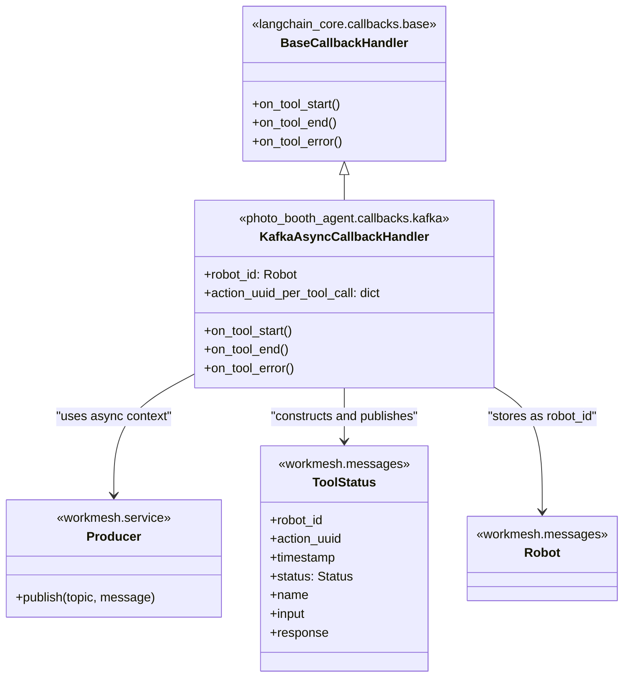
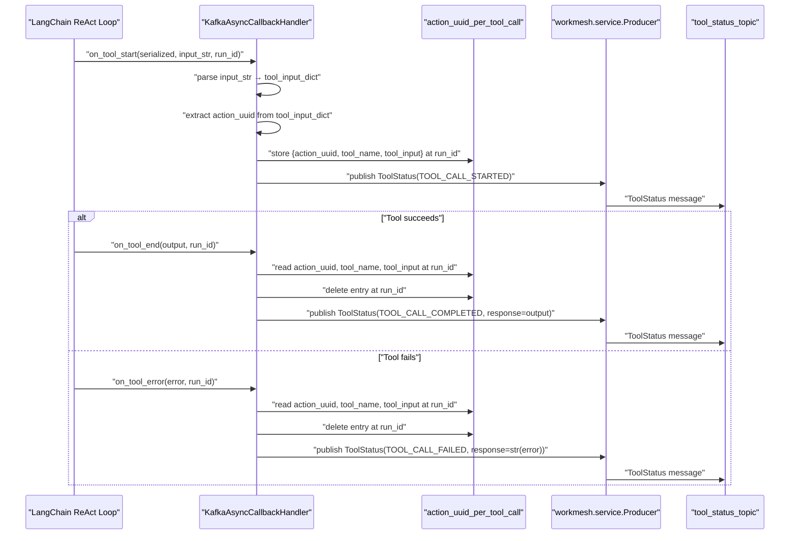
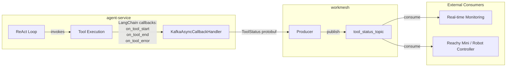

<!-- source: DeepWiki mcp.deepwiki.com · repo NVIDIA/spark-reachy-photo-booth · extra page Kafka Callbacks · fetched 2026-10-26 -->

# Kafka Callbacks

<details>
<summary>Relevant source files</summary>

The following files were used as context for generating this wiki page:

- [agent-service/README.md](agent-service/README.md)
- [agent-service/workflows/photo_booth_agent/src/photo_booth_agent/callbacks/__init__.py](agent-service/workflows/photo_booth_agent/src/photo_booth_agent/callbacks/__init__.py)
- [agent-service/workflows/photo_booth_agent/src/photo_booth_agent/callbacks/kafka.py](agent-service/workflows/photo_booth_agent/src/photo_booth_agent/callbacks/kafka.py)

</details>


This page covers the `KafkaAsyncCallbackHandler` class in the `photo_booth_agent` package — specifically, how it hooks into LangChain's callback system to publish tool lifecycle events onto the Kafka `tool_status_topic`. For context on the topics themselves and which services consume them, see [Kafka Messaging (Redpanda)](#3.1). For the tools whose execution this handler monitors, see [Tools](#2.3.1).

---

## Purpose

The agent executes tools asynchronously inside a ReAct loop. External services (e.g., the robot controller, monitoring dashboards) need to know when a tool starts, finishes, or fails — without polling the agent. `KafkaAsyncCallbackHandler` bridges this gap by translating LangChain's internal callback events into structured `ToolStatus` Protobuf messages that are published to the Kafka `tool_status_topic`.

---

## Class Overview

`KafkaAsyncCallbackHandler` is defined in [agent-service/workflows/photo_booth_agent/src/photo_booth_agent/callbacks/kafka.py]() and exported from [agent-service/workflows/photo_booth_agent/src/photo_booth_agent/callbacks/__init__.py]().

| Attribute / Method | Type | Description |
|---|---|---|
| `robot_id` | `Robot` | Identifies which robot instance is publishing events |
| `action_uuid_per_tool_call` | `dict[UUID, dict]` | In-flight tool state, keyed by LangChain `run_id` |
| `on_tool_start(...)` | `async` callback | Publishes `TOOL_CALL_STARTED` |
| `on_tool_end(...)` | `async` callback | Publishes `TOOL_CALL_COMPLETED`, clears state |
| `on_tool_error(...)` | `async` callback | Publishes `TOOL_CALL_FAILED`, clears state |

Sources: [agent-service/workflows/photo_booth_agent/src/photo_booth_agent/callbacks/kafka.py:17-21](), [agent-service/workflows/photo_booth_agent/src/photo_booth_agent/callbacks/__init__.py:1-6]()

---

## Inheritance and Dependencies

**Class hierarchy diagram: `KafkaAsyncCallbackHandler`**



Sources: [agent-service/workflows/photo_booth_agent/src/photo_booth_agent/callbacks/kafka.py:1-17]()

---

## Event Flow

**Sequence diagram: tool execution → Kafka event lifecycle**



Sources: [agent-service/workflows/photo_booth_agent/src/photo_booth_agent/callbacks/kafka.py:24-148]()

---

## State Tracking: `action_uuid_per_tool_call`

Because `on_tool_start`, `on_tool_end`, and `on_tool_error` are separate callback invocations, the handler uses a dict to persist context across them. The key is LangChain's `run_id` (`UUID`), which is stable for the lifetime of a single tool call.

| Dict Key | Value Field | Source |
|---|---|---|
| `run_id` | `action_uuid` | Extracted from `tool_input_dict` in `on_tool_start` |
| `run_id` | `tool_name` | `serialized["name"]` from `on_tool_start` |
| `run_id` | `tool_input` | Parsed `input_str` from `on_tool_start` |
| `run_id` | `tool_response` | Initialized as `""`, used in `on_tool_end`/`on_tool_error` |

The entry is deleted immediately after `on_tool_end` or `on_tool_error` constructs the outgoing `ToolStatus` message, preventing stale state.

Sources: [agent-service/workflows/photo_booth_agent/src/photo_booth_agent/callbacks/kafka.py:57-64](), [agent-service/workflows/photo_booth_agent/src/photo_booth_agent/callbacks/kafka.py:96-112](), [agent-service/workflows/photo_booth_agent/src/photo_booth_agent/callbacks/kafka.py:132-148]()

---

## Input Parsing in `on_tool_start`

LangChain passes `input_str` as a raw string. The handler attempts to deserialize it in order, falling back gracefully:

1. If `input_str` is already a `dict`, use it directly.
2. Try `json.loads(input_str)`.
3. Fall back to `ast.literal_eval(input_str)`.

This makes the handler tolerant of both JSON-formatted and Python-repr-formatted tool inputs.

Sources: [agent-service/workflows/photo_booth_agent/src/photo_booth_agent/callbacks/kafka.py:49-55]()

---

## `ToolStatus` Message Fields

Every published `ToolStatus` message includes the following fields:

| Field | Value | Notes |
|---|---|---|
| `robot_id` | `self.robot_id` | Set at handler construction |
| `action_uuid` | Extracted from tool input | Links the event to a specific agent action |
| `timestamp` | `int(time.time())` | Unix epoch seconds |
| `status` | `TOOL_CALL_STARTED` / `TOOL_CALL_COMPLETED` / `TOOL_CALL_FAILED` | `ToolStatus.Status` enum |
| `name` | Tool name string | From `serialized["name"]` |
| `input` | `dict_to_protobuf_map(tool_input_dict)` | Protobuf map representation of tool inputs |
| `response` | `str(output)` or `str(error)` | Only present on `COMPLETED` / `FAILED` |

`dict_to_protobuf_map` is imported from `workmesh` and converts a Python dict to the Protobuf map type used by `ToolStatus.input`.

Sources: [agent-service/workflows/photo_booth_agent/src/photo_booth_agent/callbacks/kafka.py:65-76](), [agent-service/workflows/photo_booth_agent/src/photo_booth_agent/callbacks/kafka.py:99-112](), [agent-service/workflows/photo_booth_agent/src/photo_booth_agent/callbacks/kafka.py:135-148]()

---

## Producer Usage Pattern

Every callback method opens a short-lived async context manager around `workmesh.service.Producer`:

```
async with Producer() as producer:
    await producer.publish(tool_status_topic, tool_status)
```

The `Producer` connects, publishes the single message, and closes. This avoids holding a long-lived connection. The `tool_status_topic` constant is imported directly from `workmesh`.

Sources: [agent-service/workflows/photo_booth_agent/src/photo_booth_agent/callbacks/kafka.py:65-76](), [agent-service/workflows/photo_booth_agent/src/photo_booth_agent/callbacks/kafka.py:96-112]()

---

## Data Flow in System Context

**Data flow diagram: callbacks within the broader service topology**



Sources: [agent-service/workflows/photo_booth_agent/src/photo_booth_agent/callbacks/kafka.py:1-148](), [agent-service/README.md:88-100]()

---

