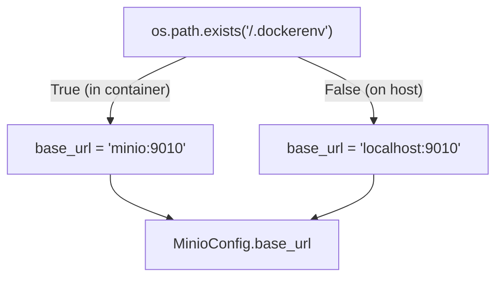
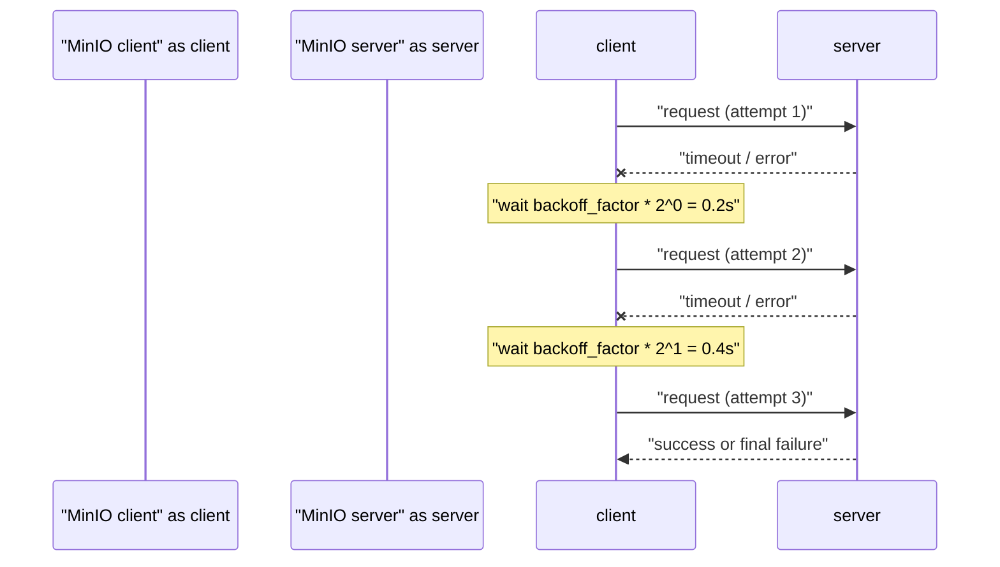
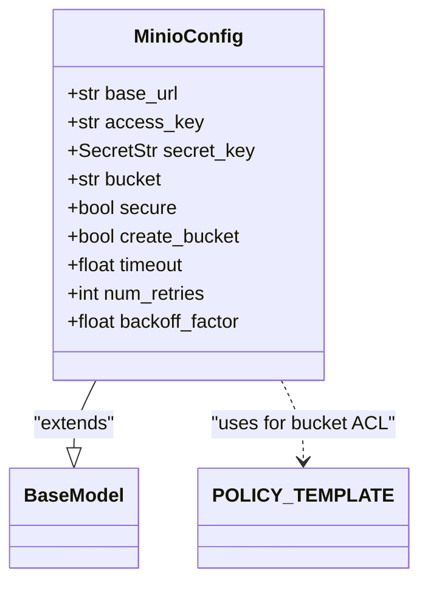

<!-- source: DeepWiki mcp.deepwiki.com · repo NVIDIA/spark-reachy-photo-booth · extra page MinIO Storage · fetched 2026-10-26 -->

# MinIO Storage

<details>
<summary>Relevant source files</summary>

The following files were used as context for generating this wiki page:

- [.env.example](.env.example)
- [agent-service/workflows/photo_booth_agent/src/photo_booth_agent/configs/__init__.py](agent-service/workflows/photo_booth_agent/src/photo_booth_agent/configs/__init__.py)
- [agent-service/workflows/photo_booth_agent/src/photo_booth_agent/configs/minio.py](agent-service/workflows/photo_booth_agent/src/photo_booth_agent/configs/minio.py)

</details>


This page documents the MinIO client configuration used within the `photo_booth_agent` package. It covers the `MinioConfig` class, its connection parameters, authentication model, bucket policy, and retry settings. For context on how MinIO is used during tool execution (e.g., uploading generated images), see the Tools page ([2.3.1](#2.3.1)). For environment variable setup during local development, see [Local Setup](#4.1).

---

## Role of MinIO in the Photo Booth Agent

MinIO provides S3-compatible object storage for the photo booth workflow. After the `generate_image` tool produces an image via the image-generator service, the result is uploaded to a MinIO bucket. The bucket is configured with a public-read policy so that the image URL can be shared (e.g., via QR code) without requiring authentication.

**Data flow diagram: Image upload path**

```mermaid
sequenceDiagram
    participant "Agent" as agent
    participant "generate_image tool" as tool
    participant "image-generator service" as imggen
    participant "MinIO (minio:9010)" as minio
    participant "End User / QR Code" as user

    agent->>tool: "invoke generate_image(prompt)"
    tool->>imggen: "POST /v1/infer"
    imggen-->>tool: "image bytes"
    tool->>minio: "put_object(bucket=photo-booth-agent, ...)"
    minio-->>tool: "object URL"
    tool-->>agent: "public URL"
    agent->>user: "display QR code with URL"
```

Sources: [agent-service/workflows/photo_booth_agent/src/photo_booth_agent/configs/minio.py:1-60]()

---

## `MinioConfig` Class

The `MinioConfig` class is a Pydantic `BaseModel` defined in `photo_booth_agent/configs/minio.py`. It encapsulates all parameters needed to connect to and interact with the MinIO service.

[agent-service/workflows/photo_booth_agent/src/photo_booth_agent/configs/minio.py:23-59]()

### Field Reference

| Field | Type | Default | Description |
|---|---|---|---|
| `base_url` | `str` | `minio:9010` (container) / `localhost:9010` (host) | MinIO service endpoint. Automatically switches based on `/.dockerenv` presence. |
| `access_key` | `str` | `MINIO_ACCESS_KEY` env var, fallback `minioadmin` | S3 access key identity. |
| `secret_key` | `SecretStr` | `MINIO_SECRET_KEY` env var, fallback `minioadmin` | S3 secret key. Wrapped in Pydantic `SecretStr` to prevent accidental logging. |
| `bucket` | `str` | `photo-booth-agent` | Name of the target bucket. |
| `secure` | `bool` | `False` | If `True`, uses HTTPS. Defaults to plain HTTP for internal cluster communication. |
| `create_bucket` | `bool` | `True` | If `True`, the agent will attempt to create the bucket on startup if it does not exist. |
| `timeout` | `float` | `5.0` | Per-request timeout in seconds. |
| `num_retries` | `int` | `3` | Number of retry attempts on transient failure. |
| `backoff_factor` | `float` | `0.2` | Exponential backoff multiplier between retries. |

Sources: [agent-service/workflows/photo_booth_agent/src/photo_booth_agent/configs/minio.py:23-59]()

---

## Endpoint Resolution

The `base_url` field uses a runtime check for `/.dockerenv` to decide which hostname to use:

- **Inside a container** (`/.dockerenv` exists): resolves to `minio:9010` — the internal Docker Compose service name.
- **On the host machine** (no `/.dockerenv`): resolves to `localhost:9010`.

This allows the same configuration class to work in both containerized and local development contexts without changes.



Sources: [agent-service/workflows/photo_booth_agent/src/photo_booth_agent/configs/minio.py:24-27]()

---

## Authentication

Authentication credentials are resolved at import time from environment variables, with hardcoded defaults as a fallback:

| Credential | Env Var Read | Default |
|---|---|---|
| `access_key` | `MINIO_ACCESS_KEY` | `minioadmin` |
| `secret_key` | `MINIO_SECRET_KEY` | `minioadmin` |

The `.env.example` file uses the variables `MINIO_ROOT_USER` and `MINIO_ROOT_PASSWORD` to configure the MinIO server itself, and the same values act as the access/secret key pair for the client:

[.env.example:3-4]()

> **Note:** In development, the MinIO server and client both default to `minioadmin`/`minioadmin`. For any deployment beyond a local demo, replace these with strong credentials via environment variables.

The `secret_key` field is typed as Pydantic's `SecretStr`, which prevents the value from appearing in logs or `repr()` output.

Sources: [agent-service/workflows/photo_booth_agent/src/photo_booth_agent/configs/minio.py:29-35](), [.env.example:1-5]()

---

## Bucket and Access Policy

The default bucket name is `photo-booth-agent` [agent-service/workflows/photo_booth_agent/src/photo_booth_agent/configs/minio.py:36-39]().

When `create_bucket` is `True`, the agent creates the bucket if absent and applies the `POLICY_TEMPLATE` defined at the top of `minio.py`:

[agent-service/workflows/photo_booth_agent/src/photo_booth_agent/configs/minio.py:8-20]()

The policy grants **public anonymous read** (`s3:GetObject`) to all objects (`*`) in the bucket. This is intentional: generated photo booth images are meant to be publicly accessible so users can retrieve them via a QR code without logging in.

**Policy summary:**

| Field | Value |
|---|---|
| Effect | `Allow` |
| Principal | `*` (public/anonymous) |
| Action | `s3:GetObject` |
| Resource | `arn:aws:s3:::photo-booth-agent/*` |

The `{bucket}` placeholder in `POLICY_TEMPLATE` is filled at runtime using Python's `.format(bucket=...)` call, allowing the policy to track whatever bucket name is configured in `MinioConfig`.

Sources: [agent-service/workflows/photo_booth_agent/src/photo_booth_agent/configs/minio.py:8-20]()

---

## Retry and Timeout Behavior

The retry parameters control resilience against transient MinIO failures:



| Parameter | Value | Effect |
|---|---|---|
| `timeout` | `5.0 s` | Max wait per individual request |
| `num_retries` | `3` | Total retry attempts after first failure |
| `backoff_factor` | `0.2` | Multiplier for exponential backoff delay |

Sources: [agent-service/workflows/photo_booth_agent/src/photo_booth_agent/configs/minio.py:48-59]()

---

## Config Class Relationship Diagram



Sources: [agent-service/workflows/photo_booth_agent/src/photo_booth_agent/configs/minio.py:23-59]()

---

