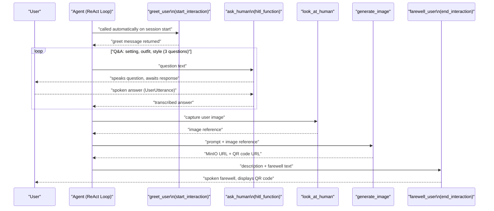
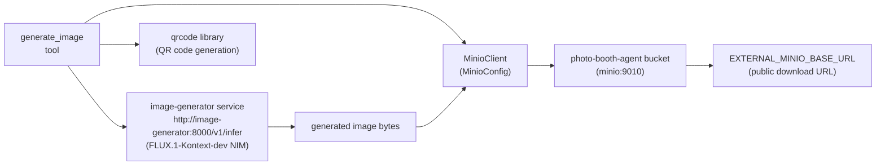
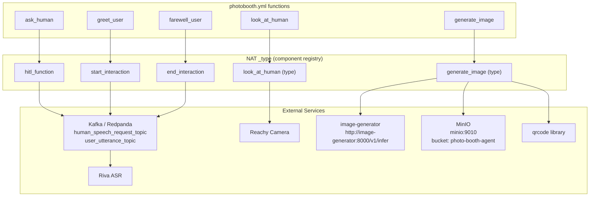

<!-- source: DeepWiki mcp.deepwiki.com · repo NVIDIA/spark-reachy-photo-booth · extra page Tools · fetched 2026-10-26 -->

# Tools

<details>
<summary>Relevant source files</summary>

The following files were used as context for generating this wiki page:

- [agent-service/README.md](agent-service/README.md)
- [agent-service/src/configs/photobooth.yml](agent-service/src/configs/photobooth.yml)
- [agent-service/workflows/photo_booth_agent/src/photo_booth_agent/configs/minio.py](agent-service/workflows/photo_booth_agent/src/photo_booth_agent/configs/minio.py)
- [agent-service/workflows/photo_booth_agent/src/photo_booth_agent/constant.py](agent-service/workflows/photo_booth_agent/src/photo_booth_agent/constant.py)

</details>


This page documents each tool available to the photo booth ReAct agent: its purpose, registered type, inputs, outputs, and external service dependencies. These tools constitute the agent's entire action space — everything the agent does is accomplished by invoking one of them.

For how the agent selects and invokes tools within the ReAct loop, see [ReAct Agent Loop](#2.1). For how tools are registered via the NAT component system, see [Photo Booth Agent Workflow](#2.3). For real-time tool status events emitted during execution, see [Kafka Callbacks](#2.3.2). For the MinIO storage details used by `generate_image`, see [MinIO Storage](#2.3.3).

---

## Tool Registration

Tools are declared in `photobooth.yml` under the `functions` key. Each entry binds a **tool name** (the identifier the LLM uses) to a **component type** (the `_type` field that the NAT registry resolves to a Python class). The `workflow.tool_names` list controls which declared tools are passed to the agent.

Sources: [agent-service/src/configs/photobooth.yml:12-28](), [agent-service/src/configs/photobooth.yml:46-56]()

**Tool Name to Component Type Mapping**

| Tool Name | `_type` | Order in Workflow |
|---|---|---|
| `greet_user` | `start_interaction` | 1 |
| `ask_human` | `hitl_function` | 2 |
| `look_at_human` | `look_at_human` | 3 |
| `generate_image` | `generate_image` | 4 |
| `farewell_user` | `end_interaction` | 5 |

The `_type` values are the keys the NAT component registry resolves at startup. They map to Python classes in `agent-service/workflows/photo_booth_agent/src/photo_booth_agent/tools/`.

---

## Typical Interaction Sequence

The following diagram shows the canonical order in which the agent invokes tools during a complete photo booth session. Not all paths are linear — the agent may loop on `ask_human` multiple times.

**Tool Invocation Flow: Photo Booth Session**



Sources: [agent-service/src/configs/photobooth.yml:46-56](), [agent-service/src/configs/photobooth.yml:116-143](), [agent-service/README.md:118-121]()

---

## Tool Reference

### `greet_user` — `start_interaction`

**Purpose:** Initiates a new photo booth session. Emits a greeting message to the user and performs any session-open setup. This tool is called automatically by the workflow at the start of each interaction — the agent cannot and should not call it manually.

**Configuration:**

```yaml
greet_user:
  _type: start_interaction
```

The `greet_message` list in `photobooth.yml` (lines 68–78) provides ten randomized welcome messages that `start_interaction` selects from when greeting a new visitor.

**Inputs:** None (invoked by the workflow engine, not the LLM).

**Outputs:** A greeting string delivered via the speech/display system.

**External dependencies:** None beyond the Kafka topic for emitting speech requests.

Sources: [agent-service/src/configs/photobooth.yml:25-26](), [agent-service/src/configs/photobooth.yml:68-78](), [agent-service/src/configs/photobooth.yml:195-201]()

---

### `ask_human` — `hitl_function`

**Purpose:** Human-in-the-Loop (HITL) callback. When the agent calls this tool, it suspends the ReAct loop and publishes a `HumanSpeechRequest` to Kafka, causing the system to speak the provided text and wait for the user's next `UserUtterance`. Execution resumes once the user responds.

This is the primary tool through which the agent communicates with the user: asking questions, describing results, refusing inappropriate requests, or providing status updates.

**Configuration:**

```yaml
ask_human:
  _type: hitl_function
  prompt: ""
```

The `prompt` field is intentionally empty; the agent supplies the actual text at call time.

**Inputs:**

| Parameter | Type | Description |
|---|---|---|
| `input` | `string` | Text to speak to the user |

**Outputs:** The user's transcribed response (from Riva ASR via the `UserUtterance` Kafka message).

**External dependencies:**
- **Kafka** — publishes to `human_speech_request_topic`, awaits `user_utterance_topic`
- **Riva ASR** — processes the user's speech into text upstream of this tool

**Notes:** When `allow_null_tool` is `false` (as configured in `photobooth.yml` line 66), the workflow falls back to this tool (`human_feedback_tool: ask_human`) if the LLM produces a null tool call. This prevents the agent from silently stalling.

Sources: [agent-service/src/configs/photobooth.yml:13-15](), [agent-service/src/configs/photobooth.yml:66-67](), [agent-service/src/configs/photobooth.yml:154-160]()

---

### `look_at_human` — `look_at_human`

**Purpose:** Captures a still image of the person currently in front of the Reachy robot's camera. The captured image becomes the input frame for subsequent `generate_image` calls. The instructions in `photobooth.yml` mandate that `look_at_human` must always be called immediately before `generate_image` — previously captured frames must never be reused.

**Configuration:**

```yaml
look_at_human:
  _type: look_at_human
```

**Inputs:** None (the camera is the implicit input source).

**Outputs:** An image reference (file path or object identifier) passed to the agent and used as input to `generate_image`.

**External dependencies:**
- **Reachy robot camera** — the physical USB/embedded camera on the robot

Sources: [agent-service/src/configs/photobooth.yml:17-18](), [agent-service/src/configs/photobooth.yml:116-116](), [agent-service/README.md:118-121]()

---

### `generate_image` — `generate_image`

**Purpose:** Sends the captured image and a text prompt to the FLUX.1 image generation NIM, retrieves the generated result, uploads it to MinIO object storage, and returns a public URL and QR code URL for the user to download their photo.

**Configuration:**

```yaml
generate_image:
  _type: generate_image
  base_url: http://image-generator:8000/v1/infer
  disable_safety_checker: true
  steps: 20
  external_minio:
    base_url: ${EXTERNAL_MINIO_BASE_URL}
```

| Config Key | Value | Description |
|---|---|---|
| `base_url` | `http://image-generator:8000/v1/infer` | FLUX NIM inference endpoint |
| `disable_safety_checker` | `true` | Bypasses the model's built-in safety filter (safety is handled at the agent prompt level) |
| `steps` | `20` | Number of diffusion steps |
| `external_minio.base_url` | `${EXTERNAL_MINIO_BASE_URL}` | Publicly-reachable MinIO URL for QR code generation |

**Inputs:**

| Parameter | Type | Description |
|---|---|---|
| `prompt` | `string` | Image transformation instruction (see prompt format below) |
| `image` | `reference` | Image captured by `look_at_human` |

**Prompt format:** The agent is instructed to use an action-based format:

```
Restyle the entire image to [style], change [what] to [new state],
while keeping the subject(s) in the exact same position, scale, and pose,
and preserving their exact facial features, hairstyle, gender, body type, age, and ethnicity.
```

**Outputs:**
- Internal MinIO object URL (not spoken aloud)
- Public-facing URL for QR code display
- QR code image reference

**External dependencies:**



MinIO bucket and connection details are governed by `MinioConfig` in [agent-service/workflows/photo_booth_agent/src/photo_booth_agent/configs/minio.py:23-59]().

**Constraints enforced by agent instructions:**
- Exactly one image per interaction; no edits or re-generations
- The URL is never spoken aloud; only a human-friendly description is given
- `look_at_human` must precede every call — no cached frames

Sources: [agent-service/src/configs/photobooth.yml:19-24](), [agent-service/src/configs/photobooth.yml:116-133](), [agent-service/src/configs/photobooth.yml:145-152](), [agent-service/workflows/photo_booth_agent/src/photo_booth_agent/configs/minio.py:23-59]()

---

### `farewell_user` — `end_interaction`

**Purpose:** Closes the photo booth session. In a single call, the agent provides: (1) an entertaining description of the generated image, (2) an invitation to download via QR code, and (3) a farewell message. The tool then resets session state so the booth is ready for the next visitor.

**Configuration:**

```yaml
farewell_user:
  _type: end_interaction
```

**Inputs:**

| Parameter | Type | Description |
|---|---|---|
| `input` | `string` | Combined farewell text: image description + QR code prompt + goodbye |

**Outputs:** Emits a session-end event; the spoken farewell text is routed through the speech system.

**Usage constraints:**
- Must be called exactly once, after `generate_image` completes
- Must NOT be used to refuse inappropriate requests (use `ask_human` for refusals)
- Cannot be called before an image has been generated (unless the user explicitly asks to leave early)

**External dependencies:** None beyond Kafka for emitting session-end signals.

Sources: [agent-service/src/configs/photobooth.yml:27-28](), [agent-service/src/configs/photobooth.yml:118-130](), [agent-service/src/configs/photobooth.yml:195-200]()

---

## Tool Dependency Map

The following diagram maps each tool to its registered type and external service dependencies, bridging tool names (as the LLM sees them) to the code and infrastructure entities they touch.

**Tool → Type → External Dependency Map**



Sources: [agent-service/src/configs/photobooth.yml:12-56](), [agent-service/workflows/photo_booth_agent/src/photo_booth_agent/configs/minio.py:23-59](), [agent-service/README.md:118-121]()

---

