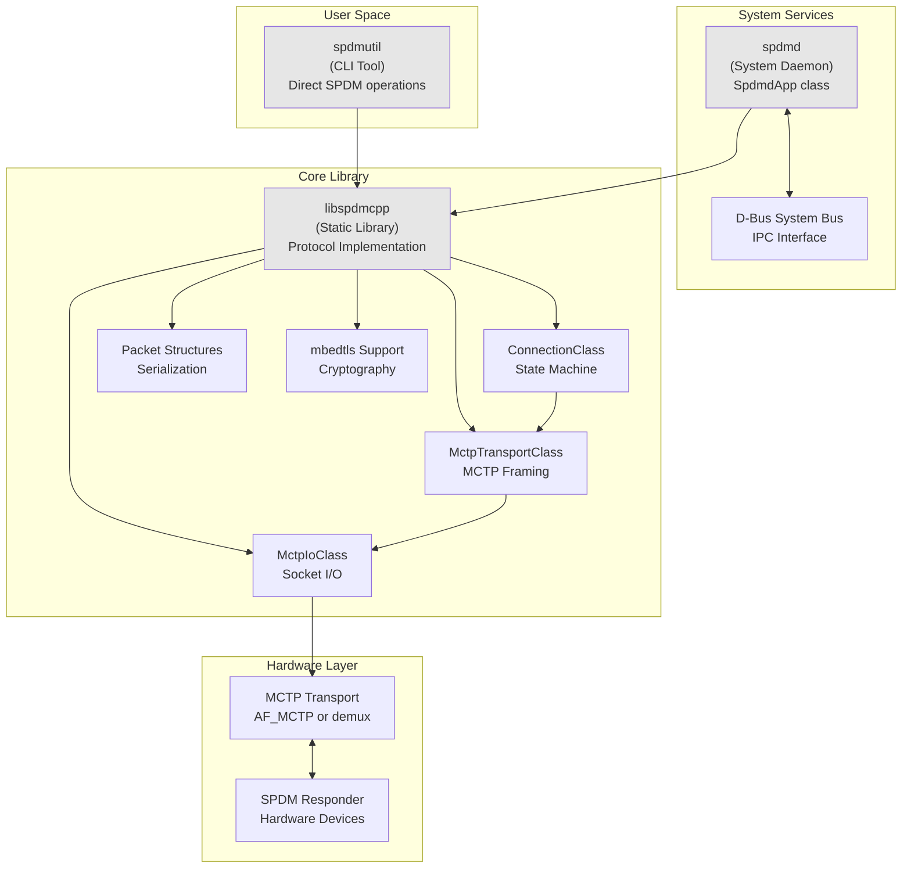
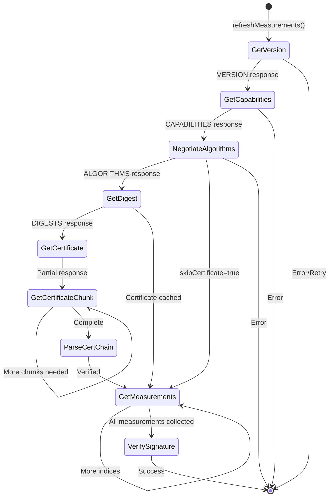
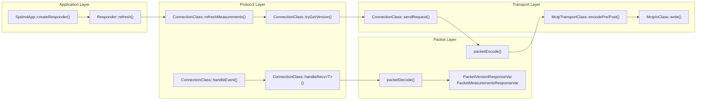
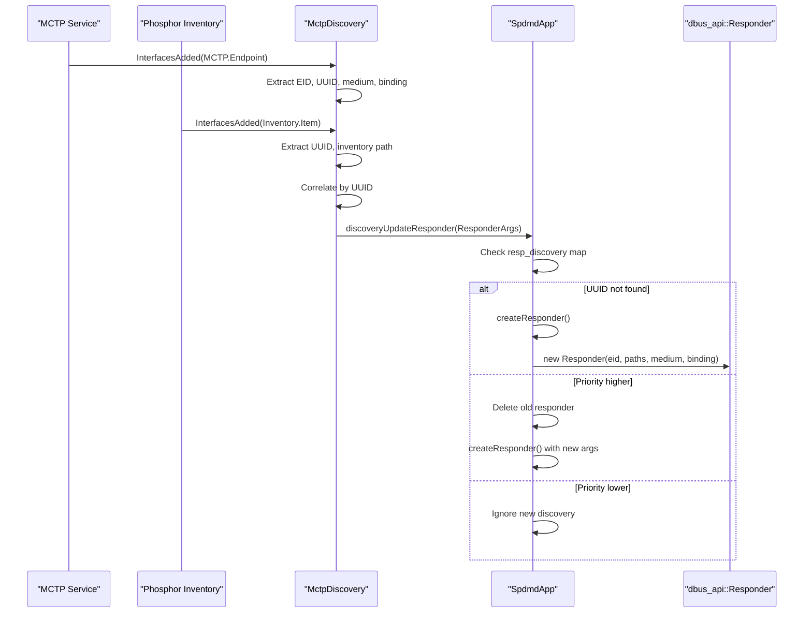

<!-- source: DeepWiki mcp.deepwiki.com · repo NVIDIA/spdm · page 1 Overview · fetched 2026-10-26 -->

# Overview

Relevant source files

The following files were used as context for generating this wiki page:

- [config.h.in](config.h.in)
- [libspdmcpp/connection.cpp](libspdmcpp/connection.cpp)
- [libspdmcpp/headers_public/spdmcpp/connection.hpp](libspdmcpp/headers_public/spdmcpp/connection.hpp)
- [libspdmcpp/headers_public/spdmcpp/connection_inl.hpp](libspdmcpp/headers_public/spdmcpp/connection_inl.hpp)
- [libspdmcpp/tests/connection_test.cpp](libspdmcpp/tests/connection_test.cpp)
- [meson.build](meson.build)
- [meson_options.txt](meson_options.txt)
- [spdmd/spdmd.cpp](spdmd/spdmd.cpp)
- [spdmd/spdmd_app.hpp](spdmd/spdmd_app.hpp)

## Purpose and Scope

The NVIDIA SPDM project provides a complete implementation of the Security Protocol and Data Model (SPDM) specification for OpenBMC environments. This implementation enables secure hardware attestation, measurement collection, and certificate management for devices that support the SPDM protocol over MCTP (Management Component Transport Protocol) transport.

The project consists of three primary components:
- **libspdmcpp**: A C++ library implementing the SPDM protocol state machine and packet handling
- **spdmd**: A system daemon that discovers SPDM-capable devices and exposes them via D-Bus interfaces
- **spdmutil**: A command-line utility for direct SPDM communication and testing

For detailed information about specific subsystems, see:
- Library implementation details: [libspdmcpp Library](#2)
- Daemon architecture and D-Bus interfaces: [spdmd Daemon](#3)
- Command-line tool usage: [spdmutil Command-Line Tool](#4)
- Build configuration options: [Build System and Configuration](#1.2)

**Sources:** [meson.build:1-110](), [README.md](), [libspdmcpp/](), [spdmd/](), [spdmutil/]()

## Project Components

### Component Architecture

**Sources:** [spdmd/spdmd.cpp:1-545](), [spdmutil/spdmutil.cpp](), [libspdmcpp/connection.hpp:1-907]()

### libspdmcpp Library

The `libspdmcpp` library is a static library built from C++23 source code that implements the SPDM protocol specification. It provides:

| Component | Purpose | Key Classes |
|-----------|---------|-------------|
| Protocol Engine | SPDM state machine implementation | `ConnectionClass` |
| Transport Layer | MCTP packet framing and I/O | `MctpTransportClass`, `MctpIoClass` |
| Packet Handling | Message serialization/deserialization | `PacketVersionResponseVar`, `PacketMeasurementsResponseVar` |
| Cryptography | Certificate parsing, hashing, signature verification | `HashClass`, `mbedtls_x509_crt` wrappers |
| Context Management | Global configuration and I/O registry | `ContextClass` |

The library is transport-agnostic through abstract `TransportClass` and `IOClass` interfaces, with concrete MCTP implementations provided.

**Sources:** [libspdmcpp/connection.hpp:136-906](), [libspdmcpp/connection.cpp:1-1763](), [meson.build:104]()

### spdmd Daemon

The `spdmd` daemon is a system service that:
- Discovers SPDM-capable endpoints via D-Bus signals from MCTP services and phosphor-inventory
- Creates `dbus_api::Responder` objects for each discovered device
- Exposes SPDM device status, capabilities, certificates, and measurements through D-Bus properties
- Handles asynchronous SPDM communication using boost::asio event loop
- Supports automatic measurement collection on device discovery

The daemon integrates with the OpenBMC D-Bus ecosystem, making SPDM data accessible to other system services.

**Sources:** [spdmd/spdmd.cpp:1-545](), [spdmd/spdmd_app.hpp:1-189](), [spdmd/dbus_impl_responder.hpp]()

### spdmutil Command-Line Tool

The `spdmutil` utility provides direct command-line access to SPDM operations for testing and debugging:
- Send individual SPDM commands (GET_VERSION, GET_CAPABILITIES, etc.)
- Retrieve certificates and measurements from responders
- Output results in JSON format
- Useful for development, testing, and manual device interrogation

**Sources:** [spdmutil/spdmutil.cpp](), [meson.build:109]()

## SPDM Protocol Implementation

### Protocol Flow State Machine

The `ConnectionClass` implements this state machine through a series of `try*()` and `handleRecv<T>()` methods:
- `tryGetVersion()` / `handleRecv<PacketVersionResponseVar>()`
- `tryGetCapabilities()` / `handleRecv<PacketCapabilitiesResponse>()`
- `tryNegotiateAlgorithms()` / `handleRecv<PacketAlgorithmsResponseVar>()`
- `tryGetDigest()` / `handleRecv<PacketDigestsResponseVar>()`
- `tryGetCertificate()` / `handleRecv<PacketCertificateResponseVar>()`
- `tryGetMeasurements()` / `handleRecv<PacketMeasurementsResponseVar>()`

Each phase appends protocol messages to internal buffers (BufA, BufB, BufL) for computing transcript hashes required by the SPDM specification.

**Sources:** [libspdmcpp/connection.cpp:354-1100](), [libspdmcpp/connection.hpp:456-464]()

### Code Entity Mapping

**Sources:** [spdmd/spdmd.cpp:336-387](), [libspdmcpp/connection.cpp:114-164](), [libspdmcpp/connection_inl.hpp:26-92]()

## Transport Modes

The implementation supports two MCTP transport modes, selected at compile time via the `MCTP_IN_KERNEL` build option:

### Kernel Mode (AF_MCTP)

When `MCTP_IN_KERNEL` is enabled, the library uses the in-kernel MCTP stack via `AF_MCTP` sockets. This mode provides:
- Direct kernel-level MCTP protocol handling
- Lower latency communication
- Integration with the Linux kernel MCTP subsystem

The daemon creates a single socket connection via `MctpIoClass::createSocket()` without a path argument, which binds to the kernel MCTP interface.

**Sources:** [config.h.in:26](), [meson_options.txt:17](), [spdmd/spdmd.cpp:524-526]()

### Userspace Mode (Demux Daemon)

When `MCTP_IN_KERNEL` is disabled, the library communicates with the `mctp-demux-daemon` userspace service via Unix domain sockets. This mode:
- Uses per-endpoint socket paths (e.g., `/tmp/mctp-socket-{eid}`)
- Supports environments where kernel MCTP is unavailable
- Allows multiple processes to communicate with MCTP endpoints

The daemon creates separate socket connections for each discovered endpoint via `MctpIoClass::createSocket(sockPath)`.

**Sources:** [spdmd/spdmd.cpp:118-175](), [libspdmcpp/connection_inl.hpp:86-91]()

## Build System Configuration

The project uses Meson as its build system with extensive compile-time configurability:

### Core Build Options

| Option | Type | Purpose | Default |
|--------|------|---------|---------|
| `enable-in-kernel-mctp` | feature | Use kernel MCTP stack (AF_MCTP) instead of demux daemon | disabled |
| `discovery_only_from_mctp_control` | feature | Restrict discovery to MCTP Control daemon signals only | disabled |
| `fetch_serialnumber_from_responder` | integer (0-254) | Measurement index for serial number retrieval | 0 (disabled) |
| `csm_service_enabled` | feature | Enable CSM service dependency checking | enabled |
| `conf_file_name` | string | Path to spdmd JSON configuration file | "/etc/spdmd_conf.json" |

These options are processed into `config.h` via `config.h.in` template substitution and control conditional compilation throughout the codebase.

**Sources:** [meson_options.txt:1-20](), [config.h.in:1-29](), [meson.build:29-52]()

### Dependencies

The project requires the following external dependencies:

**Cryptography:**
- `mbedcrypto`: Core cryptographic operations
- `mbedx509`: X.509 certificate parsing and validation

**D-Bus (daemon only):**
- `sdbusplus`: C++ D-Bus bindings
- `phosphor-dbus-interfaces`: OpenBMC D-Bus interface definitions
- `sdeventplus`: Event loop integration

**Utilities:**
- `CLI11`: Command-line parsing (spdmutil only)
- `nlohmann_json`: JSON configuration parsing (spdmd only)
- `boost::asio`: Asynchronous I/O (spdmd only)

**Sources:** [meson.build:54-102]()

## Discovery and Responder Management

### Discovery Mechanism

The `MctpDiscovery` class monitors D-Bus for:
- `InterfacesAdded` signals on `/xyz/openbmc_project/mctp` from `au.com.CodeConstruct.MCTP1` service
- `InterfacesAdded` signals on inventory paths from `xyz.openbmc_project.Inventory.Manager`

When both MCTP and inventory objects share the same UUID, a `ResponderArgs` structure is created and passed to `SpdmdApp::discoveryUpdateResponder()`. The application maintains a `resp_discovery` map keyed by UUID to track discovered devices and implements priority-based selection when multiple transport paths exist for the same device.

**Sources:** [spdmd/mctp_endpoint_discovery.hpp](), [spdmd/spdmd.cpp:294-334](), [spdmd/spdmd_app.hpp:169]()

### Priority-Based Selection

The daemon prioritizes transport mediums and binding types by bandwidth when multiple paths exist:

**Medium Priority (highest to lowest):**
PCIe > USB > SPI > I3C > KCS > Serial > SMBus

**Binding Priority (highest to lowest):**
PCIe > USB > SPI > I3C > KCS > Serial > SMBus

The `needRecreateResponder()` method compares medium priorities first, then binding priorities if mediums match, ensuring the highest-bandwidth path is selected for each device.

**Sources:** [spdmd/spdmd_app.hpp:54-73](), [spdmd/spdmd.cpp:225-292]()

## Configuration and Deployment

### Runtime Configuration

The daemon reads configuration from `/etc/spdmd_conf.json` (configurable via `conf_file_name` build option). The configuration file supports:
- Per-EID measurement settings
- Automatic measurement collection parameters
- Logging configuration

The daemon also supports command-line options:
- `-v, --verbose <0-7>`: Set log verbosity level
- `--cached_measurements <all|eid1,eid2,...>`: Enable automatic measurements on discovery
- `--cached_measurements_delay <seconds>`: Delay before initial measurements (default: 60)

**Sources:** [spdmd/spdmd.cpp:49-116](), [spdmd/spdmd_app_context.hpp](), [config.h.in:17]()

### systemd Integration

When built with `systemd` feature enabled, the project includes a systemd service unit for `spdmd`. The daemon supports:
- systemd watchdog notifications
- Automatic restart on failure
- D-Bus activation
- Integration with OpenBMC service dependencies

**Sources:** [meson.build:3](), [spdmd/meson.build]()

---

