<!-- source: DeepWiki mcp.deepwiki.com · repo NVIDIA/spdm · page 1.1 System Architecture · fetched 2026-10-26 -->

# System Architecture

Relevant source files

The following files were used as context for generating this wiki page:

- [libspdmcpp/connection.cpp](libspdmcpp/connection.cpp)
- [libspdmcpp/headers_public/spdmcpp/connection.hpp](libspdmcpp/headers_public/spdmcpp/connection.hpp)
- [libspdmcpp/headers_public/spdmcpp/connection_inl.hpp](libspdmcpp/headers_public/spdmcpp/connection_inl.hpp)
- [libspdmcpp/tests/connection_test.cpp](libspdmcpp/tests/connection_test.cpp)
- [spdmd/dbus_impl_responder.cpp](spdmd/dbus_impl_responder.cpp)
- [spdmd/dbus_impl_responder.hpp](spdmd/dbus_impl_responder.hpp)
- [spdmd/spdmd.cpp](spdmd/spdmd.cpp)
- [spdmd/spdmd_app.hpp](spdmd/spdmd_app.hpp)

## Purpose and Scope

This document describes the overall architecture of the NVIDIA SPDM implementation, focusing on how the three main components—`spdmd` daemon, `libspdmcpp` library, and `spdmutil` CLI tool—interact with each other and with external systems including D-Bus, MCTP transport, and SPDM-capable hardware devices.

For detailed information about specific subsystems:
- Build configuration and compile-time options: see [Build System and Configuration](#1.2)
- libspdmcpp library internals: see [libspdmcpp Library](#2)
- spdmd daemon implementation details: see [spdmd Daemon](#3)
- spdmutil command-line tool: see [spdmutil Command-Line Tool](#4)

---

## System Components

The NVIDIA SPDM implementation consists of three primary executable components and one library:

| Component | Type | Purpose | Key Classes |
|-----------|------|---------|-------------|
| **spdmd** | System Daemon | Manages SPDM communication, exposes D-Bus interfaces | `SpdmdApp`, `dbus_api::Responder` |
| **libspdmcpp** | Static Library | SPDM protocol implementation | `ConnectionClass`, `MctpTransportClass` |
| **spdmutil** | CLI Tool | Manual SPDM operations via command line | N/A (utility functions) |

### Component Architecture

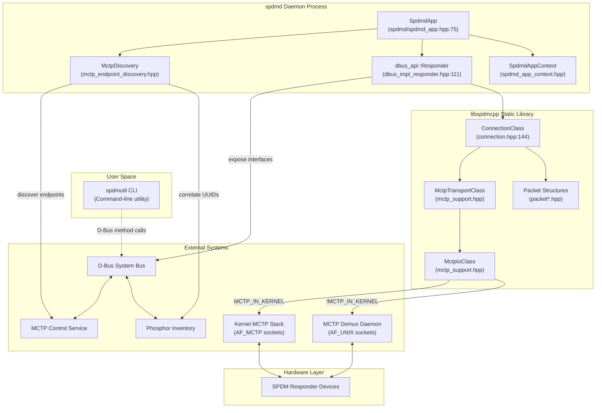

**Sources:** [spdmd/spdmd_app.hpp](), [spdmd/dbus_impl_responder.hpp](), [libspdmcpp/headers_public/spdmcpp/connection.hpp]()

---

## Protocol Stack Layering

The SPDM implementation follows a layered architecture from application logic down to hardware communication:

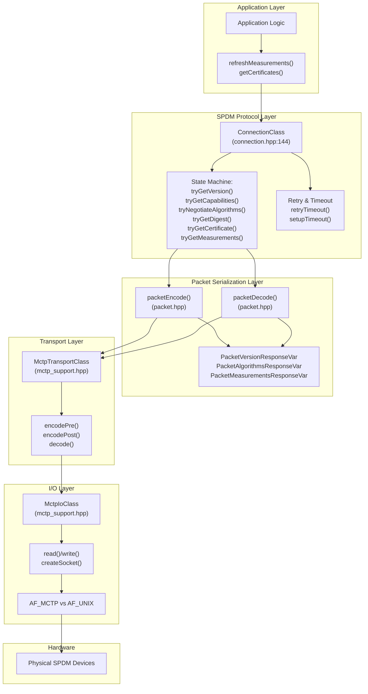

**Sources:** [libspdmcpp/connection.cpp:354-945](), [libspdmcpp/headers_public/spdmcpp/connection.hpp:456-465]()

---

## Daemon Architecture

The `spdmd` daemon orchestrates SPDM operations, managing multiple SPDM responder devices through D-Bus interfaces:

### Daemon Component Relationships

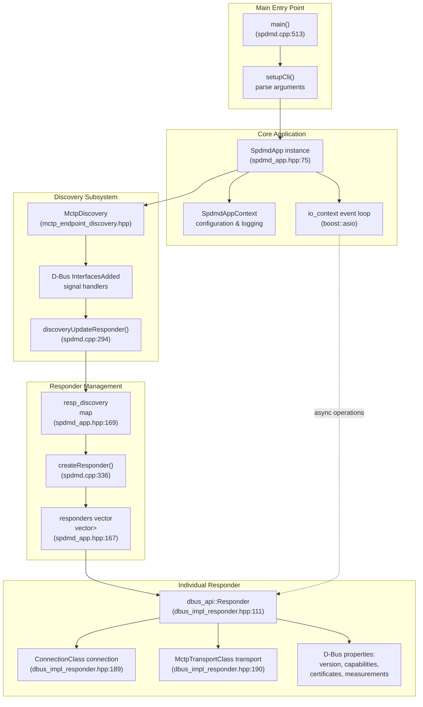

**Sources:** [spdmd/spdmd.cpp:513-544](), [spdmd/spdmd_app.hpp:75-186](), [spdmd/dbus_impl_responder.hpp:111-225]()

---

## Communication Flow

### MCTP Transport Modes

The system supports two MCTP transport modes, selected at compile time via the `MCTP_IN_KERNEL` flag:

| Mode | Socket Type | Description |
|------|-------------|-------------|
| **Kernel Mode** | `AF_MCTP` | Direct kernel MCTP stack communication |
| **Userspace Mode** | `AF_UNIX` | Communication via mctp-demux-daemon |

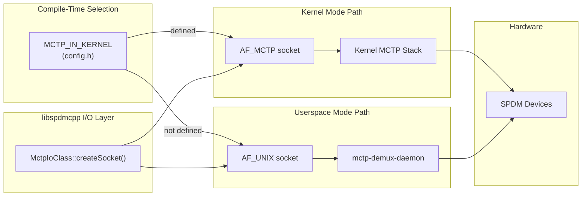

**Sources:** [libspdmcpp/connection_inl.hpp:86-90](), [spdmd/spdmd.cpp:524-526]()

### MCTP Packet Reception

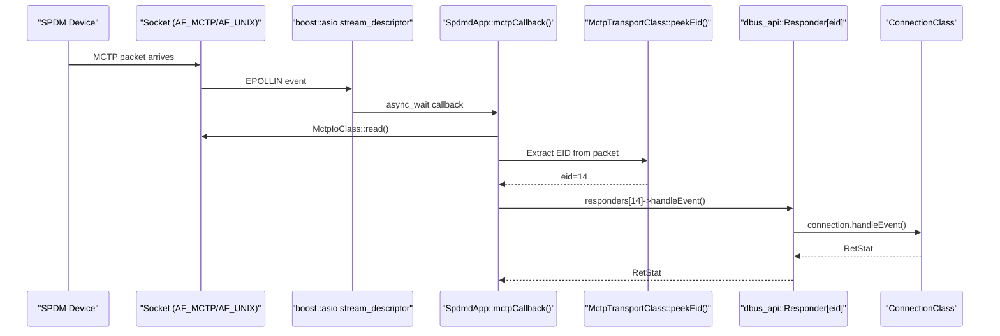

**Sources:** [spdmd/spdmd.cpp:423-486](), [spdmd/spdmd.cpp:118-175]()

---

## D-Bus Integration

The daemon exposes SPDM functionality through D-Bus interfaces, allowing external OpenBMC services to interact with SPDM responders:

### D-Bus Interface Hierarchy

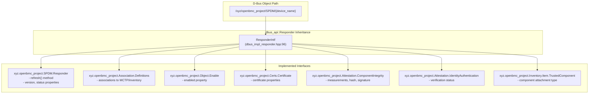

**Sources:** [spdmd/dbus_impl_responder.hpp:96-104]()

### Refresh Operation Flow

The `refresh()` D-Bus method triggers a complete SPDM measurement cycle:

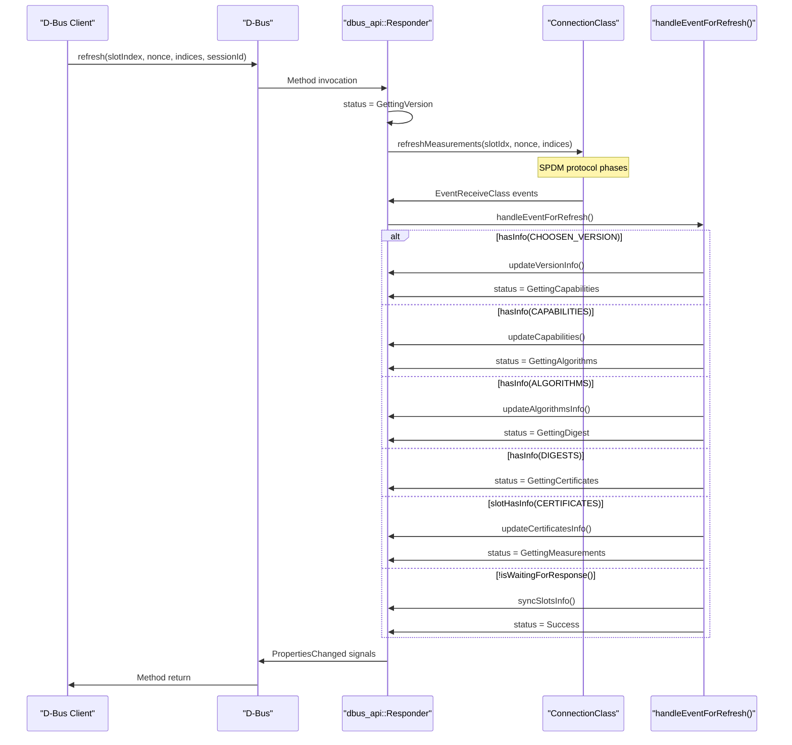

**Sources:** [spdmd/dbus_impl_responder.cpp:386-481](), [spdmd/dbus_impl_responder.cpp:330-384]()

---

## ConnectionClass State Machine

The `ConnectionClass` implements the SPDM protocol as a state machine, coordinating the multi-phase handshake:

### Protocol Phase Transitions

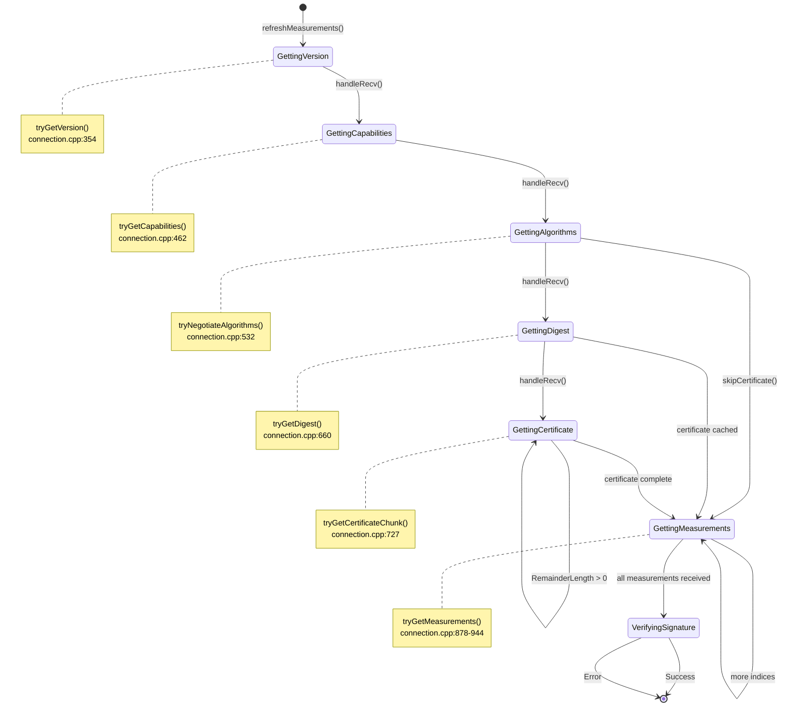

**Sources:** [libspdmcpp/connection.cpp:354-1104]()

### Key ConnectionClass Methods

| Method | Purpose | Line Reference |
|--------|---------|----------------|
| `refreshMeasurements()` | Entry point for measurement flow | [connection.cpp:114-147]() |
| `tryGetVersion()` | Negotiate SPDM version | [connection.cpp:354-371]() |
| `tryGetCapabilities()` | Exchange capabilities | [connection.cpp:462-495]() |
| `tryNegotiateAlgorithms()` | Select crypto algorithms | [connection.cpp:532-573]() |
| `tryGetDigest()` | Request certificate digests | [connection.cpp:660-673]() |
| `tryGetCertificate()` | Request certificate chain | [connection.cpp:860-876]() |
| `tryGetMeasurements()` | Request measurements | [connection.cpp:878-909]() |
| `handleEvent()` | Process receive/timeout events | [connection.cpp:1318-1356]() |

**Sources:** [libspdmcpp/connection.cpp](), [libspdmcpp/headers_public/spdmcpp/connection.hpp:144-448]()

---

## Buffer Management for Transcript Hashing

The SPDM 1.2 specification requires computing hashes over communication transcripts. `ConnectionClass` maintains three buffers:

### Buffer Architecture

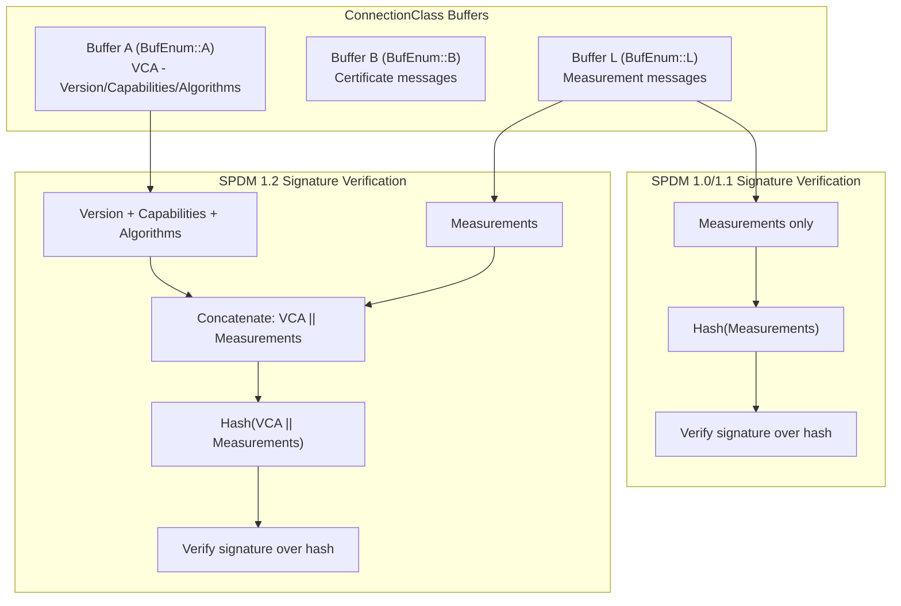

**Sources:** [libspdmcpp/connection.cpp:1028-1060](), [libspdmcpp/headers_public/spdmcpp/connection.hpp:476-486]()

### Buffer Usage Pattern

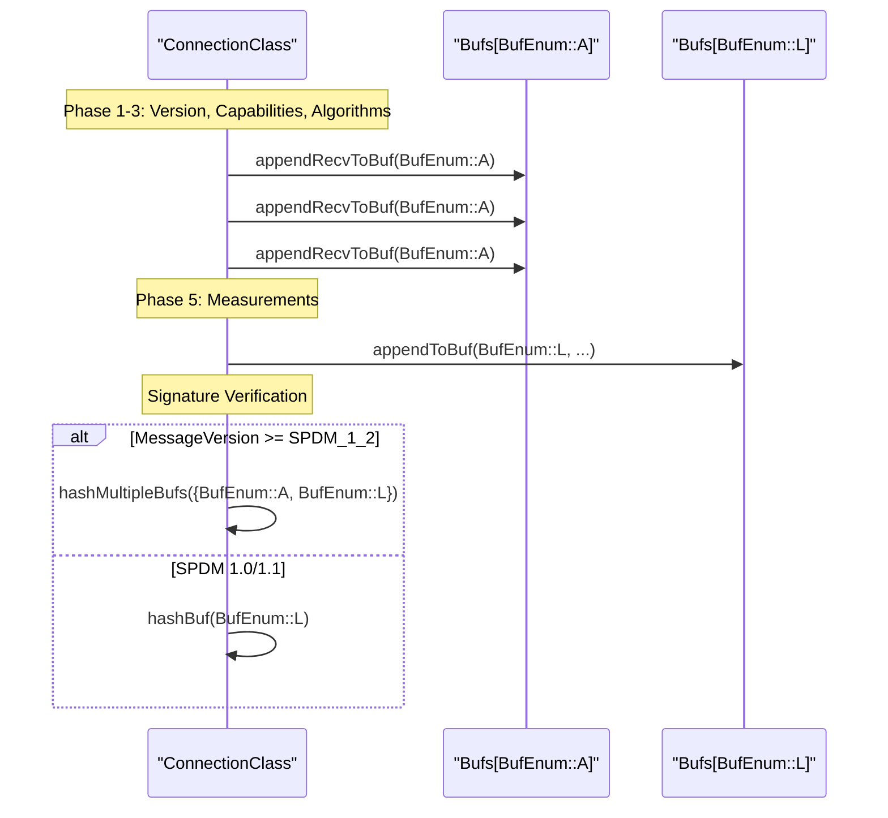

**Sources:** [libspdmcpp/connection.cpp:411-416](), [libspdmcpp/connection.cpp:1030-1041]()

---

## Event-Driven Architecture

The system uses an asynchronous, event-driven model with `boost::asio`:

### Event Loop Integration

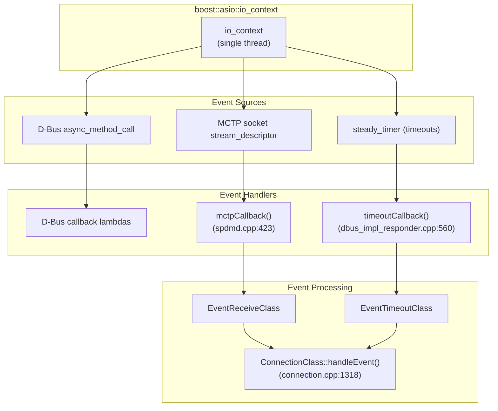

**Sources:** [spdmd/spdmd.cpp:423-486](), [spdmd/dbus_impl_responder.cpp:543-568](), [libspdmcpp/connection.cpp:1318-1356]()

---

## Discovery Mechanism

The daemon discovers SPDM responders through D-Bus signals, correlating MCTP endpoints with inventory items by UUID:

### Discovery Flow

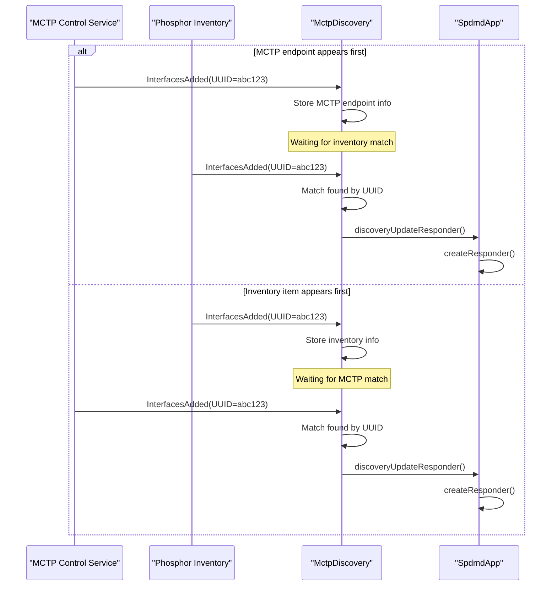

**Sources:** [spdmd/spdmd.cpp:294-334](), [spdmd/spdmd_app.hpp:115]()

### Priority-Based Responder Recreation

When multiple transports exist for the same device, the system selects the highest priority:

| Priority Level | MCTP Medium | Binding Type |
|----------------|-------------|--------------|
| 0 (highest) | PCIe | PCIe |
| 1 | USB | USB |
| 2 | SPI | SPI |
| 3 | I3C | I3C |
| 4 | KCS | KCS |
| 5 | Serial | Serial |
| 6 (lowest) | SMBus | SMBus |

**Sources:** [spdmd/spdmd_app.hpp:54-73](), [spdmd/spdmd.cpp:225-292]()

---

## Summary

The NVIDIA SPDM implementation provides a layered architecture where:

1. **libspdmcpp** implements the SPDM protocol state machine and packet handling
2. **spdmd** daemon manages multiple SPDM devices, exposing their status through D-Bus
3. **spdmutil** provides direct command-line access to SPDM operations
4. Communication occurs via MCTP transport (kernel or userspace mode)
5. Discovery happens automatically through D-Bus signal monitoring
6. The event loop coordinates asynchronous operations across D-Bus, MCTP, and timers

This architecture enables OpenBMC services to attest hardware components using the SPDM security protocol while maintaining flexibility in transport mechanisms and deployment scenarios.

---

