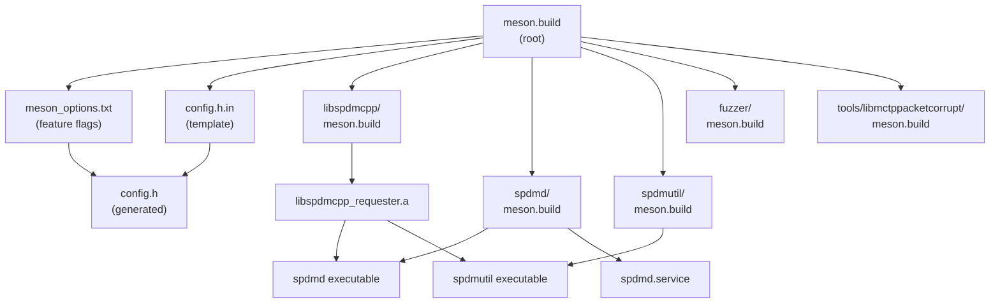
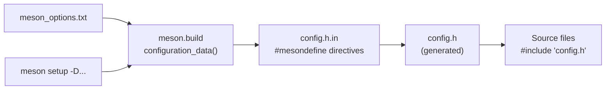
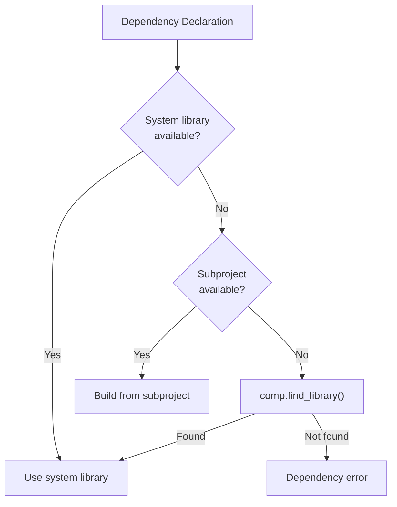
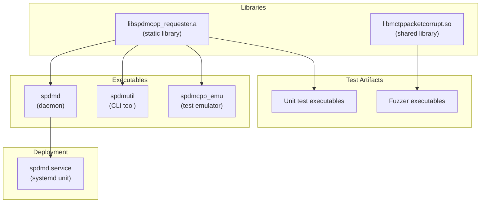
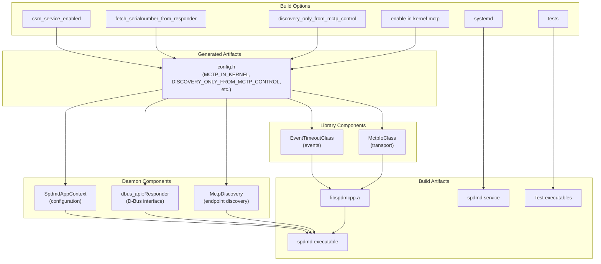

<!-- source: DeepWiki mcp.deepwiki.com · repo NVIDIA/spdm · page 1.2 Build System and Configuration · fetched 2026-10-26 -->

# Build System and Configuration

<details>
<summary>Relevant source files</summary>

The following files were used as context for generating this wiki page:

- [config.h.in](config.h.in)
- [libspdmcpp/headers_public/spdmcpp/event.hpp](libspdmcpp/headers_public/spdmcpp/event.hpp)
- [meson.build](meson.build)
- [meson_options.txt](meson_options.txt)
- [spdmd/meson.build](spdmd/meson.build)
- [spdmd/tests/meson.build](spdmd/tests/meson.build)
- [tools/libmctppacketcorrupt/random.c](tools/libmctppacketcorrupt/random.c)

</details>


This page documents the build system and compile-time configuration for the NVIDIA SPDM project. It covers Meson build definitions, feature flags, dependency management, and deployment artifacts. For runtime configuration of the `spdmd` daemon, see [Configuration](#3.4). For deployment scenarios and examples, see [Deployment Guide](#6).

---

## Build System Overview

The project uses Meson as its build system, configured through [meson.build:1-110]() with C++23 as the target standard. The build is structured as a multi-component project producing a static library (`libspdmcpp`), a system daemon (`spdmd`), a CLI utility (`spdmutil`), and test executables.

### Project Structure



**Meson Build Flow**

The root [meson.build:1-110]() orchestrates the build by:
1. Declaring project metadata and compiler options [meson.build:1-27]()
2. Processing feature flags from `meson_options.txt` [meson.build:29-43]()
3. Generating `config.h` from template [meson.build:45-52]()
4. Resolving dependencies [meson.build:56-102]()
5. Building subdirectories in order [meson.build:104-110]()

Sources: `meson.build`, `meson_options.txt`, `config.h.in`

---

## Build Options and Feature Flags

The [meson_options.txt:1-20]() file defines compile-time feature flags that control major behavioral changes. These options affect code paths via preprocessor macros in the generated `config.h`.

### Core Build Options

| Option | Type | Default | Description | Impact |
|--------|------|---------|-------------|--------|
| `tests` | feature | enabled | Build unit tests | Enables test executables with gtest/gmock |
| `spdmd` | feature | enabled | Build spdmd daemon | Controls daemon build |
| `systemd` | feature | enabled | Include systemd support | Installs systemd service unit |
| `emu` | feature | enabled | Build spdmcpp_emu | Test emulator for development |
| `use_fuzz` | feature | disabled | Fuzz testing | Enables fuzzer builds |

Sources: [meson_options.txt:1-4](), [meson_options.txt:9](), [meson_options.txt:15]()

### Transport Configuration

| Option | Type | Default | Description | Code Impact |
|--------|------|---------|-------------|-------------|
| `enable-in-kernel-mctp` | feature | disabled | Use kernel MCTP stack | Sets `MCTP_IN_KERNEL` macro; switches between `AF_MCTP` sockets vs. demux daemon communication |

The `MCTP_IN_KERNEL` flag fundamentally changes the transport layer implementation. When enabled:
- [libspdmcpp/mctp_io.cpp]() uses `AF_MCTP` sockets directly
- When disabled: uses `AF_UNIX` sockets to communicate with MCTP demux daemon

This flag also affects event handling in [libspdmcpp/headers_public/spdmcpp/event.hpp:75-82](), where `EventTimeoutClass` constructor behavior changes based on kernel vs. userspace mode.

Sources: [meson_options.txt:17](), [config.h.in:26](), [libspdmcpp/headers_public/spdmcpp/event.hpp:75-82]()

### Discovery and Endpoint Management

| Option | Type | Default | Description | Code Impact |
|--------|------|---------|-------------|-------------|
| `discovery_only_from_mctp_control` | feature | disabled | MCTP Control-only discovery | Sets `DISCOVERY_ONLY_FROM_MCTP_CONTROL`; when enabled, discovery happens only via MCTP Control D-Bus signals, using EID for D-Bus paths |
| `csm_service_enabled` | feature | enabled | Enable CSM service check | Sets `CSM_SERVICE_ENABLED`; gates CSM D-Bus service dependency |

The discovery mode determines how `MctpDiscovery` in [spdmd/mctp_endpoint_discovery.cpp]() correlates MCTP endpoints with inventory items:
- **Disabled (bidirectional)**: Matches MCTP endpoints with inventory items via UUID
- **Enabled (MCTP-only)**: Creates responders directly from MCTP Control signals, using EID as identifier

Sources: [meson_options.txt:5](), [meson_options.txt:19](), [config.h.in:14](), [config.h.in:28]()

### Application-Specific Configuration

| Option | Type | Default | Description | Code Impact |
|--------|------|---------|-------------|-------------|
| `fetch_serialnumber_from_responder` | integer | 0 | Measurement index for serial number | Sets `FETCH_SERIALNUMBER_FROM_RESPONDER`; if non-zero, enables custom code to extract serial number from measurement at specified index |
| `conf_file_name` | string | `/etc/spdmd_conf.json` | Configuration file path | Sets `SPDM_JSON_CONF_FILE_NAME` used by `SpdmdAppContext` |
| `use_default_dbus` | feature | disabled | Use default D-Bus for tests | Sets `USE_DEFAULT_DBUS`; affects test D-Bus connection |

Sources: [meson_options.txt:7](), [meson_options.txt:11](), [meson_options.txt:13](), [config.h.in:11](), [config.h.in:17](), [config.h.in:20]()

---

## Configuration Template System

The [config.h.in:1-29]() template file defines preprocessor macros that are populated by Meson during configuration. The [meson.build:29-52]() uses Meson's `configuration_data()` and `configure_file()` to generate the final `config.h`.

### Configuration Generation Flow



### Macro Definitions

The configuration system generates these key macros:

| Macro | Source | Type | Purpose |
|-------|--------|------|---------|
| `SPDMD_VERSION` | `meson.project_version()` | String | Version information |
| `SPDM_WRAPPER_VERSION` | `meson.project_version()` | String | Library version |
| `MCTP_IN_KERNEL` | `enable-in-kernel-mctp` option | Boolean | Transport mode selection |
| `DISCOVERY_ONLY_FROM_MCTP_CONTROL` | `discovery_only_from_mctp_control` option | Boolean | Discovery strategy |
| `FETCH_SERIALNUMBER_FROM_RESPONDER` | `fetch_serialnumber_from_responder` option | Integer | Measurement index |
| `CSM_SERVICE_ENABLED` | `csm_service_enabled` option | Boolean | CSM dependency gating |
| `SPDM_JSON_CONF_FILE_NAME` | `conf_file_name` option | String | Config file path |
| `USE_DEFAULT_DBUS` | `use_default_dbus` option | Boolean | Test D-Bus mode |
| `USE_FUZZ` | `use_fuzz` option | Boolean | Fuzzing mode |

The `#mesondefine` directives in [config.h.in:11-28]() are replaced by Meson with either `#define MACRO_NAME value` or `/* #undef MACRO_NAME */` based on the configuration.

**Example Configuration Code:**

```cpp
// From meson.build:29-43
conf_data = configuration_data()
conf_data.set_quoted('SPDMD_VERSION', meson.project_version())
conf_data.set('MCTP_IN_KERNEL', get_option('enable-in-kernel-mctp').enabled())
conf_data.set('DISCOVERY_ONLY_FROM_MCTP_CONTROL', 
              get_option('discovery_only_from_mctp_control').enabled())
```

Sources: [meson.build:29-52](), [config.h.in:1-29]()

---

## Dependency Management

The build system declares and resolves both internal and external dependencies. The [meson.build:54-102]() handles dependency resolution with fallback to subprojects when system libraries are unavailable.

### Dependency Resolution Strategy



### External Dependencies

#### Cryptographic Libraries

```cpp
// From meson.build:56-76
mbedcrypto_dep = dependency('mbedcrypto', required: false, 
                           fallback: ['mbedtls', 'mbedcrypto_dep'])
mbedx509_dep = dependency('mbedx509', required: false, 
                         fallback: ['mbedtls', 'mbedx509_dep'])
crypto_deps = declare_dependency(dependencies: [mbedcrypto_dep, mbedx509_dep])
```

| Library | Purpose | Usage in Code |
|---------|---------|---------------|
| `mbedcrypto` | Cryptographic operations | Hashing, signature verification, ECDSA |
| `mbedx509` | X.509 certificate parsing | Certificate chain validation |

These dependencies are used throughout [libspdmcpp]() for implementing SPDM cryptographic protocols.

#### D-Bus and IPC Libraries

```cpp
// From meson.build:78-87
sdbusplus = dependency('sdbusplus', fallback: ['sdbusplus', 'sdbusplus_dep'])
phosphor_dbus_interfaces = dependency('phosphor-dbus-interfaces', 
                                     fallback: ['phosphor-dbus-interfaces', 
                                               'phosphor_dbus_interfaces_dep'])
sdeventplus = dependency('sdeventplus', fallback: ['sdeventplus', 'sdeventplus_dep'])
```

| Library | Purpose | Usage in Code |
|---------|---------|---------------|
| `sdbusplus` | D-Bus C++ bindings | All D-Bus communication in `spdmd` |
| `phosphor-dbus-interfaces` | OpenBMC D-Bus interface definitions | Interface implementations in `dbus_api::Responder` |
| `sdeventplus` | Event loop integration | Asynchronous D-Bus signal handling |

#### Utility Libraries

```cpp
// From meson.build:89-102
CLI11_dep = dependency('CLI11', fallback: ['CLI11', 'CLI11_dep'])
nlohmann_json = dependency('nlohmann_json', fallback: ['nlohmann_json', 'nlohmann_json_dep'])
```

| Library | Purpose | Usage in Code |
|---------|---------|---------------|
| `CLI11` | Command-line argument parsing | `spdmutil` command structure |
| `nlohmann_json` | JSON parsing/serialization | Configuration file parsing in `SpdmdAppContext` |

The build system checks for header presence first (lines 89-90, 95-96) and falls back to `dependency()` calls if not found, enabling both system-installed and subproject-based builds.

#### Test Dependencies

```cpp
// From meson.build:12-15
gtest = dependency('gtest', main: true, disabler: true, required: false)
gmock = dependency('gmock', disabler: true, required: false)
```

Test dependencies are only resolved when `tests` option is enabled, using the `disabler: true` flag to gracefully handle missing test frameworks.

Sources: [meson.build:56-102](), [meson.build:12-15]()

---

## Build Targets

The project builds multiple artifacts with defined dependency relationships.

### Build Target Architecture



### libspdmcpp Static Library

Built from [libspdmcpp/meson.build](), this is the core SPDM protocol implementation library. It includes:
- `ConnectionClass` state machine
- Packet encoding/decoding
- MCTP transport layer
- Cryptographic support
- Event system

The library is linked into both `spdmd` and `spdmutil` executables.

### spdmd Daemon

The daemon executable is built by [spdmd/meson.build:10-26]():

```cpp
executable(
    'spdmd',
    sources,  // spdmd.cpp, dbus_impl_responder.cpp, mctp_endpoint_discovery.cpp, spdmd_app_context.cpp
    implicit_include_directories: false,
    include_directories: include_directories(spdmd_headers),
    link_with: libspdmcpp_requester,
    dependencies: [
        conf_h_dep, CLI11_dep, phosphor_dbus_interfaces,
        sdbusplus, crypto_deps, nlohmann_json,
        libspdmcpp_requester_dep,
    ],
    install: true,
)
```

**Source Files:**
- [spdmd/spdmd.cpp]() - Main entry point, `SpdmdApp` orchestration
- [spdmd/dbus_impl_responder.cpp]() - `dbus_api::Responder` D-Bus interface implementation
- [spdmd/mctp_endpoint_discovery.cpp]() - `MctpDiscovery` endpoint discovery logic
- [spdmd/spdmd_app_context.cpp]() - `SpdmdAppContext` configuration and logging

The daemon is installed to `/usr/sbin/spdmd` and depends on D-Bus, JSON, and cryptographic libraries.

Sources: [spdmd/meson.build:1-26]()

### spdmutil CLI Tool

Built from [spdmutil/meson.build](), this command-line utility provides direct SPDM protocol interaction without the daemon. It links against `libspdmcpp` and uses `CLI11` for argument parsing.

### Test Executables

Test builds are controlled by the `tests` option. The [spdmd/tests/meson.build:1-75]() shows test configuration:

```cpp
// Generate test-specific config.h
test_config_h = configuration_data()
test_config_h.set('FETCH_SERIALNUMBER_FROM_RESPONDER', '0')
test_config_h.set('SPDM_JSON_CONF_FILE_NAME', '""')
configure_file(output: 'config.h', configuration: test_config_h)
```

Tests override certain configuration macros (lines 12-17) to provide controlled test environments. Standard tests are defined in a list [spdmd/tests/meson.build:2](), while special tests requiring additional source files are defined in a dictionary [spdmd/tests/meson.build:5-10]().

Sources: [spdmd/tests/meson.build:1-75]()

---

## Systemd Service Deployment

When the `systemd` option is enabled, the build system installs the systemd service unit file:

```cpp
// From spdmd/meson.build:28-38
if get_option('systemd').enabled()
    systemd_system_unit_dir = dependency('systemd').get_variable(
        pkgconfig: 'systemdsystemunitdir',
    )
    
    fs.copyfile(
        'service_files/spdmd.service',
        install: true,
        install_dir: systemd_system_unit_dir,
    )
endif
```

This installs `spdmd.service` to the system's systemd unit directory (typically `/lib/systemd/system/`). The service file defines:
- Service dependencies
- Execution user/privileges
- Restart behavior
- Watchdog configuration

Sources: [spdmd/meson.build:28-38]()

---

## Compiler Flags and Warnings

The root build file configures strict compiler behavior:

```cpp
// From meson.build:7
default_options: ['cpp_std=c++23', 'warning_level=3']

// From meson.build:18-27
add_project_arguments(
    ['-Werror', '-fno-sanitize=alignment'],
    language: ['c', 'cpp'],
)

add_project_arguments('-Wno-psabi', language: 'cpp')
```

| Flag | Purpose |
|------|---------|
| `-std=c++23` | Requires C++23 features (ranges, concepts, etc.) |
| `-W3` | Warning level 3 (many warnings enabled) |
| `-Werror` | Treat all warnings as errors |
| `-fno-sanitize=alignment` | Disable alignment sanitizer |
| `-Wno-psabi` | Suppress ABI compatibility notes (for ARM cross-compilation) |

The `-Wno-psabi` flag is ARM-specific and suppresses informational messages about ABI changes between GCC 6 and 7, which are safe to ignore in homogeneous OpenBMC environments.

Sources: [meson.build:7](), [meson.build:18-27]()

---

## Build Configuration Examples

### Default Build (Userspace MCTP, Bidirectional Discovery)

```bash
meson setup builddir
ninja -C builddir
```

This produces:
- Userspace MCTP transport (communicates via demux daemon)
- Bidirectional discovery (correlates MCTP endpoints with inventory via UUID)
- All optional features enabled

### Kernel MCTP Build

```bash
meson setup builddir -Denable-in-kernel-mctp=enabled
ninja -C builddir
```

Changes:
- Uses `AF_MCTP` sockets directly
- Bypasses demux daemon
- Requires kernel MCTP stack support

### MCTP-Only Discovery Build

```bash
meson setup builddir -Ddiscovery_only_from_mctp_control=enabled
ninja -C builddir
```

Changes:
- Discovery driven only by MCTP Control D-Bus signals
- D-Bus paths use EID instead of UUID
- Faster discovery, no inventory correlation

### Minimal Build for Testing

```bash
meson setup builddir \
    -Dspdmd=disabled \
    -Dsystemd=disabled \
    -Demu=disabled \
    -Duse_fuzz=disabled
ninja -C builddir
```

This builds only the library and tests, useful for development and CI environments.

### Custom Configuration File Path

```bash
meson setup builddir -Dconf_file_name='"/custom/path/spdmd.json"'
ninja -C builddir
```

Changes the hardcoded configuration file path in the generated `config.h`.

---

## Configuration Dependencies Graph

The following diagram shows how build options affect different components:



This shows the flow from build options through configuration generation to final artifacts, highlighting which components are affected by each option.

Sources: [meson.build:1-110](), [meson_options.txt:1-20](), [config.h.in:1-29](), [spdmd/meson.build:1-43]()

---

