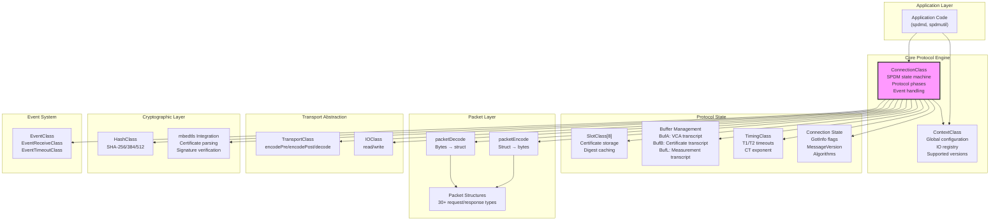
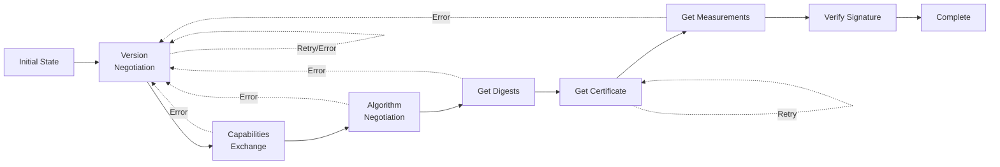
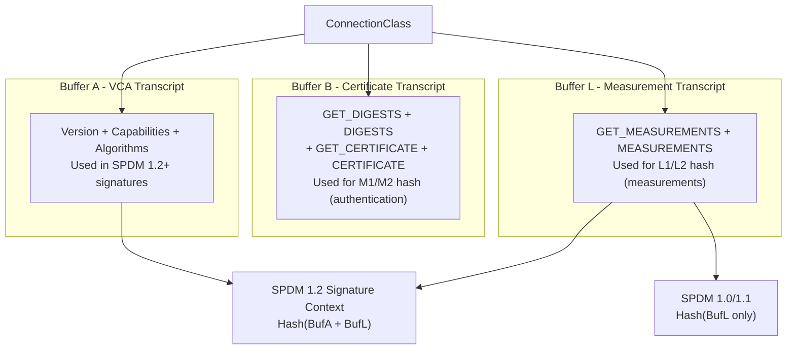
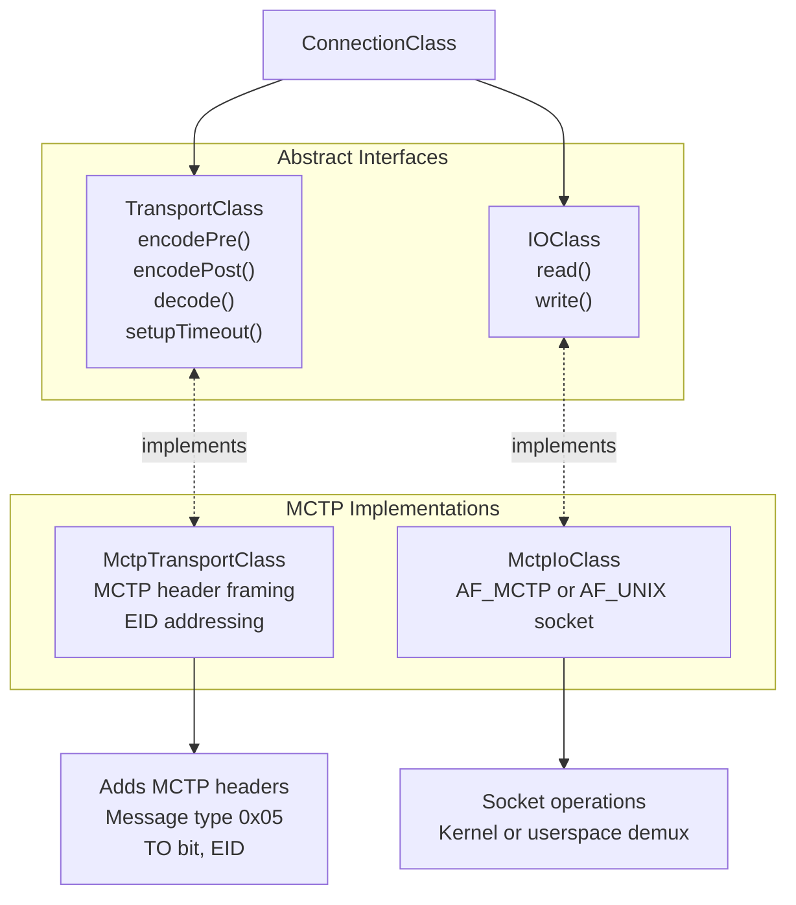
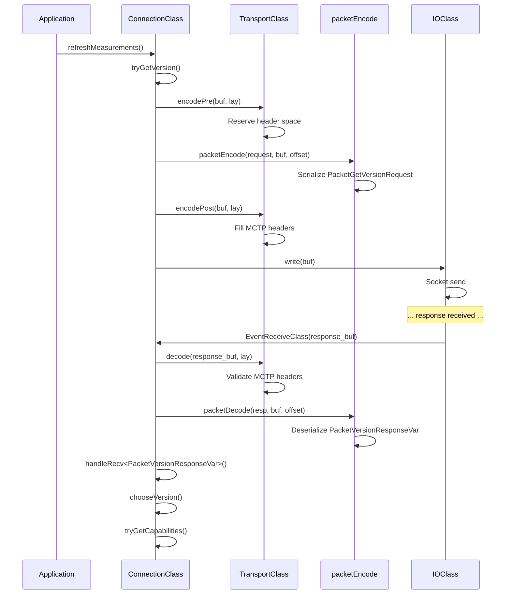
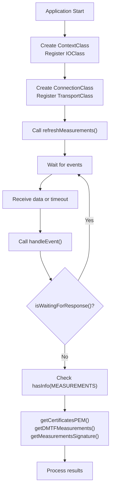

<!-- source: DeepWiki mcp.deepwiki.com · repo NVIDIA/spdm · page 2 libspdmcpp Library · fetched 2026-10-26 -->

# libspdmcpp Library

<details>
<summary>Relevant source files</summary>

The following files were used as context for generating this wiki page:

- [libspdmcpp/connection.cpp](libspdmcpp/connection.cpp)
- [libspdmcpp/headers_public/spdmcpp/common.hpp](libspdmcpp/headers_public/spdmcpp/common.hpp)
- [libspdmcpp/headers_public/spdmcpp/connection.hpp](libspdmcpp/headers_public/spdmcpp/connection.hpp)
- [libspdmcpp/headers_public/spdmcpp/connection_inl.hpp](libspdmcpp/headers_public/spdmcpp/connection_inl.hpp)
- [libspdmcpp/headers_public/spdmcpp/context.hpp](libspdmcpp/headers_public/spdmcpp/context.hpp)
- [libspdmcpp/headers_public/spdmcpp/enum_defs.hpp](libspdmcpp/headers_public/spdmcpp/enum_defs.hpp)
- [libspdmcpp/tests/connection_test.cpp](libspdmcpp/tests/connection_test.cpp)

</details>


## Purpose and Scope

The `libspdmcpp` library is the core C++ implementation of the SPDM (Security Protocol and Data Model) protocol stack. It provides a transport-agnostic, stateful protocol engine for communicating with SPDM responder devices. The library implements SPDM versions 1.0, 1.1, and 1.2 as specified in DMTF DSP0274.

This page provides an overview of the library's architecture, core components, and interfaces. For detailed information about specific subsystems:
- Protocol state machine and flow details: see [ConnectionClass and Protocol Flow](#2.1)
- Transport layer implementation: see [Transport Layer Abstraction](#2.2)
- Packet encoding/decoding: see [Packet Structures and Serialization](#2.3)
- Cryptographic operations: see [Cryptographic Support](#2.4)

## Library Architecture



**Library Component Architecture**: The library is structured in layers with `ConnectionClass` as the central protocol engine coordinating all operations.

Sources: [libspdmcpp/headers_public/spdmcpp/connection.hpp:143-904](), [libspdmcpp/headers_public/spdmcpp/common.hpp:1-270](), [libspdmcpp/headers_public/spdmcpp/context.hpp:1-164]()

## Core Components

The library is organized around several key classes and abstractions:

| Component | File | Responsibility |
|-----------|------|----------------|
| `ConnectionClass` | [connection.hpp:143-904]() | SPDM protocol state machine, orchestrates all protocol phases |
| `ContextClass` | [context.hpp:44-162]() | Global configuration, IO registry, supported versions |
| `TransportClass` | [common.hpp:126-239]() | Abstract interface for transport framing (MCTP) |
| `IOClass` | [common.hpp:249-267]() | Abstract interface for socket I/O operations |
| `SlotClass` | [connection.hpp:493-571]() | Per-slot certificate storage (8 slots per SPDM spec) |
| `TimingClass` | [connection.hpp:86-133]() | Timeout calculation (T1/T2 per SPDM spec) |
| `EventClass` | [event.hpp]() | Asynchronous event abstraction (receive/timeout) |
| `HashClass` | [hash.hpp]() | Cryptographic hashing with algorithm selection |
| `LogClass` | [log.hpp]() | Structured logging with levels and indentation |

Sources: [libspdmcpp/headers_public/spdmcpp/connection.hpp:1-907](), [libspdmcpp/headers_public/spdmcpp/common.hpp:1-270](), [libspdmcpp/headers_public/spdmcpp/context.hpp:1-164]()

## ConnectionClass: The Protocol Engine

`ConnectionClass` is the core of the library, implementing the SPDM state machine. It manages the complete protocol flow from version negotiation through measurement retrieval and signature verification.

### Key Responsibilities

1. **Protocol Phase Orchestration**: Coordinates the multi-phase SPDM handshake
2. **State Management**: Tracks connection state, received information, and pending responses
3. **Buffer Management**: Maintains transcript buffers for signature verification
4. **Certificate Handling**: Manages 8 certificate slots with digest caching
5. **Retry Logic**: Implements timeout and retry mechanisms per SPDM spec
6. **Event Processing**: Handles receive and timeout events asynchronously

### State Tracking



**SPDM Protocol State Progression**: `ConnectionClass` implements this multi-phase flow with retry and error handling.

Sources: [libspdmcpp/connection.cpp:354-1095](), [libspdmcpp/headers_public/spdmcpp/connection.hpp:143-450]()

### Public API

The primary entry points for applications:

| Method | Purpose |
|--------|---------|
| `refreshMeasurements(SlotIdx, nonce, indices)` | Initiates complete SPDM flow |
| `handleEvent(EventClass&)` | Processes receive/timeout events |
| `resetConnection()` | Resets all state to initial condition |
| `getCertificatesPEM(string&, SlotIdx)` | Retrieves certificate chain as PEM |
| `getCertificatesDER(vector<uint8_t>&, SlotIdx)` | Retrieves certificate chain as DER |
| `getDMTFMeasurements()` | Returns parsed measurement data |
| `getSignedMeasurementsBuffer()` | Returns full transcript (VCA + measurements) |
| `getSignedMeasurementsHash()` | Returns L1/L2 hash |
| `getMeasurementsSignature()` | Returns responder signature |

Sources: [libspdmcpp/headers_public/spdmcpp/connection.hpp:213-427]()

### Buffer Management for Transcript Hashing

`ConnectionClass` maintains three buffers for computing transcript hashes required for SPDM signature verification:



**Transcript Buffer Usage**: Different buffers accumulate request/response pairs for signature verification. SPDM 1.2 includes VCA in the measurement signature context.

Sources: [libspdmcpp/connection.cpp:1030-1073](), [libspdmcpp/headers_public/spdmcpp/connection.hpp:477-486](), [libspdmcpp/headers_public/spdmcpp/connection.hpp:689-742]()

## Transport and I/O Abstraction

The library uses abstract interfaces to remain transport-agnostic:



**Transport Abstraction Layers**: Applications implement concrete transport/IO classes and register them with `ContextClass`.

The library supports two MCTP modes selected at compile time via `MCTP_IN_KERNEL`:
- **Kernel Mode**: Uses `AF_MCTP` sockets, kernel handles MCTP framing
- **Userspace Mode**: Uses `AF_UNIX` sockets to mctp-demux-daemon, userspace handles MCTP

Sources: [libspdmcpp/headers_public/spdmcpp/common.hpp:119-267](), [libspdmcpp/headers_public/spdmcpp/connection_inl.hpp:26-92]()

## Enumeration Types

The library defines several critical enumerations for type-safe protocol handling:

### RetStat - Return Status Codes

```cpp
RetStat::OK                                    // Success
RetStat::ERROR_TIMEOUT                         // No response received
RetStat::ERROR_UNSUPPORTED_SPDM_VERSION        // Version negotiation failed
RetStat::ERROR_CERTIFICATE_PARSING_ERROR       // Invalid certificate format
RetStat::ERROR_MEASUREMENT_SIGNATURE_VERIFIY_FAILED  // Signature verification failed
```

### ConnectionInfoEnum - Protocol Phase Tracking

```cpp
ConnectionInfoEnum::SUPPORTED_VERSIONS  // Received VERSION response
ConnectionInfoEnum::CHOOSEN_VERSION     // Negotiated SPDM version
ConnectionInfoEnum::CAPABILITIES        // Received CAPABILITIES response
ConnectionInfoEnum::ALGORITHMS          // Negotiated algorithms
ConnectionInfoEnum::DIGESTS             // Received certificate digests
ConnectionInfoEnum::MEASUREMENTS        // Completed measurements
```

### MessageVersionEnum - SPDM Versions

```cpp
MessageVersionEnum::SPDM_1_0  // 0x10
MessageVersionEnum::SPDM_1_1  // 0x11
MessageVersionEnum::SPDM_1_2  // 0x12
```

Sources: [libspdmcpp/headers_public/spdmcpp/enum_defs.hpp:23-167]()

## Certificate Slot Management

SPDM supports up to 8 certificate slots per responder. `ConnectionClass` maintains a `SlotClass` array for managing these:

| SlotClass Member | Type | Purpose |
|------------------|------|---------|
| `Digest` | `vector<uint8_t>` | Hash of certificate chain |
| `Certificates` | `vector<uint8_t>` | Raw certificate chain (with SPDM header) |
| `MCertificates` | `vector<unique_ptr<mbedtls_x509_crt_raii>>` | Parsed X.509 certificates |
| `CertificateOffset` | `size_t` | Offset where DER data starts |
| `GotInfo` | `uint8_t` | Bitmask of received information |

The library supports digest-based caching: if the digest matches a previously received certificate chain, the certificate retrieval phase is skipped.

Sources: [libspdmcpp/headers_public/spdmcpp/connection.hpp:493-571](), [libspdmcpp/connection.cpp:199-262](), [libspdmcpp/connection.cpp:674-725]()

## Timing and Timeout Management

`TimingClass` calculates SPDM timeouts per DSP0274 section 9:

```cpp
T1 = RTT + sT1  // Standard request timeout
T2 = RTT + CT   // Measurement request timeout (includes crypto time)
```

- **RTT**: Round-trip transport time (configurable, default 6000ms for slow BMC environments)
- **sT1**: Static T1 component (24000ms)
- **CT**: Crypto time, computed from responder's `CTExponent` capability: `CT = 2^(CTExponent-10)` milliseconds

The library uses `T1` for version/capabilities/algorithm/certificate requests and `T2` for measurement requests which may require cryptographic operations.

Sources: [libspdmcpp/headers_public/spdmcpp/connection.hpp:86-133]()

## Packet Encode/Decode Flow



**Packet Encoding/Decoding Flow**: Request encoding adds transport headers, response decoding strips them and validates content.

Sources: [libspdmcpp/headers_public/spdmcpp/connection_inl.hpp:26-125](), [libspdmcpp/connection.cpp:354-424]()

## Event-Driven Operation

The library operates asynchronously via an event-driven model:

```cpp
// Application provides received data via EventReceiveClass
std::vector<uint8_t> receivedData;
io->read(receivedData);
EventReceiveClass receiveEvent(receivedData);
connection.handleEvent(receiveEvent);

// Or timeout event when no response received
EventTimeoutClass timeoutEvent;
connection.handleEvent(timeoutEvent);
```

`ConnectionClass::handleEvent()` dispatches to the appropriate handler based on `WaitingForResponse` state:

1. Validates event type matches expected response
2. Calls template specialization of `handleRecv<T>()` for the response type
3. Updates connection state and buffers
4. Initiates next protocol phase or completes flow

Sources: [libspdmcpp/connection.cpp:1157-1240](), [libspdmcpp/headers_public/spdmcpp/connection.hpp:447-454]()

## Usage Pattern Example

Typical usage sequence for applications:



**Typical Application Flow**: Applications drive the protocol by initiating `refreshMeasurements()` and pumping events.

Sources: [libspdmcpp/tests/connection_test.cpp:233-481]()

## Configuration and Context

`ContextClass` provides global configuration shared by multiple connections:

| Configuration Item | Purpose |
|-------------------|---------|
| Supported SPDM versions | Determines version negotiation behavior |
| IO registry | Maps socket paths to `IOClass` instances (userspace mode) |
| Single IO instance | Shared kernel socket (kernel mode) |

The library supports both kernel and userspace MCTP modes. In userspace mode, each MCTP medium (PCIe, USB, I2C) has a separate socket path registered in the `ContextClass` IO container.

Sources: [libspdmcpp/headers_public/spdmcpp/context.hpp:44-162]()

## Error Handling and Retry

The library implements robust error handling:

1. **Packet-level retries**: Up to 4 retries for transient errors with 3-second delays
2. **Certificate retries**: Up to 3 retries for certificate retrieval failures  
3. **Version negotiation fallback**: On error, restart from `GET_VERSION`
4. **Timeout handling**: Uses `setupTimeout()` to detect unresponsive responders

Error codes are returned as `RetStat` enums with detailed categorization:
- `ERROR_TIMEOUT`: No response within timeout period
- `ERROR_CERTIFICATE_PARSING_ERROR`: Invalid certificate format
- `ERROR_MEASUREMENT_SIGNATURE_VERIFIY_FAILED`: Signature verification failed
- `ERROR_UNSUPPORTED_SPDM_VERSION`: No common SPDM version

Sources: [libspdmcpp/connection.cpp:1241-1297](), [libspdmcpp/connection.cpp:754-858](), [libspdmcpp/headers_public/spdmcpp/enum_defs.hpp:23-56]()

## Thread Safety

`ConnectionClass` is **not thread-safe**. Applications must ensure:
- Single thread calls `handleEvent()` for a given connection
- No concurrent calls to `refreshMeasurements()` or getter methods
- Event pumping happens on a single event loop

Multiple `ConnectionClass` instances (for different responders) can safely operate on separate threads.

Sources: [libspdmcpp/headers_public/spdmcpp/connection.hpp:143-145]()

---

