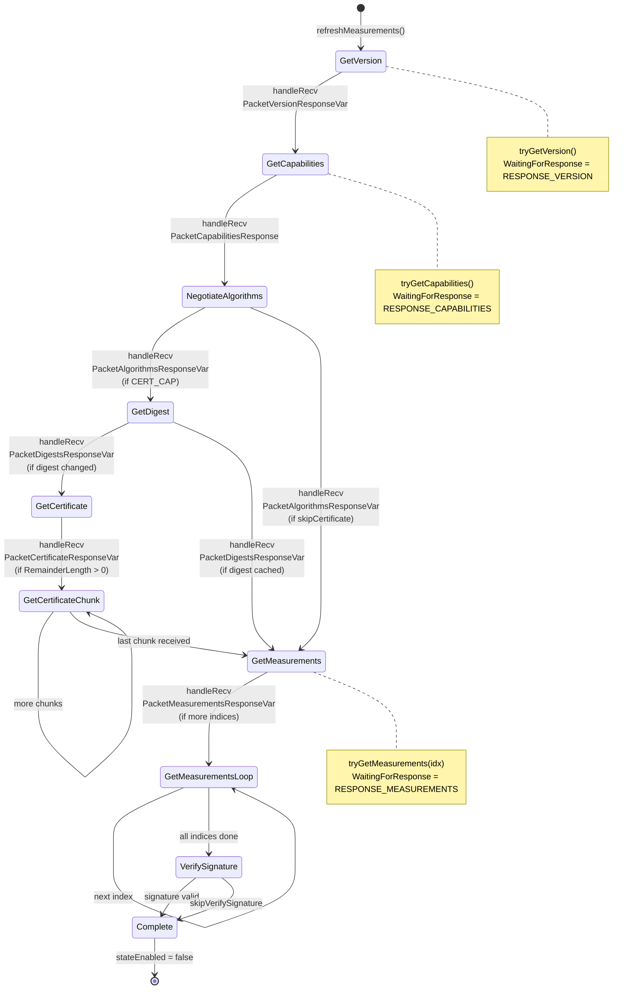
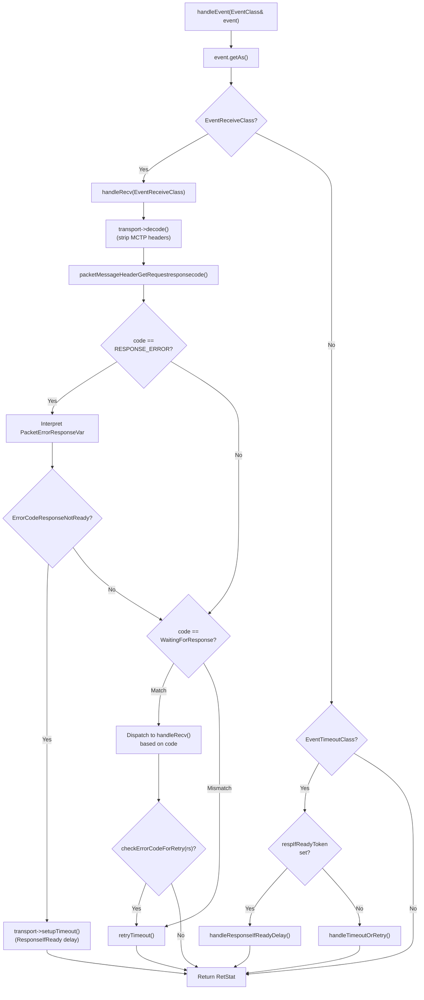
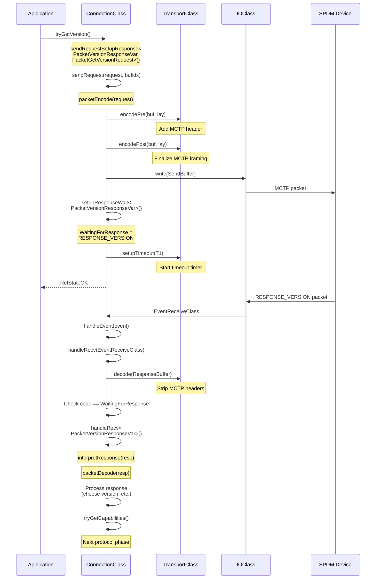
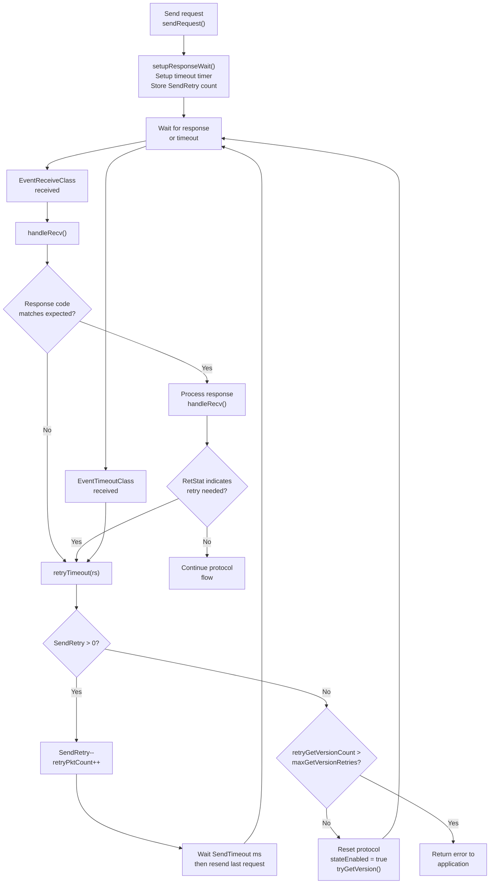
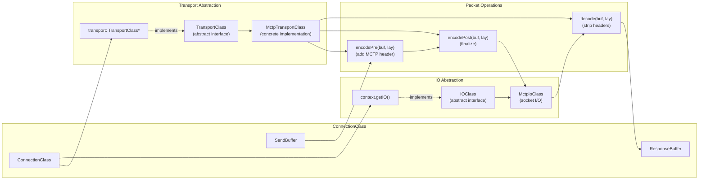

<!-- source: DeepWiki mcp.deepwiki.com · repo NVIDIA/spdm · page 2.1 ConnectionClass and Protocol Flow · fetched 2026-10-26 -->

# ConnectionClass and Protocol Flow

<details>
<summary>Relevant source files</summary>

The following files were used as context for generating this wiki page:

- [libspdmcpp/connection.cpp](libspdmcpp/connection.cpp)
- [libspdmcpp/headers_public/spdmcpp/connection.hpp](libspdmcpp/headers_public/spdmcpp/connection.hpp)
- [libspdmcpp/headers_public/spdmcpp/connection_inl.hpp](libspdmcpp/headers_public/spdmcpp/connection_inl.hpp)
- [libspdmcpp/tests/connection_test.cpp](libspdmcpp/tests/connection_test.cpp)

</details>


## Purpose and Scope

The `ConnectionClass` is the core SPDM protocol engine in libspdmcpp. It implements the complete SPDM requester state machine, managing communication with SPDM responder devices from initial version negotiation through measurement retrieval and signature verification. This page documents the class architecture, protocol flow mechanisms, event handling, and retry logic.

For details on specific protocol phases (version, capabilities, algorithms, etc.), see [SPDM Protocol Phases](#2.1.1). For certificate slot management, see [Certificate Management and Slots](#2.1.2). For buffer and transcript hash management, see [Buffer Management and Transcript Hashing](#2.1.3).

**Sources:** [libspdmcpp/headers_public/spdmcpp/connection.hpp:135-145](), [libspdmcpp/connection.cpp:107-112]()

---

## Class Architecture

`ConnectionClass` is a non-copyable class that manages all SPDM communication state for a single endpoint. It coordinates transport abstraction, cryptographic operations, packet encoding/decoding, and protocol flow logic.

### ConnectionClass Structure

```mermaid
graph TB
    subgraph "ConnectionClass Core"
        CC[ConnectionClass]
        CONTEXT["context: ContextClass<br/>(global config)"]
        TRANSPORT["transport: TransportClass*<br/>(MCTP layer)"]
        LOG["Log: LogClass<br/>(logging instance)"]
        EID["m_eid: uint8_t<br/>(endpoint ID)"]
    end
    
    subgraph "Protocol State"
        MSGVER["MessageVersion<br/>MessageVersionEnum"]
        WAITING["WaitingForResponse<br/>RequestResponseEnum"]
        GOTINFO["GotInfo: uint8_t<br/>(bitmask flags)"]
        ALGORITHMS["Algorithms<br/>PacketAlgorithmsResponseVar"]
        SUPPORTED["SupportedVersions<br/>vector<PacketVersionNumber>"]
        RESPFLAGS["responderCapabilitiesFlags<br/>ResponderCapabilitiesFlags"]
    end
    
    subgraph "Certificate Storage"
        SLOTS["Slots[8]: SlotClass<br/>(certificate chains)"]
        CERTIDX["CertificateSlotIdx<br/>(current slot)"]
    end
    
    subgraph "Buffer Management"
        BUFA["Bufs[A]: VCA transcript"]
        BUFB["Bufs[B]: Certificate data"]
        BUFL["Bufs[L]: Measurements"]
        SENDBUF["SendBuffer<br/>(outgoing requests)"]
        RESPBUF["ResponseBuffer<br/>(incoming responses)"]
    end
    
    subgraph "Measurement State"
        DMTF["DMTFMeasurements<br/>map<index, measurement>"]
        MEASHASH["MeasurementsHash<br/>(L1/L2 hash)"]
        MEASIG["MeasurementsSignature<br/>(responder signature)"]
        NONCE["MeasurementNonce[32]"]
        INDICES["MeasurementIndices<br/>bitset<256>"]
    end
    
    subgraph "Retry and Timeout"
        TIMING["Timings: TimingClass"]
        SENDTIMEOUT["SendTimeout: timeout_ms_t"]
        SENDRETRY["SendRetry: uint16_t"]
        RETRYPKT["retryPktCount: uint8_t"]
        RETRYVER["retryGetVersionCount: uint8_t"]
        RETRYCERT["retryCertCount: uint8_t"]
    end
    
    CC --> CONTEXT
    CC --> TRANSPORT
    CC --> LOG
    CC --> EID
    CC --> MSGVER
    CC --> WAITING
    CC --> GOTINFO
    CC --> ALGORITHMS
    CC --> SLOTS
    CC --> BUFA
    CC --> BUFB
    CC --> BUFL
    CC --> DMTF
    CC --> TIMING
```



**Key Member Variables:**

| Variable | Type | Purpose |
|----------|------|---------|
| `MessageVersion` | `MessageVersionEnum` | Negotiated SPDM protocol version (1.0, 1.1, or 1.2) |
| `WaitingForResponse` | `RequestResponseEnum` | Current expected response type, or `INVALID` if idle |
| `GotInfo` | `uint8_t` | Bitmask tracking which protocol stages completed |
| `Algorithms` | `PacketAlgorithmsResponseVar` | Negotiated cryptographic algorithms |
| `Slots[8]` | `SlotClass` | Certificate storage for up to 8 certificate chains |
| `Bufs[A/B/L]` | `vector<uint8_t>` | Transcript buffers for hash computation |
| `SendBuffer` | `vector<uint8_t>` | Encoded outgoing request packet |
| `ResponseBuffer` | `vector<uint8_t>` | Received response packet |
| `retryPktCount` | `uint8_t` | Retry counter for current request |
| `stateEnabled` | `bool` | Whether protocol flow is actively progressing |

**Sources:** [libspdmcpp/headers_public/spdmcpp/connection.hpp:143-904](), [libspdmcpp/connection.cpp:166-197]()

---

## Protocol State Machine

The SPDM protocol follows a strict sequential flow. `ConnectionClass` implements this as a state machine driven by `refreshMeasurements()` calls and asynchronous event handling.

### State Progression Flow



**Key Protocol Methods:**

Each protocol phase is initiated by a `try*()` method and completed by a corresponding `handleRecv<T>()` specialization:

| Phase | Initiator Method | Response Handler | Buffer |
|-------|-----------------|------------------|--------|
| Version | `tryGetVersion()` | `handleRecv<PacketVersionResponseVar>()` | BufEnum::A |
| Capabilities | `tryGetCapabilities()` | `handleRecv<PacketCapabilitiesResponse>()` | BufEnum::A |
| Algorithms | `tryNegotiateAlgorithms()` | `handleRecv<PacketAlgorithmsResponseVar>()` | BufEnum::A |
| Digests | `tryGetDigest()` | `handleRecv<PacketDigestsResponseVar>()` | BufEnum::B |
| Certificate | `tryGetCertificate(idx)` | `handleRecv<PacketCertificateResponseVar>()` | BufEnum::B |
| Measurements | `tryGetMeasurements(idx)` | `handleRecv<PacketMeasurementsResponseVar>()` | BufEnum::L |

**Sources:** [libspdmcpp/connection.cpp:354-371](), [libspdmcpp/connection.cpp:372-424](), [libspdmcpp/connection.cpp:462-530](), [libspdmcpp/connection.cpp:532-658](), [libspdmcpp/connection.cpp:660-725](), [libspdmcpp/connection.cpp:727-876](), [libspdmcpp/connection.cpp:878-1107]()

---

## Event-Driven Execution Model

`ConnectionClass` uses an event-driven model for asynchronous operation. Events are dispatched through `handleEvent()`, which routes them to specialized handlers.

### Event Handling Flow



**Event Types:**

| Event Class | Purpose | Handler |
|------------|---------|---------|
| `EventReceiveClass` | New response packet received | `handleRecv(EventReceiveClass&)` |
| `EventTimeoutClass` | Timeout expired (response timeout or ResponseIfReady delay) | `handleTimeoutOrRetry()` or `handleResponseIfReadyDelay()` |

**Response Matching Logic:**

The `WaitingForResponse` field tracks the expected response type. When a response arrives, the code is extracted from the packet header and compared:

```cpp
// From connection.cpp:1237-1263
if (code != WaitingForResponse)
{
    if (Log.logLevel >= spdmcpp::LogClass::Level::Error)
    {
        if (isWaitingForResponse())
        {
            Log.iprint("ERROR_WRONG_REQUEST_RESPONSE_CODE: ");
            Log.println(code);
            Log.iprint(" while waiting for response: ");
            Log.println(WaitingForResponse);
        }
        ...
    }
    return retryTimeout(RetStat::ERROR_WRONG_REQUEST_RESPONSE_CODE);
}
WaitingForResponse = RequestResponseEnum::INVALID;
```

**Sources:** [libspdmcpp/connection.cpp:1313-1334](), [libspdmcpp/connection.cpp:1109-1311](), [libspdmcpp/connection.cpp:1336-1371]()

---

## Request-Response Pattern

All SPDM communication follows a consistent request-response pattern implemented by the `sendRequestSetupResponse<R, T>()` template method.

### Request-Response Cycle



**Template Implementation:**

The pattern is implemented as a template in `connection_inl.hpp`:

```cpp
// From connection_inl.hpp:161-178
template <typename R = void, typename T>
RetStat ConnectionClass::sendRequestSetupResponse(const T& request,
                                                  BufEnum bufidx,
                                                  timeout_ms_t timeout,
                                                  uint16_t retry)
{
    auto rs = sendRequest(request, bufidx);
    if (isError(rs))
    {
        return rs;
    }
    rs = setupResponseWait<R>(timeout, retry);
    if (isError(rs))
    {
        return rs;
    }
    return rs;
}
```

**Buffer Tracking:**

The `bufidx` parameter determines whether the request should be appended to a transcript buffer (A, B, or L) for later hash computation. See [Buffer Management and Transcript Hashing](#2.1.3) for details.

**Sources:** [libspdmcpp/headers_public/spdmcpp/connection_inl.hpp:161-178](), [libspdmcpp/headers_public/spdmcpp/connection_inl.hpp:26-92](), [libspdmcpp/headers_public/spdmcpp/connection_inl.hpp:127-159](), [libspdmcpp/headers_public/spdmcpp/connection_inl.hpp:94-125]()

---

## Retry and Timeout Logic

`ConnectionClass` implements multi-level retry logic to handle transient communication failures and busy responders.

### Retry Mechanisms



**Retry Counters:**

| Counter | Max Value | Scope | Purpose |
|---------|-----------|-------|---------|
| `SendRetry` | 4 (default) | Per request | Number of retries for current request before timeout |
| `retryPktCount` | No limit | Per protocol flow | Total packet retries during current `refreshMeasurements()` |
| `retryGetVersionCount` | 6 (`maxGetVersionRetries`) | Per protocol flow | Number of times protocol has restarted from GET_VERSION |
| `retryCertCount` | 3 (`numCertRetries`) | Per certificate | Certificate-specific retry for parsing errors |

**Timeout Values:**

The `TimingClass` computes timeouts based on SPDM specification requirements:

```cpp
// From connection.hpp:95-102
timeout_ms_t getT1() const
{
    return RTT + sT1;
}
timeout_ms_t getT2() const
{
    return RTT + CT;
}
```

Where:
- `T1` = RTT + sT1 = 6000 + 24000 = 30000ms (used for most requests)
- `T2` = RTT + CT (used for `GET_MEASUREMENTS` with longer CT from responder)
- `CT` is computed from the `CTExponent` value in the responder's capabilities

**ResponseIfReady Handling:**

When a responder returns `ERROR_RESPONSE_NOT_READY`, it includes timing parameters for when to retry:

```cpp
// From connection.cpp:1165-1196
if (err.Min.Header.Param1 ==
    PacketErrorResponseVar::ErrorCodeResponseNotReady)
{
    const auto RTDExp =
        err.ExtendedErrorData
            [PacketErrorResponseVar::ExtErrOffsNotReadyRTDExponent];
    respIfReqCode =
        err.ExtendedErrorData
            [PacketErrorResponseVar::ExtErrOffsReadyRequestCode];
    respIfReadyToken =
        err.ExtendedErrorData
            [PacketErrorResponseVar::ExtErrOffsNotReadyToken];
    const auto RTDM =
        err.ExtendedErrorData
            [PacketErrorResponseVar::ExtErrOffsNotReadyRTDM];
    if (!transport)
    {
        return RetStat::ERROR_UNKNOWN;
    }
    return transport->setupTimeout(
        calcResponseIfReadyWaitTimeMs(RTDExp, RTDM));
}
```

When the delay expires, `handleResponseIfReadyDelay()` sends a `RESPOND_IF_READY` request.

**Error Recovery:**

For critical errors (wrong version, unsupported algorithms, etc.), the protocol restarts from GET_VERSION:

```cpp
// Macro from connection.cpp:49-62
#define SPDMCPP_CONNECTION_RS_ERROR_RETURN_WITH_VERSION(rs)                    
    do                                                                         
    {                                                                          
        if (isError(rs))                                                       
        {                                                                      
            ...
            stateEnabled = false;                                              
            return tryGetVersion();                                            
        }                                                                      
    } while (false)
```

**Sources:** [libspdmcpp/connection.cpp:1336-1371](), [libspdmcpp/connection.cpp:1373-1420](), [libspdmcpp/connection.cpp:1154-1234](), [libspdmcpp/headers_public/spdmcpp/connection.hpp:86-133]()

---

## Entry Points and Public API

Applications interact with `ConnectionClass` through a small set of public methods.

### Primary Methods

| Method | Purpose |
|--------|---------|
| `refreshMeasurements(slotIdx)` | Start protocol flow with random nonce and all measurements |
| `refreshMeasurements(slotIdx, nonce)` | Start protocol flow with specified nonce and all measurements |
| `refreshMeasurements(slotIdx, indices)` | Start protocol flow with random nonce and specific measurement indices |
| `refreshMeasurements(slotIdx, nonce, indices)` | Start protocol flow with full control |
| `handleEvent(event)` | Process incoming receive or timeout event |
| `resetConnection()` | Clear all state and return to initial conditions |

### Query Methods

| Method | Return Type | Purpose |
|--------|-------------|---------|
| `hasInfo(ConnectionInfoEnum)` | `bool` | Check if protocol stage completed |
| `slotHasInfo(idx, SlotInfoEnum)` | `bool` | Check if slot has certificate/digest data |
| `isWaitingForResponse()` | `bool` | Check if expecting a response |
| `getMessageVersion()` | `MessageVersionEnum` | Get negotiated SPDM version |
| `getSignatureEnum()` | `SignatureEnum` | Get signature algorithm |
| `getSignatureHashEnum()` | `HashEnum` | Get hash algorithm for signatures |
| `getMeasurementHashEnum()` | `HashEnum` | Get hash algorithm for measurements |
| `getDMTFMeasurements()` | `map<uint8_t, PacketMeasurementFieldVar>` | Get decoded measurements |
| `getSignedMeasurementsBuffer()` | `vector<uint8_t>` | Get VCA+Measurements transcript |
| `getSignedMeasurementsHash()` | `vector<uint8_t>` | Get L1/L2 hash |
| `getMeasurementsSignature()` | `vector<uint8_t>` | Get responder signature |
| `getCertificatesDER(buf, idx)` | `bool` | Get certificate chain in DER format |
| `getCertificatesPEM(str, idx)` | `bool` | Get certificate chain in PEM format |

**Example Usage Pattern:**

```cpp
// Typical usage from spdmd daemon
ConnectionClass conn(context, log, eid, sockPath);
MctpTransportClass transport(eid);
conn.registerTransport(transport);

// Start measurement flow
auto rs = conn.refreshMeasurements(0); // slot 0, random nonce, all measurements
if (isError(rs)) { /* handle error */ }

// Event loop
while (conn.isWaitingForResponse()) {
    EventClass event = ...; // received from transport or timer
    rs = conn.handleEvent(event);
    if (isError(rs)) { /* handle error */ }
}

// Retrieve results
if (conn.hasInfo(ConnectionInfoEnum::MEASUREMENTS)) {
    auto measurements = conn.getDMTFMeasurements();
    auto hash = conn.getSignedMeasurementsHash();
    auto signature = conn.getMeasurementsSignature();
    // Process attestation data
}

conn.unregisterTransport(transport);
```

**Sources:** [libspdmcpp/headers_public/spdmcpp/connection.hpp:213-248](), [libspdmcpp/connection.cpp:114-164](), [libspdmcpp/headers_public/spdmcpp/connection.hpp:266-445]()

---

## Integration with Transport and IO

`ConnectionClass` is transport-agnostic. It delegates packet framing and socket I/O to pluggable interfaces.

### Transport Layer Integration



**Registration Pattern:**

```cpp
// From connection.hpp:190-206
void registerTransport(TransportClass& trans)
{
    SPDMCPP_ASSERT(!transport);
    transport = &trans;
}

void unregisterTransport(TransportClass& trans)
{
    SPDMCPP_ASSERT(transport == &trans);
    transport = nullptr;
}
```

The `ConnectionClass` does not own the transport object; the caller must manage its lifetime and ensure it outlives the connection.

**Encoding Flow:**

```cpp
// From connection_inl.hpp:27-77
template <typename T>
RetStat ConnectionClass::sendRequest(const T& packet, BufEnum bufidx)
{
    ...
    std::vector<uint8_t>& buf = SendBuffer;
    buf.clear();
    TransportClass::LayerState lay;

    if (transport)
    {
        transport->encodePre(buf, lay);  // Add transport header
    }

    auto rs = packetEncode(packet, buf, lay.getEndOffset());  // Encode SPDM packet
    ...
    
    if (transport)
    {
        transport->encodePost(buf, lay);  // Finalize transport framing
    }
    
    rs = context.getIO(sockPath)->write(buf);  // Send to socket
    return rs;
}
```

**Decoding Flow:**

```cpp
// From connection.cpp:1134-1152
TransportClass::LayerState lay;
if (transport)
{
    auto rs = transport->decode(ResponseBuffer, lay);
    SPDMCPP_CONNECTION_RS_ERROR_RETURN(rs);
}
ResponseBufferSPDMOffset = lay.getEndOffset();

if (ResponseBuffer.size() - ResponseBufferSPDMOffset <
    sizeof(PacketMessageHeader))
{
    return RetStat::ERROR_BUFFER_TOO_SMALL;
}
version = packetMessageHeaderGetMessageVersion(
    ResponseBuffer, ResponseBufferSPDMOffset);
code = packetMessageHeaderGetRequestresponsecode(
    ResponseBuffer, ResponseBufferSPDMOffset);
```

For MCTP transport details, see [MCTP Transport Implementation](#2.2.1). For abstract interfaces, see [Transport Layer Abstraction](#2.2).

**Sources:** [libspdmcpp/headers_public/spdmcpp/connection.hpp:183-206](), [libspdmcpp/headers_public/spdmcpp/connection_inl.hpp:26-92](), [libspdmcpp/connection.cpp:1134-1152]()

---

## State Tracking and Information Flags

`ConnectionClass` uses bitmask flags to track which protocol stages have completed and which data is available.

### ConnectionInfoEnum Flags

The `GotInfo` field tracks connection-level information:

| Flag | Meaning |
|------|---------|
| `SUPPORTED_VERSIONS` | Received `VERSION` response with supported versions |
| `CHOOSEN_VERSION` | Selected SPDM version from intersection of supported versions |
| `CAPABILITIES` | Received `CAPABILITIES` response |
| `ALGORITHMS` | Received `ALGORITHMS` response |
| `DIGESTS` | Received `DIGESTS` response |
| `MEASUREMENTS` | Completed measurements and signature verification |

**Usage:**

```cpp
// From connection.hpp:267-272
bool hasInfo(ConnectionInfoEnum info) const
{
    return !!(GotInfo &
              (1 << static_cast<std::underlying_type_t<ConnectionInfoEnum>>(
                   info)));
}
```

### SlotInfoEnum Flags

Each `SlotClass` tracks per-slot information:

| Flag | Meaning |
|------|---------|
| `DIGEST` | Received digest for this slot |
| `CERTIFICATES` | Downloaded and parsed certificate chain for this slot |

**Usage:**

```cpp
// From connection.hpp:277-283
bool slotHasInfo(SlotIdx slotidx, SlotInfoEnum info) const
{
    SPDMCPP_ASSERT(slotidx < slotNum);
    return !!(
        Slots[slotidx].GotInfo &
        (1 << static_cast<std::underlying_type_t<SlotInfoEnum>>(info)));
}
```

**Assertion Usage:**

Many protocol methods assert that prerequisite information is available:

```cpp
// From connection.cpp:463-465
RetStat ConnectionClass::tryGetCapabilities()
{
    SPDMCPP_ASSERT(hasInfo(ConnectionInfoEnum::CHOOSEN_VERSION));
    ...
}
```

This ensures the protocol flow executes in the correct order.

**Sources:** [libspdmcpp/headers_public/spdmcpp/connection.hpp:266-283](), [libspdmcpp/headers_public/spdmcpp/connection.hpp:820-827](), [libspdmcpp/headers_public/spdmcpp/connection.hpp:492-528]()

---

## Testing and Validation

The `ConnectionClass` test suite validates the complete protocol flow with simulated responders.

### Test Structure

The test fixture creates a mock transport and IO layer:

```cpp
// From connection_test.cpp:55-66
class FixtureTransportClass : public MctpTransportClass
{
  public:
    FixtureTransportClass() : MctpTransportClass(14) {}
    
    spdmcpp::RetStat setupTimeout(spdmcpp::timeout_us_t) override
    {
        return RetStat::OK;
    }
};

class FixtureIOClass : public IOClass
{
    // Queues for write/read operations
    std::list<std::vector<uint8_t>> WriteQueue;
    std::list<std::vector<uint8_t>> ReadQueue;
    ...
};
```

**Test Flow:**

```cpp
// From connection_test.cpp:233-481
void testConnectionFlow(BaseAsymAlgoFlags asymAlgo, BaseHashAlgoFlags hashAlgo)
{
    ConnectionFixture fix;
    
    fix.Connection.refreshMeasurements(0);  // Start flow
    
    // 1. Intercept GET_VERSION request
    PacketGetVersionRequest req;
    fix.interpret(req, MessageHashEnum::M);
    
    // 2. Push VERSION response
    PacketVersionResponseVar resp;
    resp.VersionNumberEntries.push_back(ver);
    fix.push(resp, MessageHashEnum::M);
    fix.handleRecv();
    
    // 3. Intercept GET_CAPABILITIES request
    // 4. Push CAPABILITIES response
    // 5. Intercept NEGOTIATE_ALGORITHMS request
    // 6. Push ALGORITHMS response
    // 7. Intercept GET_DIGESTS request
    // 8. Push DIGESTS response
    // 9. Intercept GET_CERTIFICATE request
    // 10. Push CERTIFICATE response
    // 11. Intercept GET_MEASUREMENTS request
    // 12. Push MEASUREMENTS response with signature
    
    // Signature verification happens automatically
}
```

**Test Coverage:**

| Test Case | Algorithms | Purpose |
|-----------|-----------|---------|
| `FullFlow_ECDSA_256_SHA_256` | P-256 + SHA-256 | NIST P-256 curve with SHA-256 |
| `FullFlow_ECDSA_256_SHA_384` | P-256 + SHA-384 | NIST P-256 curve with SHA-384 |
| `FullFlow_ECDSA_256_SHA_512` | P-256 + SHA-512 | NIST P-256 curve with SHA-512 |
| `FullFlow_ECDSA_384_SHA_384` | P-384 + SHA-384 | NIST P-384 curve with SHA-384 |
| `FullFlow_ECDSA_521_SHA_512` | P-521 + SHA-512 | NIST P-521 curve with SHA-512 |

Each test validates:
- Correct request encoding
- Response interpretation
- Transcript hash computation
- Certificate parsing
- Signature verification

**Sources:** [libspdmcpp/tests/connection_test.cpp:233-481](), [libspdmcpp/tests/connection_test.cpp:483-511]()

---

