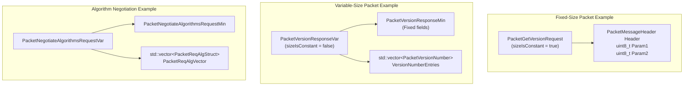
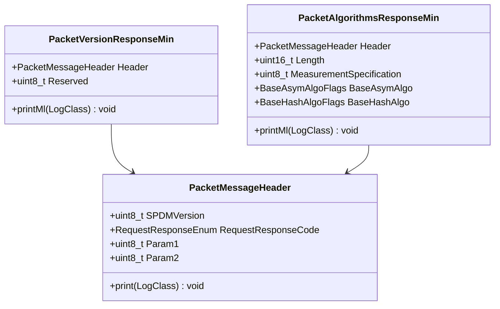
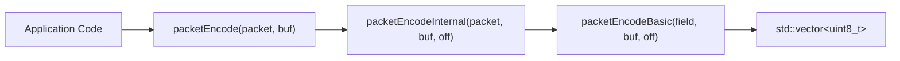
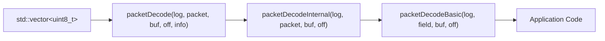
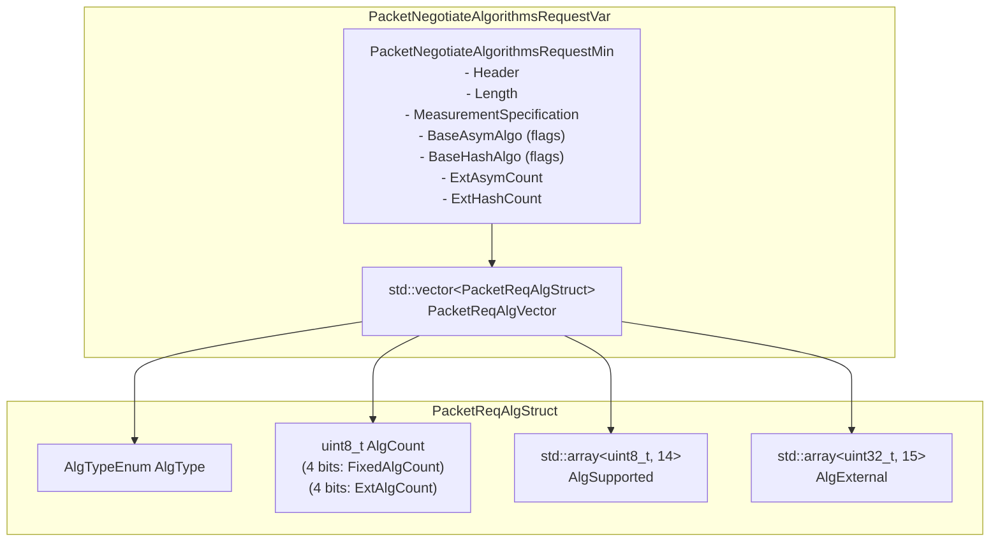
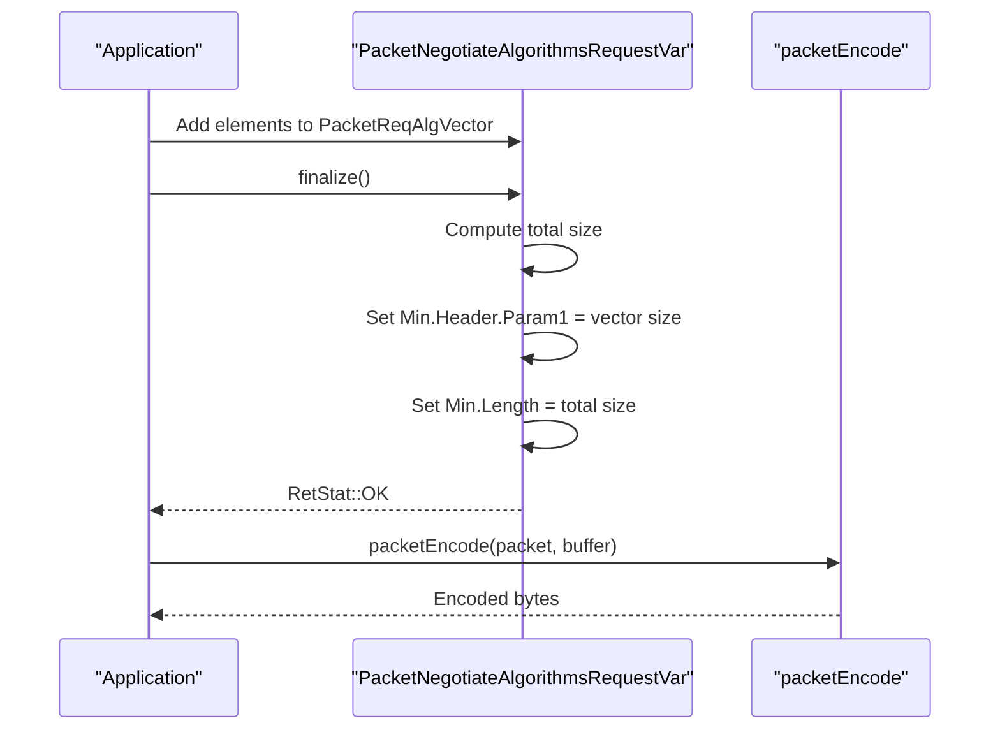
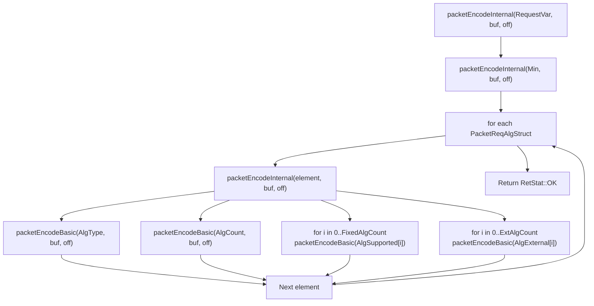
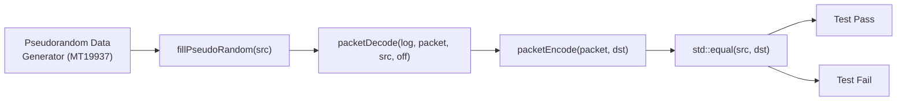

<!-- source: DeepWiki mcp.deepwiki.com · repo NVIDIA/spdm · page 2.3 Packet Structures and Serialization · fetched 2026-10-26 -->

# Packet Structures and Serialization

<details>
<summary>Relevant source files</summary>

The following files were used as context for generating this wiki page:

- [libspdmcpp/headers_public/spdmcpp/internal/request/packet_negotiate_algorithms_request.hpp](libspdmcpp/headers_public/spdmcpp/internal/request/packet_negotiate_algorithms_request.hpp)
- [libspdmcpp/headers_public/spdmcpp/internal/response/packet_algorithms_response.hpp](libspdmcpp/headers_public/spdmcpp/internal/response/packet_algorithms_response.hpp)
- [libspdmcpp/headers_public/spdmcpp/internal/response/packet_error_response.hpp](libspdmcpp/headers_public/spdmcpp/internal/response/packet_error_response.hpp)
- [libspdmcpp/headers_public/spdmcpp/internal/response/packet_version_response.hpp](libspdmcpp/headers_public/spdmcpp/internal/response/packet_version_response.hpp)
- [libspdmcpp/headers_public/spdmcpp/packet.hpp](libspdmcpp/headers_public/spdmcpp/packet.hpp)
- [libspdmcpp/tests/packet_basic_test.cpp](libspdmcpp/tests/packet_basic_test.cpp)

</details>


## Purpose and Scope

This document describes the packet structure definitions and serialization/deserialization mechanisms used in libspdmcpp to encode SPDM protocol messages into binary format and decode received binary data into C++ structures. The packet layer sits between the protocol state machine ([ConnectionClass](#2.1)) and the transport layer ([MctpTransportClass](#2.2.1)), converting between structured data and byte streams.

For information about how these packets are used in the protocol flow, see [SPDM Protocol Phases](#2.1.1). For details on cryptographic operations performed on packet data, see [Cryptographic Support](#2.4).

## Packet Organization and Min/Var Pattern

The libspdmcpp library defines 30+ packet structures representing SPDM protocol messages. All packet definitions follow a consistent organizational pattern to handle both fixed-size and variable-size messages.

### Min/Var Design Pattern

Packet structures use a dual-structure pattern to accommodate variable-length SPDM messages:

- **Min structures**: Fixed-size portion of a packet, containing all fields with predictable sizes
- **Var structures**: Complete packet including the Min structure plus variable-length fields (vectors, arrays)



**Sources:** [libspdmcpp/headers_public/spdmcpp/internal/response/packet_version_response.hpp:24-101](), [libspdmcpp/headers_public/spdmcpp/internal/request/packet_negotiate_algorithms_request.hpp:197-322]()

### Compile-Time Properties

Each packet structure defines two static constexpr properties:

| Property | Type | Purpose |
|----------|------|---------|
| `requestResponseCode` | `RequestResponseEnum` | Identifies the SPDM message type (e.g., `REQUEST_GET_VERSION`, `RESPONSE_ALGORITHMS`) |
| `sizeIsConstant` | `bool` | `true` for fixed-size packets, `false` for variable-size packets |

These properties enable compile-time dispatch and validation during encoding/decoding.

**Sources:** [libspdmcpp/headers_public/spdmcpp/internal/response/packet_version_response.hpp:26-28](), [libspdmcpp/headers_public/spdmcpp/internal/request/packet_negotiate_algorithms_request.hpp:199-201]()

### Packet Header Structure

All SPDM messages begin with `PacketMessageHeader`, which contains the message type and parameters:



**Sources:** [libspdmcpp/headers_public/spdmcpp/internal/packet_message_header.hpp](), [libspdmcpp/headers_public/spdmcpp/internal/response/packet_version_response.hpp:24-52](), [libspdmcpp/headers_public/spdmcpp/internal/response/packet_algorithms_response.hpp:24-70]()

## PacketDecodeInfo Context

The `PacketDecodeInfo` structure provides runtime context needed to decode variable-size response packets. It carries negotiated algorithm parameters that determine field sizes in subsequent messages.

```cpp
struct PacketDecodeInfo
{
    uint16_t BaseHashSize = 0;
    uint16_t SignatureSize = 0;
    uint8_t GetMeasurementsParam1 = 0;
};
```

### Context Usage

| Field | Purpose | Affects Decoding Of |
|-------|---------|---------------------|
| `BaseHashSize` | Size of hash digests based on negotiated algorithm | `PacketDigestsResponseVar`, `PacketMeasurementsResponseVar` |
| `SignatureSize` | Size of signatures based on negotiated algorithm | `PacketMeasurementsResponseVar` (when signature is present) |
| `GetMeasurementsParam1` | Copy of request Param1 to interpret response format | `PacketMeasurementsResponseVar` (determines if measurements or signature is included) |

This context is populated after algorithm negotiation completes and passed to subsequent decode operations.

**Sources:** [libspdmcpp/headers_public/spdmcpp/packet.hpp:89-94](), [libspdmcpp/tests/packet_basic_test.cpp:452-456]()

## Encoding and Decoding Functions

The serialization system provides multiple layers of encoding/decoding functions to handle different use cases.

### Public Encoding Interface



| Function | Signature | Purpose |
|----------|-----------|---------|
| `packetEncode` | `RetStat packetEncode(const T& p, std::vector<uint8_t>& buf)` | Top-level encoding starting at offset 0 |
| `packetEncodeInternal` | `RetStat packetEncodeInternal(const T& p, std::vector<uint8_t>& buf, size_t& off)` | Internal encoding advancing offset |
| `packetEncodeBasic` | `void packetEncodeBasic(const T& val, std::vector<uint8_t>& buf, size_t& off)` | Primitive type encoding (integers, enums, arrays) |

**Sources:** [libspdmcpp/headers_public/spdmcpp/internal/request/packet_negotiate_algorithms_request.hpp:324-344](), [libspdmcpp/headers_public/spdmcpp/internal/response/packet_version_response.hpp:132-155]()

### Public Decoding Interface



| Function | Signature | Purpose |
|----------|-----------|---------|
| `packetDecode` | `RetStat packetDecode(LogClass& log, T& p, const std::vector<uint8_t>& buf, size_t& off, PacketDecodeInfo info)` | Top-level decoding with validation |
| `packetDecodeInternal` | `RetStat packetDecodeInternal(LogClass& log, T& p, const std::vector<uint8_t>& buf, size_t& off)` | Internal decoding advancing offset |
| `packetDecodeBasic` | `RetStat packetDecodeBasic(LogClass& log, T& val, const std::vector<uint8_t>& buf, size_t& off)` | Primitive type decoding with bounds checking |

The decoding functions return `RetStat` values to indicate success, warnings (e.g., `WARNING_BUFFER_TOO_BIG`), or errors (e.g., `ERROR_BUFFER_TOO_SMALL`).

**Sources:** [libspdmcpp/tests/packet_basic_test.cpp:190-228](), [libspdmcpp/headers_public/spdmcpp/internal/response/packet_version_response.hpp:103-130]()

### Endianness Handling

The library provides `endianHostSpdmCopy` functions to handle byte-order conversion between host endianness and SPDM protocol endianness (little-endian). These functions are defined for each packet structure and recursively copy fields while performing necessary conversions.

```cpp
inline void endianHostSpdmCopy(const PacketAlgorithmsResponseMin& src,
                               PacketAlgorithmsResponseMin& dst)
{
    endianHostSpdmCopy(src.Header, dst.Header);
    endianHostSpdmCopy(src.Length, dst.Length);
    endianHostSpdmCopy(src.MeasurementSpecification, dst.MeasurementSpecification);
    // ... additional fields
}
```

**Sources:** [libspdmcpp/headers_public/spdmcpp/internal/response/packet_algorithms_response.hpp:72-89](), [libspdmcpp/headers_public/spdmcpp/internal/request/packet_negotiate_algorithms_request.hpp:242-258]()

## Request Packet Structures

Request packets are sent by the SPDM requester (typically the BMC) to an SPDM responder device. The library defines request structures for each SPDM message type.

### Common Request Packets

| Packet Structure | Message Type | Size | Description |
|------------------|--------------|------|-------------|
| `PacketGetVersionRequest` | `REQUEST_GET_VERSION` | Fixed | Queries supported SPDM versions |
| `PacketGetCapabilitiesRequest` | `REQUEST_GET_CAPABILITIES` | Fixed | Queries responder capabilities |
| `PacketNegotiateAlgorithmsRequestVar` | `REQUEST_NEGOTIATE_ALGORITHMS` | Variable | Proposes cryptographic algorithms |
| `PacketGetDigestsRequest` | `REQUEST_GET_DIGESTS` | Fixed | Requests certificate chain digests |
| `PacketGetCertificateRequest` | `REQUEST_GET_CERTIFICATE` | Fixed | Requests certificate chain data (with offset/length for chunking) |
| `PacketGetMeasurementsRequestVar` | `REQUEST_GET_MEASUREMENTS` | Variable | Requests device measurements (optionally includes nonce) |

**Sources:** [libspdmcpp/headers_public/spdmcpp/packet.hpp:119-127]()

### Algorithm Negotiation Request Structure

The `PacketNegotiateAlgorithmsRequestVar` is a complex variable-size packet that proposes multiple algorithm categories:



Each `PacketReqAlgStruct` element describes one algorithm type (DHE, AEAD cipher suite, etc.) with supported algorithm identifiers.

**Sources:** [libspdmcpp/headers_public/spdmcpp/internal/request/packet_negotiate_algorithms_request.hpp:24-134](), [libspdmcpp/headers_public/spdmcpp/internal/request/packet_negotiate_algorithms_request.hpp:260-322]()

## Response Packet Structures

Response packets are sent by the SPDM responder device back to the requester. Response structures mirror the request types but contain device-provided data.

### Common Response Packets

| Packet Structure | Message Type | Size | Description |
|------------------|--------------|------|-------------|
| `PacketVersionResponseVar` | `RESPONSE_VERSION` | Variable | List of supported SPDM versions |
| `PacketCapabilitiesResponse` | `RESPONSE_CAPABILITIES` | Fixed | Responder capabilities and flags |
| `PacketAlgorithmsResponseVar` | `RESPONSE_ALGORITHMS` | Variable | Selected algorithms and parameters |
| `PacketDigestsResponseVar` | `RESPONSE_DIGESTS` | Variable | Certificate chain digests (up to 8 slots) |
| `PacketCertificateResponseVar` | `RESPONSE_CERTIFICATE` | Variable | Certificate chain chunk |
| `PacketMeasurementsResponseVar` | `RESPONSE_MEASUREMENTS` | Variable | Device measurements and optional signature |
| `PacketErrorResponseVar` | `RESPONSE_ERROR` | Variable | Error indication with extended error data |

**Sources:** [libspdmcpp/headers_public/spdmcpp/packet.hpp:130-136]()

### Version Response Structure

The `PacketVersionResponseVar` demonstrates the Min/Var pattern with a vector of version entries:

```cpp
struct PacketVersionResponseVar
{
    PacketVersionResponseMin Min;
    std::vector<PacketVersionNumber> VersionNumberEntries;
    
    static constexpr RequestResponseEnum requestResponseCode = 
        RequestResponseEnum::RESPONSE_VERSION;
    static constexpr bool sizeIsConstant = false;
};
```

The number of version entries is stored in `Min.Header.Param1` and used during decoding to size the `VersionNumberEntries` vector.

**Sources:** [libspdmcpp/headers_public/spdmcpp/internal/response/packet_version_response.hpp:63-101](), [libspdmcpp/headers_public/spdmcpp/internal/response/packet_version_response.hpp:103-130]()

### Error Response Structure

`PacketErrorResponseVar` includes extended error data for certain error conditions:

```cpp
struct PacketErrorResponseVar
{
    PacketErrorResponseMin Min;
    std::vector<uint8_t> ExtendedErrorData;
    
    enum ErrorCodes : uint8_t
    {
        ErrorCodeInvalidRequest = 0x01,
        ErrorCodeBusy = 0x03,
        ErrorCodeResponseNotReady = 0x42,
    };
};
```

The `ErrorCodeResponseNotReady` case includes a token and timing information in `ExtendedErrorData` for retry handling.

**Sources:** [libspdmcpp/headers_public/spdmcpp/internal/response/packet_error_response.hpp:59-105]()

## Packet Finalization

Variable-size packet structures must be finalized before encoding to compute size fields and populate header parameters.

### Finalization Pattern



**Example finalize implementation:**

```cpp
RetStat finalize()
{
    if (PacketReqAlgVector.size() >= 256)
    {
        return RetStat::ERROR_UNKNOWN;
    }
    Min.Header.Param1 = static_cast<uint8_t>(PacketReqAlgVector.size());
    Min.Length = getSize();
    return RetStat::OK;
}
```

Finalization validates constraints (e.g., vector size < 256) and updates size fields based on the actual content. Failure to call `finalize()` before encoding results in incorrect size fields in the encoded message.

**Sources:** [libspdmcpp/headers_public/spdmcpp/internal/request/packet_negotiate_algorithms_request.hpp:280-289](), [libspdmcpp/headers_public/spdmcpp/internal/response/packet_algorithms_response.hpp:110-119]()

## Encoding/Decoding Implementation Examples

### Variable-Size Encoding

The `PacketNegotiateAlgorithmsRequestVar` encoding demonstrates how variable-size packets serialize their components:



**Sources:** [libspdmcpp/headers_public/spdmcpp/internal/request/packet_negotiate_algorithms_request.hpp:324-344](), [libspdmcpp/headers_public/spdmcpp/internal/request/packet_negotiate_algorithms_request.hpp:136-154]()

### Variable-Size Decoding

Decoding reverses the process, resizing vectors based on count fields:

```cpp
RetStat packetDecodeInternal(LogClass& logg, PacketNegotiateAlgorithmsRequestVar& p,
                             const std::vector<uint8_t>& buf, size_t& off)
{
    auto rs = packetDecodeInternal(logg, p.Min, buf, off);
    
    // Resize vector based on Param1 count
    p.PacketReqAlgVector.resize(p.Min.Header.Param1);
    
    for (auto& iter : p.PacketReqAlgVector)
    {
        rs = packetDecodeInternal(logg, iter, buf, off);
        if (isError(rs))
        {
            return rs;
        }
    }
    return rs;
}
```

**Sources:** [libspdmcpp/headers_public/spdmcpp/internal/request/packet_negotiate_algorithms_request.hpp:346-365](), [libspdmcpp/headers_public/spdmcpp/internal/response/packet_algorithms_response.hpp:173-196]()

## Testing Strategy

The packet layer includes comprehensive round-trip testing to verify encoding/decoding correctness.

### Pseudorandom Testing

The test suite uses pseudorandom data generation to test packet structures:



**Test example:**

```cpp
TEST(packet_pseudorandom_encode_decode, PacketVersionResponseVar)
{
    PacketVersionResponseVar p;
    fillPseudoRandomPacket(p.Min);
    p.VersionNumberEntries.push_back(returnPseudoRandomType<PacketVersionNumber>());
    p.VersionNumberEntries.push_back(returnPseudoRandomType<PacketVersionNumber>());
    EXPECT_TRUE(packetEncodeDecode(p));
}
```

This approach validates that:
1. Decoding correctly parses byte buffers into structures
2. Encoding produces identical byte buffers
3. Buffer size validation detects oversized/undersized buffers

**Sources:** [libspdmcpp/tests/packet_basic_test.cpp:137-188](), [libspdmcpp/tests/packet_basic_test.cpp:306-334](), [libspdmcpp/tests/packet_basic_test.cpp:450-509]()

### Buffer Size Validation

The test framework validates buffer size handling:

```cpp
// Test with extra byte - should warn
src.push_back(0xBA);
auto rs = packetDecode(log, packet, src, off);
EXPECT_EQ(rs, RetStat::WARNING_BUFFER_TOO_BIG);

// Test with missing bytes - should error  
src.pop_back();
src.pop_back();
rs = packetDecode(log, packet, src, off);
EXPECT_EQ(rs, RetStat::ERROR_BUFFER_TOO_SMALL);
```

This ensures robust handling of malformed or truncated messages.

**Sources:** [libspdmcpp/tests/packet_basic_test.cpp:174-186]()

## Common Supporting Structures

Several structures are shared across multiple packet types.

### PacketVersionNumber

Represents an SPDM protocol version (major.minor format):

```cpp
struct PacketVersionNumber
{
    uint8_t MinorVersion;
    uint8_t MajorVersion;
};
```

Used in `PacketVersionResponseVar` to list supported versions (e.g., 1.0, 1.1, 1.2).

### PacketReqAlgStruct

Describes algorithm support for one category (DHE, AEAD, signature algorithms, etc.):

```cpp
struct PacketReqAlgStruct
{
    AlgTypeEnum AlgType;
    uint8_t AlgCount;  // 4 bits: FixedAlgCount, 4 bits: ExtAlgCount
    std::array<uint8_t, 14> AlgSupported;
    std::array<uint32_t, 15> AlgExternal;
    
    uint16_t getSize() const;
    void setFixedAlgCount(uint8_t count);
    uint8_t getFixedAlgCount() const;
};
```

Used in both `PacketNegotiateAlgorithmsRequestVar` and `PacketAlgorithmsResponseVar`.

**Sources:** [libspdmcpp/headers_public/spdmcpp/internal/request/packet_negotiate_algorithms_request.hpp:24-134]()

### Pragma Pack

The packet headers use `#pragma pack(1)` to ensure structures are tightly packed without padding, matching the SPDM wire format. This is conditionally disabled for clang due to a compiler bug.

```cpp
#ifndef __clang__
#pragma pack(1)
#endif
// ... packet structure definitions ...
#ifndef __clang__
#pragma pack()
#endif
```

**Sources:** [libspdmcpp/headers_public/spdmcpp/packet.hpp:100-144]()

---

