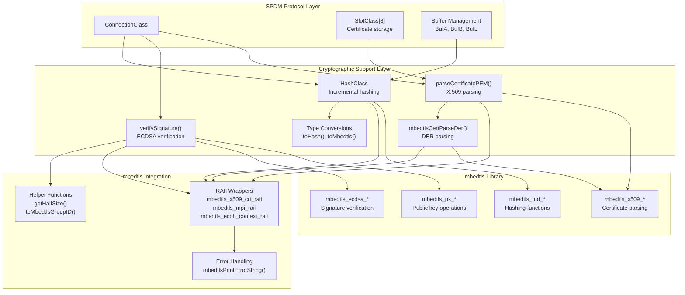
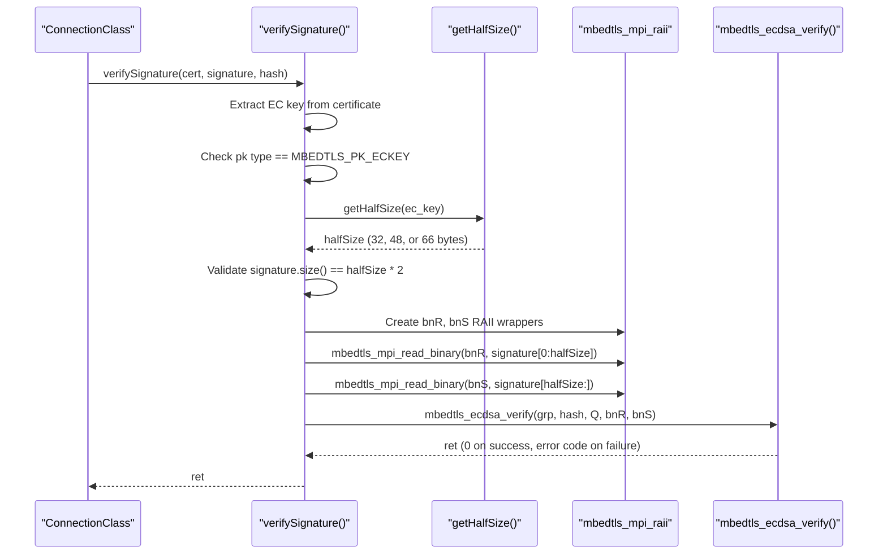
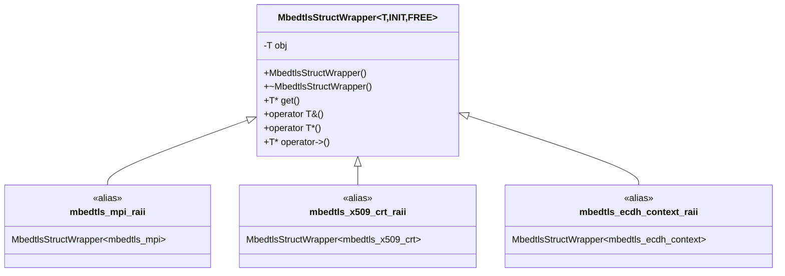
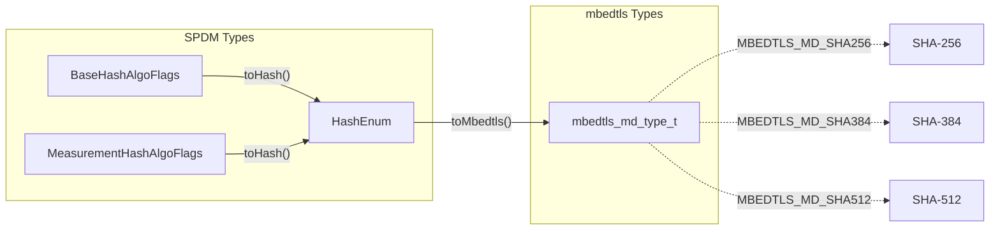
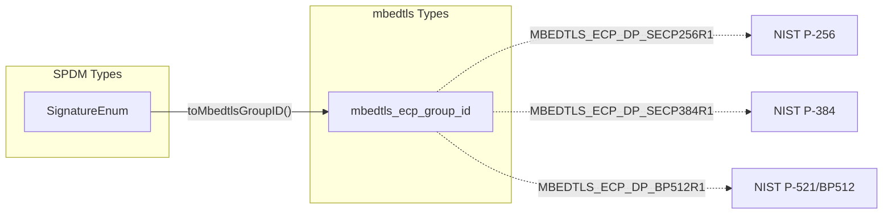

<!-- source: DeepWiki mcp.deepwiki.com · repo NVIDIA/spdm · page 2.4 Cryptographic Support · fetched 2026-10-26 -->

# Cryptographic Support

<details>
<summary>Relevant source files</summary>

The following files were used as context for generating this wiki page:

- [libspdmcpp/headers_public/spdmcpp/hash.hpp](libspdmcpp/headers_public/spdmcpp/hash.hpp)
- [libspdmcpp/headers_public/spdmcpp/mbedtls_support.hpp](libspdmcpp/headers_public/spdmcpp/mbedtls_support.hpp)

</details>


This document describes the cryptographic support layer in `libspdmcpp`, which provides the cryptographic primitives required for SPDM protocol operations. The library integrates with mbedtls to provide hashing, certificate parsing, signature verification, and other cryptographic operations.

For detailed information on specific cryptographic subsystems, see:
- Hashing operations and `HashClass`: [Hashing](#2.4.1)
- Certificate parsing and verification: [Certificate Parsing and Verification](#2.4.2)

## Purpose and Scope

The cryptographic support layer serves as an abstraction over mbedtls, providing SPDM-specific cryptographic operations including:

- **Hash computation**: SHA-256, SHA-384, SHA-512 for transcript hashing and measurement verification
- **Certificate parsing**: X.509 DER and PEM certificate chain processing
- **Signature verification**: ECDSA signature verification using certificate public keys
- **Cryptographic type conversions**: Mapping SPDM algorithm enumerations to mbedtls types

All cryptographic operations are implemented in [libspdmcpp/headers_public/spdmcpp/mbedtls_support.hpp]() and [libspdmcpp/headers_public/spdmcpp/hash.hpp]().

**Sources**: [libspdmcpp/headers_public/spdmcpp/mbedtls_support.hpp:1-463](), [libspdmcpp/headers_public/spdmcpp/hash.hpp:1-263]()

## Architecture Overview



The cryptographic layer sits between the SPDM protocol implementation (`ConnectionClass`) and the underlying mbedtls library. It provides SPDM-specific abstractions while managing mbedtls resources through RAII wrappers.

**Sources**: [libspdmcpp/headers_public/spdmcpp/mbedtls_support.hpp:42-462](), [libspdmcpp/headers_public/spdmcpp/hash.hpp:100-262]()

## Key Components

### Hash Operations

The `HashClass` provides incremental hashing capabilities for computing transcript hashes across multiple SPDM protocol phases. See [Hashing](#2.4.1) for detailed documentation.

| Component | Purpose | File Location |
|-----------|---------|---------------|
| `HashClass` | Incremental hash computation | [libspdmcpp/headers_public/spdmcpp/hash.hpp:113-260]() |
| `HashClass::compute()` | Static method for one-shot hashing | [libspdmcpp/headers_public/spdmcpp/hash.hpp:122-150]() |
| `HashClass::setup()` | Initialize hash algorithm | [libspdmcpp/headers_public/spdmcpp/hash.hpp:194-201]() |
| `HashClass::update()` | Add data to hash computation | [libspdmcpp/headers_public/spdmcpp/hash.hpp:205-229]() |
| `HashClass::hashFinish()` | Finalize and retrieve hash | [libspdmcpp/headers_public/spdmcpp/hash.hpp:235-250]() |

**Sources**: [libspdmcpp/headers_public/spdmcpp/hash.hpp:100-262]()

### Certificate Operations

Certificate parsing and verification operations process X.509 certificates in DER and PEM formats. See [Certificate Parsing and Verification](#2.4.2) for detailed documentation.

| Function | Purpose | Return Type |
|----------|---------|-------------|
| `parseCertificatePEM()` | Parse PEM certificate and extract metadata | `CertificateInfo` |
| `mbedtlsCertParseDer()` | Parse DER certificate from buffer | `std::pair<int, std::unique_ptr<mbedtls_x509_crt_raii>>` |
| `getKeyUsage()` | Extract key usage flags from certificate | `std::vector<std::string>` |
| `convertMbedtlsTime()` | Convert mbedtls time to Unix timestamp | `uint64_t` |
| `mbedtlsToInfoString()` | Convert certificate to human-readable string | `std::string` |

**Sources**: [libspdmcpp/headers_public/spdmcpp/mbedtls_support.hpp:64-88](), [libspdmcpp/headers_public/spdmcpp/mbedtls_support.hpp:267-290](), [libspdmcpp/headers_public/spdmcpp/mbedtls_support.hpp:301-317](), [libspdmcpp/headers_public/spdmcpp/mbedtls_support.hpp:335-367](), [libspdmcpp/headers_public/spdmcpp/mbedtls_support.hpp:387-460]()

### Signature Verification

#### ECDSA Signature Verification Flow



The `verifySignature()` function implements ECDSA signature verification for SPDM protocol messages. It handles NIST P-256, P-384, and P-521 curves.

**Implementation Details**:
- Signature format: Concatenation of R and S components (each `halfSize` bytes)
- Supported curves: SECP256R1 (32-byte half), SECP384R1 (48-byte half), BP512R1 (66-byte half)
- Uses `mbedtls_mpi_raii` wrappers for automatic memory management of big integers
- Extracts EC keypair from certificate using `mbedtls_pk_ec()`

**Sources**: [libspdmcpp/headers_public/spdmcpp/mbedtls_support.hpp:192-255](), [libspdmcpp/headers_public/spdmcpp/mbedtls_support.hpp:108-143]()

## RAII Wrappers for mbedtls Structures

The library provides RAII (Resource Acquisition Is Initialization) wrappers for mbedtls structures to ensure proper resource cleanup and exception safety.

### MbedtlsStructWrapper Template



The `MbedtlsStructWrapper` template automatically calls the appropriate initialization function in the constructor and the free function in the destructor, preventing resource leaks.

| Type Alias | Wrapped Structure | Init Function | Free Function |
|------------|-------------------|---------------|---------------|
| `mbedtls_mpi_raii` | `mbedtls_mpi` | `mbedtls_mpi_init` | `mbedtls_mpi_free` |
| `mbedtls_x509_crt_raii` | `mbedtls_x509_crt` | `mbedtls_x509_crt_init` | `mbedtls_x509_crt_free` |
| `mbedtls_ecdh_context_raii` | `mbedtls_ecdh_context` | `mbedtls_ecdh_init` | `mbedtls_ecdh_free` |

**Key Features**:
- Deleted copy and move operations to prevent double-free
- Implicit conversion operators for seamless use with mbedtls APIs
- Pointer access via `operator->()` for convenient member access

**Sources**: [libspdmcpp/headers_public/spdmcpp/mbedtls_support.hpp:144-191]()

## Type Conversion Functions

The cryptographic layer provides conversion functions to map SPDM algorithm enumerations to mbedtls types.

### Hash Algorithm Conversions



| Function | Input Type | Output Type | Purpose |
|----------|------------|-------------|---------|
| `toHash(BaseHashAlgoFlags)` | `BaseHashAlgoFlags` | `HashEnum` | Convert base hash flags to enum |
| `toHash(MeasurementHashAlgoFlags)` | `MeasurementHashAlgoFlags` | `HashEnum` | Convert measurement hash flags to enum |
| `toMbedtls(HashEnum)` | `HashEnum` | `mbedtls_md_type_t` | Convert hash enum to mbedtls type |

**Sources**: [libspdmcpp/headers_public/spdmcpp/hash.hpp:37-98]()

### Signature Algorithm Conversions



The `toMbedtlsGroupID()` function maps SPDM signature algorithms to mbedtls elliptic curve group identifiers:

| SPDM Signature | mbedtls Group ID | Curve | Half Size |
|----------------|------------------|-------|-----------|
| `TPM_ALG_ECDSA_ECC_NIST_P256` | `MBEDTLS_ECP_DP_SECP256R1` | NIST P-256 | 32 bytes |
| `TPM_ALG_ECDSA_ECC_NIST_P384` | `MBEDTLS_ECP_DP_SECP384R1` | NIST P-384 | 48 bytes |
| `TPM_ALG_ECDSA_ECC_NIST_P521` | `MBEDTLS_ECP_DP_BP512R1` | Brainpool P512R1 | 66 bytes |

**Sources**: [libspdmcpp/headers_public/spdmcpp/mbedtls_support.hpp:90-105](), [libspdmcpp/headers_public/spdmcpp/mbedtls_support.hpp:108-143]()

## Error Handling

The cryptographic layer provides helper functions for consistent error reporting from mbedtls operations.

| Function | Purpose | Usage |
|----------|---------|-------|
| `mbedtlsPrintErrorString()` | Convert error code to string | Inline error message printing |
| `mbedtlsPrintErrorLine()` | Print error with prefix | Formatted error output with context |

Both functions use `mbedtls_strerror()` internally to convert numeric error codes to human-readable strings.

**Example Usage Pattern**:
```cpp
int ret = mbedtls_x509_crt_parse(cert, data, size);
if (ret < 0) {
    mbedtlsPrintErrorLine(log, "Certificate parse error", ret);
    return ERROR;
}
```

**Sources**: [libspdmcpp/headers_public/spdmcpp/mbedtls_support.hpp:45-62]()

## Supported Algorithms

### Hash Algorithms

| Algorithm | SPDM Enum | mbedtls Type | Output Size |
|-----------|-----------|--------------|-------------|
| SHA-256 | `HashEnum::TPM_ALG_SHA_256` | `MBEDTLS_MD_SHA256` | 32 bytes |
| SHA-384 | `HashEnum::TPM_ALG_SHA_384` | `MBEDTLS_MD_SHA384` | 48 bytes |
| SHA-512 | `HashEnum::TPM_ALG_SHA_512` | `MBEDTLS_MD_SHA512` | 64 bytes |

**Note**: SHA3 variants are defined in SPDM enumerations but not currently supported due to mbedtls limitations.

**Sources**: [libspdmcpp/headers_public/spdmcpp/hash.hpp:84-98]()

### Signature Algorithms

| Algorithm | Curve | Signature Size | Key Usage |
|-----------|-------|----------------|-----------|
| ECDSA P-256 | SECP256R1 | 64 bytes (32+32) | Certificate signing, attestation |
| ECDSA P-384 | SECP384R1 | 96 bytes (48+48) | Certificate signing, attestation |
| ECDSA P-521 | BP512R1 | 132 bytes (66+66) | Certificate signing, attestation |

All signatures use the concatenated R||S format where R and S are big-endian encoded integers of equal size.

**Sources**: [libspdmcpp/headers_public/spdmcpp/mbedtls_support.hpp:90-105](), [libspdmcpp/headers_public/spdmcpp/mbedtls_support.hpp:228-232]()

## CertificateInfo Structure

The `CertificateInfo` structure holds parsed certificate metadata for D-Bus property exposure:

| Field | Type | Description |
|-------|------|-------------|
| `certificate` | `std::string` | PEM-encoded certificate |
| `issuer` | `std::string` | Issuer distinguished name |
| `subject` | `std::string` | Subject distinguished name |
| `notBefore` | `uint64_t` | Validity start (milliseconds since epoch) |
| `notAfter` | `uint64_t` | Validity end (milliseconds since epoch) |
| `keyUsage` | `std::vector<std::string>` | Key usage flags (e.g., "DigitalSignature", "KeyCertSign") |

This structure is populated by `parseCertificatePEM()` and used by `dbus_api::Responder` to expose certificate properties via D-Bus interfaces.

**Sources**: [libspdmcpp/headers_public/spdmcpp/mbedtls_support.hpp:370-378](), [libspdmcpp/headers_public/spdmcpp/mbedtls_support.hpp:387-460]()

---

