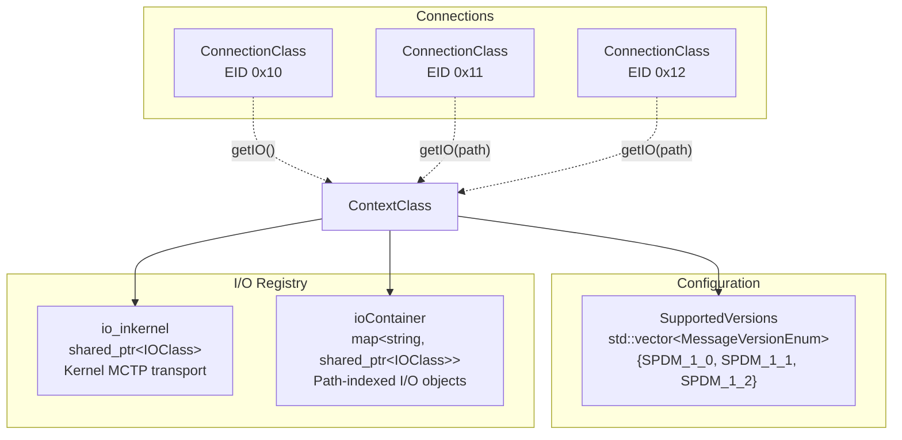

<!-- source: DeepWiki mcp.deepwiki.com · repo NVIDIA/spdm · page 2.5 Core Types and Interfaces · fetched 2026-10-26 -->

# Core Types and Interfaces

<details>
<summary>Relevant source files</summary>

The following files were used as context for generating this wiki page:

- [libspdmcpp/headers_public/spdmcpp/common.hpp](libspdmcpp/headers_public/spdmcpp/common.hpp)
- [libspdmcpp/headers_public/spdmcpp/context.hpp](libspdmcpp/headers_public/spdmcpp/context.hpp)
- [libspdmcpp/headers_public/spdmcpp/enum_defs.hpp](libspdmcpp/headers_public/spdmcpp/enum_defs.hpp)

</details>


## Purpose and Scope

This page documents the foundational types, enumerations, and abstract interfaces that form the base layer of `libspdmcpp`. These definitions establish the type system, return codes, protocol constants, and abstraction boundaries that all higher-level components depend on.

This page covers:
- Core enumerations for return codes, protocol states, and cryptographic algorithms
- Abstract interfaces (`TransportClass`, `IOClass`) that enable transport-agnostic design
- Global configuration through `ContextClass`
- Helper types for timeouts, layering, and utilities

For details on concrete implementations of these interfaces, see:
- Transport implementation: [MCTP Transport Implementation](#2.2.1)
- Protocol state machine using these types: [ConnectionClass and Protocol Flow](#2.1)
- Event handling: [Event System](#2.6)

---

## Core Enumerations

The library defines all enumerations using a custom macro system in [libspdmcpp/headers_public/spdmcpp/enum_defs.hpp](), which provides type-safe enumeration definitions with string conversion capabilities.

### RetStat: Return Status Codes

`RetStat` is the primary return type for all library operations. It uses signed 32-bit integers to distinguish success, warnings, and errors.

[libspdmcpp/headers_public/spdmcpp/enum_defs.hpp:23-56]()

| Value | Constant | Meaning |
|-------|----------|---------|
| 0 | `OK` | Operation succeeded |
| 1 | `WARNING_BUFFER_TOO_BIG` | Success with warning |
| -1 | `ERROR_UNKNOWN` | Unspecified error |
| -2 | `ERROR_BUFFER_TOO_SMALL` | Buffer capacity insufficient |
| -3 | `ERROR_WRONG_REQUEST_RESPONSE_CODE` | Unexpected message type |
| -4 | `ERROR_UNKNOWN_REQUEST_RESPONSE_CODE` | Unknown message type |
| -5 | `ERROR_RESPONSE` | SPDM error response received |
| -6 | `ERROR_TIMEOUT` | Operation timed out |
| -7 | `ERROR_INVALID_HEADER_VERSION` | Invalid SPDM header |
| -8 | `ERROR_UNSUPPORTED_SPDM_VERSION` | Unsupported SPDM version |
| -9 to -14 | Certificate/Authentication errors | Certificate chain validation failures |
| -15 to -17 | Capability errors | Missing required capabilities |
| -18 to -27 | Protocol errors | MCTP/SPDM protocol violations |
| -28 | `ERROR_UNSUPPORTED_ALGO` | Algorithm not supported |

**Sources:** [libspdmcpp/headers_public/spdmcpp/enum_defs.hpp:23-56]()

---

### Protocol State Enumerations

#### ConnectionInfoEnum

Tracks the stages of information collected during SPDM negotiation.

[libspdmcpp/headers_public/spdmcpp/enum_defs.hpp:58-66]()


**Sources:** [libspdmcpp/headers_public/spdmcpp/enum_defs.hpp:58-66]()

#### SlotInfoEnum

Indexes the types of information stored per certificate slot (0-7).

[libspdmcpp/headers_public/spdmcpp/enum_defs.hpp:68-72]()

| Value | Name | Purpose |
|-------|------|---------|
| 0 | `DIGEST` | Certificate chain digest |
| 1 | `CERTIFICATES` | Full certificate chain |

**Sources:** [libspdmcpp/headers_public/spdmcpp/enum_defs.hpp:68-72]()

---

### Cryptographic Algorithm Enumerations

#### HashEnum

Supported hash algorithms matching TPM Algorithm Registry values.

[libspdmcpp/headers_public/spdmcpp/enum_defs.hpp:74-80]()

| Value | Algorithm | Output Size |
|-------|-----------|-------------|
| 0 | `NONE` | N/A |
| 1 | `TPM_ALG_SHA_256` | 32 bytes |
| 2 | `TPM_ALG_SHA_384` | 48 bytes |
| 3 | `TPM_ALG_SHA_512` | 64 bytes |
| 4 | `INVALID` | Error marker |

#### SignatureEnum

Supported signature algorithms for authentication and measurements.

[libspdmcpp/headers_public/spdmcpp/enum_defs.hpp:82-94]()

**RSA Algorithms:**
- `TPM_ALG_RSASSA_2048`, `TPM_ALG_RSAPSS_2048` (values 1-2)
- `TPM_ALG_RSASSA_3072`, `TPM_ALG_RSAPSS_3072` (values 3-4)
- `TPM_ALG_RSASSA_4096`, `TPM_ALG_RSAPSS_4096` (values 5-6)

**ECDSA Algorithms:**
- `TPM_ALG_ECDSA_ECC_NIST_P256` (value 7)
- `TPM_ALG_ECDSA_ECC_NIST_P384` (value 8)
- `TPM_ALG_ECDSA_ECC_NIST_P521` (value 9)

**Sources:** [libspdmcpp/headers_public/spdmcpp/enum_defs.hpp:74-94]()

---

### SPDM Protocol Enumerations

#### MessageVersionEnum

SPDM specification versions supported by the library.

[libspdmcpp/headers_public/spdmcpp/enum_defs.hpp:104-109]()

| Value | Version | Hex Encoding |
|-------|---------|--------------|
| 0x10 | `SPDM_1_0` | Version 1.0 |
| 0x11 | `SPDM_1_1` | Version 1.1 |
| 0x12 | `SPDM_1_2` | Version 1.2 |

#### RequestResponseEnum

Complete set of SPDM request and response message codes.

[libspdmcpp/headers_public/spdmcpp/enum_defs.hpp:113-157]()

```mermaid
graph TB
    subgraph "Request Codes (0x80-0xFF)"
        REQ_DIGESTS["REQUEST_GET_DIGESTS<br/>0x81"]
        REQ_CERT["REQUEST_GET_CERTIFICATE<br/>0x82"]
        REQ_CHALLENGE["REQUEST_CHALLENGE<br/>0x83"]
        REQ_VERSION["REQUEST_GET_VERSION<br/>0x84"]
        REQ_MEAS["REQUEST_GET_MEASUREMENTS<br/>0xE0"]
        REQ_CAPAB["REQUEST_GET_CAPABILITIES<br/>0xE1"]
        REQ_ALGO["REQUEST_NEGOTIATE_ALGORITHMS<br/>0xE3"]
        REQ_KEY_EX["REQUEST_KEY_EXCHANGE<br/>0xE4"]
        REQ_FINISH["REQUEST_FINISH<br/>0xE5"]
    end
    
    subgraph "Response Codes (0x01-0x7F)"
        RESP_DIGESTS["RESPONSE_DIGESTS<br/>0x01"]
        RESP_CERT["RESPONSE_CERTIFICATE<br/>0x02"]
        RESP_CHALLENGE["RESPONSE_CHALLENGE_AUTH<br/>0x03"]
        RESP_VERSION["RESPONSE_VERSION<br/>0x04"]
        RESP_MEAS["RESPONSE_MEASUREMENTS<br/>0x60"]
        RESP_CAPAB["RESPONSE_CAPABILITIES<br/>0x61"]
        RESP_ALGO["RESPONSE_ALGORITHMS<br/>0x63"]
        RESP_KEY_EX["RESPONSE_KEY_EXCHANGE_RSP<br/>0x64"]
        RESP_FINISH["RESPONSE_FINISH_RSP<br/>0x65"]
        RESP_ERROR["RESPONSE_ERROR<br/>0x7F"]
    end
    
    REQ_VERSION -.->|"pair"| RESP_VERSION
    REQ_CAPAB -.->|"pair"| RESP_CAPAB
    REQ_ALGO -.->|"pair"| RESP_ALGO
    REQ_DIGESTS -.->|"pair"| RESP_DIGESTS
    REQ_CERT -.->|"pair"| RESP_CERT
    REQ_MEAS -.->|"pair"| RESP_MEAS
```



The enumeration includes:
- **SPDM 1.0 messages**: Version, capabilities, algorithms, digests, certificates, challenge, measurements
- **SPDM 1.1 additions**: Key exchange, finish, PSK operations, heartbeat, key update, encapsulation
- **Error responses**: `RESPONSE_ERROR` (0x7F) for all error conditions

**Sources:** [libspdmcpp/headers_public/spdmcpp/enum_defs.hpp:113-157]()

#### AlgTypeEnum

Algorithm type identifiers for negotiation.

[libspdmcpp/headers_public/spdmcpp/enum_defs.hpp:159-165]()

| Value | Type | Used In |
|-------|------|---------|
| 2 | `DHE` | Key exchange |
| 3 | `AEADCipherSuite` | Encryption |
| 4 | `ReqBaseAsymAlg` | Requester authentication |
| 5 | `KeySchedule` | Key derivation |

**Sources:** [libspdmcpp/headers_public/spdmcpp/enum_defs.hpp:159-165]()

---

### Transport Enumerations

#### MCTPMessageTypeEnum

MCTP message type codes per DSP0236 specification.

[libspdmcpp/headers_public/spdmcpp/enum_defs.hpp:97-102]()

| Value | Type | Purpose |
|-------|------|---------|
| 0x00 | `CONTROL` | MCTP control messages |
| 0x01 | `PLDM` | Platform Level Data Model |
| 0x05 | `SPDM` | Security Protocol and Data Model |
| 0x06 | `SECURED` | Secured SPDM messages |

**Sources:** [libspdmcpp/headers_public/spdmcpp/enum_defs.hpp:97-102]()

---

## Abstract Interfaces

The library uses abstract base classes to decouple protocol logic from transport and I/O mechanisms.

### Interface Hierarchy

```mermaid
graph TB
    subgraph "Abstract Interfaces"
        TransportClass["TransportClass<br/>Transport framing interface"]
        IOClass["IOClass<br/>Socket I/O interface"]
        NonCopyable["NonCopyable<br/>Base for non-copyable types"]
    end
    
    subgraph "Helper Types"
        LayerState["LayerState<br/>Buffer layout tracker"]
    end
    
    subgraph "Concrete Implementations"
        MctpTransportClass["MctpTransportClass<br/>MCTP framing"]
        MctpIoClass["MctpIoClass<br/>AF_MCTP / AF_UNIX sockets"]
    end
    
    subgraph "Protocol Layer"
        ConnectionClass["ConnectionClass<br/>SPDM state machine"]
    end
    
    NonCopyable --> TransportClass
    NonCopyable --> IOClass
    TransportClass -.->|"uses"| LayerState
    TransportClass <|..|"implements"| MctpTransportClass
    IOClass <|..|"implements"| MctpIoClass
    ConnectionClass -->|"depends on"| TransportClass
    TransportClass -->|"depends on"| IOClass
```

**Sources:** [libspdmcpp/headers_public/spdmcpp/common.hpp:107-268]()

---

### TransportClass Interface

Provides transport-layer framing for SPDM messages. Implementations add protocol-specific headers (e.g., MCTP) around SPDM payloads.

[libspdmcpp/headers_public/spdmcpp/common.hpp:119-239]()

#### Key Methods

| Method | Purpose | Called By |
|--------|---------|-----------|
| `encodePre()` | Reserve space for transport header | `ConnectionClass` before encoding |
| `encodePost()` | Finalize transport header after SPDM message | `ConnectionClass` after encoding |
| `decode()` | Strip transport header from received data | `ConnectionClass` on receive |
| `setupTimeout()` | Configure timeout for response | `ConnectionClass` when waiting |
| `clearTimeout()` | Cancel pending timeout | `ConnectionClass` on receive |

#### LayerState Helper

Tracks buffer layout during encoding/decoding to coordinate between layers.

[libspdmcpp/headers_public/spdmcpp/common.hpp:132-149]()

```cpp
class LayerState {
    size_t Offset;  // Start position of this layer
    size_t Size;    // Size of this layer's data
    
    size_t getEndOffset() const {
        return Offset + Size;  // Where next layer begins
    }
};
```

**Encoding Flow:**
1. `ConnectionClass` allocates buffer
2. Calls `TransportClass::encodePre()` to reserve header space
3. Writes SPDM message at `LayerState.getEndOffset()`
4. Calls `TransportClass::encodePost()` to finalize headers

**Decoding Flow:**
1. `IOClass` reads full packet into buffer
2. `TransportClass::decode()` validates and strips transport headers
3. `ConnectionClass` processes SPDM message starting at `LayerState.getEndOffset()`

**Sources:** [libspdmcpp/headers_public/spdmcpp/common.hpp:119-239]()

---

### IOClass Interface

Provides abstract I/O operations for reading and writing complete transport+SPDM packets.

[libspdmcpp/headers_public/spdmcpp/common.hpp:248-268]()

#### Methods

```cpp
class IOClass {
    virtual RetStat write(const std::vector<uint8_t>& buf, 
                         timeout_us_t timeout = timeoutUsInfinite) = 0;
    
    virtual RetStat read(std::vector<uint8_t>& buf,
                        timeout_us_t timeout = timeoutUsInfinite) = 0;
};
```

| Method | Direction | Parameters | Returns |
|--------|-----------|------------|---------|
| `write()` | Outbound | Buffer, timeout | `RetStat::OK` or error |
| `read()` | Inbound | Output buffer, timeout | `RetStat::OK` or error |

**Timeout Semantics:**
- `timeoutUsInfinite`: Block indefinitely
- Positive value: Microsecond timeout
- Returns `RetStat::ERROR_TIMEOUT` on expiration

**Sources:** [libspdmcpp/headers_public/spdmcpp/common.hpp:248-268]()

---

## Context and Configuration

### ContextClass

Manages global configuration and I/O resource registry for multiple SPDM connections.

[libspdmcpp/headers_public/spdmcpp/context.hpp:40-163]()



#### Key Methods

[libspdmcpp/headers_public/spdmcpp/context.hpp:56-150]()

| Method | Purpose | Notes |
|--------|---------|-------|
| `registerIo(io)` | Register default I/O | For kernel MCTP transport |
| `registerIo(io, path)` | Register path-specific I/O | For userspace demux daemon |
| `unregisterIo()` | Remove default I/O | Must be called before destruction |
| `unregisterIo(path)` | Remove path-specific I/O | Throws if path not registered |
| `getIO()` | Retrieve default I/O | Returns `shared_ptr<IOClass>` |
| `getIO(path)` | Retrieve path-specific I/O | Throws if path not found |
| `getSupportedVersions()` | Get version list | Returns sorted vector (highest first) |
| `isIOPathRegistered(path)` | Check registration | Boolean query |

#### Default Configuration

Constructor initializes with all supported SPDM versions sorted in descending order for negotiation:

[libspdmcpp/headers_public/spdmcpp/context.hpp:47-54]()

```cpp
ContextClass() {
    SupportedVersions.push_back(MessageVersionEnum::SPDM_1_0);
    SupportedVersions.push_back(MessageVersionEnum::SPDM_1_1);
    SupportedVersions.push_back(MessageVersionEnum::SPDM_1_2);
    std::sort(SupportedVersions.begin(), SupportedVersions.end(),
              std::greater());  // {1.2, 1.1, 1.0}
}
```

**Sources:** [libspdmcpp/headers_public/spdmcpp/context.hpp:40-163]()

---

## Helper Types and Utilities

### Timeout Types

Type-safe timeout durations with special sentinel values.

[libspdmcpp/headers_public/spdmcpp/common.hpp:36-44]()

```cpp
using timeout_us_t = uint64_t;  // Microseconds
constexpr timeout_us_t timeoutUsInfinite = std::numeric_limits<uint64_t>::max();
constexpr timeout_us_t timeoutUsMaximum = timeoutUsInfinite - 1;

using timeout_ms_t = uint64_t;  // Milliseconds
constexpr timeout_ms_t timeoutMsInfinite = std::numeric_limits<uint64_t>::max();
constexpr timeout_ms_t timeoutMsMaximum = timeoutMsInfinite - 1;
```

**Usage Pattern:**
- Infinite timeout for blocking operations: `timeoutUsInfinite`
- Maximum finite timeout: `timeoutUsMaximum` or `timeoutMsMaximum`
- Concrete timeouts: Positive integer values

**Sources:** [libspdmcpp/headers_public/spdmcpp/common.hpp:36-44]()

---

### SPDM 1.2 Constants and Utilities

#### Data Transfer Sizes

[libspdmcpp/headers_public/spdmcpp/common.hpp:46-51]()

```cpp
constexpr uint32_t spdmMinDataTransferSize12 = 42;  // SPDM 1.2 minimum
constexpr uint32_t spdmDefaultDataTransferSize = 64 * 1024;  // 64KB
constexpr uint32_t spdmDefaultMaxSpdmMsgSize = 64 * 1024;    // 64KB
```

#### Signature Context Construction

SPDM 1.2 requires a specific prefix structure for signature verification per DSP0274 Section 15.

[libspdmcpp/headers_public/spdmcpp/common.hpp:53-100]()

```cpp
constexpr const char* SPDM_VERSION_1_2_SIGNING_PREFIX = "dmtf-spdm-v1.2.*";  // 16 chars
constexpr size_t SPDM_SIGNING_CONTEXT_PREFIX_REPEAT_COUNT = 4;  // 64 bytes total
constexpr size_t SPDM_COMBINED_PREFIX_SIZE = 100;

std::vector<uint8_t> buildSpdm12SignatureContext(
    const char* context,        // e.g., "measurements signing"
    bool is_requester,          // Signing role
    const std::vector<uint8_t>& hash  // Data to be signed
);
```

**Context Structure:**
1. Repeat prefix 4 times: `"dmtf-spdm-v1.2.*"` × 4 = 64 bytes
2. Zero byte separator: 1 byte
3. Zero padding to align
4. Role prefix: `"requester-"` or `"responder-"`
5. Context string: e.g., `"measurements signing"`
6. Hash value appended

Total prefix size: 100 bytes before hash

**Sources:** [libspdmcpp/headers_public/spdmcpp/common.hpp:46-100]()

---

### NonCopyable Base Class

Helper to explicitly delete copy and move operations for classes that should not be copied.

[libspdmcpp/headers_public/spdmcpp/common.hpp:107-117]()

```cpp
struct NonCopyable {
    NonCopyable() = default;
    ~NonCopyable() = default;
    
    NonCopyable(const NonCopyable&) = delete;
    NonCopyable& operator=(const NonCopyable&) = delete;
    
    NonCopyable(NonCopyable&&) = delete;
    NonCopyable& operator=(NonCopyable&&) = delete;
};
```

**Inheritance Pattern:**
- `TransportClass : public NonCopyable`
- `IOClass : NonCopyable`
- Prevents accidental copying of stateful protocol objects

**Sources:** [libspdmcpp/headers_public/spdmcpp/common.hpp:107-117]()

---

## Type System Architecture

```mermaid
graph TB
    subgraph "Enumerations (enum_defs.hpp)"
        RetStat["RetStat<br/>Return codes"]
        HashEnum["HashEnum<br/>Hash algorithms"]
        SignatureEnum["SignatureEnum<br/>Signature algorithms"]
        MessageVersionEnum["MessageVersionEnum<br/>SPDM versions"]
        RequestResponseEnum["RequestResponseEnum<br/>Message types"]
        ConnectionInfoEnum["ConnectionInfoEnum<br/>Protocol phases"]
        SlotInfoEnum["SlotInfoEnum<br/>Certificate slot data"]
    end
    
    subgraph "Abstract Interfaces (common.hpp)"
        TransportClass["TransportClass<br/>encodePre/Post, decode"]
        IOClass["IOClass<br/>read, write"]
        LayerState["LayerState<br/>Offset, Size"]
    end
    
    subgraph "Configuration (context.hpp)"
        ContextClass["ContextClass<br/>SupportedVersions<br/>ioContainer"]
    end
    
    subgraph "Utilities (common.hpp)"
        TimeoutTypes["timeout_us_t<br/>timeout_ms_t"]
        SpdmConstants["spdmDefaultDataTransferSize<br/>SPDM_COMBINED_PREFIX_SIZE"]
        NonCopyable["NonCopyable"]
        BuildContext["buildSpdm12SignatureContext()"]
    end
    
    subgraph "Protocol Implementation"
        ConnectionClass["ConnectionClass<br/>State machine"]
        PacketStructures["Packet encode/decode<br/>Uses RequestResponseEnum"]
        HashClass["HashClass<br/>Uses HashEnum"]
    end
    
    ConnectionClass -.->|"returns"| RetStat
    ConnectionClass -.->|"uses"| TransportClass
    ConnectionClass -.->|"gets IO from"| ContextClass
    ConnectionClass -.->|"tracks"| ConnectionInfoEnum
    
    TransportClass -.->|"uses"| LayerState
    TransportClass -.->|"uses"| IOClass
    TransportClass -.->|"inherits"| NonCopyable
    
    ContextClass -.->|"stores"| MessageVersionEnum
    ContextClass -.->|"manages"| IOClass
    
    PacketStructures -.->|"uses"| RequestResponseEnum
    HashClass -.->|"implements"| HashEnum
    
    ConnectionClass -.->|"uses"| TimeoutTypes
    ConnectionClass -.->|"uses"| BuildContext
```



**Sources:** [libspdmcpp/headers_public/spdmcpp/enum_defs.hpp](), [libspdmcpp/headers_public/spdmcpp/common.hpp](), [libspdmcpp/headers_public/spdmcpp/context.hpp]()

---

