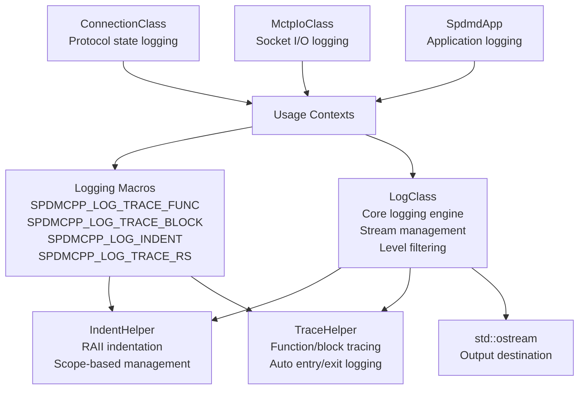
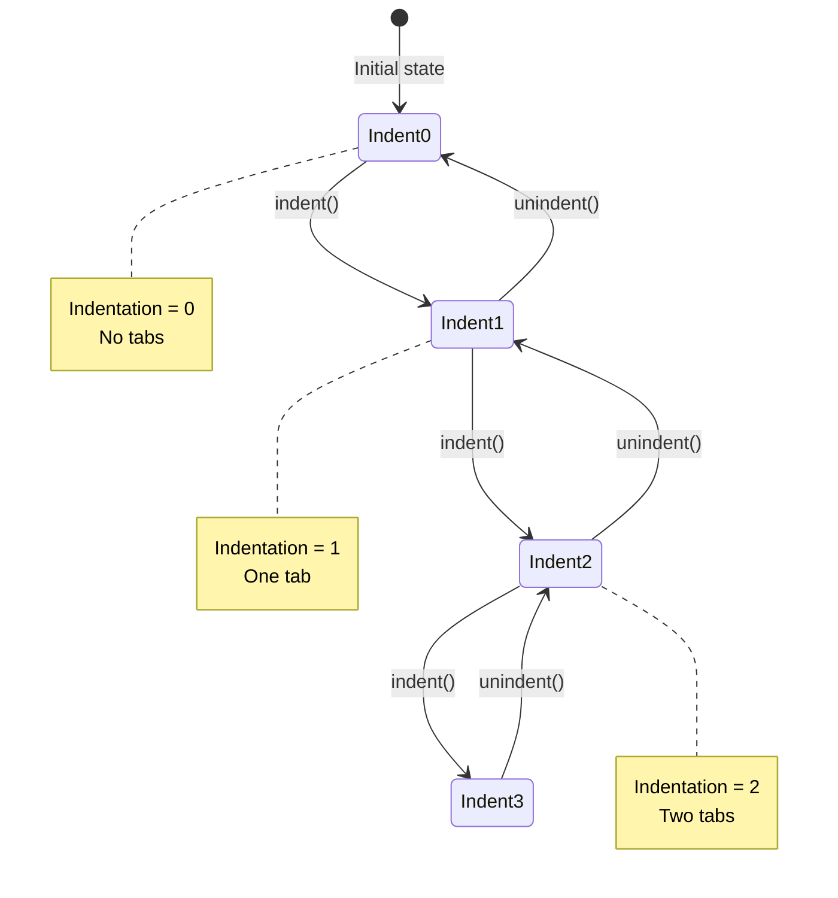
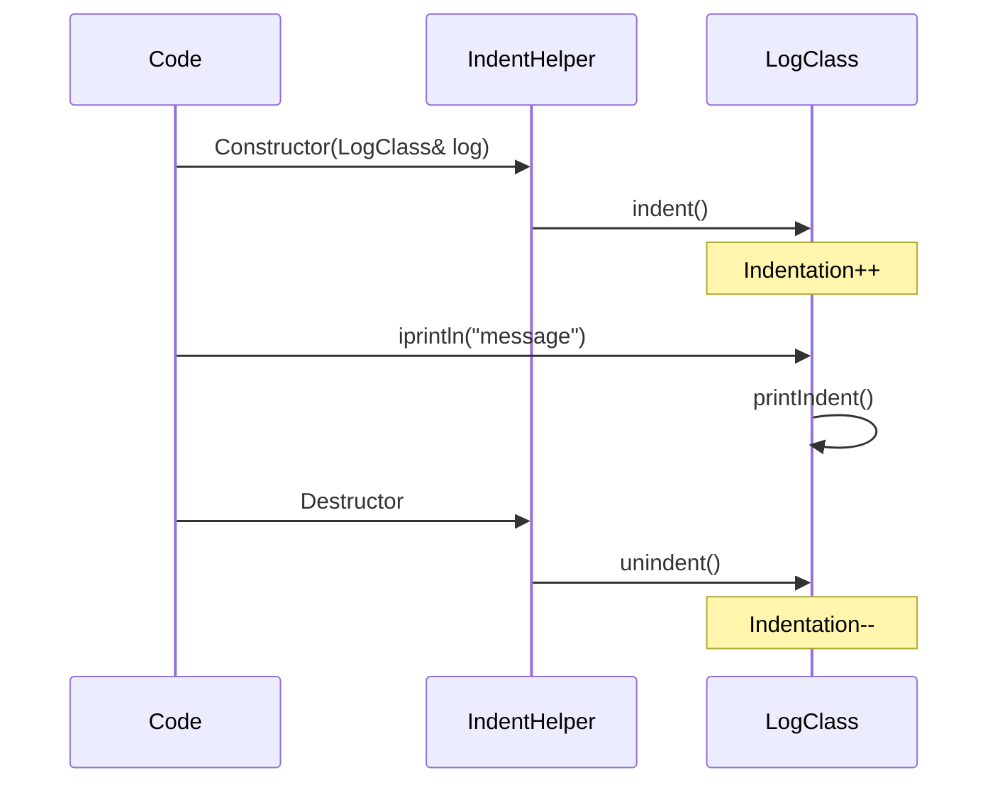
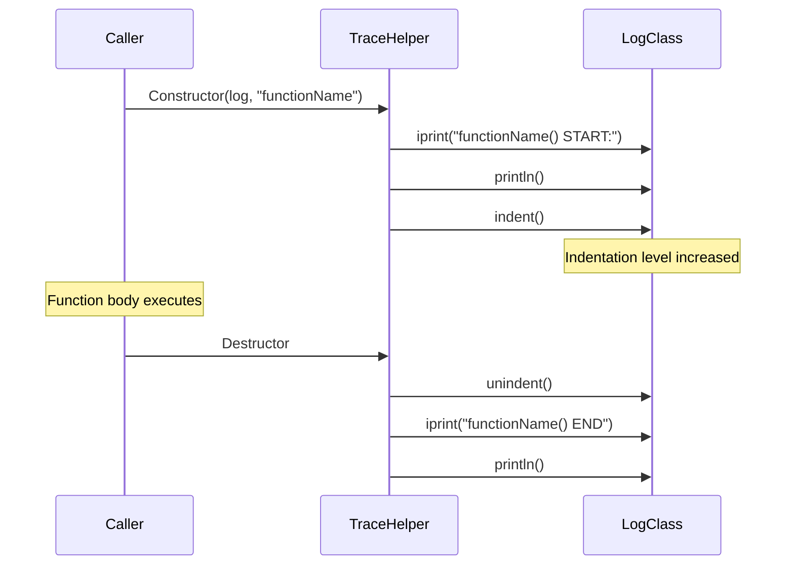
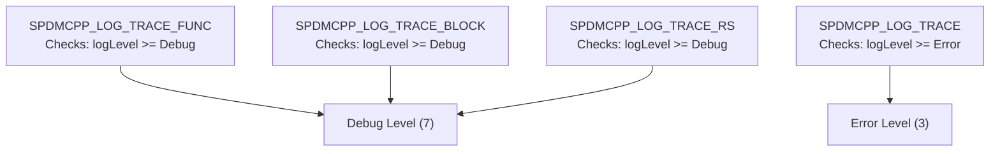
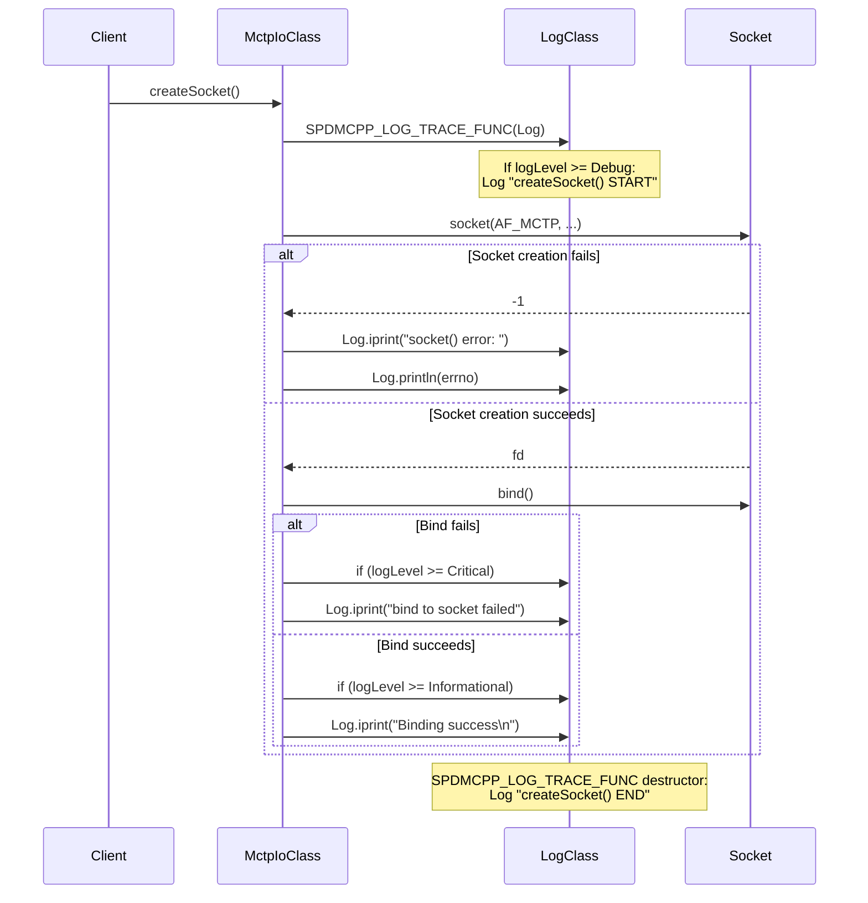
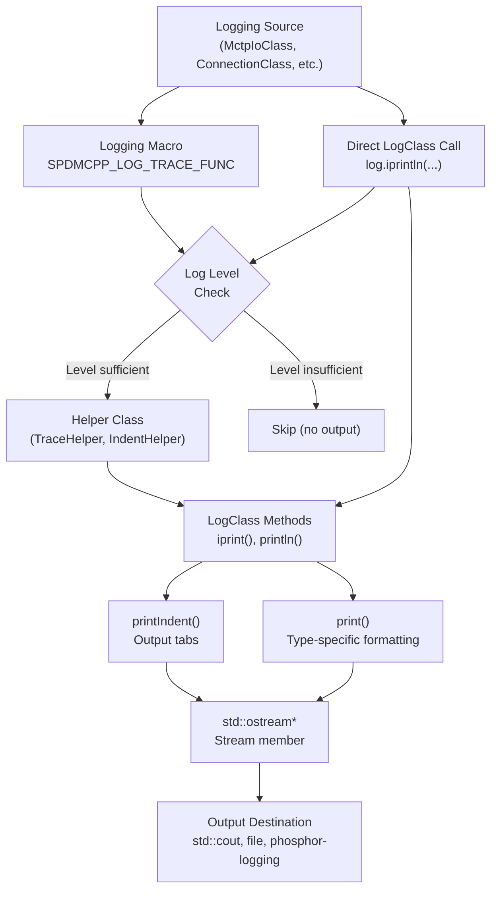

<!-- source: DeepWiki mcp.deepwiki.com · repo NVIDIA/spdm · page 2.7 Logging System · fetched 2026-10-26 -->

# Logging System

<details>
<summary>Relevant source files</summary>

The following files were used as context for generating this wiki page:

- [libspdmcpp/headers_public/spdmcpp/log.hpp](libspdmcpp/headers_public/spdmcpp/log.hpp)
- [libspdmcpp/headers_public/spdmcpp/mctp_support.hpp](libspdmcpp/headers_public/spdmcpp/mctp_support.hpp)

</details>


## Purpose and Scope

This document describes the logging infrastructure provided by `libspdmcpp` for diagnostic output, debugging, and operational monitoring. The logging system supports hierarchical log levels, automatic indentation, function tracing, and structured output. For information about the `SpdmdAppContext` configuration that integrates logging with phosphor-logging, see [Application Context](#3.1.1).

**Sources:** [libspdmcpp/headers_public/spdmcpp/log.hpp:1-406]()

---

## Architecture Overview

The logging system consists of three primary components working together to provide structured, hierarchical logging output:



**Sources:** [libspdmcpp/headers_public/spdmcpp/log.hpp:47-280](), [libspdmcpp/headers_public/spdmcpp/log.hpp:287-352]()

---

## LogClass Core Component

### Class Definition and Members

`LogClass` is the central logging component that manages output stream operations, log level filtering, and indentation state.

| Member | Type | Purpose |
|--------|------|---------|
| `logLevel` | `LogClass::Level` | Current log level threshold for filtering |
| `Stream` | `std::ostream*` | Output stream for all log messages |
| `Indentation` | `uint16_t` | Current indentation depth counter |

**Sources:** [libspdmcpp/headers_public/spdmcpp/log.hpp:274-279]()

### Log Levels

The log level enumeration matches phosphor-logging severity levels for OpenBMC integration:


**Level Filtering Behavior:** Messages are printed only if their severity is less than or equal to the configured `logLevel`. For example, if `logLevel = LogClass::Level::Warning`, only Emergency through Warning messages appear.

**Sources:** [libspdmcpp/headers_public/spdmcpp/log.hpp:52-62]()

### Print Function Variants

`LogClass` provides multiple overloaded `print()` functions for type-safe output:

| Function Pattern | Supported Types | Example Usage |
|-----------------|-----------------|---------------|
| `print(T value)` | Integers (int8_t - int64_t, uint8_t - uint64_t) | `log.print(42)` |
| `print(const char*)` | C-strings | `log.print("message")` |
| `print(const std::string&)` | std::string | `log.print(str)` |
| `print(std::span<const uint8_t>)` | Byte arrays | `log.print(buffer)` |
| `print(const std::vector<uint8_t>&)` | Byte vectors | `log.print(data)` |
| `print(std::chrono::time_point)` | Timestamps | `log.print(now())` |
| `print(const T&)` | Enumerations | `log.print(RetStat::OK)` |

**Hexadecimal Byte Array Output:** The byte array printing functions format output as space-separated hex values with leading zeros (e.g., `"0a 1f 3c 4d"`).

**Sources:** [libspdmcpp/headers_public/spdmcpp/log.hpp:86-214]()

### Indentation Management



**Indentation Functions:**
- `indent()`: Increments indentation counter [libspdmcpp/headers_public/spdmcpp/log.hpp:250-253]()
- `unindent()`: Decrements indentation counter with underflow protection [libspdmcpp/headers_public/spdmcpp/log.hpp:258-267]()
- `printIndent()`: Outputs tabs equal to current indentation level [libspdmcpp/headers_public/spdmcpp/log.hpp:238-245]()

**Print Variants with Indentation:**
- `iprint(...)`: Prints indentation, then arguments
- `println(...)`: Prints arguments, then newline
- `iprintln(...)`: Prints indentation, arguments, then newline

**Sources:** [libspdmcpp/headers_public/spdmcpp/log.hpp:216-233](), [libspdmcpp/headers_public/spdmcpp/log.hpp:238-267]()

---

## Helper Classes

### IndentHelper - RAII Indentation

`IndentHelper` provides automatic indentation management using RAII (Resource Acquisition Is Initialization) pattern:

```cpp
// Conceptual usage (actual usage via macro)
{
    IndentHelper helper(log);  // Calls log.indent()
    log.iprintln("Indented message");
    // ... more indented code ...
}  // Destructor calls log.unindent()
```

**Class Lifecycle:**



**Sources:** [libspdmcpp/headers_public/spdmcpp/log.hpp:287-307]()

### TraceHelper - Function and Block Tracing

`TraceHelper` automatically logs function entry and exit with indentation:



**Constructor Variants:**
1. **Function tracing:** `TraceHelper(LogClass& log, const std::string& func)` - Logs function name
2. **Block tracing:** `TraceHelper(LogClass& log, const std::string& func, const std::string& file, uint32_t line)` - Logs function name, file, and line number

**Sources:** [libspdmcpp/headers_public/spdmcpp/log.hpp:317-352]()

---

## Logging Macros

### Macro Definitions and Usage

| Macro | Purpose | Example Output |
|-------|---------|----------------|
| `SPDMCPP_LOG_TRACE_FUNC(log)` | Trace function entry/exit | `functionName() START:` ... `functionName() END` |
| `SPDMCPP_LOG_TRACE_BLOCK(log)` | Trace code block with location | `functionName() BLOCK START: @ file.cpp : 42` |
| `SPDMCPP_LOG_INDENT(log)` | RAII indentation for scope | (No output, just indentation) |
| `SPDMCPP_LOG_TRACE_RS(log, rs)` | Debug-level variable trace | `rs = OK; in: functionName() @ file.cpp : 42` |
| `SPDMCPP_LOG_TRACE(log, rs)` | Error-level variable trace | `rs = ERROR; in: functionName() @ file.cpp : 42` |

**Level-Based Filtering:**



**Sources:** [libspdmcpp/headers_public/spdmcpp/log.hpp:357-401]()

### Implementation Details

**SPDMCPP_LOG_TRACE_FUNC Macro:**
```cpp
#define SPDMCPP_LOG_TRACE_FUNC(log)                                    \
    if ((log).logLevel >= spdmcpp::LogClass::Level::Debug)             \
    {                                                                  \
        spdmcpp::TraceHelper log_trace_helper_##__LINE__((log), (__func__)); \
    }
```

The macro uses `__LINE__` in the helper variable name to ensure unique identifiers when multiple macros appear in the same scope.

**Sources:** [libspdmcpp/headers_public/spdmcpp/log.hpp:357-363]()

---

## Usage Patterns in libspdmcpp

### MctpIoClass Socket Operations

The `MctpIoClass` demonstrates typical logging patterns:



**Key Patterns:**
1. **Function entry tracing:** `SPDMCPP_LOG_TRACE_FUNC(Log)` at function start
2. **Conditional logging:** Check `Log.logLevel >= Level::X` before expensive operations
3. **Error reporting:** Always log critical errors with context (errno, error messages)
4. **Informational logging:** Log successful operations at appropriate levels

**Sources:** [libspdmcpp/headers_public/spdmcpp/mctp_support.hpp:224-266](), [libspdmcpp/headers_public/spdmcpp/mctp_support.hpp:280-335]()

### Write Operation Example

```cpp
inline RetStat MctpIoClass::write(const std::vector<uint8_t>& buf,
                                  [[maybe_unused]] timeout_us_t /*timeout*/)
{
    SPDMCPP_LOG_TRACE_FUNC(Log);  // Automatic function tracing
    ssize_t sent = 0;
    ssize_t toSend = static_cast<ssize_t>(buf.size());

    while (sent < toSend)
    {
        ssize_t ret = send(Socket, (void*)&buf[static_cast<size_t>(sent)],
                           static_cast<size_t>(toSend - sent), 0);
        if (ret <= 0)
        {
            if (Log.logLevel >= LogClass::Level::Critical)  // Conditional logging
            {
                Log.iprint("Send error:");
                Log.println(errno);
            }
            return RetStat::ERROR_UNKNOWN;
        }
        sent += ret;
    }
    return RetStat::OK;
}
```

**Sources:** [libspdmcpp/headers_public/spdmcpp/mctp_support.hpp:477-500]()

---

## Logging Output Flow

### Complete Message Path



**Sources:** [libspdmcpp/headers_public/spdmcpp/log.hpp:86-280]()

---

## Integration Points

### Phosphor-Logging Integration

The `spdmd` daemon can integrate with OpenBMC's phosphor-logging system via the `USE_PHOSPHOR_LOGGING` compile-time option. When enabled:

1. **Level mapping:** `LogClass::Level` enum matches phosphor-logging severity levels exactly
2. **Stream redirection:** The `std::ostream` can be connected to phosphor-logging output
3. **Structured logging:** Log messages can be tagged with metadata for the OpenBMC journal

**Sources:** [libspdmcpp/headers_public/spdmcpp/log.hpp:50-62]()

### MctpIoClass Constructor Pattern

Every class that uses logging stores a reference to a `LogClass` instance:

```cpp
class MctpIoClass : public IOClass
{
  public:
    explicit MctpIoClass(LogClass& log) : Log(log)
    {}
    
  private:
    LogClass& Log;  // Reference to logging instance
    // ...
};
```

This dependency injection pattern allows:
- **Centralized configuration:** Single log level controls all components
- **Consistent output:** All logs go to the same stream
- **Testability:** Mock logging implementations for unit tests

**Sources:** [libspdmcpp/headers_public/spdmcpp/mctp_support.hpp:199-364]()

---

## Example Logging Output

### Hierarchical Function Trace

Given the following code with proper logging:

```cpp
void outerFunction() {
    SPDMCPP_LOG_TRACE_FUNC(log);
    log.iprintln("Outer function logic");
    
    {
        SPDMCPP_LOG_INDENT(log);
        innerFunction();
    }
}

void innerFunction() {
    SPDMCPP_LOG_TRACE_FUNC(log);
    log.iprintln("Inner function logic");
}
```

**Expected Output (with logLevel = Debug):**
```
outerFunction() START:
	Outer function logic
		innerFunction() START:
			Inner function logic
		innerFunction() END
outerFunction() END
```

**Sources:** [libspdmcpp/headers_public/spdmcpp/log.hpp:310-373]()

---

## Summary of Key Classes and Macros

| Component | File | Lines | Purpose |
|-----------|------|-------|---------|
| `LogClass` | log.hpp | 47-280 | Core logging engine with level filtering and indentation |
| `LogClass::Level` | log.hpp | 52-62 | Severity enumeration (Emergency to Debug) |
| `IndentHelper` | log.hpp | 287-307 | RAII indentation management |
| `TraceHelper` | log.hpp | 317-352 | Automatic function/block entry/exit tracing |
| `SPDMCPP_LOG_TRACE_FUNC` | log.hpp | 357-363 | Function tracing macro (Debug level) |
| `SPDMCPP_LOG_TRACE_BLOCK` | log.hpp | 366-373 | Block tracing macro with file/line (Debug level) |
| `SPDMCPP_LOG_INDENT` | log.hpp | 310 | Scope-based indentation macro |
| `SPDMCPP_LOG_TRACE_RS` | log.hpp | 376-387 | Variable value tracing macro (Debug level) |
| `SPDMCPP_LOG_TRACE` | log.hpp | 390-401 | Variable value tracing macro (Error level) |

**Sources:** [libspdmcpp/headers_public/spdmcpp/log.hpp:1-406]()

---

