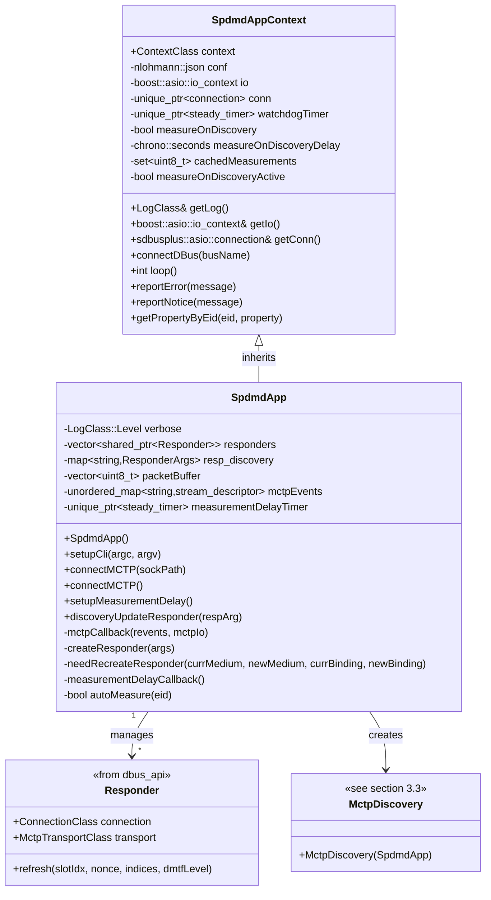
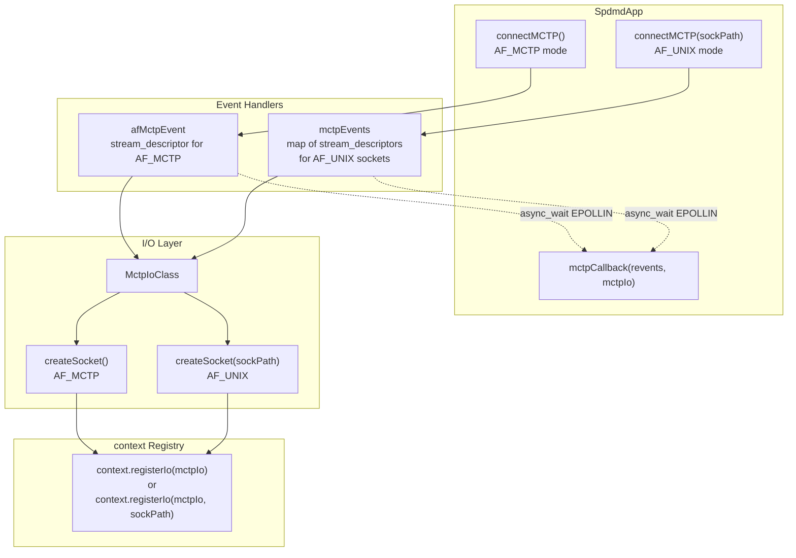
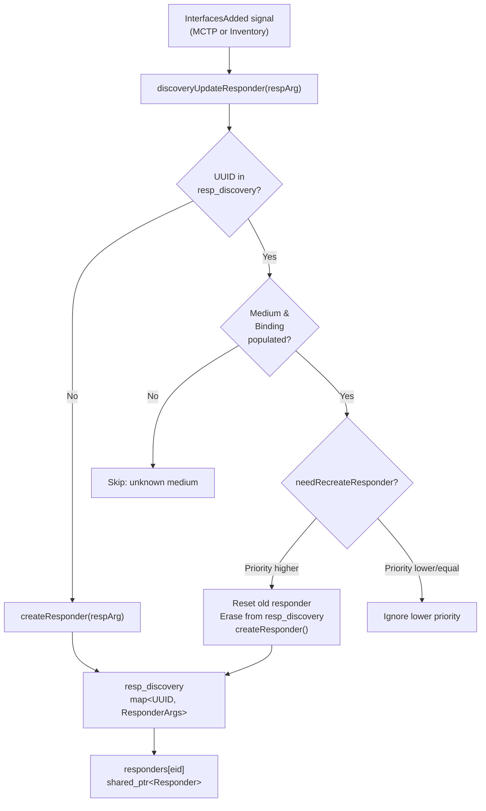
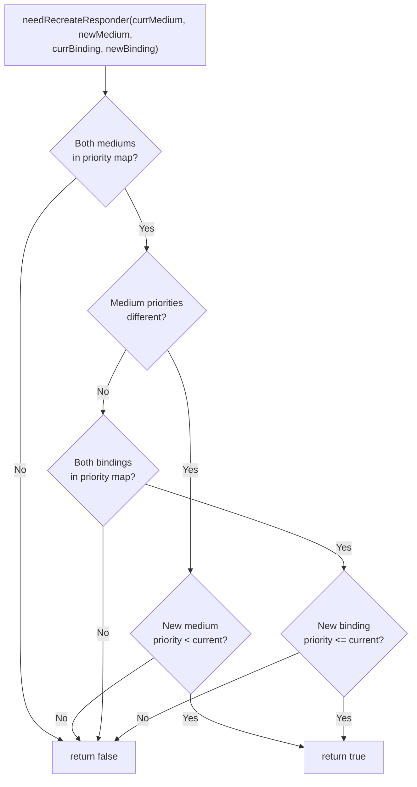
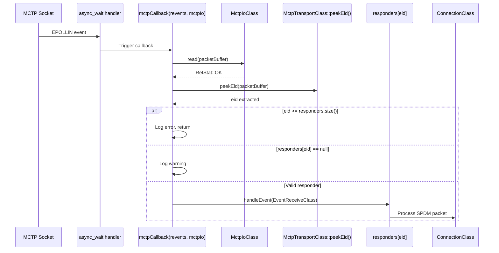
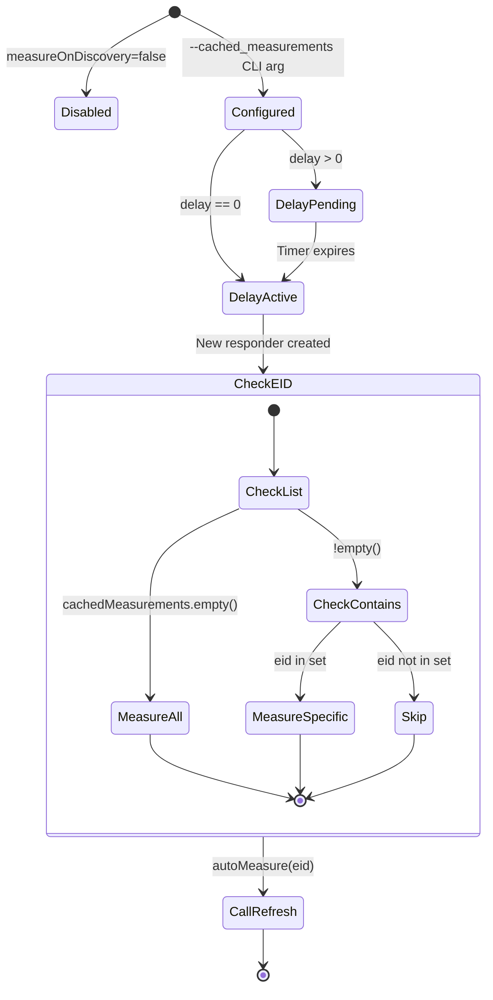
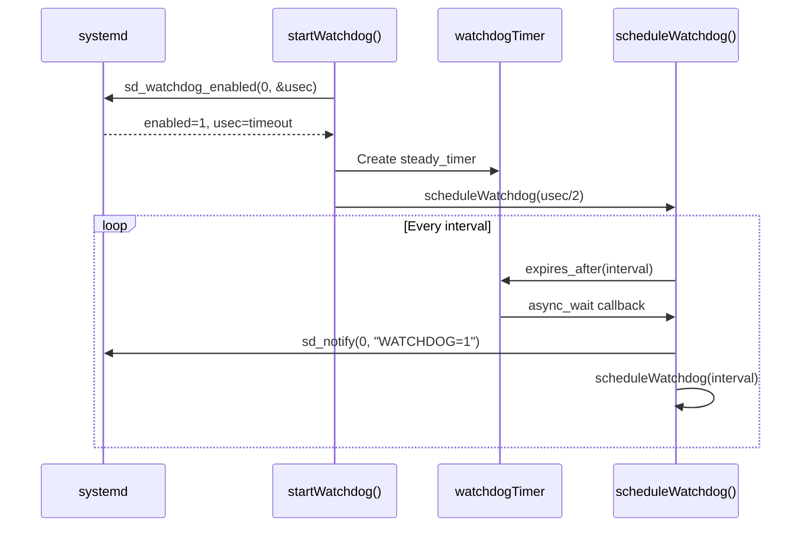
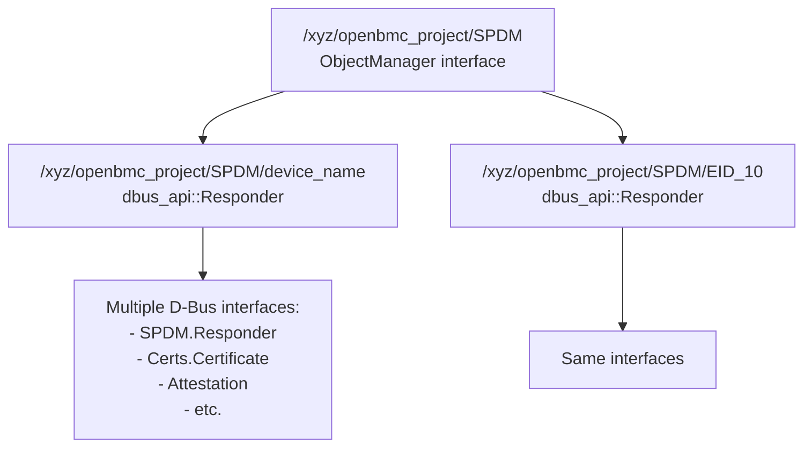
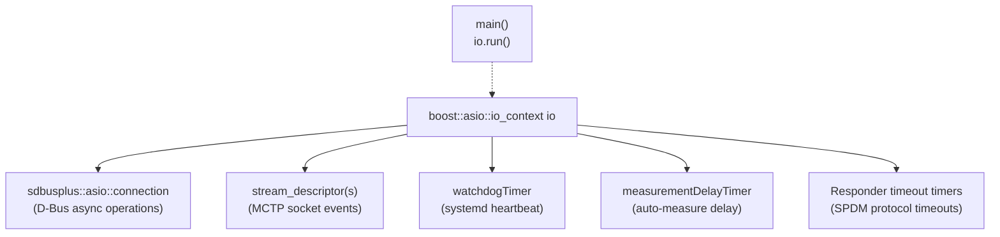

<!-- source: DeepWiki mcp.deepwiki.com · repo NVIDIA/spdm · page 3 spdmd Daemon · fetched 2026-10-26 -->

# spdmd Daemon

<details>
<summary>Relevant source files</summary>

The following files were used as context for generating this wiki page:

- [spdmd/spdmd.cpp](spdmd/spdmd.cpp)
- [spdmd/spdmd_app.hpp](spdmd/spdmd_app.hpp)
- [spdmd/spdmd_app_context.cpp](spdmd/spdmd_app_context.cpp)
- [spdmd/spdmd_app_context.hpp](spdmd/spdmd_app_context.hpp)

</details>


The `spdmd` daemon is the central orchestrator of the NVIDIA SPDM system. It manages SPDM communication with hardware devices, exposes device status via D-Bus interfaces, discovers MCTP endpoints, and handles automatic measurement scheduling. The daemon integrates with OpenBMC's D-Bus infrastructure and systemd service management.

For details on the SPDM protocol implementation, see [libspdmcpp Library](#2). For information on discovery mechanisms, see [MCTP Endpoint Discovery](#3.3). For the D-Bus API surface, see [D-Bus Responder Interface](#3.2).

---

## Architecture Overview

The daemon is built around two primary classes: `SpdmdApp` and `SpdmdAppContext`. `SpdmdApp` inherits from `SpdmdAppContext` and adds application-level orchestration, while `SpdmdAppContext` provides foundational services including configuration management, logging, D-Bus connectivity, and boost::asio event loop integration.

### Class Hierarchy



**Sources:** [spdmd/spdmd_app_context.hpp:46-199](), [spdmd/spdmd_app.hpp:75-186]()

---

## Initialization and Main Entry Point

The daemon's lifecycle begins in `main()` and follows a structured initialization sequence.

### Startup Sequence

```mermaid
sequenceDiagram
    participant main as main()
    participant App as SpdmdApp
    participant Ctx as SpdmdAppContext
    participant CLI as CLI::App
    participant DBus as D-Bus
    participant Disc as MctpDiscovery
    participant Loop as io_context
    
    main->>App: SpdmdApp()
    App->>Ctx: SpdmdAppContext(cout)
    Ctx->>Ctx: Load /etc/spdmd_conf.json
    Ctx->>Ctx: Create boost::asio::io_context
    
    main->>App: setupCli(argc, argv)
    App->>CLI: Parse arguments
    CLI-->>App: verbose, cached_measurements, delay
    App->>App: Set log level
    App->>App: Configure auto-measurement
    
    main->>App: connectDBus("xyz.openbmc_project.SPDM")
    App->>Ctx: connectDBus()
    Ctx->>DBus: Create asio::connection
    Ctx->>Ctx: startWatchdog()
    DBus-->>Ctx: request_name()
    
    alt MCTP_IN_KERNEL
        main->>App: connectMCTP()
        App->>App: Create AF_MCTP socket
        App->>App: Register async_wait handler
    end
    
    main->>Disc: MctpDiscovery(spdmApp)
    Disc->>DBus: Setup InterfacesAdded matches
    
    main->>App: setupMeasurementDelay()
    App->>App: Create delay timer if needed
    
    main->>DBus: manager_t(conn, "/xyz/openbmc_project/SPDM")
    
    main->>Loop: io.run()
    Loop-->>main: Event loop running
```

**Sources:** [spdmd/spdmd.cpp:513-544](), [spdmd/spdmd_app.cpp:46-116](), [spdmd/spdmd_app_context.cpp:28-40]()

### CLI Argument Parsing

The daemon accepts three main command-line options:

| Option | Type | Default | Description |
|--------|------|---------|-------------|
| `-v, --verbose` | Range(0-7) | Emergency | Log verbosity level (0=Emergency, 7=Debug) |
| `--cached_measurements` | List/all | None | EIDs to auto-measure: `all` or `eid1,eid2,...` |
| `--cached_measurements_delay` | Seconds | 60 | Delay before automatic measurements begin |

**Sources:** [spdmd/spdmd.cpp:49-116]()

---

## MCTP Connection Management

The daemon supports two MCTP transport modes selected at compile time via the `MCTP_IN_KERNEL` flag:

1. **Kernel Mode** (`MCTP_IN_KERNEL=true`): Uses AF_MCTP sockets directly
2. **Userspace Mode** (`MCTP_IN_KERNEL=false`): Connects to demux daemon via AF_UNIX sockets

### Dual Transport Mode Architecture



**Sources:** [spdmd/spdmd.cpp:118-223](), [spdmd/spdmd_app.hpp:158-164]()

### Socket Registration and Event Handling

For kernel mode, `connectMCTP()` creates a single AF_MCTP socket:

```cpp
// spdmd/spdmd.cpp:177-223
void connectMCTP()
{
    auto io = std::make_shared<spdmcpp::MctpIoClass>(getLog());
    if (io->createSocket())
    {
        int fd = io->getSocket();
        auto streamDesc = std::make_unique<boost::asio::posix::stream_descriptor>(getIo(), fd);
        // ... async_wait setup ...
        afMctpEvent = std::move(streamDesc);
        context.registerIo(io);
    }
}
```

For userspace mode with demux daemon, `connectMCTP(sockPath)` is called for each endpoint:

```cpp
// spdmd/spdmd.cpp:118-175
void connectMCTP(const std::string& sockPath)
{
    if (!context.isIOPathRegistered(sockPath))
    {
        auto mctpIo = std::make_shared<spdmcpp::MctpIoClass>(getLog());
        if (mctpIo->createSocket(sockPath))
        {
            // ... stream_descriptor setup ...
            mctpEvents[sockPath] = std::move(streamDesc);
            context.registerIo(mctpIo, sockPath);
        }
    }
}
```

**Sources:** [spdmd/spdmd.cpp:118-175](), [spdmd/spdmd.cpp:177-223]()

---

## Responder Lifecycle Management

The daemon maintains a vector of `dbus_api::Responder` objects indexed by EID. Each responder represents a single SPDM device and exposes D-Bus interfaces for that device.

### Responder Discovery and Priority Logic



**Sources:** [spdmd/spdmd.cpp:294-334]()

### Priority Tables

The daemon uses two priority tables to determine which transport path to prefer:

**Medium Priority** (lower number = higher priority):

| Medium Type | Priority |
|-------------|----------|
| `xyz.openbmc_project.MCTP.Endpoint.MediaTypes.PCIe` | 0 |
| `xyz.openbmc_project.MCTP.Endpoint.MediaTypes.USB` | 1 |
| `xyz.openbmc_project.MCTP.Endpoint.MediaTypes.SPI` | 2 |
| `xyz.openbmc_project.MCTP.Endpoint.MediaTypes.I3C` | 3 |
| `xyz.openbmc_project.MCTP.Endpoint.MediaTypes.KCS` | 4 |
| `xyz.openbmc_project.MCTP.Endpoint.MediaTypes.Serial` | 5 |
| `xyz.openbmc_project.MCTP.Endpoint.MediaTypes.SMBus` | 6 |

**Binding Type Priority** (same ordering):

| Binding Type | Priority |
|--------------|----------|
| `xyz.openbmc_project.MCTP.Binding.BindingTypes.PCIe` | 0 |
| `xyz.openbmc_project.MCTP.Binding.BindingTypes.USB` | 1 |
| ... | ... |

**Sources:** [spdmd/spdmd_app.hpp:54-73]()

### Priority Comparison Logic

The `needRecreateResponder()` function implements the priority comparison:



**Logic Summary:**
1. Compare medium priorities first
2. If medium priorities equal, compare binding priorities
3. Recreate if new configuration has equal or higher priority

**Sources:** [spdmd/spdmd.cpp:225-292]()

---

## MCTP Packet Processing

When an MCTP packet arrives, the `mctpCallback()` function extracts the EID and dispatches the packet to the appropriate responder.

### Packet Reception Flow



**Sources:** [spdmd/spdmd.cpp:423-486]()

### EID Extraction

The `peekEid()` function decodes the MCTP transport header to determine the source EID without fully parsing the packet:

```cpp
// spdmd/spdmd.cpp:445-449
spdmcpp::TransportClass::LayerState lay;
auto rs = spdmcpp::MctpTransportClass::peekEid(packetBuffer, lay, eid);
```

This allows the daemon to route incoming packets to the correct `Responder` object based on the device's EID.

**Sources:** [spdmd/spdmd.cpp:444-465]()

---

## Automatic Measurements

The daemon can automatically trigger SPDM measurements for discovered devices after a configurable delay.

### Measurement Configuration

Three related settings control automatic measurements:

1. **`measureOnDiscovery`** (bool): Enabled by `--cached_measurements` CLI option
2. **`measureOnDiscoveryDelay`** (chrono::seconds): Set by `--cached_measurements_delay`, default 60s
3. **`cachedMeasurements`** (set<uint8_t>): Specific EIDs to measure, or empty for "all"
4. **`measureOnDiscoveryActive`** (bool): True after delay expires or if delay is 0

### Measurement Flow



**Sources:** [spdmd/spdmd.cpp:389-421](), [spdmd/spdmd.cpp:488-509](), [spdmd/spdmd_app_context.cpp:42-58]()

### Measurement Trigger Points

Automatic measurements are triggered in two scenarios:

1. **On responder creation** via `createResponder()` → `autoMeasure(eid)`
2. **When delay expires** via `measurementDelayCallback()` which iterates all existing responders

```cpp
// spdmd/spdmd.cpp:488-498
void SpdmdApp::measurementDelayCallback()
{
    measureOnDiscoveryActive = true;
    for (size_t eid = 0; eid < responders.size(); ++eid)
    {
        if (responders[eid])
        {
            autoMeasure(eid);
        }
    }
}
```

The `autoMeasure()` function checks eligibility then calls `responders[eid]->refresh()` with default parameters (slot 0, no nonce, all measurements, DMTF level 0).

**Sources:** [spdmd/spdmd.cpp:488-509](), [spdmd/spdmd.cpp:383-387]()

---

## Configuration System

The daemon loads configuration from `/etc/spdmd_conf.json` at startup via `SpdmdAppContext` constructor.

### Configuration Schema

```json
{
  "endpoints": [
    {
      "eid": 10,
      "custom_property1": "value1",
      "custom_property2": 42
    }
  ]
}
```

The `getPropertyByEid<T>()` template function provides type-safe access to per-EID configuration:

```cpp
// Usage example:
auto value = getPropertyByEid<std::string>(10, "custom_property1");
if (value.has_value()) {
    // Use value.value()
}
```

**Sources:** [spdmd/spdmd_app_context.hpp:83-124](), [spdmd/spdmd_app_context.cpp:28-40]()

---

## Systemd Integration

The daemon integrates with systemd through two mechanisms:

### Watchdog Support

If systemd watchdog is enabled, the daemon sends periodic heartbeats:



The watchdog interval is set to half the systemd timeout to ensure timely heartbeats.

**Sources:** [spdmd/spdmd_app_context.cpp:166-188]()

### Service Definition

The daemon is deployed as `spdmd.service` and claims the D-Bus service name `xyz.openbmc_project.SPDM`.

**Sources:** [spdmd/spdmd.cpp:40-41](), [spdmd/spdmd.cpp:523]()

---

## D-Bus Object Hierarchy

The daemon creates D-Bus objects under the `/xyz/openbmc_project/SPDM` root path:



Object path construction logic:

1. Extract filename from `inventoryPath` (e.g., "device_name")
2. If filename empty, fallback to EID number (e.g., "10")
3. Construct path: `/xyz/openbmc_project/SPDM/{filename_or_eid}`

**Sources:** [spdmd/spdmd.cpp:348-360](), [spdmd/spdmd.cpp:534]()

---

## Error Handling and Logging

### Logging Levels

The daemon supports 8 log levels (0-7) configurable via `--verbose`:

| Level | Name | Usage |
|-------|------|-------|
| 0 | Emergency | System unusable |
| 1 | Alert | Action required immediately |
| 2 | Critical | Critical conditions |
| 3 | Error | Error conditions (default if verbose not set) |
| 4 | Warning | Warning conditions |
| 5 | Notice | Normal but significant |
| 6 | Informational | Informational messages |
| 7 | Debug | Debug-level messages |

### Phosphor Logging Integration

When `USE_PHOSPHOR_LOGGING` is defined, the daemon reports errors and notices to the phosphor logging service:

```cpp
// spdmd/spdmd_app_context.hpp:62-73
bool reportError(const string& message)
{
    return reportLog(obmcprj::Logging::server::Entry::Level::Error, message);
}

bool reportNotice(const string& message)
{
    return reportLog(obmcprj::Logging::server::Entry::Level::Notice, message);
}
```

**Sources:** [spdmd/spdmd_app_context.hpp:62-73](), [spdmd/spdmd_app_context.cpp:60-120](), [spdmd/spdmd.cpp:78-89]()

---

## Runtime Event Loop

All asynchronous operations share a single `boost::asio::io_context`:



The `loop()` function simply calls `io.run()`, which blocks until all async operations complete or the io_context is stopped.

**Sources:** [spdmd/spdmd_app_context.hpp:138-142](), [spdmd/spdmd.cpp:535]()

---

