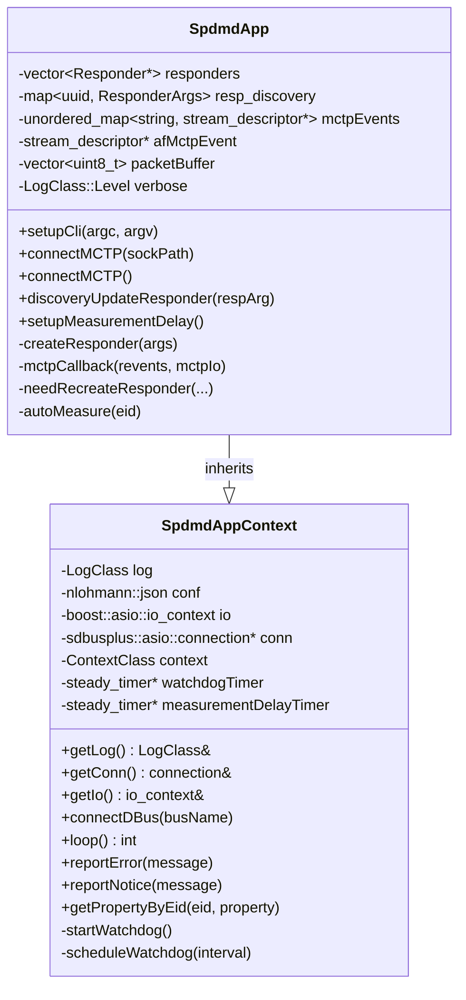
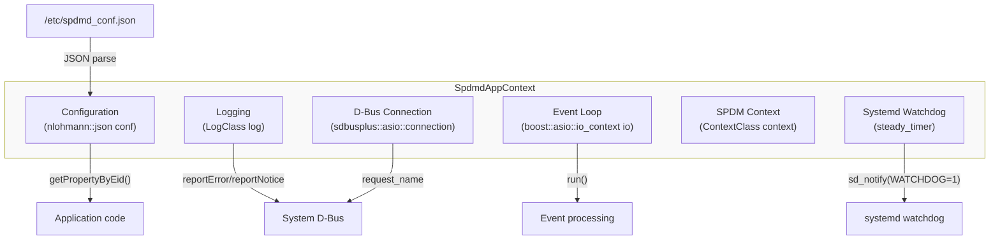
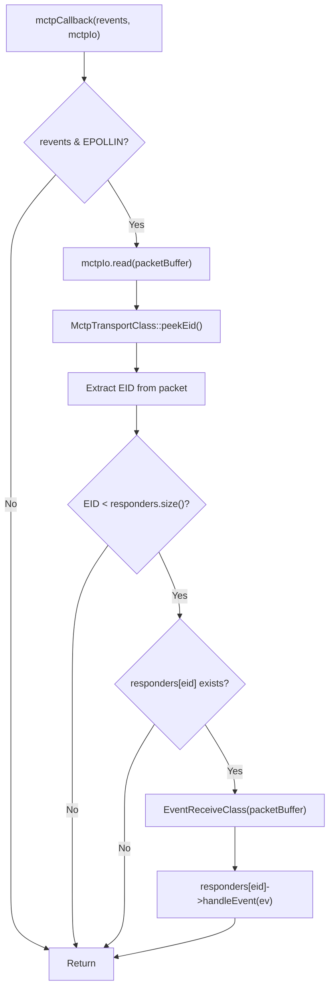
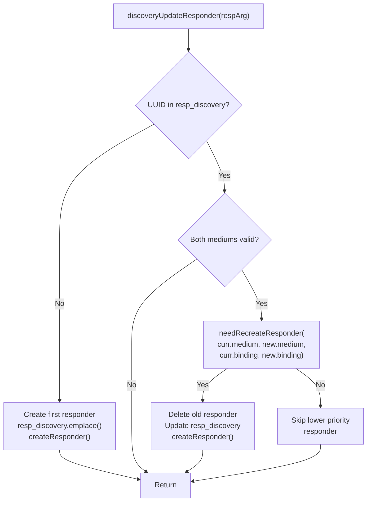
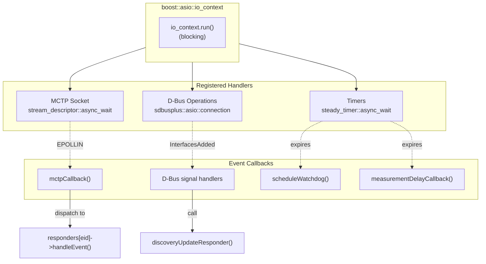

<!-- source: DeepWiki mcp.deepwiki.com · repo NVIDIA/spdm · page 3.1 Application Architecture · fetched 2026-10-26 -->

# Application Architecture

<details>
<summary>Relevant source files</summary>

The following files were used as context for generating this wiki page:

- [spdmd/spdmd.cpp](spdmd/spdmd.cpp)
- [spdmd/spdmd_app.hpp](spdmd/spdmd_app.hpp)
- [spdmd/spdmd_app_context.cpp](spdmd/spdmd_app_context.cpp)
- [spdmd/spdmd_app_context.hpp](spdmd/spdmd_app_context.hpp)

</details>


## Purpose and Scope

This document describes the core application architecture of the `spdmd` daemon, focusing on the `SpdmdApp` and `SpdmdAppContext` classes that orchestrate SPDM communication. It covers initialization, configuration loading, event loop integration, and resource management.

For information about the D-Bus responder interfaces exposed by the daemon, see [D-Bus Responder Interface](#3.2). For endpoint discovery mechanisms, see [MCTP Endpoint Discovery](#3.3). For configuration file format, see [Configuration](#3.4).

---

## Component Overview

The `spdmd` daemon is built around two primary classes that work together to provide the application infrastructure:

| Class | File | Primary Responsibilities |
|-------|------|-------------------------|
| `SpdmdAppContext` | [spdmd/spdmd_app_context.hpp]() | Configuration loading, logging setup, D-Bus connection, boost::asio event loop, systemd watchdog |
| `SpdmdApp` | [spdmd/spdmd_app.hpp]() | CLI argument parsing, MCTP connectivity, responder lifecycle management, MCTP packet routing, priority-based responder selection |

`SpdmdApp` inherits from `SpdmdAppContext`, extending the base context with application-specific logic for managing SPDM responders and MCTP communication.

**Class Hierarchy:**



Sources: [spdmd/spdmd_app.hpp:75-186](), [spdmd/spdmd_app_context.hpp:46-199]()

---

## Application Initialization

The daemon initialization follows a well-defined sequence orchestrated by the `main()` function. The startup process configures all necessary subsystems before entering the event loop.

**Initialization Sequence:**

```mermaid
sequenceDiagram
    participant Main as main()
    participant App as SpdmdApp
    participant Ctx as SpdmdAppContext
    participant CLI as CLI11
    participant DBus as D-Bus
    participant MCTP as MCTP
    participant Disc as MctpDiscovery
    participant Loop as io_context
    
    Main->>App: SpdmdApp()
    App->>Ctx: SpdmdAppContext(cout)
    Ctx->>Ctx: Load /etc/spdmd_conf.json
    Ctx->>Ctx: Initialize LogClass
    Ctx->>Ctx: Create io_context
    
    Main->>App: setupCli(argc, argv)
    App->>CLI: Parse arguments
    CLI-->>App: verbose, cached_measurements, delay
    App->>Ctx: log.setLogLevel(verbose)
    
    Main->>App: connectDBus(busName)
    App->>Ctx: connectDBus()
    Ctx->>DBus: request_name("xyz.openbmc_project.SPDM")
    Ctx->>Ctx: startWatchdog()
    
    alt MCTP_IN_KERNEL enabled
        Main->>App: connectMCTP()
        App->>MCTP: MctpIoClass::createSocket()
        App->>Loop: Register async_wait handler
    end
    
    Main->>Disc: MctpDiscovery(spdmApp)
    Disc->>DBus: Register InterfacesAdded signals
    
    Main->>App: setupMeasurementDelay()
    App->>Loop: Schedule steady_timer
    
    Main->>Loop: io_context.run()
    Loop->>Loop: Process events indefinitely
```

Sources: [spdmd/spdmd.cpp:513-544]()

The `main()` function creates a single `SpdmdApp` instance and sequentially initializes each subsystem:

1. **CLI parsing** via `setupCli()` - processes command-line arguments
2. **D-Bus connection** via `connectDBus()` - claims the service name and sets up systemd watchdog
3. **MCTP connectivity** (conditionally) - establishes socket connections for packet I/O
4. **Discovery handler** - creates `MctpDiscovery` to monitor for new endpoints
5. **Measurement delay timer** - schedules automatic measurements if configured
6. **Event loop** - enters `io_context.run()` which blocks until shutdown

Sources: [spdmd/spdmd.cpp:513-544]()

---

## SpdmdAppContext: Configuration and Resource Management

The `SpdmdAppContext` class provides foundational services that the daemon relies on throughout its lifecycle. It manages configuration, logging, D-Bus connectivity, and the central event loop.

**SpdmdAppContext Responsibilities:**



Sources: [spdmd/spdmd_app_context.hpp:46-199]()

### Configuration File Loading

The constructor loads the JSON configuration file specified by the `SPDM_JSON_CONF_FILE_NAME` macro:

```cpp
SpdmdAppContext::SpdmdAppContext(std::ostream& logOutStream) : log(logOutStream)
{
    try
    {
        std::ifstream ifs(confFile);
        conf = json::parse(ifs);
    }
    catch (json::parse_error& err)
    {
        logOutStream << "Unable to open config file: " << err.what() << std::endl;
    }
}
```

The configuration is stored in the `nlohmann::json conf` member and accessed via the `getPropertyByEid<T>()` template method, which allows per-endpoint customization.

Sources: [spdmd/spdmd_app_context.cpp:28-40](), [spdmd/spdmd_app_context.hpp:85-124]()

### Logging System

`SpdmdAppContext` initializes a `spdmcpp::LogClass` instance that provides structured logging throughout the daemon. Two public methods expose logging to phosphor:

- `reportError(message)` - logs error-level messages
- `reportNotice(message)` - logs notice-level messages

When `USE_PHOSPHOR_LOGGING` is defined, these methods invoke D-Bus methods on `xyz.openbmc_project.Logging` to create persistent log entries with metadata.

Sources: [spdmd/spdmd_app_context.hpp:62-73](), [spdmd/spdmd_app_context.cpp:60-120]()

### Boost ASIO Event Loop

The `boost::asio::io_context io` member is the central event dispatcher for all asynchronous operations:

```cpp
boost::asio::io_context io;

int loop()
{
    return io.run();
}
```

All timers, D-Bus operations, and MCTP socket I/O are registered with this single `io_context`, enabling cooperative multitasking without threads.

Sources: [spdmd/spdmd_app_context.hpp:133-142]()

### D-Bus Connection

The `connectDBus()` method establishes the D-Bus connection and claims the service name:

```cpp
void SpdmdAppContext::connectDBus(const std::string& busName)
{
    startWatchdog();
    conn = std::make_unique<sdbusplus::asio::connection>(io);
    if (conn)
    {
        conn->request_name(busName.c_str());
    }
}
```

The `sdbusplus::asio::connection` integrates with the `io_context`, so D-Bus signals and method calls are processed in the same event loop as MCTP I/O.

Sources: [spdmd/spdmd_app_context.cpp:122-137]()

### Systemd Watchdog Integration

If systemd watchdog is enabled, the daemon periodically notifies systemd to prevent service restarts:

```cpp
void SpdmdAppContext::startWatchdog()
{
    uint64_t usec = 0;
    int enabled = sd_watchdog_enabled(0, &usec);
    if (enabled > 0 && usec > 0)
    {
        watchdogTimer = std::make_unique<boost::asio::steady_timer>(io);
        scheduleWatchdog(std::chrono::microseconds(usec / 2));
    }
}

void SpdmdAppContext::scheduleWatchdog(std::chrono::microseconds interval)
{
    watchdogTimer->expires_after(interval);
    watchdogTimer->async_wait(
        [this, interval](const boost::system::error_code& ec) {
            if (!ec)
            {
                sd_notify(0, "WATCHDOG=1");
                scheduleWatchdog(interval);
            }
        });
}
```

The watchdog pings at half the configured interval to provide a safety margin.

Sources: [spdmd/spdmd_app_context.cpp:166-188]()

---

## SpdmdApp: Main Application Orchestrator

`SpdmdApp` extends `SpdmdAppContext` with the application-level logic for managing SPDM responders, routing MCTP packets, and handling discovery events.

### CLI Argument Parsing

The `setupCli()` method uses CLI11 to parse command-line arguments:

| Option | Type | Description | Validation |
|--------|------|-------------|------------|
| `-v, --verbose` | int | Log verbosity level | Range(0-7) |
| `--cached_measurements` | vector<string> | EIDs to auto-measure on discovery | "all" or comma-separated EID list (1-254) |
| `--cached_measurements_delay` | int | Delay in seconds before auto-measurement | Default: 60 |

Example usage:
```
spdmd --verbose 7 --cached_measurements all --cached_measurements_delay 30
```

The parsed values control:
- `verbose` → sets `log.setLogLevel()`
- `cached_measurements` → populates `cachedMeasurements` set and sets `measureOnDiscovery` flag
- `cached_measurements_delay` → configures `measureOnDiscoveryDelay`

Sources: [spdmd/spdmd.cpp:49-116]()

### MCTP Connectivity

The daemon supports two MCTP transport modes, selected at compile time via `MCTP_IN_KERNEL`:

**Kernel Mode (AF_MCTP):**
```cpp
void SpdmdApp::connectMCTP()
{
    auto io = std::make_shared<spdmcpp::MctpIoClass>(getLog());
    if (io->createSocket())
    {
        int fd = io->getSocket();
        auto streamDesc = std::make_unique<boost::asio::posix::stream_descriptor>(getIo(), fd);
        // Register async_wait handler
        afMctpEvent = std::move(streamDesc);
        context.registerIo(io);
    }
}
```

**Userspace Demux Mode:**
```cpp
void SpdmdApp::connectMCTP(const std::string& sockPath)
{
    if (!context.isIOPathRegistered(sockPath))
    {
        auto mctpIo = std::make_shared<spdmcpp::MctpIoClass>(getLog());
        if (mctpIo->createSocket(sockPath))
        {
            int fd = mctpIo->getSocket();
            auto streamDesc = std::make_unique<boost::asio::posix::stream_descriptor>(getIo(), fd);
            // Register async_wait handler
            mctpEvents[sockPath] = std::move(streamDesc);
            context.registerIo(mctpIo, sockPath);
        }
    }
}
```

In both cases, the file descriptor is wrapped in a `boost::asio::posix::stream_descriptor` and configured with an `async_wait` handler that invokes `mctpCallback()` when data arrives.

Sources: [spdmd/spdmd.cpp:118-223]()

### MCTP Packet Routing

When MCTP packets arrive, the `mctpCallback()` method routes them to the appropriate responder:



Sources: [spdmd/spdmd.cpp:423-486]()

The EID extraction uses `MctpTransportClass::peekEid()` to determine which responder should handle the packet without fully decoding it. The packet is then wrapped in an `EventReceiveClass` and passed to the responder's `handleEvent()` method.

### Responder Lifecycle Management

The daemon maintains two data structures for responder management:

```cpp
std::vector<std::shared_ptr<dbus_api::Responder>> responders;  // Indexed by EID
std::map<std::string, dbus_api::ResponderArgs> resp_discovery;  // Keyed by UUID
```

When a new endpoint is discovered (via `discoveryUpdateResponder()`), the daemon applies priority-based selection:

**Priority-Based Responder Selection:**



Sources: [spdmd/spdmd.cpp:294-334]()

The `needRecreateResponder()` method implements a two-tier priority system:

1. **Medium Priority** (higher priority = lower number):
   - PCIe (0)
   - USB (1)
   - SPI (2)
   - I3C (3)
   - KCS (4)
   - Serial (5)
   - SMBus (6)

2. **Binding Type Priority** (used when mediums are equal):
   - Same ordering as medium priority

This ensures that if a device appears on multiple transports (e.g., PCIe and SMBus), the daemon uses the higher-bandwidth connection.

Sources: [spdmd/spdmd.cpp:225-292](), [spdmd/spdmd_app.hpp:54-73]()

### Automatic Measurements

If `--cached_measurements` is specified, the daemon automatically refreshes measurements after a configurable delay:

```cpp
void SpdmdApp::setupMeasurementDelay()
{
    if (!measureOnDiscovery)
        return;
    
    if (measureOnDiscoveryDelay == std::chrono::seconds(0))
    {
        measureOnDiscoveryActive = true;  // Already set
        return;
    }
    
    measurementDelayTimer = std::make_unique<boost::asio::steady_timer>(getIo());
    measurementDelayTimer->expires_after(measureOnDiscoveryDelay);
    measurementDelayTimer->async_wait([this](const boost::system::error_code& ec) {
        if (!ec)
        {
            measurementDelayCallback();
        }
    });
}

void SpdmdApp::measurementDelayCallback()
{
    measureOnDiscoveryActive = true;
    for (size_t eid = 0; eid < responders.size(); ++eid)
    {
        if (responders[eid])
        {
            autoMeasure(eid);
        }
    }
}
```

The delay mechanism prevents overwhelming the devices with measurement requests immediately after daemon startup. After the delay expires, `autoMeasure()` calls `responders[eid]->refresh()` for each configured EID.

Sources: [spdmd/spdmd.cpp:389-509]()

---

## Event Loop Architecture

All asynchronous operations in `spdmd` share a single `boost::asio::io_context`. This cooperative multitasking model avoids the complexity of threading while providing responsive event handling.

**Event Loop Components:**



Sources: [spdmd/spdmd_app_context.hpp:133-142](), [spdmd/spdmd.cpp:118-223]()

The event loop processes:
1. **MCTP socket events** - incoming SPDM packets from devices
2. **D-Bus signals** - endpoint discovery and inventory updates
3. **Watchdog timer** - systemd health checks
4. **Measurement timer** - automatic measurement triggers

All callbacks execute synchronously within the event loop, so they must complete quickly to avoid blocking other events.

---

## Key Data Structures

### Responder Storage

```cpp
std::vector<std::shared_ptr<dbus_api::Responder>> responders;
```

A vector indexed by MCTP EID (0-255). Sparse storage is acceptable since most EIDs are unused. Each non-null entry is a `Responder` object managing SPDM communication with that endpoint.

### Discovery Map

```cpp
std::map<std::string, dbus_api::ResponderArgs> resp_discovery;
```

Maps device UUID to discovery arguments. Used to track which devices have been discovered and their transport properties (medium, binding type) for priority-based responder selection.

### MCTP Event Handlers

```cpp
std::unordered_map<std::string, std::unique_ptr<boost::asio::posix::stream_descriptor>> mctpEvents;
```

In userspace demux mode, maps socket path to stream descriptor. Each socket can receive packets from multiple endpoints.

```cpp
std::unique_ptr<boost::asio::posix::stream_descriptor> afMctpEvent;
```

In kernel mode, a single stream descriptor for the AF_MCTP socket.

Sources: [spdmd/spdmd_app.hpp:158-172]()

---

## Summary

The `spdmd` application architecture is designed around a single-threaded, event-driven model:

- **SpdmdAppContext** provides foundational services: configuration, logging, D-Bus connectivity, event loop, and systemd integration
- **SpdmdApp** orchestrates SPDM communication: CLI parsing, MCTP connectivity, responder lifecycle, and packet routing
- **boost::asio::io_context** unifies all asynchronous operations in a cooperative multitasking model
- **Priority-based responder selection** ensures optimal transport utilization when devices appear on multiple interfaces
- **Automatic measurements** can be scheduled with configurable delays to minimize startup impact

This architecture provides a robust foundation for managing SPDM communication with multiple devices while integrating cleanly with OpenBMC's D-Bus-based infrastructure.

---

