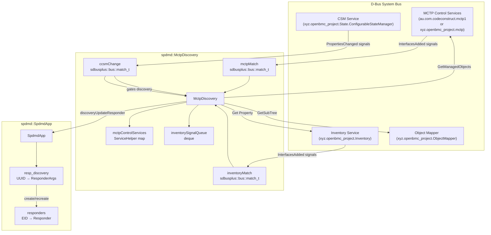
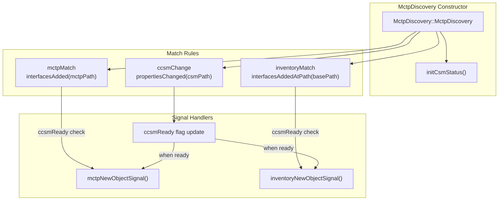
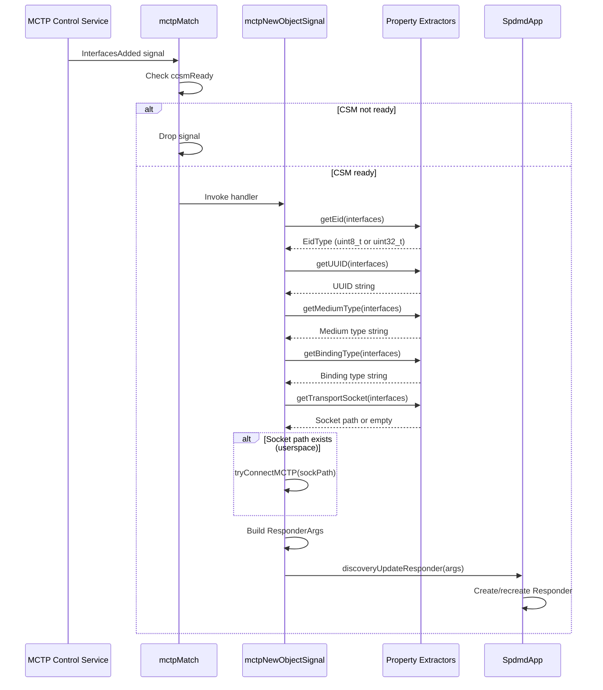
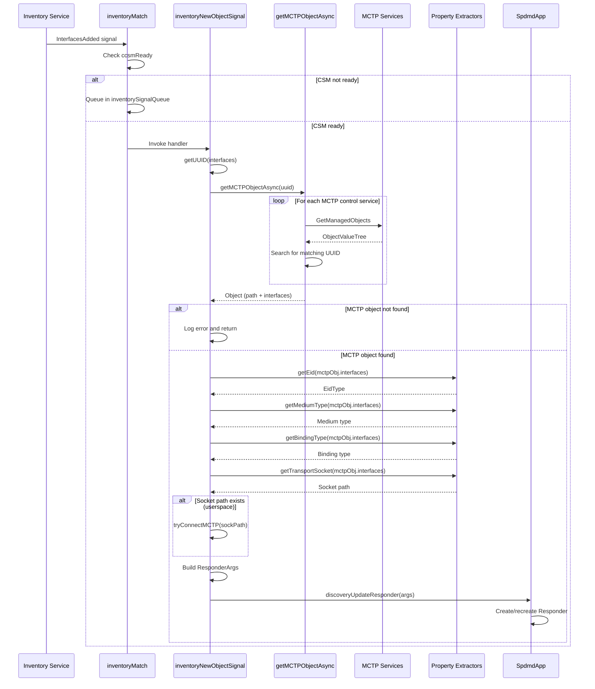
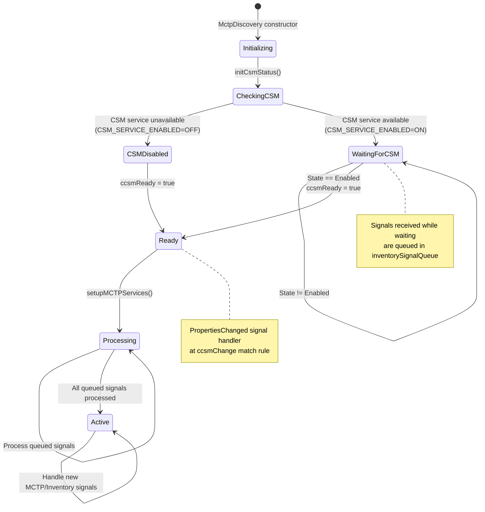
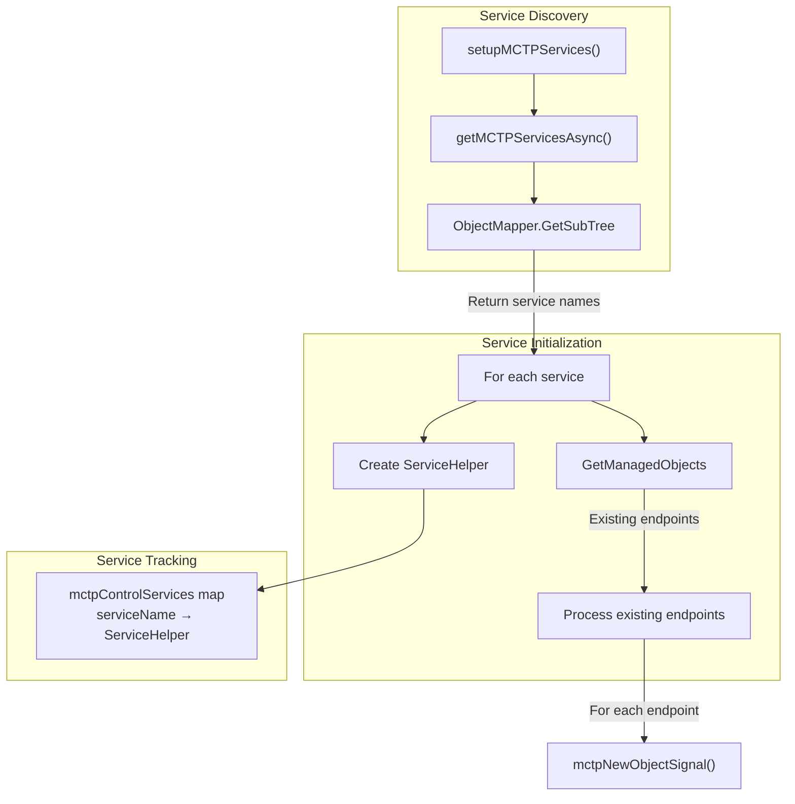
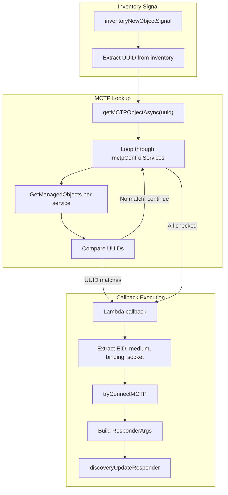

<!-- source: DeepWiki mcp.deepwiki.com · repo NVIDIA/spdm · page 3.3 MCTP Endpoint Discovery · fetched 2026-10-26 -->

# MCTP Endpoint Discovery

<details>
<summary>Relevant source files</summary>

The following files were used as context for generating this wiki page:

- [spdmd/mctp_endpoint_discovery.cpp](spdmd/mctp_endpoint_discovery.cpp)
- [spdmd/mctp_endpoint_discovery.hpp](spdmd/mctp_endpoint_discovery.hpp)

</details>


## Purpose and Scope

This document describes the `MctpDiscovery` subsystem within the `spdmd` daemon, which automatically detects SPDM-capable devices on the MCTP transport layer. The discovery system monitors D-Bus signals from MCTP control services and optionally from the OpenBMC inventory service, correlates endpoints by UUID, extracts transport properties (EID, medium type, binding type, socket path), and instructs `SpdmdApp` to create `Responder` objects for each discovered device.

For information about the `Responder` object lifecycle and priority-based selection, see [Responder Lifecycle Management](#3.1.2). For details on D-Bus interfaces exposed by responders, see [D-Bus Responder Interface](#3.2).

---

## System Architecture

The `MctpDiscovery` class serves as the discovery engine for the spdmd daemon, bridging MCTP transport infrastructure with SPDM protocol handling.

**Discovery Architecture**



Sources: [spdmd/mctp_endpoint_discovery.hpp:34-271](), [spdmd/mctp_endpoint_discovery.cpp:40-116]()

---

## Discovery Modes

The `DISCOVERY_ONLY_FROM_MCTP_CONTROL` compile-time flag determines the discovery strategy:

| Mode | Flag State | Behavior |
|------|-----------|----------|
| **MCTP-Only Discovery** | `DISCOVERY_ONLY_FROM_MCTP_CONTROL` defined | Discovery triggered exclusively by MCTP endpoint signals. UUID from MCTP endpoint. Inventory path optional (from config if not found). |
| **Bidirectional Discovery** | `DISCOVERY_ONLY_FROM_MCTP_CONTROL` not defined | Discovery triggered by either MCTP endpoint signals OR inventory object signals. UUID correlation between both sources required. |

**Mode Selection Table**

| Property | MCTP-Only Mode | Bidirectional Mode |
|----------|----------------|-------------------|
| Primary trigger | MCTP `InterfacesAdded` | MCTP or Inventory `InterfacesAdded` |
| UUID source | MCTP endpoint (`xyz.openbmc_project.MCTP.UUID`) | Both MCTP and inventory must match |
| Inventory path | Optional (config fallback) | Required for correlation |
| Discovery flow | Single-pass from MCTP | Two-pass with async lookups |
| Use case | Simpler deployments | Full inventory integration |

Sources: [spdmd/mctp_endpoint_discovery.cpp:42-68](), [spdmd/mctp_endpoint_discovery.cpp:321-493]()

---

## D-Bus Signal Monitoring

The discovery system registers D-Bus match rules to monitor object lifecycle events from MCTP and inventory services.

**Signal Monitoring Setup**



### MCTP Endpoint Signals

The `mctpMatch` match rule monitors `InterfacesAdded` signals on the MCTP control path:

- **Path**: `/au/com/codeconstruct/mctp1` (kernel mode) or `/xyz/openbmc_project/mctp` (userspace mode)
- **Interface**: `xyz.openbmc_project.MCTP.Endpoint`
- **Handler**: `mctpNewObjectSignal()` at [spdmd/mctp_endpoint_discovery.cpp:277-494]()

**Key Properties Extracted**:
- `EID`: Endpoint ID (uint8_t or uint32_t variant)
- `SupportedMessageTypes`: Must contain value `5` (SPDM)
- `UUID`: Device unique identifier
- `MediumType`: Transport medium (PCIe, USB, etc.)
- `BindingType`: MCTP binding protocol
- `Address`: Unix socket path (userspace mode only)

### Inventory Signals (Bidirectional Mode Only)

When `DISCOVERY_ONLY_FROM_MCTP_CONTROL` is not defined, the `inventoryMatch` match rule monitors inventory additions:

- **Path**: `/xyz/openbmc_project/inventory/system/chassis/`
- **Interface**: `xyz.openbmc_project.Inventory.Item.SPDMResponder`
- **Handler**: `inventoryNewObjectSignal()` at [spdmd/mctp_endpoint_discovery.cpp:497-626]()

Sources: [spdmd/mctp_endpoint_discovery.cpp:74-86](), [spdmd/mctp_endpoint_discovery.cpp:42-68](), [spdmd/mctp_endpoint_discovery.hpp:119-162]()

---

## Discovery Flow by Mode

### MCTP-Only Discovery Flow

**MCTP-Only Discovery Sequence**



In MCTP-only mode, all required information is extracted from the MCTP endpoint object. If the inventory path cannot be found via async lookup, it falls back to the configuration file's `name` property to construct a synthetic path.

Sources: [spdmd/mctp_endpoint_discovery.cpp:321-393]()

### Bidirectional Discovery Flow

**Bidirectional Discovery Sequence**



In bidirectional mode, the inventory signal triggers a reverse lookup to find the corresponding MCTP endpoint by UUID. This enables inventory-driven discovery where the inventory service is the source of truth for device presence.

Sources: [spdmd/mctp_endpoint_discovery.cpp:497-626]()

---

## CSM Gating Mechanism

The Configurable State Manager (CSM) service controls when discovery is enabled, preventing premature responder creation before the system is ready.

**CSM State Management**



### CSM State Checking

The `initCsmStatus()` function queries the CSM service state:

**CSM Property Path**: `/xyz/openbmc_project/state/configurableStateManager/MCTP`  
**Interface**: `xyz.openbmc_project.State.FeatureReady`  
**Property**: `State`  
**Ready Value**: `xyz.openbmc_project.State.FeatureReady.States.Enabled`

When `CSM_SERVICE_ENABLED` is not defined, `ccsmReady` is immediately set to `true` at [spdmd/mctp_endpoint_discovery.cpp:56]() and [spdmd/mctp_endpoint_discovery.cpp:1174]().

### Signal Queuing

Signals received before CSM is ready are stored in `inventorySignalQueue` (bidirectional mode only). When CSM transitions to ready state, the queue is drained at [spdmd/mctp_endpoint_discovery.cpp:105-111]() and [spdmd/mctp_endpoint_discovery.cpp:1155-1161]().

Sources: [spdmd/mctp_endpoint_discovery.cpp:1133-1185](), [spdmd/mctp_endpoint_discovery.cpp:88-115](), [spdmd/mctp_endpoint_discovery.hpp:83-96]()

---

## MCTP Service Discovery and Management

Before processing endpoint signals, the discovery system must identify all MCTP control services on the D-Bus system.

**MCTP Service Discovery Flow**



### Service Discovery Process

The `getMCTPServicesAsync()` function at [spdmd/mctp_endpoint_discovery.cpp:195-257]() queries the ObjectMapper for services implementing `xyz.openbmc_project.MCTP.Endpoint`:

```
ObjectMapper.GetSubTree(
    rootPath = "/",
    depth = 0,
    interfaces = ["xyz.openbmc_project.MCTP.Endpoint"]
)
```

The response contains a map of object paths to service names. The unique service names are extracted and processed.

### Per-Service Initialization

For each discovered service, `setupMCTPServices()` at [spdmd/mctp_endpoint_discovery.cpp:118-193]():

1. Creates a `ServiceHelper` instance stored in `mctpControlServices` map
2. Calls `GetManagedObjects` on the service to retrieve all existing MCTP endpoints
3. Processes each existing endpoint through `mctpNewObjectSignal()`

This ensures that endpoints already present before `spdmd` starts are discovered, not just new endpoints added after startup.

Sources: [spdmd/mctp_endpoint_discovery.cpp:118-193](), [spdmd/mctp_endpoint_discovery.cpp:195-257](), [spdmd/mctp_endpoint_discovery.hpp:80-81]()

---

## Property Extraction

The discovery system extracts multiple properties from D-Bus interface maps to construct `ResponderArgs` objects.

**Property Extraction Functions**

| Function | Return Type | Interface | Property | Description |
|----------|-------------|-----------|----------|-------------|
| `getEid()` | `std::optional<std::variant<uint32_t, uint8_t>>` | `xyz.openbmc_project.MCTP.Endpoint` | `EID`, `SupportedMessageTypes` | Endpoint ID, validates SPDM support (type 5) |
| `getUUID()` | `std::string` | `xyz.openbmc_project.MCTP.UUID` or `xyz.openbmc_project.Common.UUID` | `UUID` | Device unique identifier |
| `getMediumType()` | `std::string` | `xyz.openbmc_project.MCTP.Endpoint` | `MediumType` | Transport medium (PCIe, USB, etc.) |
| `getBindingType()` | `std::string` | `xyz.openbmc_project.MCTP.Binding` | `BindingType` | MCTP binding protocol |
| `getTransportSocket()` | `std::string` | `xyz.openbmc_project.Common.UnixSocket` | `Address` | Unix socket path (userspace mode) |

### EID Extraction

The `getEid()` function at [spdmd/mctp_endpoint_discovery.cpp:649-726]() handles two data type variants for EID (uint8_t or uint32_t depending on the control daemon implementation). It also validates that the endpoint supports SPDM by checking for message type `5` in the `SupportedMessageTypes` array:

```cpp
if (std::find(types.begin(), types.end(), mctpTypeSPDM) != types.end())
{
    return eid;
}
```

### UUID Extraction

The `getUUID()` function at [spdmd/mctp_endpoint_discovery.cpp:773-804]() checks both MCTP-specific and common UUID interfaces, prioritizing `xyz.openbmc_project.MCTP.UUID` before falling back to `xyz.openbmc_project.Common.UUID`.

### Transport Socket Extraction

In userspace MCTP mode (when `MCTP_IN_KERNEL` is not defined), the `getTransportSocket()` function at [spdmd/mctp_endpoint_discovery.cpp:729-771]() extracts the Unix socket path from the `xyz.openbmc_project.Common.UnixSocket` interface. The `Address` property contains a `std::vector<uint8_t>` that is converted to a string.

Sources: [spdmd/mctp_endpoint_discovery.cpp:629-804](), [spdmd/mctp_endpoint_discovery.cpp:1059-1131](), [spdmd/mctp_endpoint_discovery.hpp:193-229]()

---

## Asynchronous Lookup Operations

The bidirectional discovery mode requires several asynchronous D-Bus operations to correlate endpoints across services.

**Asynchronous Callback Chain**



### getMCTPObjectAsync()

The `getMCTPObjectAsync()` function at [spdmd/mctp_endpoint_discovery.cpp:852-921]() iterates through all MCTP control services stored in `mctpControlServices` map. For each service, it:

1. Calls `GetManagedObjects` asynchronously
2. Searches the returned object tree for matching UUID
3. Uses shared atomic counters to track completion across multiple async calls
4. Returns the first matching `Object` or empty object if none found

This parallel search pattern handles systems with multiple MCTP control services (e.g., separate services for PCIe and USB).

### getInventoryPathAsync()

The reverse lookup, `getInventoryPathAsync()` at [spdmd/mctp_endpoint_discovery.cpp:923-1057](), queries the ObjectMapper for inventory items implementing `xyz.openbmc_project.Inventory.Item.SPDMResponder`, then serially queries each candidate's UUID property until a match is found.

The serial iteration pattern uses a recursive lambda stored in `std::shared_ptr<std::function<void()>>` to maintain state across async calls:

```cpp
*processNextPtr = [this, uuid, callback, candidates, sharedIndex,
                   resultPathPtr, processNextPtr]() {
    if (*sharedIndex >= candidates->size()) {
        callback(*resultPathPtr);
        return;
    }
    // Process candidate, then call (*processNextPtr)() for next
};
```

Sources: [spdmd/mctp_endpoint_discovery.cpp:852-921](), [spdmd/mctp_endpoint_discovery.cpp:923-1057](), [spdmd/mctp_endpoint_discovery.cpp:806-850]()

---

## MCTP Connection Establishment

After extracting all properties, the discovery system establishes the MCTP transport connection.

### tryConnectMCTP()

The `tryConnectMCTP()` function at [spdmd/mctp_endpoint_discovery.cpp:259-275]() wraps the `SpdmdApp::connectMCTP()` call with exception handling. This is necessary because MCTP control daemons may become available on D-Bus but fail socket connection due to service initialization issues.

**Connection Modes**:

| Mode | Socket Path | Connection Method |
|------|-------------|-------------------|
| **Kernel Mode** (`MCTP_IN_KERNEL` defined) | Not used | AF_MCTP socket with EID |
| **Userspace Mode** (`MCTP_IN_KERNEL` not defined) | Extracted from `Address` property | AF_UNIX socket to demux daemon |

The socket path is passed to `SpdmdApp::connectMCTP()` which creates the appropriate `MctpIoClass` instance configured for the discovered endpoint.

### Responder Creation

After successful property extraction and optional connection establishment, the discovery system constructs a `dbus_api::ResponderArgs` structure:

```cpp
dbus_api::ResponderArgs{
    eid,            // uint8_t endpoint ID
    uuid,           // std::string device UUID
    mediumType,     // std::string transport medium
    bindingType,    // std::string binding protocol
    mctpPath,       // object_path MCTP D-Bus path
    inventoryPath,  // object_path inventory D-Bus path
    sockPath        // std::string Unix socket path
}
```

This is passed to `SpdmdApp::discoveryUpdateResponder()` which handles priority-based responder creation/recreation logic documented in [Responder Lifecycle Management](#3.1.2).

Sources: [spdmd/mctp_endpoint_discovery.cpp:259-275](), [spdmd/mctp_endpoint_discovery.cpp:362-389](), [spdmd/mctp_endpoint_discovery.cpp:463-490](), [spdmd/mctp_endpoint_discovery.cpp:596-624]()

---

## Error Handling and Logging

The discovery system includes extensive error handling and logging for debugging deployment issues.

**Common Error Scenarios**:

| Error Condition | Detection | Action |
|-----------------|-----------|--------|
| Invalid EID (>= 255) | `getEid()` validation | Log error, skip endpoint |
| Missing UUID | `getUUID()` returns empty | Log error, skip endpoint |
| Missing medium type | `getMediumType()` returns empty | Log error, skip endpoint |
| Missing binding type | `getBindingType()` returns empty | Log error, skip endpoint |
| Missing socket path (userspace) | `getTransportSocket()` returns empty | Log error, skip endpoint |
| MCTP lookup failure | `getMCTPObjectAsync()` callback with invalid Object | Log error, skip endpoint |
| Inventory lookup failure | `getInventoryPathAsync()` callback with empty path | Try config fallback, log error if fails |
| D-Bus error | `boost::system::error_code` in callbacks | Log error with error code message |

### Logging Patterns

Error messages include context to aid troubleshooting:

```cpp
log.iprint("Unable to get medium type for EID = ");
log.iprintln(eidValue1);

log.iprint("SPDM inventoryNewObjectSignal couldn't get EID for UUID '");
log.iprintln(uuid + "'");
```

The logging system respects the configured log level, typically checking `logLevel >= LogClass::Level::Error` before logging at [spdmd/mctp_endpoint_discovery.cpp:326-330](), [spdmd/mctp_endpoint_discovery.cpp:403-409](), etc.

Sources: [spdmd/mctp_endpoint_discovery.cpp:313-317](), [spdmd/mctp_endpoint_discovery.cpp:394-398](), [spdmd/mctp_endpoint_discovery.cpp:506-511](), [spdmd/mctp_endpoint_discovery.cpp:517-520]()

---

