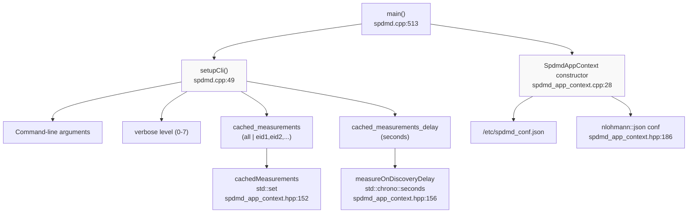
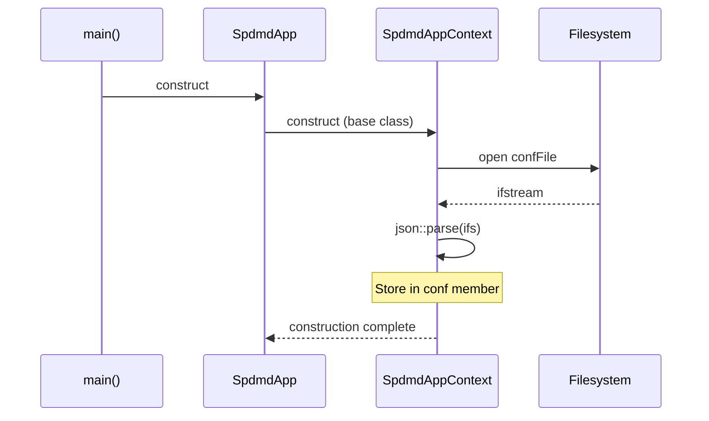
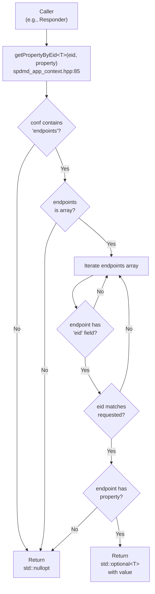
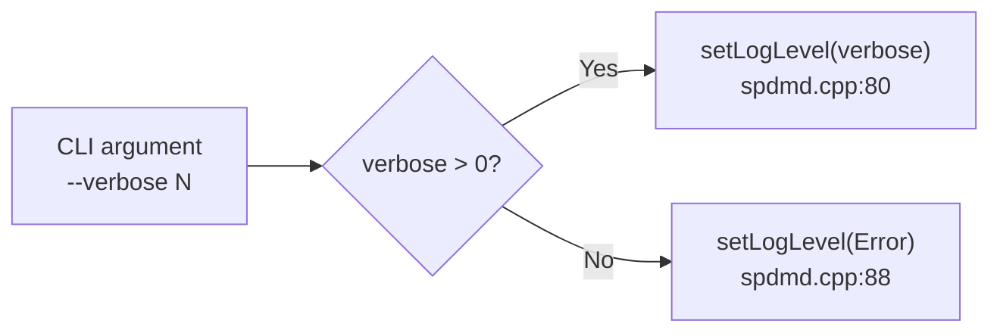
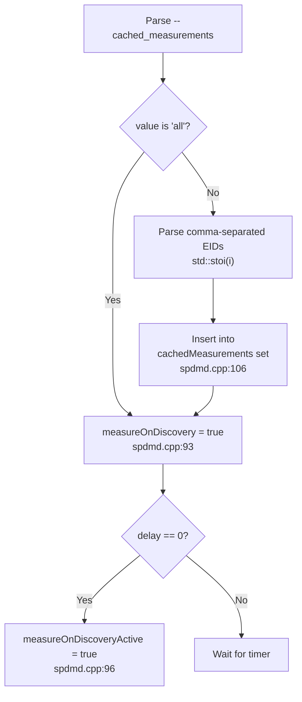
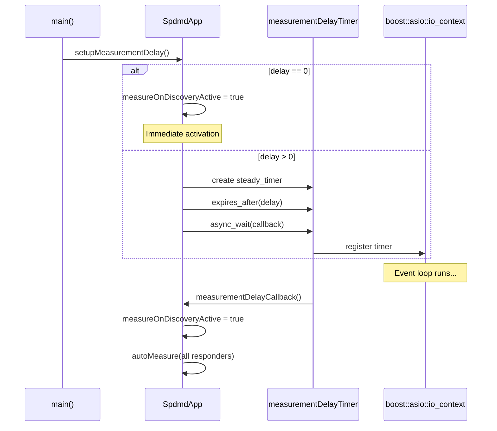
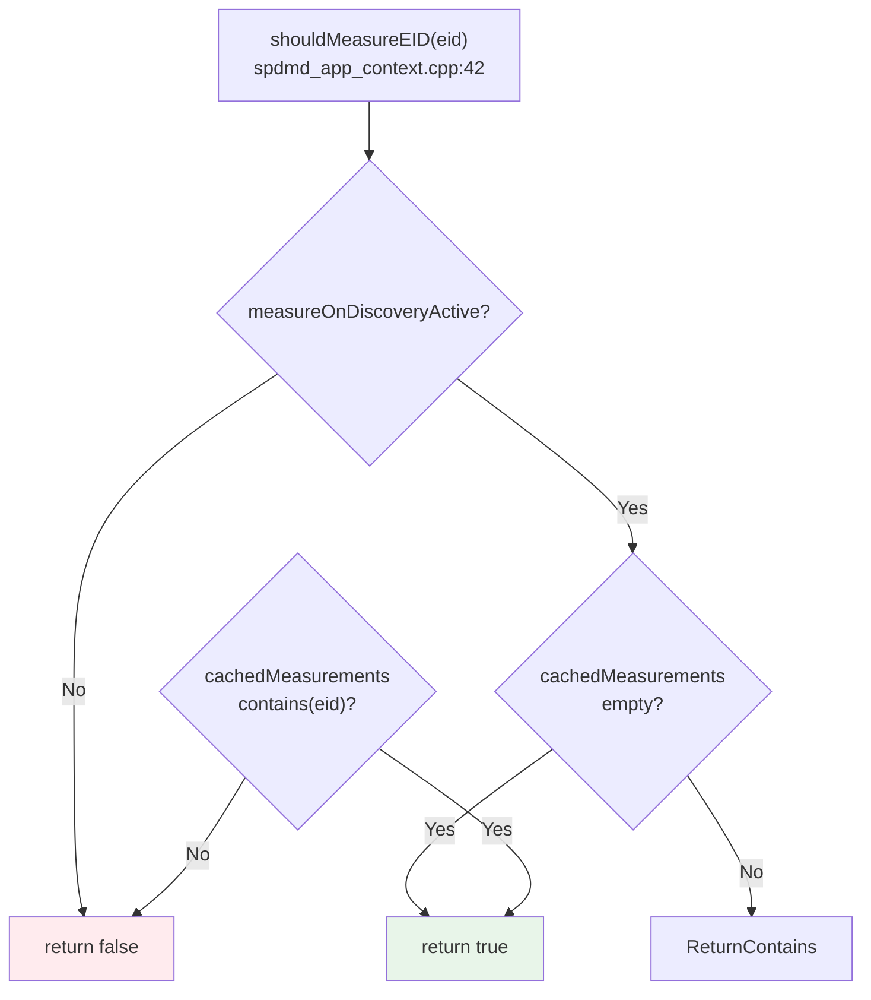
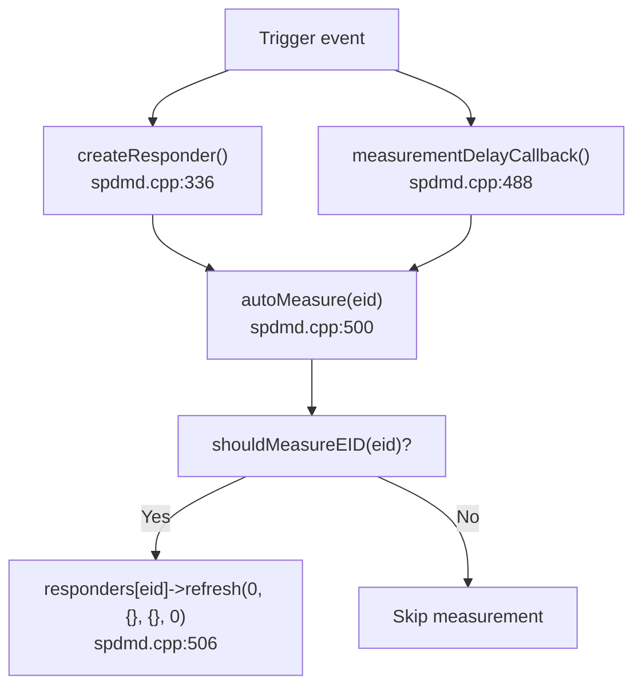
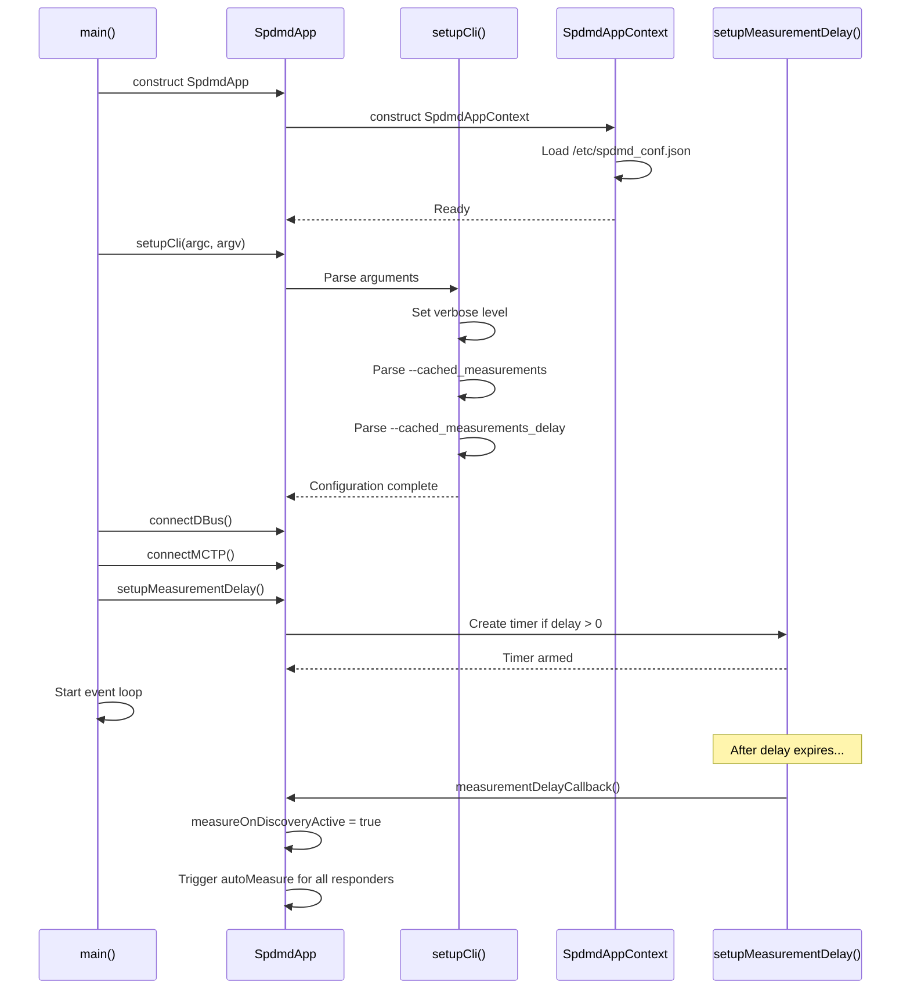

<!-- source: DeepWiki mcp.deepwiki.com · repo NVIDIA/spdm · page 3.4 Configuration · fetched 2026-10-26 -->

# Configuration

<details>
<summary>Relevant source files</summary>

The following files were used as context for generating this wiki page:

- [spdmd/spdmd.cpp](spdmd/spdmd.cpp)
- [spdmd/spdmd_app.hpp](spdmd/spdmd_app.hpp)
- [spdmd/spdmd_app_context.cpp](spdmd/spdmd_app_context.cpp)
- [spdmd/spdmd_app_context.hpp](spdmd/spdmd_app_context.hpp)

</details>


## Purpose and Scope

This page documents the configuration system for the `spdmd` daemon. It covers both compile-time and runtime configuration mechanisms, including the JSON configuration file format and command-line arguments. For information about build-time configuration options (meson options), see [Build Options and Compilation](#6.1). For details on MCTP endpoint discovery configuration, see [Discovery Modes](#3.3.1).

The configuration system controls:
- Per-endpoint (EID) properties
- Automatic measurement behavior
- Logging verbosity
- Discovery timing and gating

## Configuration Sources

The `spdmd` daemon obtains configuration from two sources at runtime:



**Sources:** [spdmd/spdmd.cpp:49-116](), [spdmd/spdmd_app_context.cpp:28-40](), [spdmd/spdmd_app_context.hpp:48-59,150-163]()

## JSON Configuration File

### File Location and Loading

The JSON configuration file is located at the path defined by `SPDM_JSON_CONF_FILE_NAME` in `config.h` (typically `/etc/spdmd_conf.json`). The file is loaded during `SpdmdAppContext` construction and parsed into an `nlohmann::json` object.



If the JSON file cannot be parsed, an error message is logged to the output stream, but the daemon continues execution without failing:

[spdmd/spdmd_app_context.cpp:30-39]()

**Sources:** [spdmd/spdmd_app_context.hpp:48](), [spdmd/spdmd_app_context.cpp:28-40]()

### JSON File Structure

The configuration file uses the following JSON structure:

| Top-Level Key | Type | Description |
|---------------|------|-------------|
| `endpoints` | Array | Array of endpoint configuration objects |

Each element in the `endpoints` array represents per-EID configuration:

| Property | Type | Required | Description |
|----------|------|----------|-------------|
| `eid` | unsigned integer | Yes | MCTP Endpoint ID (1-254) |
| `<property>` | varies | No | Custom properties specific to EID |

Example configuration:

```json
{
  "endpoints": [
    {
      "eid": 10,
      "custom_property": "value1",
      "another_setting": 42
    },
    {
      "eid": 20,
      "custom_property": "value2"
    }
  ]
}
```

**Sources:** [spdmd/spdmd_app_context.hpp:85-124]()

### Accessing Per-EID Properties

The `SpdmdAppContext::getPropertyByEid<T>()` template method retrieves properties from the JSON configuration:



The method returns `std::optional<T>` to handle missing properties safely. The template parameter `T` specifies the expected type (e.g., `int`, `std::string`, `bool`).

**Sources:** [spdmd/spdmd_app_context.hpp:85-124]()

## Command-Line Options

The daemon uses the CLI11 library for command-line argument parsing. All options are processed in `SpdmdApp::setupCli()`:

### Available Options

| Option | Short | Type | Range/Values | Default | Description |
|--------|-------|------|--------------|---------|-------------|
| `--verbose` | `-v` | integer | 0-7 | Emergency (0) | Log verbosity level matching `spdmcpp::LogClass::Level` |
| `--cached_measurements` | - | string list | `all` or `eid1,eid2,...` | (none) | Enables automatic measurement on discovery |
| `--cached_measurements_delay` | - | integer | seconds | 60 | Initial delay before automatic measurements begin |

**Sources:** [spdmd/spdmd.cpp:49-116]()

### Verbose Option

The verbose option sets the log level for the daemon:



Log level values correspond to `spdmcpp::LogClass::Level` enumeration:
- 0: Emergency
- 1: Alert
- 2: Critical
- 3: Error
- 4: Warning
- 5: Notice
- 6: Informational
- 7: Debug

**Sources:** [spdmd/spdmd.cpp:54-89]()

### Cached Measurements Option

The `--cached_measurements` option enables automatic measurement collection upon device discovery:



**Behavior:**
- `--cached_measurements all`: Measure all discovered endpoints
- `--cached_measurements 10,20,30`: Measure only EIDs 10, 20, and 30
- Empty `cachedMeasurements` set with `measureOnDiscovery=true` means "all"

**Sources:** [spdmd/spdmd.cpp:91-115]()

### Cached Measurements Delay

The delay parameter controls when automatic measurements begin after daemon startup:

| Delay Value | Behavior |
|-------------|----------|
| `0` | Measurements start immediately upon discovery |
| `> 0` | Measurements deferred until timer expires |

The delay prevents overwhelming the system during initial discovery when many endpoints may appear simultaneously.

**Sources:** [spdmd/spdmd.cpp:65-68,94-99]()

## Automatic Measurement Configuration

### Measurement Delay Timer

When `--cached_measurements_delay` is non-zero, a `boost::asio::steady_timer` is created to gate automatic measurements:



**Sources:** [spdmd/spdmd.cpp:389-421,488-498]()

### EID Filtering Logic

The `shouldMeasureEID()` method determines whether a specific EID should be measured:



**Decision Table:**

| `measureOnDiscoveryActive` | `cachedMeasurements.empty()` | `cachedMeasurements.contains(eid)` | Result |
|---------------------------|------------------------------|-----------------------------------|--------|
| `false` | - | - | Not measured |
| `true` | `true` | - | Measured (all mode) |
| `true` | `false` | `true` | Measured |
| `true` | `false` | `false` | Not measured |

**Sources:** [spdmd/spdmd_app_context.cpp:42-58]()

### Automatic Measurement Trigger

When a responder is created or the delay timer expires, `autoMeasure()` is called:



The `refresh()` call with default parameters (slot 0, empty nonce, empty indices, 0) triggers a full SPDM measurement flow as documented in [Refresh Method and Event Handling](#3.2.2).

**Sources:** [spdmd/spdmd.cpp:383-387,488-509]()

## Configuration Loading Flow

### Complete Initialization Sequence



**Sources:** [spdmd/spdmd.cpp:513-544]()

## Priority Configuration

The daemon uses hardcoded priority maps for responder selection when multiple transport paths exist to the same device (by UUID):

### Medium Priority Map

Defined in [spdmd/spdmd_app.hpp:54-61]():

| Medium Type | Priority | D-Bus Interface |
|-------------|----------|-----------------|
| PCIe | 0 (highest) | `xyz.openbmc_project.MCTP.Endpoint.MediaTypes.PCIe` |
| USB | 1 | `xyz.openbmc_project.MCTP.Endpoint.MediaTypes.USB` |
| SPI | 2 | `xyz.openbmc_project.MCTP.Endpoint.MediaTypes.SPI` |
| I3C | 3 | `xyz.openbmc_project.MCTP.Endpoint.MediaTypes.I3C` |
| KCS | 4 | `xyz.openbmc_project.MCTP.Endpoint.MediaTypes.KCS` |
| Serial | 5 | `xyz.openbmc_project.MCTP.Endpoint.MediaTypes.Serial` |
| SMBus | 6 (lowest) | `xyz.openbmc_project.MCTP.Endpoint.MediaTypes.SMBus` |

### Binding Priority Map

Defined in [spdmd/spdmd_app.hpp:66-73]():

| Binding Type | Priority | D-Bus Interface |
|--------------|----------|-----------------|
| PCIe | 0 (highest) | `xyz.openbmc_project.MCTP.Binding.BindingTypes.PCIe` |
| USB | 1 | `xyz.openbmc_project.MCTP.Binding.BindingTypes.USB` |
| SPI | 2 | `xyz.openbmc_project.MCTP.Binding.BindingTypes.SPI` |
| I3C | 3 | `xyz.openbmc_project.MCTP.Binding.BindingTypes.I3C` |
| KCS | 4 | `xyz.openbmc_project.MCTP.Binding.BindingTypes.KCS` |
| Serial | 5 | `xyz.openbmc_project.MCTP.Binding.BindingTypes.Serial` |
| SMBus | 6 (lowest) | `xyz.openbmc_project.MCTP.Binding.BindingTypes.SMBus` |

These priorities are used in `needRecreateResponder()` to determine if a newly discovered transport should replace an existing one. For details, see [Responder Lifecycle Management](#3.1.2).

**Sources:** [spdmd/spdmd_app.hpp:52-73](), [spdmd/spdmd.cpp:225-292]()

## Usage Examples

### Example 1: Measure All Devices After 30 Seconds

```bash
spdmd --verbose 5 --cached_measurements all --cached_measurements_delay 30
```

This configuration:
- Sets log level to Notice (5)
- Enables automatic measurement for all discovered endpoints
- Waits 30 seconds after daemon start before beginning measurements

### Example 2: Measure Specific EIDs Immediately

```bash
spdmd --verbose 6 --cached_measurements 10,20,30 --cached_measurements_delay 0
```

This configuration:
- Sets log level to Informational (6)
- Measures only endpoints with EID 10, 20, and 30
- Begins measurements immediately upon discovery (no delay)

### Example 3: Production Mode with Default Delay

```bash
spdmd --cached_measurements all
```

This configuration:
- Uses default log level (Error)
- Measures all discovered endpoints
- Uses default 60-second delay before starting measurements

**Sources:** [spdmd/spdmd.cpp:49-116]()

---

