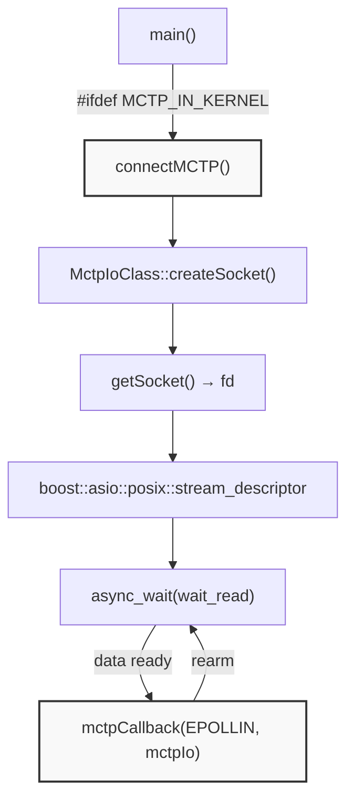
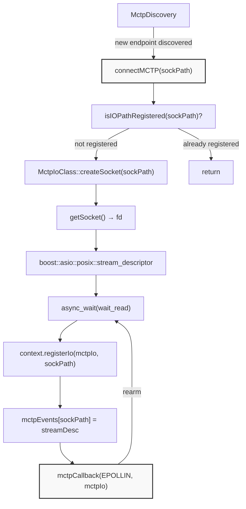
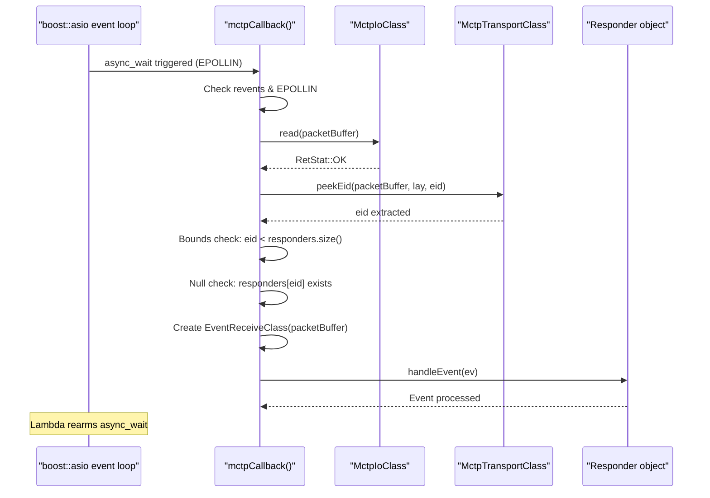
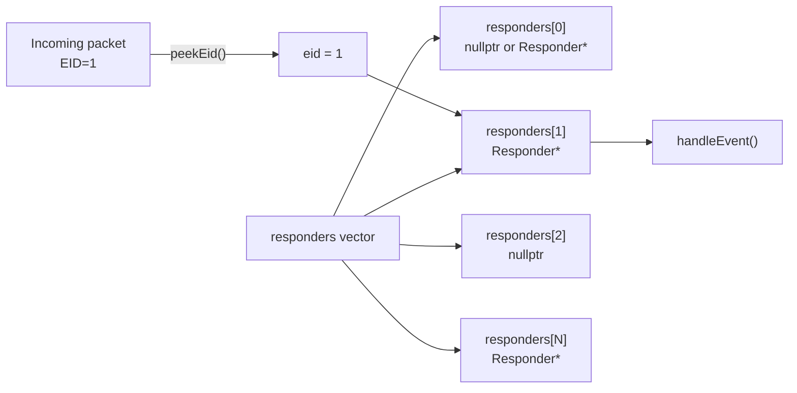
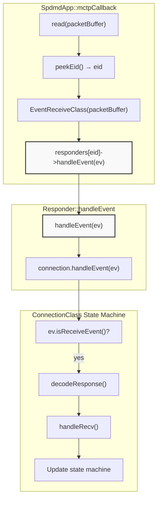

<!-- source: DeepWiki mcp.deepwiki.com · repo NVIDIA/spdm · page 3.5 MCTP Packet Processing · fetched 2026-10-26 -->

# MCTP Packet Processing

<details>
<summary>Relevant source files</summary>

The following files were used as context for generating this wiki page:

- [spdmd/spdmd.cpp](spdmd/spdmd.cpp)
- [spdmd/spdmd_app.hpp](spdmd/spdmd_app.hpp)

</details>


## Purpose and Scope

This document describes how the `spdmd` daemon receives and processes incoming MCTP packets from SPDM responder devices. It covers the socket setup, asynchronous I/O handling with `boost::asio`, the packet reception callback, EID extraction, and routing of packets to the appropriate `Responder` objects.

For information about the MCTP transport layer implementation within `libspdmcpp` (including packet encoding/decoding), see [MCTP Transport Implementation](#2.2.1). For details on how `Responder` objects handle the dispatched events, see [Refresh Method and Event Handling](#3.2.2). For the overall application event loop architecture, see [Application Architecture](#3.1).

---

## Overview

The `spdmd` daemon uses an event-driven architecture to handle MCTP packet reception. The system supports two transport modes, selected at compile time:

1. **Kernel Mode** (`MCTP_IN_KERNEL` enabled): Uses Linux kernel's `AF_MCTP` socket family
2. **Userspace Mode** (`MCTP_IN_KERNEL` disabled): Uses UNIX domain sockets to communicate with the MCTP demux daemon

In both modes, the daemon sets up asynchronous I/O using `boost::asio::posix::stream_descriptor` to monitor socket file descriptors. When data arrives, the `mctpCallback` method is invoked, which reads the packet, extracts the source EID (Endpoint ID), and dispatches the packet to the corresponding `Responder` object for SPDM protocol processing.

**Sources:** [spdmd/spdmd.cpp:118-223](), [spdmd/spdmd_app.hpp:158-172]()

---

## Socket Connection Setup

### Kernel Mode Connection

When compiled with `MCTP_IN_KERNEL`, the daemon establishes a single AF_MCTP socket connection that can communicate with all MCTP endpoints through the kernel's MCTP subsystem.



**Connection Establishment Flow (Kernel Mode)**

The `connectMCTP()` method performs the following steps:

1. **Create MctpIoClass**: Instantiates `spdmcpp::MctpIoClass` with logging context
2. **Create Socket**: Calls `createSocket()` without arguments, which creates an AF_MCTP socket
3. **Extract File Descriptor**: Obtains the socket file descriptor via `getSocket()`
4. **Wrap in Stream Descriptor**: Creates `boost::asio::posix::stream_descriptor` to integrate the socket with the asio event loop
5. **Setup Async Read**: Configures `async_wait()` with a lambda that invokes `mctpCallback()` and rearms itself

**Sources:** [spdmd/spdmd.cpp:177-223](), [spdmd/spdmd_app.hpp:164]()

### Userspace Mode Connection

When `MCTP_IN_KERNEL` is disabled, the daemon connects to UNIX domain sockets provided by the MCTP demux daemon. Each MCTP binding may have its own socket path.



**Connection Establishment Flow (Userspace Mode)**

The `connectMCTP(const std::string& sockPath)` method:

1. **Check Registration**: Verifies if the socket path is already registered to avoid duplicate connections
2. **Create MctpIoClass**: Instantiates with logging
3. **Create Socket**: Calls `createSocket(sockPath)` to connect to the UNIX domain socket
4. **Wrap and Register**: Creates stream descriptor and registers the I/O handler in the context
5. **Store Descriptor**: Adds the stream descriptor to `mctpEvents` map for lifecycle management

**Sources:** [spdmd/spdmd.cpp:118-175](), [spdmd/spdmd_app.hpp:158-160]()

---

## Asynchronous I/O Pattern

Both transport modes use the same asynchronous I/O pattern with `boost::asio`:

| Component | Type | Purpose |
|-----------|------|---------|
| `mctpIo` | `std::shared_ptr<MctpIoClass>` | Manages the socket and provides read/write operations |
| `streamDesc` | `std::unique_ptr<boost::asio::posix::stream_descriptor>` | Integrates socket fd with asio event loop |
| `rearmPtr` | `std::shared_ptr<std::function<void(...)>>` | Self-rearming lambda for continuous monitoring |
| `async_wait()` | asio operation | Waits for `wait_read` events on the descriptor |

The self-rearming lambda pattern ensures that the socket remains monitored after each packet is received. The lambda captures all necessary state (io context, stream descriptor, mctpIo reference) and recursively calls itself after processing each event.

**Error Handling**: If `async_wait()` returns an error code, the error is logged but the connection is not automatically reestablished. For the single AF_MCTP socket, a critical error typically results in daemon termination.

**Sources:** [spdmd/spdmd.cpp:131-157](), [spdmd/spdmd.cpp:189-210]()

---

## Packet Reception and Processing

### The mctpCallback Method

The `mctpCallback` method is the central packet reception handler. It is invoked by the asio event loop when data is available on an MCTP socket.



**mctpCallback Flow**

**Sources:** [spdmd/spdmd.cpp:423-486]()

### Step-by-Step Processing

#### 1. Event Validation

```cpp
if (!(revents & EPOLLIN))
{
    return;
}
```

The method first checks that the event is actually a read event (`EPOLLIN`). This is a safety check since the socket is configured for read monitoring.

**Sources:** [spdmd/spdmd.cpp:428-431]()

#### 2. Packet Reading

```cpp
auto rs = mctpIo.read(packetBuffer);
if (rs != spdmcpp::RetStat::OK)
{
    getLog().println("SpdmdApp::IO read failed...");
    std::exit(1);
    return;
}
```

The `MctpIoClass::read()` method reads the incoming packet into `packetBuffer`. For kernel mode, this uses `recvmsg()` on the AF_MCTP socket. For userspace mode, it reads from the UNIX domain socket. A read failure typically indicates a broken socket connection, which causes the daemon to exit.

**Sources:** [spdmd/spdmd.cpp:434-442]()

#### 3. EID Extraction

```cpp
uint8_t eid = 0;
spdmcpp::TransportClass::LayerState lay;
auto rs = spdmcpp::MctpTransportClass::peekEid(packetBuffer, lay, eid);
```

The `peekEid()` static method examines the MCTP packet headers to extract the source endpoint ID without fully decoding the packet. This is a lightweight operation that parses just the MCTP transport header.

**Possible Return Values:**
- `RetStat::OK`: EID successfully extracted
- `RetStat::ERROR_BUFFER_TOO_SMALL`: Packet is too small to contain valid MCTP headers
- Other errors: Unexpected parsing failures

**Sources:** [spdmd/spdmd.cpp:444-465]()

#### 4. Responder Lookup and Validation

```cpp
if (eid >= responders.size())
{
    getLog().println("SpdmdApp::IO received message from EID=...");
    return;
}
if (!responders[eid])
{
    getLog().println("SpdmdApp::IO received message from EID=... while responder class is not created");
}
```

The daemon maintains a vector of `Responder` objects indexed by EID. The code performs two safety checks:

1. **Bounds Check**: Ensures the EID is within the vector bounds
2. **Null Check**: Verifies a `Responder` object has been created for this EID

If either check fails, the packet is logged and discarded. This can occur if a packet arrives from an undiscovered endpoint or before discovery is complete.

**Sources:** [spdmd/spdmd.cpp:466-479]()

#### 5. Event Dispatch

```cpp
else
{
    auto& resp = responders[eid];
    spdmcpp::EventReceiveClass ev(packetBuffer);
    resp->handleEvent(ev);
}
```

If a valid `Responder` exists, the packet buffer is wrapped in an `EventReceiveClass` and passed to the responder's `handleEvent()` method. The `Responder` (which contains a `ConnectionClass`) then processes the packet according to the SPDM state machine.

**Sources:** [spdmd/spdmd.cpp:480-485]()

---

## Responder Vector Management

The `responders` vector serves as the central dispatch table, mapping EIDs to `Responder` objects:



**Vector Characteristics:**

- **Dynamic Sizing**: The vector grows as needed when new responders are discovered
- **Sparse Population**: Not all indices necessarily contain responders; null entries are common
- **EID-Based Indexing**: The EID directly serves as the array index for O(1) lookup
- **Thread Safety**: Access is serialized through the single-threaded asio event loop

The vector is resized in `createResponder()` when a new endpoint is discovered:

```cpp
if (args.eid >= responders.size())
{
    responders.resize(args.eid + 1);
}
```

**Sources:** [spdmd/spdmd_app.hpp:167](), [spdmd/spdmd.cpp:339-342]()

---

## Packet Buffer Management

### Buffer Lifecycle

```mermaid
stateDiagram-v2
    [*] --> Allocated: SpdmdApp constructed
    Allocated --> Filled: mctpCallback() → mctpIo.read()
    Filled --> Peeked: MctpTransportClass::peekEid()
    Peeked --> Wrapped: EventReceiveClass(packetBuffer)
    Wrapped --> Dispatched: responders[eid]->handleEvent()
    Dispatched --> Processing: ConnectionClass decodes packet
    Processing --> Reused: Next mctpCallback invocation
    Reused --> Filled
```

The `packetBuffer` is a member variable of `SpdmdApp`:

```cpp
std::vector<uint8_t> packetBuffer;
```

**Buffer Reuse**: The same buffer is reused for all packet receptions. The `MctpIoClass::read()` method resizes the buffer as needed to accommodate the incoming packet size. This design minimizes allocations during normal operation.

**Buffer Contents**: After `read()`, the buffer contains the complete MCTP packet including:
- MCTP transport header (with source/destination EID)
- SPDM message header
- SPDM payload

The buffer is passed by reference to `EventReceiveClass`, which stores a reference to it for later decoding by `ConnectionClass`.

**Sources:** [spdmd/spdmd_app.hpp:172](), [spdmd/spdmd.cpp:434]()

---

## Error Handling and Edge Cases

### Read Failures

When `mctpIo.read()` fails, it typically indicates a broken socket connection:

```cpp
if (rs != spdmcpp::RetStat::OK)
{
    getLog().println("SpdmdApp::IO read failed likely due to broken socket connection, quitting!");
    std::exit(1);
    return;
}
```

**Rationale**: A read failure on the primary MCTP socket is a critical error. The daemon exits rather than attempting recovery, allowing the system's process manager (e.g., systemd) to restart it.

**Sources:** [spdmd/spdmd.cpp:435-441]()

### Invalid Packet Size

If `peekEid()` returns `ERROR_BUFFER_TOO_SMALL`, the packet is too small to contain valid MCTP headers:

```cpp
case spdmcpp::RetStat::ERROR_BUFFER_TOO_SMALL:
    getLog().print("SpdmdApp::IO: packet size = ");
    getLog().print(packetBuffer.size());
    getLog().println(" is too small to be a valid SPDM packet");
    return;
```

The packet is logged and discarded. This can occur due to network corruption or malformed packets.

**Sources:** [spdmd/spdmd.cpp:454-458]()

### EID Out of Bounds

Packets from unknown EIDs are logged but do not cause daemon termination:

```cpp
if (eid >= responders.size())
{
    getLog().println("SpdmdApp::IO received message from EID=..." + 
                     " outside of responder array size=...");
    return;
}
```

This is a non-fatal error since devices can be dynamically discovered and removed.

**Sources:** [spdmd/spdmd.cpp:466-472]()

### Responder Not Created

If a packet arrives before the responder is fully initialized:

```cpp
if (!responders[eid])
{
    getLog().println("SpdmdApp::IO received message from EID=..." +
                     " while responder class is not created");
}
```

This can occur during the discovery phase or if discovery failed for an endpoint. The packet is logged and discarded.

**Sources:** [spdmd/spdmd.cpp:474-478]()

---

## Integration with Connection State Machine

The packet processing flow integrates with the SPDM protocol state machine in `ConnectionClass`:



The `EventReceiveClass` carries the raw packet data through the dispatch chain. When it reaches `ConnectionClass::handleEvent()`, the connection examines the event type and, if it's a receive event, decodes the SPDM packet and invokes the appropriate handler based on the current state.

**Sources:** [spdmd/spdmd.cpp:480-485]()

---

## Performance Considerations

### Zero-Copy Design

The packet processing path minimizes data copying:

1. **Direct Read**: `mctpIo.read()` reads directly into `packetBuffer`
2. **Reference Passing**: `EventReceiveClass` stores a reference to the buffer
3. **In-Place Decoding**: Packet decoding reads from the buffer without copying

### Single-Threaded Event Loop

All packet processing occurs on the main thread through the `boost::asio` event loop. This design:

- **Eliminates locking**: No mutex contention for shared state
- **Simplifies debugging**: Sequential execution is easier to reason about
- **Sufficient throughput**: SPDM is a request-response protocol with low message rate

### Buffer Reuse

The single `packetBuffer` is reused across all packet receptions, reducing heap allocations. The buffer grows to accommodate the largest packet seen but never shrinks, optimizing for steady-state operation.

**Sources:** [spdmd/spdmd.cpp:423-486]()

---

## Summary

The MCTP packet processing subsystem in `spdmd` provides efficient, event-driven reception and dispatch of SPDM protocol messages. Key design elements include:

- **Dual Transport Support**: Kernel AF_MCTP and userspace demux sockets
- **Asynchronous I/O**: `boost::asio` integration with self-rearming callbacks
- **Direct Dispatch**: EID-based vector lookup for O(1) responder routing
- **Robust Error Handling**: Graceful handling of malformed packets and missing responders
- **Zero-Copy Path**: Minimal data copying from socket to state machine

The system integrates seamlessly with the SPDM protocol state machine in `ConnectionClass`, enabling the daemon to handle multiple responders concurrently within a single-threaded event loop architecture.

---

