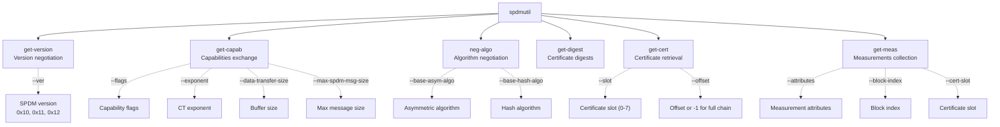
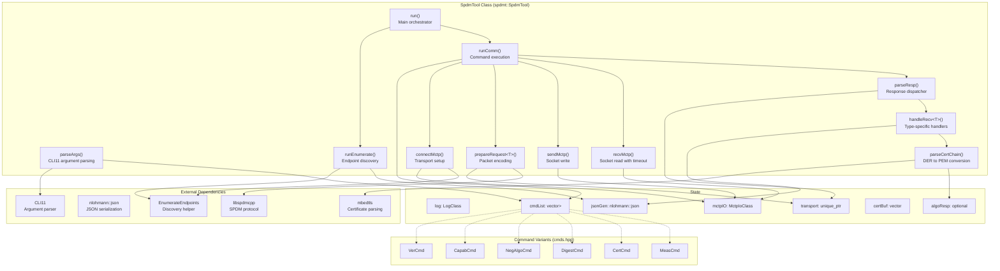
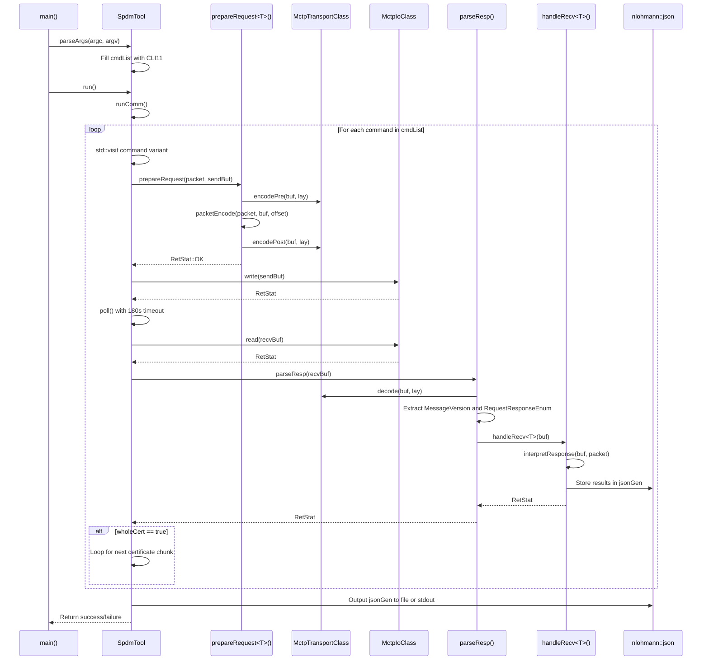
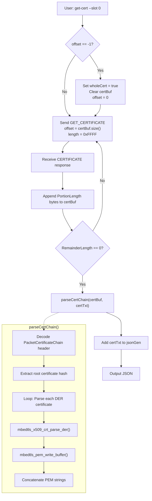
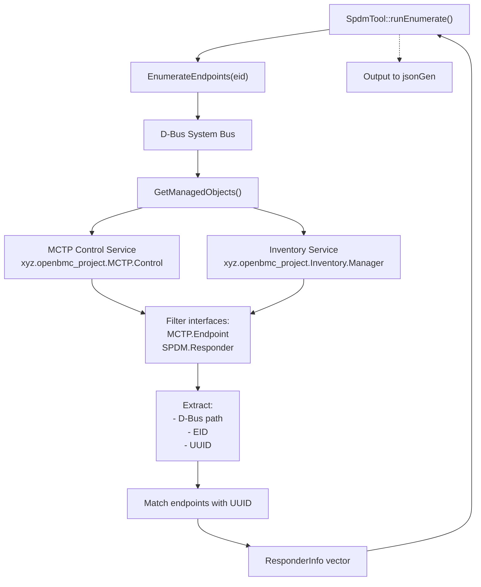

<!-- source: DeepWiki mcp.deepwiki.com · repo NVIDIA/spdm · page 4 spdmutil Command-Line Tool · fetched 2026-10-26 -->

# spdmutil Command-Line Tool

<details>
<summary>Relevant source files</summary>

The following files were used as context for generating this wiki page:

- [spdmutil/cmds.hpp](spdmutil/cmds.hpp)
- [spdmutil/spdm_tool.cpp](spdmutil/spdm_tool.cpp)
- [spdmutil/spdm_tool.hpp](spdmutil/spdm_tool.hpp)

</details>


`spdmutil` is a command-line utility that provides direct access to SPDM (Security Protocol and Data Model) operations for testing, debugging, and interacting with SPDM responder devices. Unlike the `spdmd` daemon (see [spdmd Daemon](#3)), which continuously manages SPDM connections and exposes D-Bus interfaces, `spdmutil` performs one-time command execution and outputs results as JSON.

**Scope**: This document covers the `spdmutil` tool architecture, command structure, request-response processing, and output format. For information about the underlying SPDM protocol implementation, see [libspdmcpp Library](#2). For daemon-based SPDM management, see [spdmd Daemon](#3).

---

## Overview

`spdmutil` enables direct communication with SPDM responders over MCTP transport. The tool supports the complete SPDM protocol flow: version negotiation, capabilities exchange, algorithm negotiation, certificate retrieval, and measurements collection. It is primarily used for:

- **Testing**: Verifying SPDM responder behavior
- **Debugging**: Troubleshooting SPDM communication issues
- **Manual Operations**: Performing one-time SPDM requests outside daemon control
- **Endpoint Discovery**: Enumerating available SPDM endpoints

The tool is implemented in the `spdmt` namespace with the `SpdmTool` class as the main orchestrator.

Sources: [spdmutil/spdm_tool.cpp:1-943](), [spdmutil/spdm_tool.hpp:1-182]()

---

## Command Structure

### Global Options

`spdmutil` accepts several global options that apply to all subcommands:

| Option | Type | Range | Description |
|--------|------|-------|-------------|
| `-e, --eid` | integer | 0x00-0xff | Target endpoint ID (EID) for SPDM communication |
| `--json` | string | - | Output file path for JSON results (stdout if omitted) |
| `--debug` | flag | - | Enable detailed logging (sets log level to Informational) |
| `--enumerate` | flag | - | Enumerate available SPDM endpoints instead of sending commands |
| `--help-all` | flag | - | Display expanded help for all subcommands |

**Mutual Exclusivity**: `--eid` and `--enumerate` cannot be used together. Commands require either `--eid` for targeted operations or `--enumerate` for discovery.

Sources: [spdmutil/spdm_tool.cpp:64-146]()

### Subcommands

The tool provides six SPDM protocol subcommands, each with specific parameters:



Sources: [spdmutil/spdm_tool.cpp:81-145](), [spdmutil/cmds.hpp:1-76]()

#### Command Definitions

**VerCmd** - Version Negotiation
- `--ver`: SPDM version (0x10=1.0, 0x11=1.1, 0x12=1.2), default: 0x11
- Negotiates the SPDM protocol version to use for subsequent commands

**CapabCmd** - Capabilities Exchange
- `--flags`: Requester capability flags, range: 0x00000000-0x0001FFFF, default: 0x00
- `--exponent`: CT exponent for timeout calculation, range: 0x00-0xFF, default: 0x00
- `--data-transfer-size`: SPDM 1.2 maximum receive buffer size, default: 2048
- `--max-spdm-msg-size`: SPDM 1.2 maximum reassembly size, default: 4096

**NegAlgoCmd** - Algorithm Negotiation
- `--base-asym-algo`: Asymmetric algorithm flags, default: 0x00000080 (ECDSA P-384)
- `--base-hash-algo`: Hash algorithm flags, default: 0x00000002 (SHA-256)

**DigestCmd** - Certificate Digests
- No parameters
- Retrieves digests of all certificate slots

**CertCmd** - Certificate Retrieval
- `--slot`: Certificate slot index, range: 0-7, default: 0
- `--offset`: Byte offset for partial retrieval, or -1 for complete chain (default: -1)
- When offset is -1, automatically retrieves and reassembles the full chain

**MeasCmd** - Measurements Collection
- `--attributes`: Measurement attributes (0x01=signature requested), range: 0x00-0x03, default: 0x01
- `--block-index`: Measurement block index (0xFE=all blocks), range: 0x00-0xFF, default: 0xFE
- `--cert-slot`: Certificate slot for signature verification, range: 0x00-0x0F, default: 0x0F

Sources: [spdmutil/cmds.hpp:26-76](), [spdmutil/spdm_tool.cpp:88-145]()

#### Command Chaining and Dependencies

Commands can be chained in a single invocation. The tool automatically fills in prerequisite commands if they are missing:


The tool inspects the command list and automatically inserts missing prerequisite commands with default parameters. This ensures the SPDM protocol flow is maintained.

Sources: [spdmutil/spdm_tool.cpp:218-260]()

---

## Architecture and Flow

### Main Components



The `SpdmTool` class manages the complete tool lifecycle. It stores parsed commands in `cmdList` as a vector of optional command variants. The tool maintains state for MCTP transport (`mctpIO`, `transport`), JSON output (`jsonGen`), and certificate reassembly (`certBuf`, `wholeCert` flag).

Sources: [spdmutil/spdm_tool.hpp:36-115](), [spdmutil/spdm_tool.cpp:54-61]()

### Request-Response Cycle

The complete request-response cycle for each command follows this sequence:



**Key Steps**:

1. **Argument Parsing**: CLI11 parses command-line arguments and populates `cmdList` at positions 0-5 (version, capabilities, algorithms, digest, certificate, measurements).

2. **Command Execution**: `std::visit` with an `Overloaded` pattern invokes lambda functions for each command variant, constructing the appropriate request packet.

3. **Encoding**: `prepareRequest` template function handles SPDM packet serialization:
   - `encodePre` adds MCTP pre-headers
   - `packetEncode` serializes the SPDM packet structure
   - `encodePost` finalizes MCTP framing

4. **Transmission**: `sendMctp` writes to the MCTP socket via `MctpIoClass::write()`.

5. **Reception**: `recvMctp` uses `poll()` with a 180-second timeout, then reads from the socket.

6. **Decoding**: `parseResp` strips MCTP headers, extracts the response code, and dispatches to the appropriate `handleRecv` specialization.

7. **Result Storage**: Each `handleRecv` specialization parses the response and stores structured data in `jsonGen`.

Sources: [spdmutil/spdm_tool.cpp:486-645](), [spdmutil/spdm_tool.hpp:118-179]()

#### prepareRequest Template Function

The `prepareRequest` template function provides type-safe packet encoding:

```cpp
template <typename T>
auto SpdmTool::prepareRequest(const T& packet, std::vector<uint8_t>& buf)
    -> spdmcpp::RetStat
```

**Parameters**:
- `packet`: SPDM request packet (e.g., `PacketGetVersionRequest`, `PacketGetCertificateRequest`)
- `buf`: Output buffer for encoded data

**Process**:
1. Logs packet details if debug mode is enabled
2. Calls `transport->encodePre()` to add MCTP headers
3. Calls `packetEncode()` from libspdmcpp to serialize the packet
4. Calls `transport->encodePost()` to finalize headers
5. Returns `RetStat::OK` on success

Sources: [spdmutil/spdm_tool.hpp:118-145]()

#### interpretResponse Template Function

The `interpretResponse` template function provides type-safe packet decoding:

```cpp
template <typename T, typename... Targs>
auto SpdmTool::interpretResponse(std::vector<uint8_t>& buf, T& packet,
                                 Targs... fargs) -> spdmcpp::RetStat
```

**Parameters**:
- `buf`: Received buffer from socket
- `packet`: Output packet structure
- `fargs`: Optional decode parameters (e.g., `PacketDecodeInfo` for variable-sized packets)

**Process**:
1. Calls `transport->decode()` to strip MCTP headers
2. Calls `packetDecode()` from libspdmcpp to deserialize the packet
3. Logs packet details if debug mode is enabled
4. Returns parsing status

Sources: [spdmutil/spdm_tool.hpp:148-179]()

#### handleRecv Specializations

The tool provides six template specializations for handling different response types:

| Specialization | Response Type | Purpose |
|----------------|---------------|---------|
| `handleRecv<PacketVersionResponseVar>` | VERSION | Parse version entries, negotiate highest supported version |
| `handleRecv<PacketCapabilitiesResponse>` | CAPABILITIES | Extract capability flags and CT exponent |
| `handleRecv<PacketAlgorithmsResponseVar>` | ALGORITHMS | Update `packetDecodeInfo` with hash/signature sizes |
| `handleRecv<PacketDigestsResponseVar>` | DIGESTS | Extract certificate slot digests |
| `handleRecv<PacketCertificateResponseVar>` | CERTIFICATE | Handle chunked certificate retrieval |
| `handleRecv<PacketMeasurementsResponseVar>` | MEASUREMENTS | Extract measurement blocks |

Each specialization:
1. Calls `interpretResponse()` to deserialize the packet
2. Extracts relevant fields and stores them in `jsonGen`
3. Updates tool state (e.g., `negotiatedVersion`, `packetDecodeInfo`, `algoResp`)
4. Returns the parsing status

Sources: [spdmutil/spdm_tool.cpp:263-483]()

---

## Certificate Chain Retrieval

Certificate chains can exceed MCTP's maximum transfer unit, requiring chunked retrieval. The tool implements automatic reassembly:



**Chunking Process**:

1. **Initialization**: When `--offset` is -1 or omitted, `wholeCert` is set to `true` and `certBuf` is cleared.

2. **First Request**: A `GET_CERTIFICATE` request is sent with `offset=0` and `length=0xFFFF` (maximum).

3. **Response Handling**: The `handleRecv<PacketCertificateResponseVar>` specialization:
   - Reserves space: `certBuf.reserve(PortionLength + RemainderLength)`
   - Appends chunk: `std::copy(CertificateVector → certBuf)`
   - Checks completion: `if (!RemainderLength)` then all chunks received

4. **Subsequent Requests**: If `RemainderLength > 0`, the `runComm()` loop sends another request with `offset=certBuf.size()`.

5. **Completion**: When `RemainderLength == 0`, `wholeCert` is set to `false` and `parseCertChain()` is called.

Sources: [spdmutil/spdm_tool.cpp:376-425](), [spdmutil/spdm_tool.cpp:605-642]()

### Certificate Parsing

The `parseCertChain()` function converts the binary certificate chain to PEM format:

**Input**: `std::vector<uint8_t>` containing raw certificate chain data
**Output**: `std::string` containing concatenated PEM-encoded certificates

**Process**:

1. **Header Decoding**: Parse `PacketCertificateChain` structure to extract chain length.

2. **Root Hash Extraction**: Read the root certificate hash based on `algoResp->Min.BaseHashAlgo`.

3. **Certificate Loop**: For each certificate in the chain:
   - Parse DER format using `mbedtls_x509_crt_parse_der()`
   - Extract ASN.1 tag and length to determine certificate boundaries
   - Convert to PEM format using `mbedtls_pem_write_buffer()`
   - Concatenate to output string

4. **Validation**: Verify that the parsed length matches the expected chain length.

Sources: [spdmutil/spdm_tool.cpp:806-888]()

---

## JSON Output Format

All results are stored in `nlohmann::json` format and output at the end of execution. The output structure varies by command:

### Version Response

```json
{
  "GetVersion": {
    "SPDMVersion": ["1.0.0", "1.1.0", "1.2.0"],
    "NegotiatedVersion": "1.2.0",
    "ResponseCode": "OK"
  }
}
```

Sources: [spdmutil/spdm_tool.cpp:274-300]()

### Capabilities Response

```json
{
  "GetCapabilities": {
    "SPDMVersion": "1.2.0",
    "CTExponent": 12,
    "Capabilities": ["CERT_CAP", "MEAS_CAP_SIG"],
    "ResponseCode": "OK",
    "DataTransferSize": 4096,
    "MaxSPDMmsgSize": 8192
  }
}
```

**Note**: `DataTransferSize` and `MaxSPDMmsgSize` are only present for SPDM 1.2+.

Sources: [spdmutil/spdm_tool.cpp:314-324]()

### Algorithms Response

```json
{
  "NegotiateAlgorithms": {
    "SPDMVersion": "1.2.0",
    "SignatureAlgorithm": "ECDSA_P384",
    "HashingAlgorithm": "SHA_384",
    "ResponseCode": "OK"
  }
}
```

**Side Effect**: Updates `packetDecodeInfo.BaseHashSize` and `packetDecodeInfo.SignatureSize` for subsequent packet decoding.

Sources: [spdmutil/spdm_tool.cpp:328-373]()

### Certificate Response

```json
{
  "GetCertificate": {
    "SPDMVersion": "1.2.0",
    "ResponseCode": "OK",
    "Slot": 0,
    "CertChain": "-----BEGIN CERTIFICATE-----\nMIIC...\n-----END CERTIFICATE-----\n-----BEGIN CERTIFICATE-----\nMIID...\n-----END CERTIFICATE-----\n"
  }
}
```

For partial retrieval (when `--offset` is specified):

```json
{
  "GetCertificate": {
    "SPDMVersion": "1.2.0",
    "ResponseCode": "OK",
    "Slot": 0,
    "CertChunk:": [48, 130, 2, 218, ...]
  }
}
```

Sources: [spdmutil/spdm_tool.cpp:381-424]()

### Digest Response

```json
{
  "GetDigest": {
    "SPDMVersion": "1.2.0",
    "ResponseCode": "OK",
    "Slot": 15,
    "Digest": [
      [159, 171, 82, 193, ...],
      [47, 218, 103, 245, ...]
    ]
  }
}
```

Sources: [spdmutil/spdm_tool.cpp:428-454]()

### Measurements Response

```json
{
  "GetMeasurement": {
    "SPDMVersion": "1.2.0",
    "ResponseCode": "OK",
    "Slot": 0,
    "MeasurementRecordLength": 512,
    "MeasurementData": [
      [1, [0, 12, 0, 4, 1, 2, 3, 4]],
      [2, [0, 12, 0, 8, 5, 6, 7, 8, 9, 10, 11, 12]]
    ],
    "Nonce": [143, 201, 47, 89, ...],
    "Signature": [48, 69, 2, 33, ...]
  }
}
```

**Format**: `MeasurementData` is an array of `[index, measurement_bytes]` pairs.

Sources: [spdmutil/spdm_tool.cpp:458-482]()

### Error Response

For any command that fails:

```json
{
  "GetVersion": {
    "ResponseCode": "ERROR_RESPONSE"
  }
}
```

Sources: [spdmutil/spdm_tool.cpp:270-276]()

### Endpoint Enumeration

When `--enumerate` is used:

```json
{
  "Endpoints": [
    {
      "Path": "/xyz/openbmc_project/mctp/1/8",
      "EID": 8,
      "UUID": "12345678-1234-5678-1234-567812345678"
    },
    {
      "Path": "/xyz/openbmc_project/mctp/1/9",
      "EID": 9,
      "UUID": "87654321-4321-8765-4321-876543218765"
    }
  ]
}
```

Sources: [spdmutil/spdm_tool.cpp:922-940]()

---

## Endpoint Enumeration

The `EnumerateEndpoints` class discovers SPDM endpoints via D-Bus:



**Discovery Process**:

1. **D-Bus Query**: Calls `GetManagedObjects()` on both MCTP Control and Inventory services.

2. **Interface Filtering**: Searches for objects implementing:
   - `xyz.openbmc_project.MCTP.Endpoint` (provides EID)
   - `xyz.openbmc_project.SPDM.Responder` (provides UUID)

3. **Endpoint Matching**: Correlates MCTP endpoints with inventory items by UUID.

4. **Result Collection**: Returns a vector of `ResponderInfo` structures containing:
   - `path`: D-Bus object path
   - `eid`: MCTP endpoint ID
   - `uuid`: SPDM responder UUID
   - `sockPath`: UNIX socket path (for non-kernel MCTP mode)

5. **JSON Output**: Each endpoint is serialized to `jsonGen["Endpoints"]`.

**EID Filtering**: If a specific EID is provided via `--eid`, only that endpoint is included. Otherwise, all discovered endpoints are returned.

Sources: [spdmutil/spdm_tool.cpp:922-940](), [spdmutil/enumerate_endpoints.hpp]()

---

## Transport Configuration

The tool supports both kernel-based and userspace MCTP transport, determined at compile time:

| Configuration | Socket Type | Connection Method |
|---------------|-------------|-------------------|
| `MCTP_IN_KERNEL=true` | `AF_MCTP` | Direct kernel MCTP stack |
| `MCTP_IN_KERNEL=false` | `AF_UNIX` | MCTP demux daemon |

**Connection Establishment**:

```cpp
void SpdmTool::connectMctp()
{
    EnumerateEndpoints enumerate(m_eid);
    auto& respInfo = enumerate.getRespondersInfo();
    
#ifndef MCTP_IN_KERNEL
    const auto& unixSock = responder.sockPath;
    if (!mctpIO.createSocket(unixSock)) {
        throw std::logic_error("Unable connect to MCTP socket");
    }
#else
    if (!mctpIO.createSocket()) {
        throw std::logic_error("Unable connect to MCTP socket");
    }
#endif
}
```

**Kernel Mode**: `MctpIoClass::createSocket()` creates an `AF_MCTP` socket and binds it.

**Userspace Mode**: `MctpIoClass::createSocket(unixSock)` connects to a UNIX domain socket provided by the demux daemon.

Sources: [spdmutil/spdm_tool.cpp:744-774]()

---

## Error Handling

The tool employs several error detection mechanisms:

### Timeout Handling

`recvMctp()` uses `poll()` with a 180-second timeout:

```cpp
auto SpdmTool::recvMctp(std::vector<uint8_t>& buf) -> spdmcpp::RetStat
{
    static constexpr auto timeout = 180'000U;
    std::array<pollfd, 1> pfd{};
    pfd[0].fd = mctpIO.getSocket();
    pfd[0].events = POLLIN;
    auto ret = ::poll(pfd.data(), 1, timeout);
    if (ret == -1) {
        throw std::logic_error("Poll error");
    }
    if (ret == 0) {
        return RetStat::ERROR_TIMEOUT;
    }
    return mctpIO.read(buf);
}
```

Sources: [spdmutil/spdm_tool.cpp:776-792]()

### Response Error Handling

`parseResp()` checks for `RESPONSE_ERROR` packets:

```cpp
if (code == RequestResponseEnum::RESPONSE_ERROR)
{
    log.iprintln("RESPONSE_ERROR");
    PacketErrorResponseVar err;
    rs = interpretResponse(buf, err);
    return RetStat::ERROR_RESPONSE;
}
```

When detected, the error response is decoded and `ERROR_RESPONSE` is returned, propagating to the JSON output.

Sources: [spdmutil/spdm_tool.cpp:693-704]()

### RetStat Propagation

Every operation returns a `RetStat` enum. The main loop checks for errors after each step:

1. **Encoding**: `if (isError(rs))` after `prepareRequest()`
2. **Sending**: `if (rs != RetStat::OK)` after `sendMctp()`
3. **Receiving**: `if (rs != RetStat::OK)` after `recvMctp()`
4. **Parsing**: `if (isError(rs))` after `parseResp()`

On error, the loop breaks and `jsonGen` contains the response code.

Sources: [spdmutil/spdm_tool.cpp:604-643]()

---

## Usage Examples

### Example 1: Get Version

```bash
$ spdmutil --eid 8 get-version
{
  "GetVersion": {
    "SPDMVersion": ["1.1.0", "1.2.0"],
    "NegotiatedVersion": "1.2.0",
    "ResponseCode": "OK"
  }
}
```

### Example 2: Full Protocol Flow with Measurements

```bash
$ spdmutil --eid 8 get-meas --json output.json
```

This automatically executes:
1. `get-version` (with defaults)
2. `get-capab` (with defaults)
3. `neg-algo` (with defaults)
4. `get-meas` (with specified parameters)

Output includes all four responses in `output.json`.

### Example 3: Certificate Retrieval

```bash
$ spdmutil --eid 8 get-cert --slot 0
{
  "GetVersion": {...},
  "GetCapabilities": {...},
  "NegotiateAlgorithms": {...},
  "GetCertificate": {
    "SPDMVersion": "1.2.0",
    "ResponseCode": "OK",
    "Slot": 0,
    "CertChain": "-----BEGIN CERTIFICATE-----\n...\n-----END CERTIFICATE-----\n"
  }
}
```

### Example 4: Enumerate Endpoints

```bash
$ spdmutil --enumerate
{
  "Endpoints": [
    {
      "Path": "/xyz/openbmc_project/mctp/1/8",
      "EID": 8,
      "UUID": "12345678-1234-5678-1234-567812345678"
    }
  ]
}
```

### Example 5: Debug Mode

```bash
$ spdmutil --eid 8 --debug get-version
sendRequest(N6spdmcpp25PacketGetVersionRequestE):
  Header:
    MessageVersion: 1.1
    RequestResponseCode: GET_VERSION
  ...
ResponseBuffer.size() = 42
ResponseBuffer = [0x10, 0x04, 0x00, ...]
...
```

Sources: [spdmutil/spdm_tool.cpp:1-943]()

---

