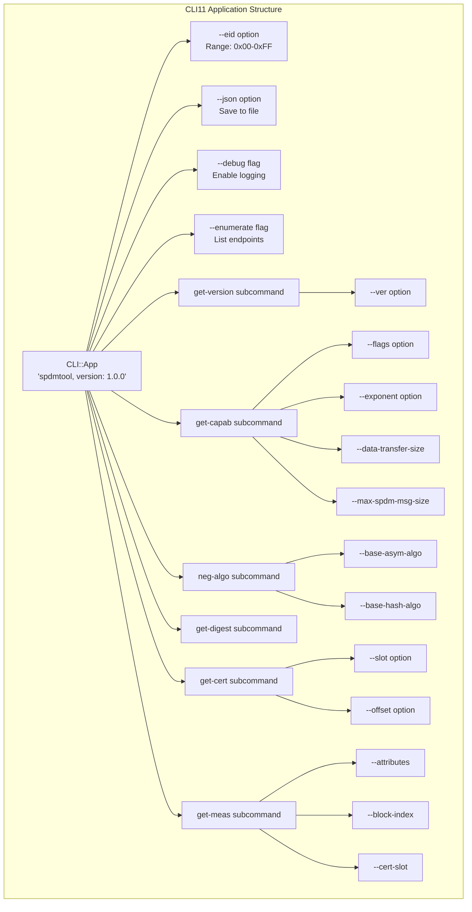
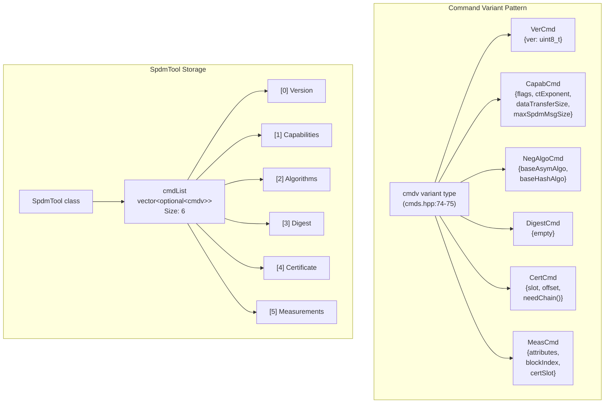
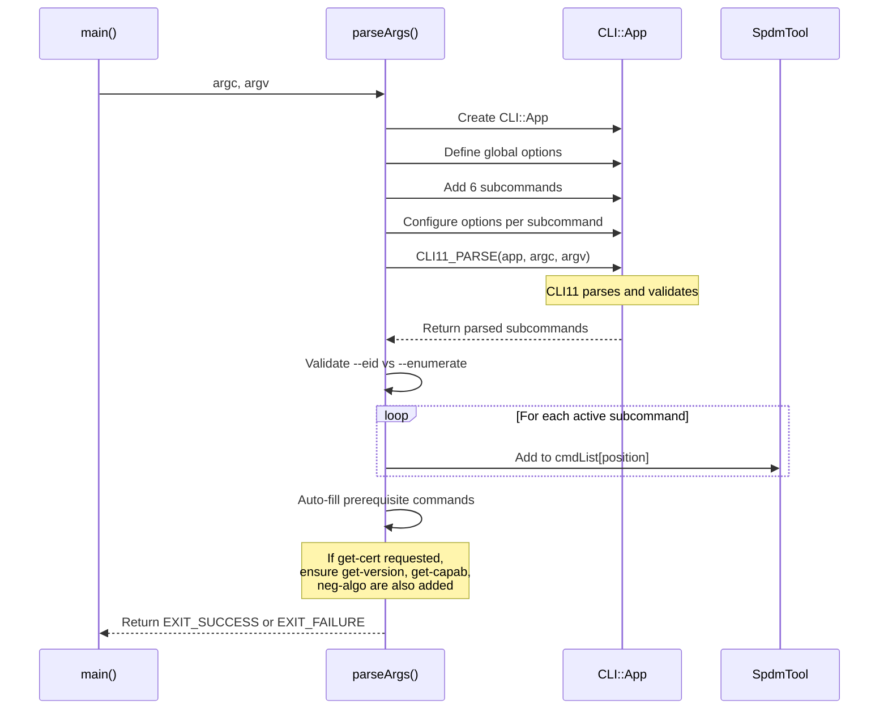
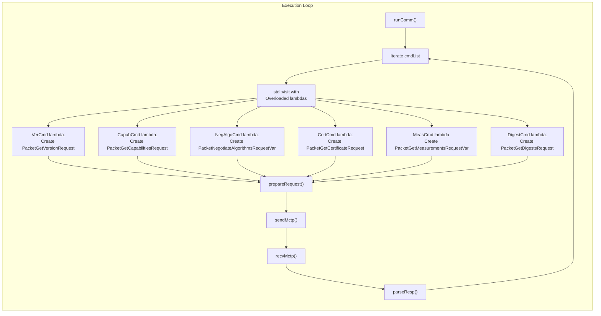

<!-- source: DeepWiki mcp.deepwiki.com · repo NVIDIA/spdm · page 4.1 Command Structure · fetched 2026-10-26 -->

# Command Structure

<details>
<summary>Relevant source files</summary>

The following files were used as context for generating this wiki page:

- [spdmutil/cmds.hpp](spdmutil/cmds.hpp)
- [spdmutil/spdm_tool.cpp](spdmutil/spdm_tool.cpp)
- [spdmutil/spdm_tool.hpp](spdmutil/spdm_tool.hpp)

</details>


## Purpose and Scope

This page documents the command-line interface structure of the `spdmutil` tool, including argument parsing with CLI11, available subcommands, global options, and the internal representation of commands. For information about how commands are executed and responses are processed, see [Request-Response Cycle](#4.2). For JSON output formatting, see [JSON Output Format](#4.4).

---

## Overview

The `spdmutil` tool provides a command-line interface for performing SPDM protocol operations directly against MCTP endpoints. The tool uses the CLI11 library for argument parsing and supports six primary SPDM operations as subcommands, each with their own specific options.

**Sources:** [spdmutil/spdm_tool.cpp:64-261](), [spdmutil/spdm_tool.hpp:36-115]()

---

## CLI11 Framework Integration

The `SpdmTool::parseArgs()` method creates a `CLI::App` instance to define the command-line interface. CLI11 provides structured argument parsing with type checking, range validation, and automatic help generation.



**Sources:** [spdmutil/spdm_tool.cpp:66-145]()

---

## Global Options

Global options apply to all subcommands and control the tool's behavior:

| Option | Type | Description | Validation |
|--------|------|-------------|------------|
| `-e, --eid` | Integer | Target MCTP Endpoint ID | Range: 0x00-0xFF |
| `--json` | String | Save responses to JSON file | File path |
| `--debug` | Flag | Enable debug logging (Informational level) | Boolean |
| `--enumerate` | Flag | Enumerate SPDM endpoints instead of executing commands | Boolean |
| `--help-all` | Flag | Expand all help including subcommands | Boolean |

The `--eid` and `--enumerate` options are mutually exclusive. When `--enumerate` is used, the tool lists available SPDM endpoints and exits. Otherwise, `--eid` must be specified to target a specific endpoint.

**Sources:** [spdmutil/spdm_tool.cpp:72-79](), [spdmutil/spdm_tool.cpp:154-164]()

---

## Subcommands

### get-version

Retrieves the SPDM version(s) supported by the responder.

**Options:**

| Option | Type | Default | Description |
|--------|------|---------|-------------|
| `--ver` | Hex (0x00-0xFF) | `0x11` | SPDM version to request (0x10=1.0, 0x11=1.1, 0x12=1.2) |

**Implementation:** Constructs a `PacketGetVersionRequest` with the specified version.

**Sources:** [spdmutil/spdm_tool.cpp:81-95](), [spdmutil/spdm_tool.cpp:520-543]()

---

### get-capab

Retrieves the capabilities of the responder.

**Options:**

| Option | Type | Default | Description |
|--------|------|---------|-------------|
| `--flags` | Hex (0x00-0x1FFFF) | `0x00` | Requester capabilities flags |
| `--exponent` | Hex (0x00-0xFF) | `0x00` | CT (Connection Timeout) exponent |
| `--data-transfer-size` | Integer | `0x1000` | SPDM 1.2: Maximum receive buffer size |
| `--max-spdm-msg-size` | Integer | `0x1200` | SPDM 1.2: Maximum SPDM message size for reassembly |

**Implementation:** Constructs a `PacketGetCapabilitiesRequest`. The last two options are only included for SPDM 1.2+ connections.

**Sources:** [spdmutil/spdm_tool.cpp:82-113](), [spdmutil/spdm_tool.cpp:545-556]()

---

### neg-algo

Negotiates cryptographic algorithms with the responder.

**Options:**

| Option | Type | Default | Description |
|--------|------|---------|-------------|
| `--base-asym-algo` | Hex (0x00-0x190) | `0x00000080` | Base asymmetric algorithm flags |
| `--base-hash-algo` | Hex (0x00-0x20) | `0x00000002` | Base hash algorithm flags |

**Implementation:** Constructs a `PacketNegotiateAlgorithmsRequestVar` with specified algorithms.

**Sources:** [spdmutil/spdm_tool.cpp:83-122](), [spdmutil/spdm_tool.cpp:558-567]()

---

### get-digest

Retrieves certificate digests from all available slots. This subcommand has no additional options.

**Implementation:** Constructs a `PacketGetDigestsRequest` using the negotiated version.

**Sources:** [spdmutil/spdm_tool.cpp:86](), [spdmutil/spdm_tool.cpp:597-600]()

---

### get-cert

Retrieves certificates from a specific slot.

**Options:**

| Option | Type | Default | Description |
|--------|------|---------|-------------|
| `--slot` | Integer (0-7) | `0` | Certificate slot index |
| `--offset` | Integer (0-0xFFFF) | Omitted | Certificate offset for partial retrieval |

**Implementation:** When `--offset` is omitted, the tool automatically retrieves the entire certificate chain by chunking (see [Certificate Chain Retrieval](#4.3)). When specified, only the chunk at that offset is retrieved.

**Sources:** [spdmutil/spdm_tool.cpp:87-130](), [spdmutil/spdm_tool.cpp:569-585]()

---

### get-meas

Retrieves measurements from the responder.

**Options:**

| Option | Type | Default | Description |
|--------|------|---------|-------------|
| `--attributes` | Hex (0x00-0x03) | `0x01` | Measurement attributes (signature request) |
| `--block-index` | Hex (0x00-0xFF) | `0xFE` | Measurement block index (0xFE=all, 0xFF=count) |
| `--cert-slot` | Hex (0x00-0x0F) | `0x0F` | Certificate slot for signature verification |

**Implementation:** Constructs a `PacketGetMeasurementsRequestVar` with a randomly generated nonce.

**Sources:** [spdmutil/spdm_tool.cpp:88-144](), [spdmutil/spdm_tool.cpp:587-595]()

---

## Command Data Structures



Each subcommand has a corresponding C++ struct defined in `cmds.hpp`. These structs are combined into a `std::variant` type called `cmdv`, allowing type-safe storage of different command types. The `SpdmTool` class maintains a `cmdList` vector with fixed positions for each command type.

**Position Constants:**

The parsing logic uses an internal enumeration to map commands to positions:

```
vpos_ver   = 0  // get-version
vpos_capab = 1  // get-capab
vpos_algo  = 2  // neg-algo
vpos_dig   = 3  // get-digest
vpos_cert  = 4  // get-cert
vpos_meas  = 5  // get-meas
```

**Sources:** [spdmutil/cmds.hpp:24-76](), [spdmutil/spdm_tool.hpp:91](), [spdmutil/spdm_tool.cpp:176-184]()

---

## Command Parsing Flow



**Auto-fill Logic:**

The tool automatically inserts prerequisite commands when a higher-level command is requested. For example, requesting `get-cert` automatically includes `get-version`, `get-capab`, and `neg-algo` if they weren't explicitly specified. This ensures the SPDM protocol handshake completes properly.

The auto-fill algorithm:
1. Find the rightmost (highest) command in `cmdList` that has a value
2. Fill in any empty positions to the left with default-constructed commands

**Sources:** [spdmutil/spdm_tool.cpp:186-259]()

---

## Command Execution

After parsing, commands are executed sequentially from the `cmdList` vector using `std::visit` with an `Overloaded` visitor pattern. Each command variant is handled by a lambda that constructs the appropriate request packet.



The `Overloaded` struct is a template helper that combines multiple lambda functions into a single visitor callable:

```cpp
template <class... Ts>
struct Overloaded : Ts...
{
    using Ts::operator()...;
};
```

This enables the `std::visit` call to dispatch to the correct lambda based on the active variant type at runtime.

**Sources:** [spdmutil/spdm_tool.cpp:486-645](), [spdmutil/spdm_tool.cpp:44-50](), [spdmutil/spdm_tool.cpp:518-602]()

---

## Validation and Error Handling

The tool performs several validation checks during argument parsing:

| Validation | Error Condition | Error Message |
|------------|----------------|---------------|
| Mutual exclusivity | Both `--eid` and `--enumerate` specified | `"--eid or --enumerate should be choosen at the same time"` |
| EID requirement | Neither `--eid` nor `--enumerate` specified | `"--eid argument not specified"` |
| JSON file creation | Unable to create specified JSON file | `"Unable to create json file: <filename>"` |

Range validation is handled automatically by CLI11 through the `->check(CLI::Range(...))` modifiers on each option.

**Sources:** [spdmutil/spdm_tool.cpp:154-175]()

---

## Debug Mode

When the `--debug` flag is enabled, the `LogClass` log level is set to `Informational`, which causes the tool to output:
- Request packet details before sending
- Response buffer contents after receiving
- Packet sizes and hex dumps
- Decoded packet structures

Without debug mode, the log level remains at `Critical`, suppressing most diagnostic output.

**Sources:** [spdmutil/spdm_tool.cpp:77](), [spdmutil/spdm_tool.cpp:148-151](), [spdmutil/spdm_tool.cpp:58]()

---

## Summary

The `spdmutil` command structure provides a hierarchical, type-safe interface for SPDM operations:
- **CLI11** handles argument parsing and validation
- **Command structs** (`VerCmd`, `CapabCmd`, etc.) store parsed arguments
- **Variant pattern** enables type-safe storage and dispatch
- **Auto-fill logic** ensures protocol prerequisites are met
- **Sequential execution** processes commands in protocol-correct order

This design separates concerns between argument parsing, command representation, and execution, making the tool maintainable and extensible for future SPDM operations.

**Sources:** [spdmutil/spdm_tool.cpp:1-943](), [spdmutil/spdm_tool.hpp:1-181](), [spdmutil/cmds.hpp:1-76]()

---

