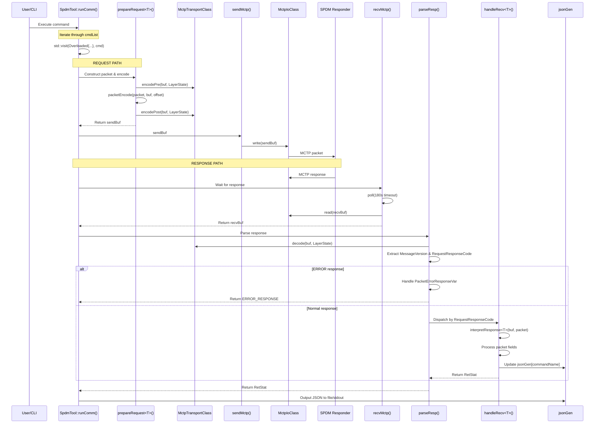
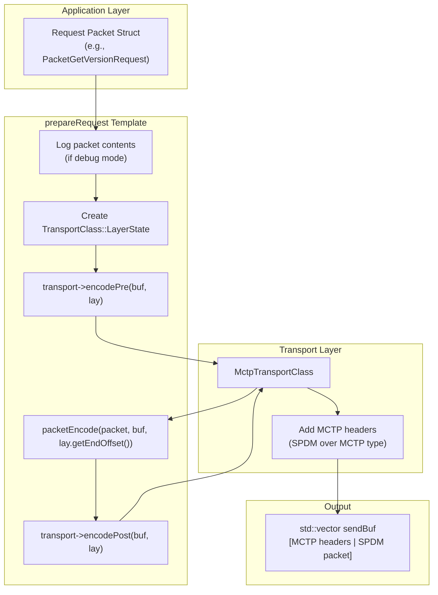
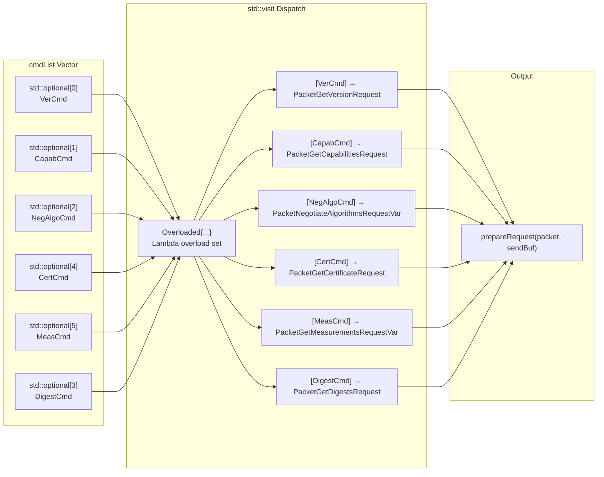
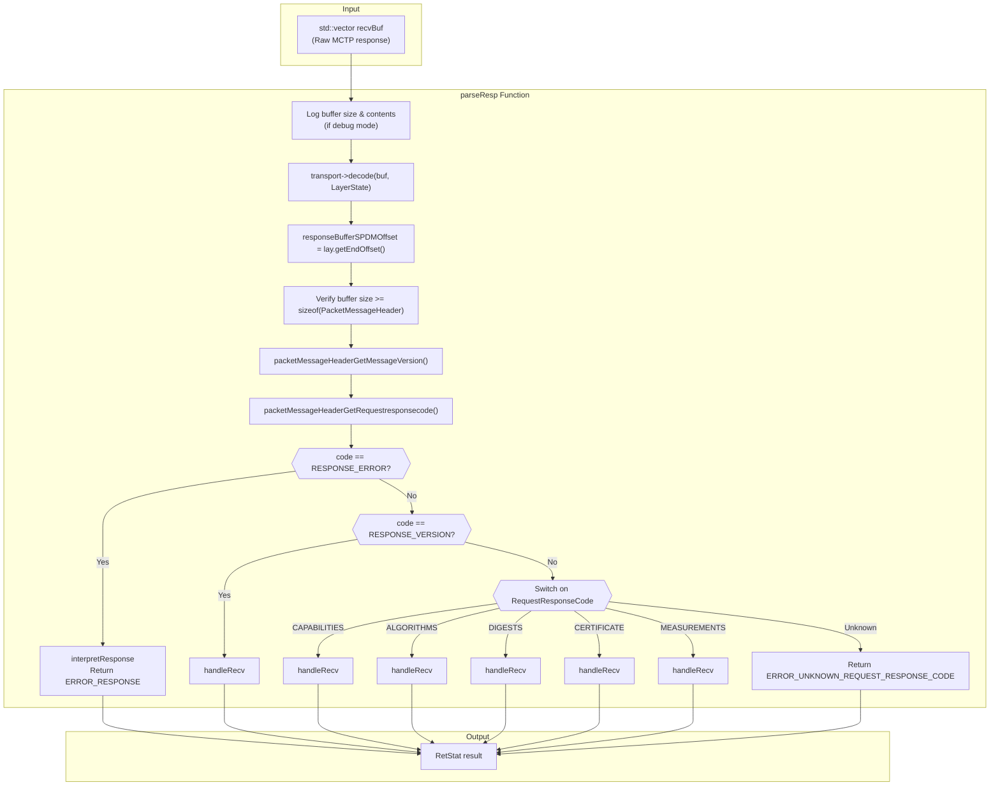
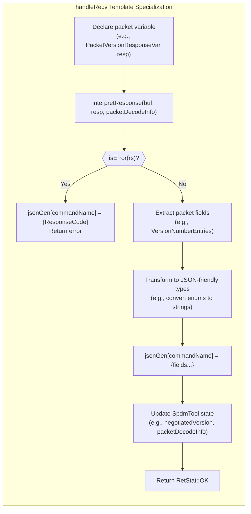
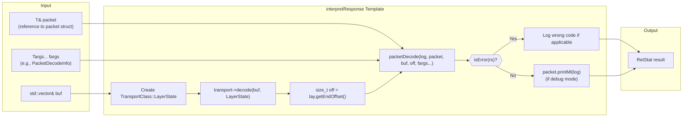
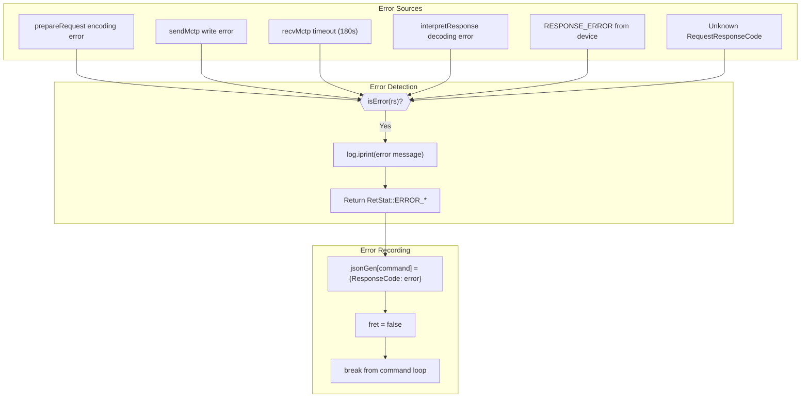

<!-- source: DeepWiki mcp.deepwiki.com · repo NVIDIA/spdm · page 4.2 Request-Response Cycle · fetched 2026-10-26 -->

# Request-Response Cycle

<details>
<summary>Relevant source files</summary>

The following files were used as context for generating this wiki page:

- [spdmutil/cmds.hpp](spdmutil/cmds.hpp)
- [spdmutil/spdm_tool.cpp](spdmutil/spdm_tool.cpp)
- [spdmutil/spdm_tool.hpp](spdmutil/spdm_tool.hpp)

</details>


## Purpose and Scope

This page documents the request-response cycle in the `spdmutil` command-line tool. It covers the complete flow from encoding SPDM request packets, transmitting them over MCTP, receiving responses, and parsing them into structured data for JSON output. The cycle involves template-based packet encoding/decoding, transport layer framing, socket I/O, and type-specific response handlers.

For information about the overall command structure and CLI argument parsing, see [Command Structure](#4.1). For details on certificate chain retrieval with chunking, see [Certificate Chain Retrieval](#4.3). For JSON output formatting, see [JSON Output Format](#4.4).

---

## Request-Response Flow Overview

The request-response cycle in `spdmutil` follows a layered approach: application logic constructs SPDM request packets, which are encoded and framed at the transport layer, transmitted over MCTP sockets, and then decoded and dispatched to type-specific handlers on the response path.

### Complete Request-Response Sequence



**Sources:** [spdmutil/spdm_tool.cpp:486-645](), [spdmutil/spdm_tool.cpp:648-742]()

---

## Request Encoding Path

The `prepareRequest()` template function handles encoding SPDM request packets with transport layer framing.

### Request Encoding Process



**Sources:** [spdmutil/spdm_tool.hpp:118-145]()

### prepareRequest Template Implementation

The `prepareRequest()` function is a template that works with any SPDM request packet type:

| Step | Function | Purpose |
|------|----------|---------|
| 1 | Debug logging | Print packet type name and fields using `printMl()` |
| 2 | Create LayerState | Initialize transport layer state tracker |
| 3 | `encodePre()` | Add MCTP pre-headers (reserves space) |
| 4 | `packetEncode()` | Serialize SPDM packet structure to bytes |
| 5 | `encodePost()` | Finalize MCTP headers (fill in length, etc.) |

The function accepts any packet type `T` that implements the SPDM packet encoding interface, enabling compile-time polymorphism for different request types.

**Sources:** [spdmutil/spdm_tool.hpp:118-145]()

---

## Command Dispatch with std::visit

The `runComm()` function uses `std::visit` with an `Overloaded` helper to dispatch commands from the `cmdList` vector. Each command variant constructs its corresponding request packet.

### Command Dispatch Pattern



**Sources:** [spdmutil/spdm_tool.cpp:518-602](), [spdmutil/spdm_tool.hpp:44-50]()

### Example: Version Command Dispatch

For a `VerCmd` command, the lambda constructs a `PacketGetVersionRequest` and sets the `MessageVersion` field based on the command-line argument:

```cpp
[&sendBuf, &rs, this](const VerCmd& arg) {
    PacketGetVersionRequest req{};
    if (arg.ver == 0x10) {
        req.Header.MessageVersion = MessageVersionEnum::SPDM_1_0;
    } else if (arg.ver == 0x11) {
        req.Header.MessageVersion = MessageVersionEnum::SPDM_1_1;
    } else if (arg.ver == 0x12) {
        req.Header.MessageVersion = MessageVersionEnum::SPDM_1_2;
    }
    rs = prepareRequest(req, sendBuf);
}
```

**Sources:** [spdmutil/spdm_tool.cpp:520-544]()

---

## MCTP Transmission

After encoding, the request buffer is transmitted via the `sendMctp()` and `recvMctp()` functions, which wrap the `MctpIoClass` socket operations.

### MCTP Send Function

The `sendMctp()` function logs the buffer size and contents (in debug mode) and delegates to `MctpIoClass::write()`:

| Field | Value |
|-------|-------|
| Function | `SpdmTool::sendMctp(const std::vector<uint8_t>& buf)` |
| Location | [spdmutil/spdm_tool.cpp:794-804]() |
| Debug Output | Buffer size and hex dump |
| Delegation | `mctpIO.write(buf)` |

**Sources:** [spdmutil/spdm_tool.cpp:794-804]()

### MCTP Receive with Timeout

The `recvMctp()` function implements timeout handling using `poll()` before reading from the socket:

| Field | Value |
|-------|-------|
| Function | `SpdmTool::recvMctp(std::vector<uint8_t>& buf)` |
| Location | [spdmutil/spdm_tool.cpp:776-792]() |
| Timeout | 180,000 ms (3 minutes) |
| Poll Mechanism | `::poll(pfd.data(), 1, timeout)` |
| Error Handling | Returns `RetStat::ERROR_TIMEOUT` on timeout |

The function uses a `pollfd` structure to monitor the MCTP socket file descriptor for incoming data. If no data arrives within 180 seconds, it returns a timeout error.

**Sources:** [spdmutil/spdm_tool.cpp:776-792]()

---

## Response Parsing and Decoding

The `parseResp()` function is the central dispatcher for response handling. It decodes the transport layer, extracts the message header, and dispatches to the appropriate `handleRecv<T>()` specialization based on the `RequestResponseCode`.

### Response Parsing Flow



**Sources:** [spdmutil/spdm_tool.cpp:648-742]()

### Transport Layer Decoding

The `parseResp()` function first strips MCTP framing by calling `transport->decode()`, which populates a `LayerState` object. The `LayerState` tracks the offset where the SPDM payload begins after transport headers.

**Sources:** [spdmutil/spdm_tool.cpp:663-671]()

### Header Extraction

After decoding the transport layer, the function extracts the SPDM message header to determine the message version and request/response code:

| Utility Function | Purpose |
|-----------------|---------|
| `packetMessageHeaderGetMessageVersion()` | Extracts `MessageVersionEnum` from buffer |
| `packetMessageHeaderGetRequestresponsecode()` | Extracts `RequestResponseEnum` from buffer |

These helper functions read the header without fully decoding the entire packet structure.

**Sources:** [spdmutil/spdm_tool.cpp:683-686]()

### Response Code Dispatch

The function uses a switch statement on `RequestResponseCode` to dispatch to the appropriate `handleRecv<T>()` specialization:

| RequestResponseCode | Handler Function |
|---------------------|------------------|
| `RESPONSE_ERROR` | `interpretResponse<PacketErrorResponseVar>()` |
| `RESPONSE_VERSION` | `handleRecv<PacketVersionResponseVar>()` |
| `RESPONSE_CAPABILITIES` | `handleRecv<PacketCapabilitiesResponse>()` |
| `RESPONSE_ALGORITHMS` | `handleRecv<PacketAlgorithmsResponseVar>()` |
| `RESPONSE_DIGESTS` | `handleRecv<PacketDigestsResponseVar>()` |
| `RESPONSE_CERTIFICATE` | `handleRecv<PacketCertificateResponseVar>()` |
| `RESPONSE_MEASUREMENTS` | `handleRecv<PacketMeasurementsResponseVar>()` |

**Sources:** [spdmutil/spdm_tool.cpp:718-739]()

---

## Response Handler Specializations

The `handleRecv<T>()` template has explicit specializations for each SPDM response type. Each specialization decodes the packet, validates the response, extracts relevant fields, and populates the `jsonGen` object for output.

### Handler Template Pattern



**Sources:** [spdmutil/spdm_tool.cpp:263-483]()

### Example: Version Response Handler

The `handleRecv<PacketVersionResponseVar>()` specialization demonstrates the pattern:

1. **Decode packet:** Call `interpretResponse()` to decode into `PacketVersionResponseVar`
2. **Check error:** Return early with error code in JSON if decoding failed
3. **Extract versions:** Iterate through `resp.VersionNumberEntries` and convert to string representations
4. **Negotiate version:** Select the highest supported version as `negotiatedVersion`
5. **Update JSON:** Store version list and negotiated version in `jsonGen["GetVersion"]`

**Sources:** [spdmutil/spdm_tool.cpp:263-301]()

### Example: Algorithms Response Handler

The `handleRecv<PacketAlgorithmsResponseVar>()` specialization updates critical decode context:

1. **Decode packet:** Parse `PacketAlgorithmsResponseVar` structure
2. **Update hash size:** Call `getHashSize(resp.Min.BaseHashAlgo)` and store in `packetDecodeInfo.BaseHashSize`
3. **Update signature size:** Call `getSignatureSize(resp.Min.BaseAsymAlgo)` and store in `packetDecodeInfo.SignatureSize`
4. **Store response:** Save entire `algoResp` for later use (e.g., certificate parsing)
5. **Update JSON:** Convert algorithm flags to human-readable strings

The `packetDecodeInfo` updates are critical for decoding subsequent variable-sized responses (digests, measurements) that depend on the negotiated algorithms.

**Sources:** [spdmutil/spdm_tool.cpp:327-373]()

---

## interpretResponse Template

The `interpretResponse()` template function abstracts the common decoding pattern used by all response handlers.

### interpretResponse Implementation



**Sources:** [spdmutil/spdm_tool.hpp:148-179]()

The template accepts optional `PacketDecodeInfo` argument for variable-sized packets that require context (e.g., hash size) for decoding.

---

## PacketDecodeInfo Context

The `PacketDecodeInfo` structure maintains context needed for decoding variable-sized SPDM response packets.

### PacketDecodeInfo Fields

| Field | Type | Purpose | Updated By |
|-------|------|---------|------------|
| `BaseHashSize` | `size_t` | Size of hash digests (32/48/64 bytes) | `handleRecv<PacketAlgorithmsResponseVar>()` |
| `SignatureSize` | `size_t` | Size of signatures (64/96 bytes) | `handleRecv<PacketAlgorithmsResponseVar>()` |
| `GetMeasurementsParam1` | `uint8_t` | Attributes field for measurements | `runComm()` when constructing request |

The `packetDecodeInfo` member is initialized with default values in the `SpdmTool` constructor and updated as negotiation progresses. It is passed to `interpretResponse()` and `packetDecode()` for packets that contain variable-sized fields.

**Sources:** [spdmutil/spdm_tool.cpp:59-61](), [spdmutil/spdm_tool.cpp:339-358](), [spdmutil/spdm_tool.hpp:103]()

---

## Error Handling

The request-response cycle includes multiple error handling mechanisms at each layer.

### Error Handling Points



**Sources:** [spdmutil/spdm_tool.cpp:614-641](), [spdmutil/spdm_tool.cpp:693-704]()

### Error Response Handling

When the device returns `RESPONSE_ERROR`, the code decodes the error packet to extract error details:

```cpp
if (code == RequestResponseEnum::RESPONSE_ERROR)
{
    log.iprintln("RESPONSE_ERROR");
    PacketErrorResponseVar err;
    rs = interpretResponse(buf, err);
    if (isError(rs)) {
        log.iprint("Interpret response error ");
        log.iprintln(rs);
    }
    return RetStat::ERROR_RESPONSE;
}
```

The `PacketErrorResponseVar` structure contains error code and error data fields per the SPDM specification.

**Sources:** [spdmutil/spdm_tool.cpp:693-704]()

---

## Special Case: Certificate Chunking

Certificate retrieval requires special handling because certificate chains may exceed the maximum SPDM message size and must be retrieved in chunks.

### Certificate Chunking Loop

```mermaid
graph TB
    subgraph "Certificate Command Processing"
        CheckWholeCert{{"wholeCert flag set?"}}
        FirstReq["Send GET_CERTIFICATE (offset=0, length=MAX)"]
        RecvChunk["Receive CERTIFICATE response"]
        HandleChunk["handleRecv<PacketCertificateResponseVar>"]
        
        subgraph "handleRecv Chunking Logic"
            CheckFirst{{"certBuf.empty()?"}}
            Reserve["certBuf.reserve(PortionLength + RemainderLength)"]
            Append["Append CertificateVector to certBuf"]
            CheckRemainder{{"RemainderLength == 0?"}}
            ParseChain["parseCertChain(certBuf, certTxt)"]
            UpdateJSON["jsonGen[GetCertificate] = {CertChain}"]
            ClearFlag["wholeCert = false"]
        end
        
        LoopCheck{{"wholeCert still true?"}}
        NextReq["Send GET_CERTIFICATE (offset=certBuf.size())"]
    end
    
    CheckWholeCert -->|Yes| FirstReq
    FirstReq --> RecvChunk
    RecvChunk --> HandleChunk
    HandleChunk --> CheckFirst
    CheckFirst -->|Yes| Reserve
    Reserve --> Append
    CheckFirst -->|No| Append
    Append --> CheckRemainder
    CheckRemainder -->|No| LoopCheck
    CheckRemainder -->|Yes| ParseChain
    ParseChain --> UpdateJSON
    UpdateJSON --> ClearFlag
    ClearFlag --> LoopCheck
    LoopCheck -->|Yes| NextReq
    NextReq --> RecvChunk
```



**Sources:** [spdmutil/spdm_tool.cpp:605-642](), [spdmutil/spdm_tool.cpp:381-424]()

### Certificate Chunking State

The chunking mechanism uses several member variables to maintain state across iterations:

| Member Variable | Type | Purpose |
|----------------|------|---------|
| `wholeCert` | `bool` | Flag indicating chunking is active |
| `certBuf` | `std::vector<uint8_t>` | Accumulated certificate data |
| `certSlot` | `uint8_t` | Certificate slot number (0-7) |

The `do-while` loop in `runComm()` continues as long as `wholeCert` is true, automatically constructing and sending subsequent `GET_CERTIFICATE` requests with updated offsets.

**Sources:** [spdmutil/spdm_tool.hpp:104-109](), [spdmutil/spdm_tool.cpp:605-642]()

---

## State Tracking Across Requests

The `SpdmTool` class maintains state that evolves across the command sequence:

### State Variables

| Variable | Type | Updated By | Used By |
|----------|------|------------|---------|
| `negotiatedVersion` | `MessageVersionEnum` | `handleRecv<PacketVersionResponseVar>()` | Subsequent request construction |
| `packetDecodeInfo.BaseHashSize` | `size_t` | `handleRecv<PacketAlgorithmsResponseVar>()` | Digest/measurement decoding |
| `packetDecodeInfo.SignatureSize` | `size_t` | `handleRecv<PacketAlgorithmsResponseVar>()` | Measurement signature decoding |
| `algoResp` | `std::optional<PacketAlgorithmsResponseVar>` | `handleRecv<PacketAlgorithmsResponseVar>()` | Certificate chain parsing |

These state variables enable proper encoding/decoding of subsequent commands in the sequence. For example, the `GET_CAPABILITIES` request uses the `negotiatedVersion` from the previous `GET_VERSION` response.

**Sources:** [spdmutil/spdm_tool.hpp:103-114](), [spdmutil/spdm_tool.cpp:545-556]()

---

## Summary

The `spdmutil` request-response cycle implements a layered, template-based architecture:

1. **Command dispatch:** Uses `std::visit` with `Overloaded` pattern to construct request packets
2. **Request encoding:** `prepareRequest<T>()` template handles encoding with transport framing
3. **Transmission:** `sendMctp()` writes to socket, `recvMctp()` reads with timeout
4. **Response parsing:** `parseResp()` decodes transport layer and dispatches by `RequestResponseCode`
5. **Type-specific handling:** `handleRecv<T>()` specializations decode packets and update JSON output
6. **State management:** `negotiatedVersion`, `packetDecodeInfo`, and `algoResp` track protocol state
7. **Special cases:** Certificate chunking uses loop and state flags

This design provides type-safe packet handling, clean separation of concerns across protocol layers, and extensibility for adding new SPDM command types.

**Sources:** [spdmutil/spdm_tool.cpp:486-645](), [spdmutil/spdm_tool.hpp:36-115]()

---

