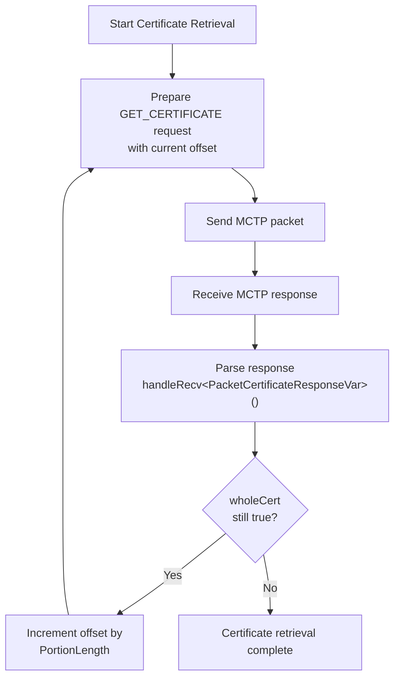
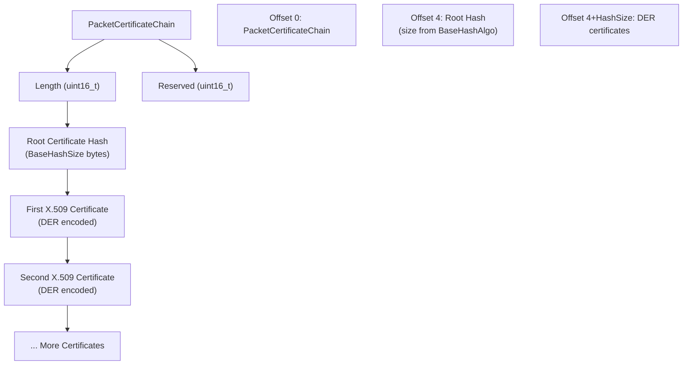

<!-- source: DeepWiki mcp.deepwiki.com · repo NVIDIA/spdm · page 4.3 Certificate Chain Retrieval · fetched 2026-10-26 -->

# Certificate Chain Retrieval

<details>
<summary>Relevant source files</summary>

The following files were used as context for generating this wiki page:

- [spdmutil/cmds.hpp](spdmutil/cmds.hpp)
- [spdmutil/spdm_tool.cpp](spdmutil/spdm_tool.cpp)
- [spdmutil/spdm_tool.hpp](spdmutil/spdm_tool.hpp)

</details>


## Purpose and Scope

This page documents how the `spdmutil` command-line tool retrieves and processes SPDM certificate chains from responder devices. Certificate chains in SPDM can be larger than the maximum SPDM message size, requiring a chunking mechanism to retrieve them in multiple requests. This page covers the chunking logic, response accumulation, and certificate chain parsing with mbedtls PEM conversion.

For information about the overall request-response cycle in spdmutil, see [Request-Response Cycle](#4.2). For details on how the daemon (`spdmd`) handles certificate retrieval, see [Certificate and Measurement Data Processing](#3.2.3).

## Overview

SPDM certificate chains consist of a `PacketCertificateChain` structure followed by a root certificate hash and one or more X.509 certificates. These chains can easily exceed 1KB or more, which may be larger than the maximum SPDM message size negotiated with the responder. The SPDM specification addresses this by allowing certificate retrieval through multiple `GET_CERTIFICATE` requests with different offset and length parameters.

The `spdmutil` tool implements automatic chunking when the user requests a complete certificate chain (as opposed to a specific offset). The tool iteratively requests chunks until all data is received, then parses and converts the certificate chain to PEM format for output.

**Sources:** [spdmutil/spdm_tool.cpp:376-425](), [spdmutil/spdm_tool.cpp:569-643]()

## Chunking Mechanism

### Whole Certificate Flag

The `SpdmTool` class maintains a `wholeCert` boolean flag that controls whether the tool is in chunked retrieval mode. When set to `true`, the tool will automatically issue subsequent `GET_CERTIFICATE` requests until the entire certificate chain is retrieved.

```cpp
bool wholeCert{};
std::vector<uint8_t> certBuf;
uint8_t certSlot{};
```

The flag is activated when the user issues a `get-cert` command without specifying an explicit `--offset` parameter. The command parsing logic determines this through the `CertCmd::needChain()` method:

```cpp
struct CertCmd
{
    static constexpr auto wholeChain = -1;
    uint8_t slot{0};
    int offset{wholeChain};
    auto needChain() const { return offset == wholeChain; }
};
```

**Sources:** [spdmutil/spdm_tool.hpp:104-109](), [spdmutil/cmds.hpp:50-59](), [spdmutil/spdm_tool.cpp:569-586]()

### Request Loop

The `runComm()` function contains a do-while loop that continues requesting certificate chunks until `wholeCert` becomes `false`:



The loop implementation:

[spdmutil/spdm_tool.cpp:603-642]()

Each iteration constructs a new `PacketGetCertificateRequest` with:
- `Offset`: Current size of `certBuf`
- `Length`: Maximum value (`0xFFFF`)
- `Param1`: Certificate slot number

**Sources:** [spdmutil/spdm_tool.cpp:605-613]()

## Certificate Response Handling

### PacketCertificateResponseVar Structure

The `handleRecv<PacketCertificateResponseVar>()` specialization processes each certificate chunk response. The response packet contains:

| Field | Type | Description |
|-------|------|-------------|
| `Header.MessageVersion` | `MessageVersionEnum` | SPDM protocol version |
| `Header.Param1` | `uint8_t` | Certificate slot number |
| `PortionLength` | `uint16_t` | Number of bytes in this chunk |
| `RemainderLength` | `uint16_t` | Number of bytes remaining after this chunk |
| `CertificateVector` | `std::vector<uint8_t>` | Certificate data for this chunk |

### Chunk Accumulation

The handler accumulates chunks into the `certBuf` member variable:

```mermaid
sequenceDiagram
    participant User as User
    participant Tool as SpdmTool
    participant Handler as handleRecv<br/>&lt;PacketCertificateResponseVar&gt;
    participant Buffer as certBuf
    
    User->>Tool: "get-cert --slot 0"
    Note over Tool: wholeCert = true<br/>certBuf.clear()
    
    loop Until RemainderLength == 0
        Tool->>Tool: "Request chunk at offset certBuf.size()"
        Tool->>Handler: "Process CERTIFICATE response"
        
        alt First chunk
            Handler->>Buffer: "Reserve total size<br/>(PortionLength + RemainderLength)"
        end
        
        Handler->>Buffer: "Append PortionLength bytes"
        Handler->>Handler: "Check RemainderLength"
        
        alt RemainderLength > 0
            Note over Handler: "Continue chunking"
        else RemainderLength == 0
            Handler->>Handler: "wholeCert = false"
            Handler->>Handler: "parseCertChain(certBuf)"
        end
    end
    
    Handler->>User: "Return complete certificate chain"
```

The accumulation logic:

1. **First chunk**: Reserve space based on `PortionLength + RemainderLength` to avoid repeated reallocations
2. **Each chunk**: Append `CertificateVector` bytes to `certBuf`
3. **Last chunk**: When `RemainderLength == 0`, call `parseCertChain()` and set `wholeCert = false`

**Sources:** [spdmutil/spdm_tool.cpp:376-425]()

### Handling Partial vs. Complete Retrieval

The handler distinguishes between whole-chain mode and single-chunk mode:

```cpp
if (wholeCert)
{
    // Accumulate chunks
    if (certBuf.empty()) { /* reserve space */ }
    // Append chunk data
    if (!resp.Min.RemainderLength)
    {
        wholeCert = false;
        std::string certTxt;
        rs = parseCertChain(certBuf, certTxt);
        // Store in JSON
    }
}
else
{
    // Single chunk request - output raw data
    jsonGen["GetCertificate"] = {
        {"CertChunk:", resp.CertificateVector}
    };
}
```

**Sources:** [spdmutil/spdm_tool.cpp:381-423]()

## Certificate Chain Parsing

### Structure of Certificate Chain Data

The accumulated `certBuf` contains an SPDM certificate chain with the following structure:



**Sources:** [spdmutil/spdm_tool.cpp:807-888]()

### parseCertChain Function

The `parseCertChain()` function performs the following steps:

#### Step 1: Decode Certificate Chain Header

[spdmutil/spdm_tool.cpp:810-817]()

Parse the `PacketCertificateChain` structure and validate that `Length` matches the buffer size.

#### Step 2: Extract Root Certificate Hash

[spdmutil/spdm_tool.cpp:822-842]()

The root certificate hash size is determined from the negotiated `BaseHashAlgo` (stored in `algoResp`):

| Algorithm | Hash Size |
|-----------|-----------|
| SHA-256 | 32 bytes |
| SHA-384 | 48 bytes |
| SHA-512 | 64 bytes |

#### Step 3: Parse DER-Encoded Certificates

[spdmutil/spdm_tool.cpp:843-886]()

The function iterates through remaining buffer data, parsing each X.509 certificate:

```cpp
do
{
    mbedtls_x509_crt cert;
    mbedtls_x509_crt_init(&cert);
    
    // Parse DER certificate
    auto ret = mbedtls_x509_crt_parse_der(&cert, &vec[off], vec.size() - off);
    
    // Get ASN.1 length to advance offset
    size_t asn1Len = 0;
    ret = mbedtls_asn1_get_tag(&p, vec.data() + vec.size(), &asn1Len, ...);
    asn1Len += (p - s);
    
    // Convert to PEM format
    std::array<unsigned char, 8192> buf{{}};
    ret = mbedtls_pem_write_buffer(
        "-----BEGIN CERTIFICATE-----\n", 
        "-----END CERTIFICATE-----\n",
        cert.raw.p, cert.raw.len, buf.data(), buf.size(), &sz);
    
    // Append to output string
    out += reinterpret_cast<char*>(buf.data());
    
    mbedtls_x509_crt_free(&cert);
    off += asn1Len;
} while (off < vec.size());
```

### mbedtls Integration

The parsing uses several mbedtls functions:

| Function | Purpose |
|----------|---------|
| `mbedtls_x509_crt_parse_der()` | Parse DER-encoded X.509 certificate |
| `mbedtls_asn1_get_tag()` | Determine ASN.1 structure length |
| `mbedtls_pem_write_buffer()` | Convert DER certificate to PEM format |
| `mbedtls_x509_crt_init()` / `_free()` | RAII management of certificate structure |

Each certificate is individually converted to PEM format and concatenated to the output string. The PEM format includes standard BEGIN/END markers and base64-encoded certificate data.

**Sources:** [spdmutil/spdm_tool.cpp:807-888]()

## Complete Control Flow

```mermaid
flowchart TB
    ParseArgs["parseArgs()<br/>Process CLI arguments"]
    CheckOffset{"offset parameter<br/>specified?"}
    SetWhole["wholeCert = true<br/>certBuf.clear()"]
    RunCommLoop["runComm() loop<br/>Iterate through commands"]
    PrepareGetCert["Prepare GET_CERTIFICATE<br/>Offset = certBuf.size()<br/>Length = 0xFFFF"]
    SendRequest["sendMctp()<br/>Transmit request"]
    RecvResponse["recvMctp()<br/>Receive response"]
    ParseResponse["parseResp()<br/>Route to handler"]
    HandleCert["handleRecv&lt;PacketCertificateResponseVar&gt;()"]
    FirstChunk{"certBuf<br/>empty?"}
    Reserve["Reserve space:<br/>PortionLength + RemainderLength"]
    AppendChunk["Append CertificateVector<br/>to certBuf"]
    CheckRemainder{"RemainderLength<br/>== 0?"}
    ParseChain["parseCertChain(certBuf, certTxt)<br/>1. Decode PacketCertificateChain<br/>2. Extract root hash<br/>3. Parse DER certificates<br/>4. Convert to PEM"]
    SetWholeFalse["wholeCert = false"]
    StoreJSON["Store in jsonGen<br/>'CertChain': certTxt"]
    CheckLoop{"wholeCert<br/>true?"}
    Done["Certificate retrieval complete"]
    
    ParseArgs --> CheckOffset
    CheckOffset -->|"No (default)"| SetWhole
    CheckOffset -->|"Yes"| RunCommLoop
    SetWhole --> RunCommLoop
    RunCommLoop --> PrepareGetCert
    PrepareGetCert --> SendRequest
    SendRequest --> RecvResponse
    RecvResponse --> ParseResponse
    ParseResponse --> HandleCert
    HandleCert --> FirstChunk
    FirstChunk -->|"Yes"| Reserve
    FirstChunk -->|"No"| AppendChunk
    Reserve --> AppendChunk
    AppendChunk --> CheckRemainder
    CheckRemainder -->|"No"| CheckLoop
    CheckRemainder -->|"Yes"| ParseChain
    ParseChain --> SetWholeFalse
    SetWholeFalse --> StoreJSON
    StoreJSON --> CheckLoop
    CheckLoop -->|"Yes"| PrepareGetCert
    CheckLoop -->|"No"| Done
```



**Sources:** [spdmutil/spdm_tool.cpp:64-261](), [spdmutil/spdm_tool.cpp:486-645](), [spdmutil/spdm_tool.cpp:376-425](), [spdmutil/spdm_tool.cpp:807-888]()

## Error Handling

The certificate chain retrieval process includes several error checks:

| Error Condition | RetStat Code | Location |
|----------------|--------------|----------|
| Certificate chain size mismatch | `ERROR_CERTIFICATE_CHAIN_SIZE_INVALID` | [spdmutil/spdm_tool.cpp:818-820]() |
| Invalid hash algorithm flag | `ERROR_INVALID_FLAG_SIZE` | [spdmutil/spdm_tool.cpp:824-836]() |
| Certificate parsing failure | `ERROR_CERTIFICATE_PARSING_ERROR` | [spdmutil/spdm_tool.cpp:849-865]() |
| PEM conversion buffer overflow | `ERROR_CERTIFICATE_PARSING_ERROR` | [spdmutil/spdm_tool.cpp:878-880]() |

All errors are propagated to the caller and stored in the JSON output with the corresponding `ResponseCode` field.

**Sources:** [spdmutil/spdm_tool.cpp:807-888](), [spdmutil/spdm_tool.cpp:399-402]()

## JSON Output Format

Upon successful retrieval and parsing, the certificate chain is stored in the JSON output:

```json
{
  "GetCertificate": {
    "SPDMVersion": "1.2.0",
    "ResponseCode": "OK",
    "Slot": 0,
    "CertChain": "-----BEGIN CERTIFICATE-----\n...\n-----END CERTIFICATE-----\n-----BEGIN CERTIFICATE-----\n...\n-----END CERTIFICATE-----\n"
  }
}
```

The `CertChain` field contains the complete concatenated PEM-formatted certificate chain, which can be directly used by standard X.509 tools.

**Sources:** [spdmutil/spdm_tool.cpp:404-408]()

---

