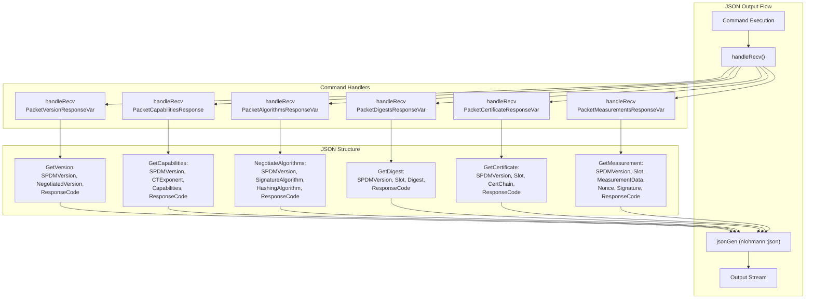
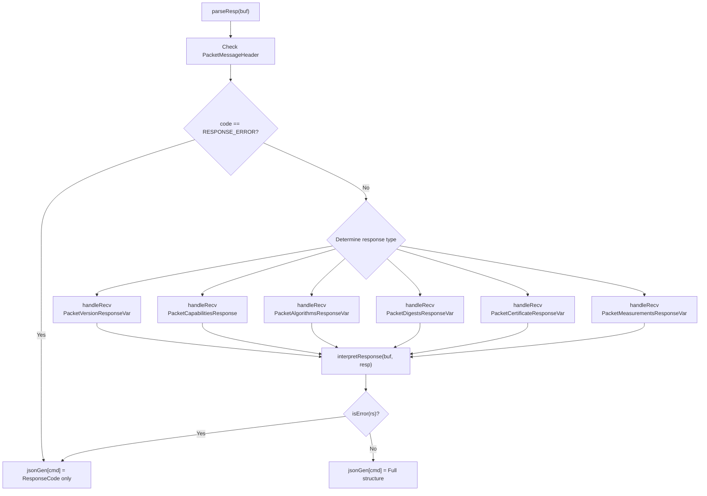
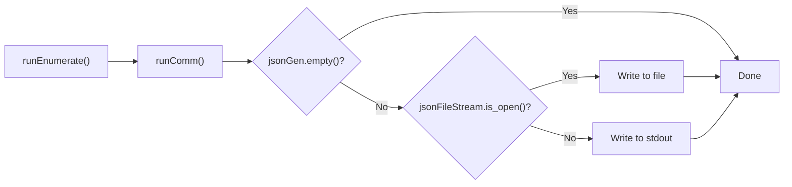

<!-- source: DeepWiki mcp.deepwiki.com · repo NVIDIA/spdm · page 4.4 JSON Output Format · fetched 2026-10-26 -->

# JSON Output Format

<details>
<summary>Relevant source files</summary>

The following files were used as context for generating this wiki page:

- [spdmutil/cmds.hpp](spdmutil/cmds.hpp)
- [spdmutil/spdm_tool.cpp](spdmutil/spdm_tool.cpp)
- [spdmutil/spdm_tool.hpp](spdmutil/spdm_tool.hpp)

</details>


This page documents the JSON output format produced by `spdmutil` for all SPDM protocol commands and endpoint enumeration operations. The tool uses the `nlohmann::json` library to serialize command results into structured JSON format.

For information about the command structure and argument parsing, see [Command Structure](#4.1). For details about the request-response cycle, see [Request-Response Cycle](#4.2).

---

## Purpose and Output Destination

The `spdmutil` tool generates JSON output for all executed SPDM commands, providing a structured, machine-readable representation of protocol responses. The JSON output can be directed to either:

- **Standard output (stdout)**: Default behavior when no `--json` flag is specified
- **File output**: When the `--json <filename>` argument is provided, output is written to the specified file

The JSON generation logic is implemented in the `SpdmTool` class using the `nlohmann::json jsonGen` member variable [spdmutil/spdm_tool.hpp:99](). Each command handler populates the appropriate JSON structure based on the response received from the SPDM responder.

**Sources:** [spdmutil/spdm_tool.hpp:89-115](), [spdmutil/spdm_tool.cpp:64-76](), [spdmutil/spdm_tool.cpp:906-916]()

---

## Output Structure Overview

The JSON output consists of a top-level object with keys corresponding to executed commands. Each command creates a nested object containing:

1. **ResponseCode**: Status of the operation (e.g., "OK", "ERROR_RESPONSE")
2. **SPDMVersion**: SPDM protocol version used in the message
3. **Command-specific fields**: Data extracted from the SPDM response packet



**Sources:** [spdmutil/spdm_tool.cpp:263-483](), [spdmutil/spdm_tool.cpp:648-742]()

---

## Command-Specific JSON Formats

### Get Version Command

The `get-version` command produces a JSON object under the `"GetVersion"` key containing an array of supported SPDM versions and the negotiated version.

**JSON Structure:**
```json
{
  "GetVersion": {
    "SPDMVersion": ["SPDM_1.0", "SPDM_1.1", "SPDM_1.2"],
    "NegotiatedVersion": "SPDM_1.2",
    "ResponseCode": "OK"
  }
}
```

**Fields:**
| Field | Type | Description |
|-------|------|-------------|
| `SPDMVersion` | Array of strings | List of SPDM versions supported by the responder |
| `NegotiatedVersion` | String | Highest mutually supported version selected for the session |
| `ResponseCode` | String | Result status (OK, ERROR_RESPONSE, etc.) |

**Implementation:** The handler converts `MessageVersionEnum` values to human-readable strings using `verToString()` and selects the highest version as the negotiated version [spdmutil/spdm_tool.cpp:285-294]().

**Sources:** [spdmutil/spdm_tool.cpp:263-301]()

---

### Get Capabilities Command

The `get-capab` command outputs responder capabilities and timing parameters under the `"GetCapabilities"` key.

**JSON Structure (SPDM 1.1):**
```json
{
  "GetCapabilities": {
    "SPDMVersion": "SPDM_1.1",
    "CTExponent": 12,
    "Capabilities": ["CERT_CAP", "MEAS_CAP_11", "ENCRYPT_CAP"],
    "ResponseCode": "OK"
  }
}
```

**JSON Structure (SPDM 1.2 with additional fields):**
```json
{
  "GetCapabilities": {
    "SPDMVersion": "SPDM_1.2",
    "CTExponent": 12,
    "Capabilities": ["CERT_CAP", "MEAS_CAP_11", "ENCRYPT_CAP"],
    "DataTransferSize": 4096,
    "MaxSPDMmsgSize": 4096,
    "ResponseCode": "OK"
  }
}
```

**Fields:**
| Field | Type | Description |
|-------|------|-------------|
| `SPDMVersion` | String | SPDM version of the response message |
| `CTExponent` | Number | CT (Coordinated Timing) exponent for timeout calculation |
| `Capabilities` | Array of strings | Capability flags converted to human-readable names |
| `DataTransferSize` | Number | SPDM 1.2+ only: Maximum buffer size for receiving messages |
| `MaxSPDMmsgSize` | Number | SPDM 1.2+ only: Maximum size for reassembling large SPDM messages |
| `ResponseCode` | String | Result status |

**Implementation:** The handler uses `capFlagsToStr()` to convert the `ResponderCapabilitiesFlags` bitfield into an array of flag names. For SPDM 1.2+, additional fields are conditionally included [spdmutil/spdm_tool.cpp:319-323]().

**Sources:** [spdmutil/spdm_tool.cpp:303-325]()

---

### Negotiate Algorithms Command

The `neg-algo` command outputs the negotiated cryptographic algorithms under the `"NegotiateAlgorithms"` key.

**JSON Structure:**
```json
{
  "NegotiateAlgorithms": {
    "SPDMVersion": "SPDM_1.2",
    "SignatureAlgorithm": "TPM_ALG_ECDSA_ECC_NIST_P384",
    "HashingAlgorithm": "TPM_ALG_SHA_384",
    "ResponseCode": "OK"
  }
}
```

**Fields:**
| Field | Type | Description |
|-------|------|-------------|
| `SPDMVersion` | String | SPDM version of the response message |
| `SignatureAlgorithm` | String | Negotiated asymmetric signature algorithm |
| `HashingAlgorithm` | String | Negotiated hash algorithm |
| `ResponseCode` | String | Result status |

**Implementation:** The handler extracts algorithm identifiers from `PacketAlgorithmsResponseVar` and converts them using `asymAlgoToStr()` and `hashAlgoToStr()` [spdmutil/spdm_tool.cpp:367-372](). The negotiated hash and signature sizes are stored in `packetDecodeInfo` for decoding subsequent responses [spdmutil/spdm_tool.cpp:339-359]().

**Sources:** [spdmutil/spdm_tool.cpp:327-373]()

---

### Get Certificate Command

The `get-cert` command outputs certificate chain data under the `"GetCertificate"` key. The format differs depending on whether a full certificate chain or a single chunk is retrieved.

**JSON Structure (Full Certificate Chain):**
```json
{
  "GetCertificate": {
    "SPDMVersion": "SPDM_1.2",
    "ResponseCode": "OK",
    "Slot": 0,
    "CertChain": "-----BEGIN CERTIFICATE-----\n...\n-----END CERTIFICATE-----\n..."
  }
}
```

**JSON Structure (Single Chunk):**
```json
{
  "GetCertificate": {
    "SPDMVersion": "SPDM_1.2",
    "ResponseCode": "OK",
    "Slot": 0,
    "CertChunk:": [48, 130, 3, 42, ...]
  }
}
```

**Fields:**
| Field | Type | Description |
|-------|------|-------------|
| `SPDMVersion` | String | SPDM version of the response message |
| `ResponseCode` | String | Result status |
| `Slot` | Number | Certificate slot index (0-7) |
| `CertChain` | String | PEM-encoded certificate chain (full retrieval mode) |
| `CertChunk` | Array of numbers | Raw certificate bytes (chunk retrieval mode) |

**Implementation:** When retrieving a full certificate chain (`wholeCert` flag is true), the handler accumulates chunks into `certBuf` [spdmutil/spdm_tool.cpp:383-393](). When all chunks are received (`RemainderLength == 0`), it calls `parseCertChain()` to convert the DER-encoded certificate chain to PEM format using mbedtls [spdmutil/spdm_tool.cpp:396-409]().

**Sources:** [spdmutil/spdm_tool.cpp:375-425](), [spdmutil/spdm_tool.cpp:806-888]()

---

### Get Digest Command

The `get-digest` command outputs certificate digests under the `"GetDigest"` key.

**JSON Structure:**
```json
{
  "GetDigest": {
    "SPDMVersion": "SPDM_1.2",
    "ResponseCode": "OK",
    "Slot": 255,
    "Digest": [
      [48, 130, 62, ...],
      [89, 201, 143, ...]
    ]
  }
}
```

**Fields:**
| Field | Type | Description |
|-------|------|-------------|
| `SPDMVersion` | String | SPDM version of the response message |
| `ResponseCode` | String | Result status |
| `Slot` | Number | Slot parameter from response header |
| `Digest` | Array of arrays | Each inner array contains digest bytes for one certificate slot |

**Implementation:** The handler converts `std::vector<std::vector<uint8_t>>` digest data to nested JSON arrays, transforming `uint8_t` to `int` for JSON compatibility [spdmutil/spdm_tool.cpp:438-448]().

**Sources:** [spdmutil/spdm_tool.cpp:427-455]()

---

### Get Measurements Command

The `get-meas` command outputs attestation measurements under the `"GetMeasurement"` key.

**JSON Structure:**
```json
{
  "GetMeasurement": {
    "SPDMVersion": "SPDM_1.2",
    "ResponseCode": "OK",
    "Slot": 0,
    "MeasurementRecordLength": 512,
    "MeasurementData": [
      [1, [72, 101, 108, 108, 111]],
      [2, [87, 111, 114, 108, 100]]
    ],
    "Nonce": [12, 34, 56, ...],
    "Signature": [48, 130, 3, ...]
  }
}
```

**Fields:**
| Field | Type | Description |
|-------|------|-------------|
| `SPDMVersion` | String | SPDM version of the response message |
| `ResponseCode` | String | Result status |
| `Slot` | Number | Certificate slot used for signature |
| `MeasurementRecordLength` | Number | Total length of measurement record data |
| `MeasurementData` | Array of pairs | Each pair contains `[index, byteArray]` for a measurement block |
| `Nonce` | Array of numbers | Random nonce bytes |
| `Signature` | Array of numbers | Signature bytes over measurements |

**Implementation:** The handler extracts measurement blocks from `PacketMeasurementsResponseVar` and creates pairs of `(index, measurementVector)` [spdmutil/spdm_tool.cpp:468-473](). The signature and nonce are included as byte arrays [spdmutil/spdm_tool.cpp:474-481]().

**Sources:** [spdmutil/spdm_tool.cpp:457-483]()

---

### Enumerate Endpoints

When the `--enumerate` flag is used, the tool outputs discovered SPDM endpoints under the `"Endpoints"` key.

**JSON Structure:**
```json
{
  "Endpoints": [
    {
      "Path": "/xyz/openbmc_project/mctp/device/1",
      "EID": 10,
      "UUID": "12345678-1234-5678-1234-567812345678"
    },
    {
      "Path": "/xyz/openbmc_project/mctp/device/2",
      "EID": 11,
      "UUID": "87654321-4321-8765-4321-876543218765"
    }
  ]
}
```

**Fields:**
| Field | Type | Description |
|-------|------|-------------|
| `Path` | String | D-Bus object path of the MCTP endpoint |
| `EID` | Number | MCTP Endpoint ID |
| `UUID` | String | Universally unique identifier for the endpoint |

**Implementation:** The enumeration logic uses the `EnumerateEndpoints` class to query D-Bus for MCTP endpoints, then populates the JSON array [spdmutil/spdm_tool.cpp:928-934]().

**Sources:** [spdmutil/spdm_tool.cpp:922-940]()

---

## Error Handling in JSON Output

When a command encounters an error, the JSON output includes only the `ResponseCode` field with an error status.

**Error Response Example:**
```json
{
  "GetVersion": {
    "ResponseCode": "ERROR_RESPONSE"
  }
}
```

**Common Error Codes:**
| ResponseCode | Description |
|--------------|-------------|
| `OK` | Successful operation |
| `ERROR_RESPONSE` | Responder returned an SPDM ERROR response |
| `ERROR_TIMEOUT` | No response received within timeout period |
| `ERROR_BUFFER_TOO_SMALL` | Receive buffer insufficient for response |
| `ERROR_WRONG_REQUEST_RESPONSE_CODE` | Unexpected response type received |
| `ERROR_CERTIFICATE_PARSING_ERROR` | Failed to parse certificate chain |
| `ERROR_INVALID_FLAG_SIZE` | Invalid hash or signature algorithm size |

**Implementation:** Error handling occurs in specialized `handleRecv<T>()` template instantiations, which check the return status and either populate full JSON structures or error-only structures [spdmutil/spdm_tool.cpp:270-276](), [spdmutil/spdm_tool.cpp:309-312](), [spdmutil/spdm_tool.cpp:361-364]().



**Sources:** [spdmutil/spdm_tool.cpp:648-742](), [spdmutil/spdm_tool.cpp:693-704]()

---

## Output Generation and Writing

The final JSON output is generated and written in the `SpdmTool::run()` method after all commands have been executed.



**Implementation Details:**

1. **JSON Accumulation**: Throughout command execution, each `handleRecv<T>()` specialization populates its section of `jsonGen` [spdmutil/spdm_tool.cpp:296-300](), [spdmutil/spdm_tool.cpp:314-323](), etc.

2. **Output Determination**: In `run()`, the tool checks if `jsonGen` contains any data and if a file stream is open [spdmutil/spdm_tool.cpp:906-916]().

3. **Serialization**: The `nlohmann::json` library automatically handles serialization with proper indentation when using the `<<` operator [spdmutil/spdm_tool.cpp:910](), [spdmutil/spdm_tool.cpp:914]().

**Command-Line Configuration:**
- The `--json <filename>` option opens `jsonFileStream` during argument parsing [spdmutil/spdm_tool.cpp:166-175]()
- If the file cannot be created, the tool exits with an error before executing any commands

**Sources:** [spdmutil/spdm_tool.cpp:891-919](), [spdmutil/spdm_tool.cpp:64-76]()

---

## Data Type Conversions

The JSON output requires specific conversions from C++ types to JSON-compatible representations:

| C++ Type | JSON Type | Conversion Method | Example |
|----------|-----------|-------------------|---------|
| `MessageVersionEnum` | String | `verToString()` | `SPDM_1_2` → `"SPDM_1.2"` |
| `ResponderCapabilitiesFlags` | Array of strings | `capFlagsToStr()` | Bitfield → `["CERT_CAP", "MEAS_CAP_11"]` |
| `BaseHashAlgoFlags` | String | `hashAlgoToStr()` | Flag → `"TPM_ALG_SHA_384"` |
| `BaseAsymAlgoFlags` | String | `asymAlgoToStr()` | Flag → `"TPM_ALG_ECDSA_ECC_NIST_P384"` |
| `std::vector<uint8_t>` | Array of numbers | Automatic by nlohmann::json | `{0x48, 0x65}` → `[72, 101]` |
| `RetStat` | String | `get_cstr()` | `RetStat::OK` → `"OK"` |

**Certificate Chain Conversion:** The certificate parsing process involves multiple steps:
1. Decode `PacketCertificateChain` header [spdmutil/spdm_tool.cpp:810-817]()
2. Extract root certificate hash [spdmutil/spdm_tool.cpp:827-842]()
3. Parse DER-encoded certificates using `mbedtls_x509_crt_parse_der()` [spdmutil/spdm_tool.cpp:847-853]()
4. Calculate ASN.1 length for each certificate [spdmutil/spdm_tool.cpp:854-867]()
5. Convert to PEM format using `mbedtls_pem_write_buffer()` [spdmutil/spdm_tool.cpp:871-877]()
6. Concatenate all PEM certificates into a single string [spdmutil/spdm_tool.cpp:884]()

**Sources:** [spdmutil/spdm_tool.cpp:806-888](), [spdmutil/spdm_tool.cpp:277-283](), [spdmutil/spdm_tool.cpp:314-323]()

---

## Implementation Summary

The JSON output system is implemented through the following key components:

**Core Class Members:**
- `nlohmann::json jsonGen` [spdmutil/spdm_tool.hpp:99]() - Main JSON accumulator
- `std::ofstream jsonFileStream` [spdmutil/spdm_tool.hpp:97]() - Optional file output stream

**Handler Template Specializations:**
Each SPDM response type has a specialized `handleRecv<T>()` template:
- `handleRecv<PacketVersionResponseVar>` [spdmutil/spdm_tool.cpp:264-301]()
- `handleRecv<PacketCapabilitiesResponse>` [spdmutil/spdm_tool.cpp:304-325]()
- `handleRecv<PacketAlgorithmsResponseVar>` [spdmutil/spdm_tool.cpp:328-373]()
- `handleRecv<PacketCertificateResponseVar>` [spdmutil/spdm_tool.cpp:376-425]()
- `handleRecv<PacketDigestsResponseVar>` [spdmutil/spdm_tool.cpp:428-455]()
- `handleRecv<PacketMeasurementsResponseVar>` [spdmutil/spdm_tool.cpp:458-483]()

**Supporting Functions:**
- `parseCertChain()` - Converts DER certificate chains to PEM format [spdmutil/spdm_tool.cpp:807-888]()
- `runEnumerate()` - Populates endpoint enumeration data [spdmutil/spdm_tool.cpp:922-940]()
- `run()` - Final output generation and writing [spdmutil/spdm_tool.cpp:891-919]()

**Sources:** [spdmutil/spdm_tool.hpp:36-115](), [spdmutil/spdm_tool.cpp:263-483]()

---

