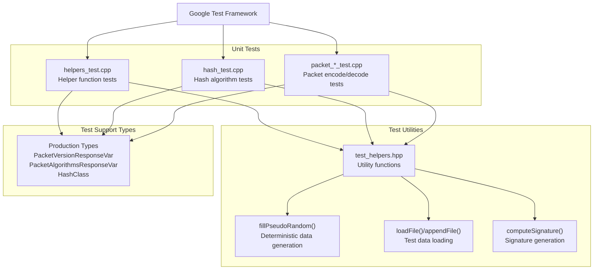
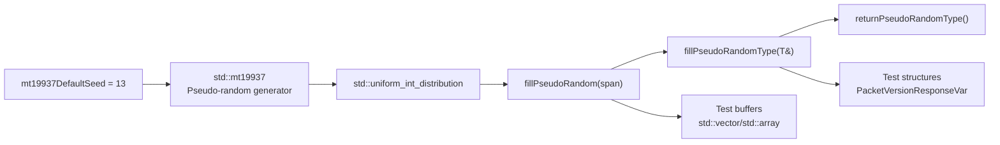
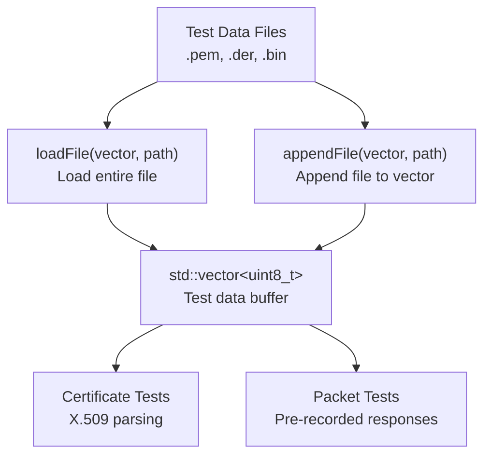
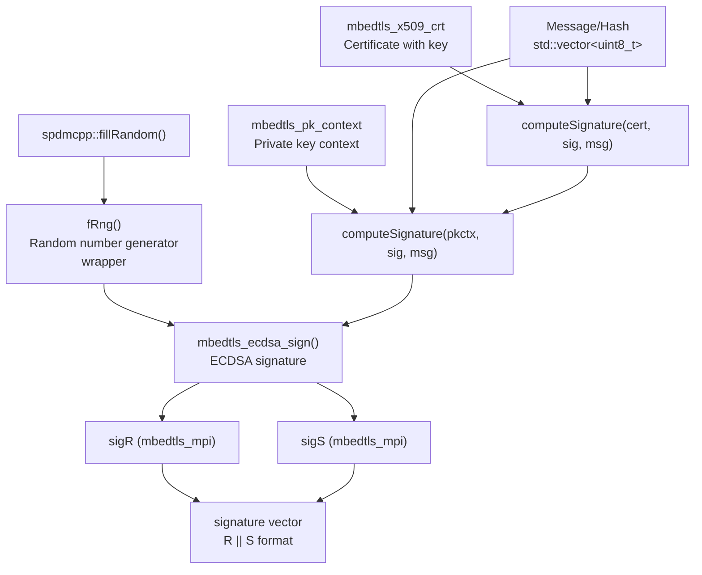
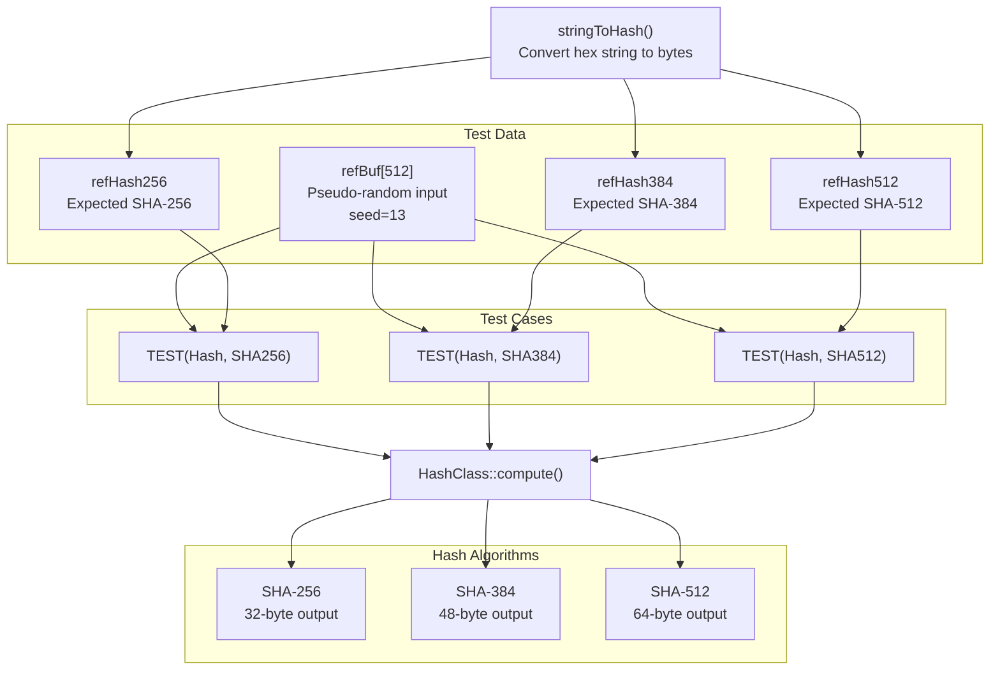
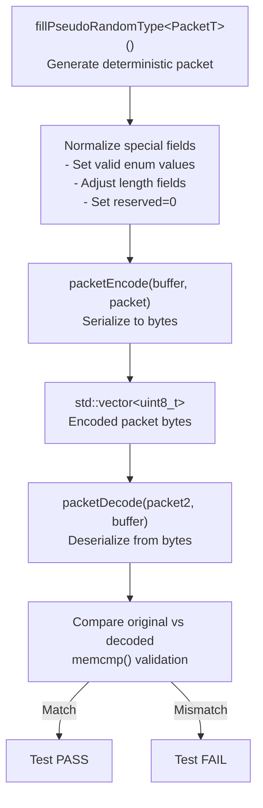
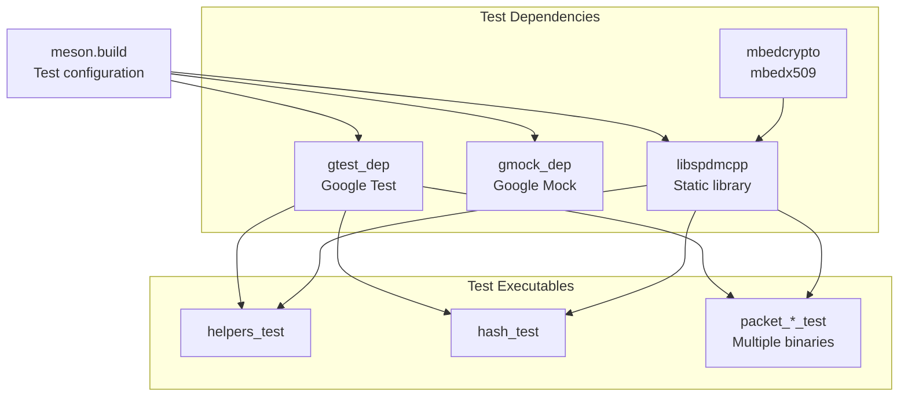

<!-- source: DeepWiki mcp.deepwiki.com · repo NVIDIA/spdm · page 5 Testing Infrastructure · fetched 2026-10-26 -->

# Testing Infrastructure

<details>
<summary>Relevant source files</summary>

The following files were used as context for generating this wiki page:

- [libspdmcpp/headers/spdmcpp/helpers.hpp](libspdmcpp/headers/spdmcpp/helpers.hpp)
- [libspdmcpp/tests/hash_test.cpp](libspdmcpp/tests/hash_test.cpp)
- [libspdmcpp/tests/helpers_test.cpp](libspdmcpp/tests/helpers_test.cpp)
- [libspdmcpp/tests/test_helpers.hpp](libspdmcpp/tests/test_helpers.hpp)
- [spdmd/spdmd_app_context.cpp](spdmd/spdmd_app_context.cpp)
- [spdmd/spdmd_app_context.hpp](spdmd/spdmd_app_context.hpp)

</details>


## Purpose and Scope

This document describes the testing infrastructure used in the SPDM project, focusing on test utilities, helper functions, and testing patterns. The testing framework supports unit testing of SPDM packet structures, cryptographic operations, and protocol flows.

For information about the SPDM protocol implementation being tested, see [libspdmcpp Library](#2). For deployment and runtime configuration, see [Deployment Guide](#6).

---

## Testing Framework Overview

The SPDM project uses **Google Test** (gtest/gmock) as its testing framework. Tests are organized under `libspdmcpp/tests/` and focus on validating packet encoding/decoding, cryptographic operations, and protocol state management.

The testing infrastructure emphasizes **deterministic testing** through pseudo-random data generation with fixed seeds, enabling reproducible test results across different environments and runs.

### Test Organization



**Sources:** [libspdmcpp/tests/test_helpers.hpp:1-123](), [libspdmcpp/tests/helpers_test.cpp:1-153](), [libspdmcpp/tests/hash_test.cpp:1-183]()

---

## Test Helpers and Utilities

The test infrastructure provides reusable utility functions in `test_helpers.hpp` to support deterministic testing, file operations, and cryptographic test operations.

### Pseudo-Random Data Generation

Tests require deterministic data generation to ensure reproducibility. The `fillPseudoRandom()` function uses `std::mt19937` with a fixed seed to generate consistent pseudo-random data across test runs.



**Key Functions:**

| Function | Purpose | Signature |
|----------|---------|-----------|
| `fillPseudoRandom()` | Fill buffer with pseudo-random data | `void fillPseudoRandom(std::span<uint8_t>, seed)` |
| `fillPseudoRandomType<T>()` | Fill struct with pseudo-random data | `void fillPseudoRandomType(T& dst, seed)` |
| `returnPseudoRandomType<T>()` | Create and return pseudo-random struct | `T returnPseudoRandomType(seed)` |
| `fillRandom()` | Fill buffer with true random data | `void fillRandom(std::span<uint8_t>)` |

The default seed is defined as `mt19937DefaultSeed = 13` at [libspdmcpp/tests/test_helpers.hpp:25]().

**Example Usage:**

```cpp
// Generate deterministic test data for a 512-byte buffer
std::vector<uint8_t> testBuffer(512);
fillPseudoRandom(testBuffer);  // Uses default seed=13

// Generate deterministic test packet structure
auto testPacket = returnPseudoRandomType<PacketVersionResponseVar>();
```

**Sources:** [libspdmcpp/tests/test_helpers.hpp:27-54](), [libspdmcpp/headers/spdmcpp/helpers.hpp:34-40](), [libspdmcpp/tests/helpers_test.cpp:86-122]()

### Reference Data Validation

The `helpers_test.cpp` file defines a 512-byte reference buffer at [libspdmcpp/tests/helpers_test.cpp:32-75]() that represents the expected output when using the default seed. This enables validation that the pseudo-random generator produces consistent results:

```cpp
std::array<uint8_t, 512> refBuf = { 0xc7, 0x9b, 0x3d, ... };

TEST(Helpers, fillPseudoRandom_stdarray) {
    std::array<uint8_t, refBuf.size()> buf{};
    fillPseudoRandom(buf);
    EXPECT_EQ(memcmp(buf.data(), refBuf.data(), sizeof(buf)), 0);
}
```

**Sources:** [libspdmcpp/tests/helpers_test.cpp:32-92]()

---

## File I/O Test Utilities

Test data such as certificates, private keys, and pre-generated packets can be loaded from files for integration testing.

### File Loading Functions



| Function | Purpose | Implementation |
|----------|---------|----------------|
| `loadFile(buf, path)` | Clear buffer and load entire file | Opens file in binary mode, resizes buffer, reads all data |
| `appendFile(buf, path)` | Append file contents to existing buffer | Preserves existing data, appends file at end |

Both functions at [libspdmcpp/tests/test_helpers.hpp:56-81]() use `std::ifstream` with `std::ios::binary` mode and handle buffer sizing automatically based on file size.

**Sources:** [libspdmcpp/tests/test_helpers.hpp:56-81]()

---

## Cryptographic Test Utilities

Testing SPDM protocol flows requires generating valid cryptographic signatures for verification testing. The test helpers provide signature computation using mbedtls.

### Signature Generation for Testing



The `computeSignature()` function at [libspdmcpp/tests/test_helpers.hpp:89-122]() performs ECDSA signing for test purposes:

1. Validates the key type is `MBEDTLS_PK_ECKEY`
2. Extracts the elliptic curve keypair from the pk context
3. Uses `mbedtls_ecdsa_sign()` to compute signature components (R, S)
4. Writes the signature in concatenated R||S format

**Signature Format:**

The output signature vector contains two equal-sized components:
- First half: R value (big-endian)
- Second half: S value (big-endian)

The half-size is determined by `spdmcpp::getHalfSize(*ctx)` which returns the curve's field size.

**Sources:** [libspdmcpp/tests/test_helpers.hpp:83-122]()

---

## Hash Testing

The SPDM protocol uses cryptographic hashing extensively for transcript hashing and measurement verification. Hash tests validate the `HashClass` implementation against known test vectors.

### Hash Algorithm Test Coverage



### Test Vector Format

Hash test vectors are stored as hex strings and converted to byte arrays using the `stringToHash()` helper at [libspdmcpp/tests/hash_test.cpp:99-111]():

```cpp
template <size_t N>
void stringToHash(std::array<uint8_t, N>& arr, const char* str) {
    // Converts hex string "33c452d9..." to byte array
}
```

The `charToUint()` function at [libspdmcpp/tests/hash_test.cpp:80-97]() converts individual hex characters to 4-bit values.

### Hash Test Example

Each hash test follows this pattern at [libspdmcpp/tests/hash_test.cpp:113-142]():

1. Define expected hash output as hex string
2. Convert hex string to byte array using `stringToHash()`
3. Call `HashClass::compute()` with the `refBuf` input
4. Verify output matches expected hash value

**Test Vector Sources:**

The 512-byte reference buffer is shared with helper tests at [libspdmcpp/tests/hash_test.cpp:35-78](), ensuring consistency across test suites.

**Sources:** [libspdmcpp/tests/hash_test.cpp:1-183]()

---

## Packet Testing Approach

SPDM packet structures must correctly serialize and deserialize to/from wire format. The testing approach validates this through round-trip encode/decode testing with pseudo-random data.

### Packet Test Pattern



### Typical Packet Test Structure

While specific packet test files are not provided in the sources, the pattern follows:

1. **Generate test packet:** Use `returnPseudoRandomType<PacketVersionResponseVar>()` to create a packet with deterministic random data
2. **Normalize fields:** Set enum values to valid constants, adjust length fields to match actual data
3. **Encode:** Call `packetEncode()` to serialize the packet to a byte buffer
4. **Decode:** Call `packetDecode()` to deserialize back to a packet structure
5. **Validate:** Use `memcmp()` or field-by-field comparison to verify round-trip correctness

### Buffer Size Validation

Packet tests also validate buffer size requirements:
- Minimum buffer size must accommodate fixed header + minimum variable data
- Maximum buffer size must not exceed SPDM protocol limits
- Length fields must correctly reflect actual data sizes

**Sources:** [libspdmcpp/tests/test_helpers.hpp:1-123]()

---

## Test Execution and Build Integration

Tests are built using the Meson build system and integrated into the project's continuous integration pipeline.

### Test Binary Organization



### Running Tests

Tests can be executed using Meson's test runner:

```bash
# Build and run all tests
meson test -C build

# Run specific test suite
meson test -C build helpers_test

# Run with verbose output
meson test -C build --verbose
```

**Test Output:**

Each test reports:
- Number of tests executed
- Pass/fail status for each test
- Failure details including expected vs actual values
- Execution time

**Sources:** Build system integration inferred from [libspdmcpp/tests/test_helpers.hpp:1-123](), [libspdmcpp/tests/helpers_test.cpp:1-153]()

---

## Test Data Management

### Deterministic vs Random Data

The testing infrastructure provides two approaches for data generation:

| Approach | Function | Use Case | Reproducibility |
|----------|----------|----------|-----------------|
| **Pseudo-random** | `fillPseudoRandom()` | Unit tests, regression tests | Fully reproducible with same seed |
| **True random** | `fillRandom()` | Fuzzing, stress testing | Non-reproducible, higher coverage |

The `fillRandom()` function at [libspdmcpp/headers/spdmcpp/helpers.hpp:34-40]() uses `std::random_device` for true randomness, making it suitable for:
- Fuzzing packet decoders with random inputs
- Stress testing memory management
- Finding edge cases not covered by deterministic tests

### Reference Data Storage

Test reference data follows these patterns:

1. **Inline hex arrays:** Small test vectors (hashes, signatures) stored as C++ arrays in test files
2. **External files:** Large test data (certificates, packet captures) loaded via `loadFile()`
3. **Generated data:** Pseudo-random data generated at test time with fixed seeds

The reference buffer at [libspdmcpp/tests/hash_test.cpp:35-78]() demonstrates inline storage of 512 bytes, while the file I/O utilities support external test data management.

**Sources:** [libspdmcpp/headers/spdmcpp/helpers.hpp:34-40](), [libspdmcpp/tests/helpers_test.cpp:124-152]()

---

## Summary

The SPDM testing infrastructure provides comprehensive utilities for validating protocol implementation:

- **Deterministic testing** through pseudo-random data generation with fixed seeds
- **Cryptographic test support** for signature generation and verification
- **File I/O utilities** for loading external test data
- **Hash validation** against known test vectors
- **Round-trip packet testing** for encode/decode correctness

This infrastructure enables reliable, reproducible testing across the SPDM protocol stack, from low-level packet serialization to high-level protocol flows.

**Sources:** [libspdmcpp/tests/test_helpers.hpp:1-123](), [libspdmcpp/tests/helpers_test.cpp:1-153](), [libspdmcpp/tests/hash_test.cpp:1-183](), [libspdmcpp/headers/spdmcpp/helpers.hpp:1-43]()

---

