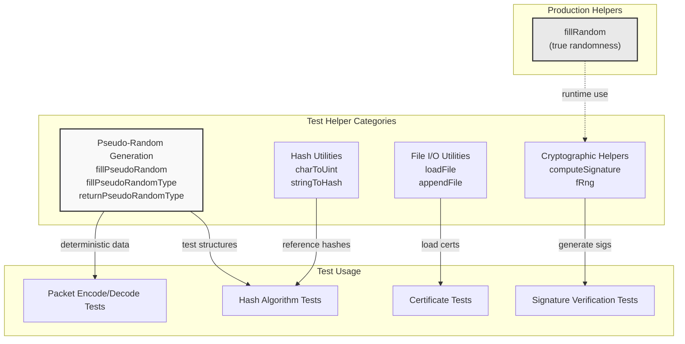
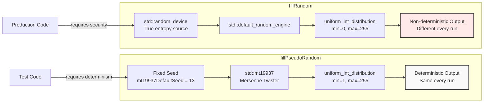
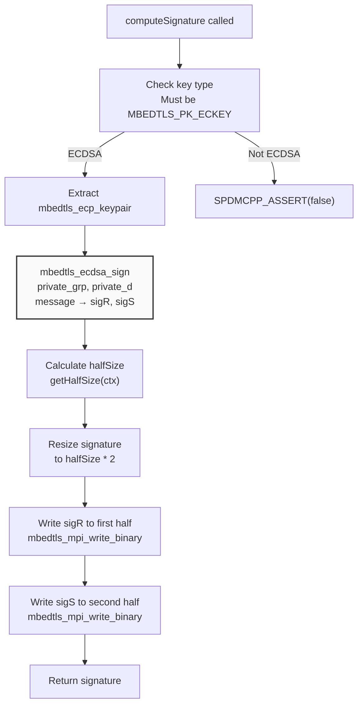

<!-- source: DeepWiki mcp.deepwiki.com · repo NVIDIA/spdm · page 5.1 Test Helpers and Utilities · fetched 2026-10-26 -->

# Test Helpers and Utilities

<details>
<summary>Relevant source files</summary>

The following files were used as context for generating this wiki page:

- [libspdmcpp/headers/spdmcpp/helpers.hpp](libspdmcpp/headers/spdmcpp/helpers.hpp)
- [libspdmcpp/tests/hash_test.cpp](libspdmcpp/tests/hash_test.cpp)
- [libspdmcpp/tests/helpers_test.cpp](libspdmcpp/tests/helpers_test.cpp)
- [libspdmcpp/tests/test_helpers.hpp](libspdmcpp/tests/test_helpers.hpp)

</details>


This document describes the test helper functions and utilities used throughout the SPDM testing infrastructure. These utilities provide deterministic pseudo-random data generation, file I/O operations, cryptographic test support, and hash manipulation for unit and integration tests.

For information about the broader testing infrastructure including packet testing and fuzzing, see [Testing Infrastructure](#5).

---

## Overview

The test helpers are organized into several categories based on functionality:

| Category | Purpose | Primary Location |
|----------|---------|------------------|
| Pseudo-Random Generation | Deterministic data generation for reproducible tests | `libspdmcpp/tests/test_helpers.hpp` |
| File I/O | Loading test data from files | `libspdmcpp/tests/test_helpers.hpp` |
| Cryptographic Support | Signature computation and RNG callbacks | `libspdmcpp/tests/test_helpers.hpp` |
| Hash Utilities | Hex string to byte array conversion | `libspdmcpp/tests/hash_test.cpp` |
| Production Helpers | True random data generation | `libspdmcpp/headers/spdmcpp/helpers.hpp` |

The key distinction between test and production helpers is **determinism**: test helpers use fixed seeds to produce reproducible results, while production helpers use true randomness.

**Sources:** [libspdmcpp/tests/test_helpers.hpp:1-123](), [libspdmcpp/headers/spdmcpp/helpers.hpp:1-43]()

---

## Test Helper Architecture



**Sources:** [libspdmcpp/tests/test_helpers.hpp:1-123](), [libspdmcpp/tests/helpers_test.cpp:1-153](), [libspdmcpp/tests/hash_test.cpp:1-183]()

---

## Pseudo-Random Data Generation

The pseudo-random generation utilities provide deterministic random data using the Mersenne Twister (MT19937) algorithm with a fixed seed. This enables reproducible test results across runs and platforms.

### Core Functions

#### `fillPseudoRandom()`

Fills a span of bytes with deterministic pseudo-random data.

```cpp
inline void fillPseudoRandom(
    std::span<uint8_t, std::dynamic_extent> buf,
    std::mt19937::result_type seed = mt19937DefaultSeed)
```

**Parameters:**
- `buf`: Span to fill with pseudo-random data
- `seed`: Random seed (default: `mt19937DefaultSeed = 13`)

**Implementation:** Creates an `std::mt19937` generator with the specified seed and fills the buffer using `std::uniform_int_distribution<uint8_t>` with minimum value 1 (ensuring no zero bytes by default).

**Sources:** [libspdmcpp/tests/test_helpers.hpp:25-35]()

#### `fillPseudoRandomType()`

Fills an arbitrary typed structure with pseudo-random data by reinterpreting it as a byte array.

```cpp
template <typename T>
inline void fillPseudoRandomType(
    T& dst,
    std::mt19937::result_type seed = mt19937DefaultSeed)
```

**Usage:** Useful for initializing complex packet structures with non-zero data to catch uninitialized field bugs.

**Sources:** [libspdmcpp/tests/test_helpers.hpp:37-45]()

#### `returnPseudoRandomType()`

Returns a new instance of type `T` filled with pseudo-random data.

```cpp
template <typename T>
inline T returnPseudoRandomType(
    std::mt19937::result_type seed = mt19937DefaultSeed)
```

**Sources:** [libspdmcpp/tests/test_helpers.hpp:47-54]()

### Deterministic Behavior

The fixed seed ensures that the same input size always produces the same output bytes:

| Buffer Size | First 4 Bytes (hex) | Notes |
|-------------|---------------------|-------|
| 512 bytes | `c7 9b 3d dc` | Reference buffer defined in tests |
| Any size | Deterministic | Same seed → same output |

**Sources:** [libspdmcpp/tests/helpers_test.cpp:32-75](), [libspdmcpp/tests/helpers_test.cpp:86-122]()

---

## Pseudo-Random vs True Random



**Key Differences:**

| Aspect | `fillPseudoRandom` | `fillRandom` |
|--------|-------------------|--------------|
| **Entropy Source** | Fixed seed (13) | `std::random_device` |
| **Determinism** | Yes - same output every run | No - different every run |
| **Minimum Value** | 1 (no zeros) | 0 (includes zeros) |
| **Use Case** | Unit tests, reproducibility | Runtime operations, security |
| **Location** | `tests/test_helpers.hpp` | `headers/spdmcpp/helpers.hpp` |

**Sources:** [libspdmcpp/tests/test_helpers.hpp:25-35](), [libspdmcpp/headers/spdmcpp/helpers.hpp:32-40](), [libspdmcpp/tests/helpers_test.cpp:124-152]()

---

## File I/O Utilities

File I/O utilities load test data from the filesystem, primarily for certificate chains and reference data.

### `loadFile()`

Loads an entire file into a `std::vector<uint8_t>`.

```cpp
inline void loadFile(std::vector<uint8_t>& buf, const std::string& str)
```

**Behavior:**
1. Clears the destination buffer
2. Opens file in binary mode (`std::ios::binary`)
3. Seeks to end to determine file size (`std::ios::ate`)
4. Resizes buffer to file size
5. Seeks back to beginning
6. Reads entire file into buffer

**Sources:** [libspdmcpp/tests/test_helpers.hpp:56-67]()

### `appendFile()`

Appends file contents to an existing buffer without clearing it.

```cpp
inline void appendFile(std::vector<uint8_t>& buf, const std::string& str)
```

**Use Case:** Building multi-file certificate chains where multiple PEM files need to be concatenated.

**Sources:** [libspdmcpp/tests/test_helpers.hpp:69-81]()

---

## Cryptographic Test Utilities

Cryptographic helpers support signature generation and provide mbedtls callback functions for tests.

### `fRng()` - Random Number Generator Callback

Provides an mbedtls-compatible RNG callback that wraps the production `fillRandom()` function.

```cpp
inline int fRng(void* /*ctx*/, unsigned char* buf, size_t len)
```

**Signature:** Matches `mbedtls_ctr_drbg_random` and similar mbedtls RNG function pointers.

**Returns:** Always 0 (success).

**Sources:** [libspdmcpp/tests/test_helpers.hpp:83-87]()

### `computeSignature()` - ECDSA Signature Generation

Computes ECDSA signatures for testing signature verification logic.

```cpp
inline int computeSignature(mbedtls_pk_context* pkctx,
                            std::vector<uint8_t>& signature,
                            const std::vector<uint8_t>& message)

inline int computeSignature(mbedtls_x509_crt* cert,
                            std::vector<uint8_t>& signature,
                            const std::vector<uint8_t>& message)
```

**Overloads:**
- Takes `mbedtls_pk_context*` (public key context)
- Takes `mbedtls_x509_crt*` (certificate) - extracts public key automatically

**Algorithm Flow:**



**Signature Format:** Raw ECDSA signature as concatenated R||S components (no DER encoding).

**Sources:** [libspdmcpp/tests/test_helpers.hpp:89-122]()

---

## Hash Testing Utilities

Hash utilities convert human-readable hex strings to byte arrays for test reference data.

### `charToUint()`

Converts a single hexadecimal character to its numeric value.

```cpp
uint8_t charToUint(char c)
```

**Supported Characters:**
- `'0'` - `'9'` → 0-9
- `'a'` - `'f'` → 10-15
- `'A'` - `'F'` → 10-15

**Error Handling:** Asserts on invalid characters.

**Sources:** [libspdmcpp/tests/hash_test.cpp:80-97]()

### `stringToHash()`

Converts a hex string to a fixed-size byte array.

```cpp
template <size_t N>
void stringToHash(std::array<uint8_t, N>& arr, const char* str)
```

**Requirements:**
- Input string length must be exactly `2 * N` (two hex chars per byte)
- Processes pairs of hex characters into single bytes
- High nibble first (big-endian within byte)

**Example Usage:**
```cpp
std::array<uint8_t, 32> refHash{};
stringToHash(refHash, 
    "33c452d940f6b206bc539bfe92b3151317fb70dfe2c17ecf59375c9f745d1102");
// refHash now contains 32 bytes of SHA-256 reference hash
```

**Sources:** [libspdmcpp/tests/hash_test.cpp:99-111](), [libspdmcpp/tests/hash_test.cpp:113-142]()

---

## Test Helper Usage Patterns

```mermaid
graph TB
    subgraph "Packet Encode/Decode Testing"
        PKT_TEST["Test Case"]
        FILL_PKT["fillPseudoRandomType<br/>PacketXxxRequest"]
        ENCODE["packetEncode"]
        DECODE["packetDecode"]
        VERIFY["memcmp original vs decoded"]
    end
    
    subgraph "Hash Algorithm Testing"
        HASH_TEST["Test Case"]
        FILL_BUF["fillPseudoRandom<br/>512-byte buffer"]
        COMPUTE["HashClass::compute"]
        STRING_HASH["stringToHash<br/>reference value"]
        COMPARE["memcmp computed vs reference"]
    end
    
    subgraph "Certificate Chain Testing"
        CERT_TEST["Test Case"]
        LOAD["loadFile<br/>cert_chain.pem"]
        APPEND["appendFile<br/>additional_certs.pem"]
        PARSE["parseCertificatePEM"]
        VERIFY_SIG["Verify signature"]
    end
    
    subgraph "Signature Verification Testing"
        SIG_TEST["Test Case"]
        LOAD_KEY["Load private key"]
        GEN_MSG["fillPseudoRandom<br/>message"]
        COMPUTE_SIG["computeSignature"]
        VERIFY_SIG_TEST["verifySignature"]
    end
    
    PKT_TEST --> FILL_PKT
    FILL_PKT --> ENCODE
    ENCODE --> DECODE
    DECODE --> VERIFY
    
    HASH_TEST --> FILL_BUF
    FILL_BUF --> COMPUTE
    HASH_TEST --> STRING_HASH
    COMPUTE --> COMPARE
    STRING_HASH --> COMPARE
    
    CERT_TEST --> LOAD
    LOAD --> APPEND
    APPEND --> PARSE
    PARSE --> VERIFY_SIG
    
    SIG_TEST --> LOAD_KEY
    SIG_TEST --> GEN_MSG
    LOAD_KEY --> COMPUTE_SIG
    GEN_MSG --> COMPUTE_SIG
    COMPUTE_SIG --> VERIFY_SIG_TEST
    
    style FILL_PKT fill:#f9f9f9,stroke:#333,stroke-width:2px
    style FILL_BUF fill:#f9f9f9,stroke:#333,stroke-width:2px
    style GEN_MSG fill:#f9f9f9,stroke:#333,stroke-width:2px
```



**Sources:** [libspdmcpp/tests/helpers_test.cpp:1-153](), [libspdmcpp/tests/hash_test.cpp:1-183]()

---

## Reference Data Generation

The test infrastructure uses a 512-byte reference buffer generated with the default seed:

```cpp
constexpr std::mt19937::result_type mt19937DefaultSeed = 13;

std::array<uint8_t, 512> refBuf = {
    0xc7, 0x9b, 0x3d, 0xdc, 0xd3, 0xe4, 0xf7, 0x2e, 
    0xf9, 0xc2, 0x74, 0xc0, 0x9c, 0x9b, 0xc6, 0xcb,
    // ... (512 bytes total)
};
```

This reference buffer is used to validate:
- Pseudo-random generation produces consistent output
- Hash algorithms compute correct digests
- Packet structures handle arbitrary data correctly

**Validation Pattern:**
1. Call `fillPseudoRandom()` with default seed
2. Compare output with `refBuf` using `memcmp()`
3. Expect exact match (result = 0)

**Sources:** [libspdmcpp/tests/helpers_test.cpp:32-75](), [libspdmcpp/tests/hash_test.cpp:35-78]()

---

## Summary Table

| Function | Return Type | Primary Use Case | Deterministic |
|----------|-------------|------------------|---------------|
| `fillPseudoRandom()` | `void` | Fill buffer with test data | Yes (seed=13) |
| `fillPseudoRandomType<T>()` | `void` | Initialize struct for testing | Yes (seed=13) |
| `returnPseudoRandomType<T>()` | `T` | Create test instance | Yes (seed=13) |
| `fillRandom()` | `void` | Production random data | No |
| `loadFile()` | `void` | Load test files | N/A |
| `appendFile()` | `void` | Concatenate files | N/A |
| `fRng()` | `int` | mbedtls RNG callback | No |
| `computeSignature()` | `int` | Generate ECDSA signatures | No (uses fRng) |
| `charToUint()` | `uint8_t` | Hex char conversion | N/A |
| `stringToHash<N>()` | `void` | Convert hex string to bytes | N/A |

**Sources:** [libspdmcpp/tests/test_helpers.hpp:1-123](), [libspdmcpp/headers/spdmcpp/helpers.hpp:1-43]()

---

