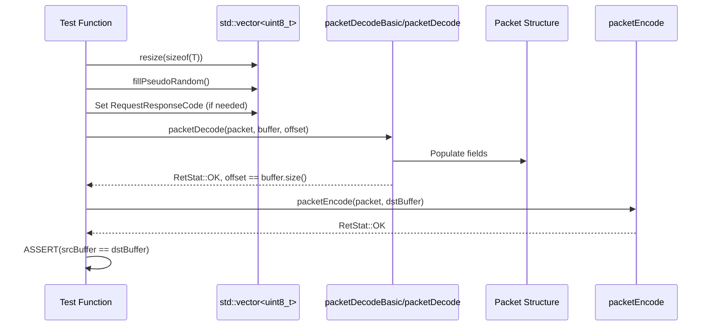
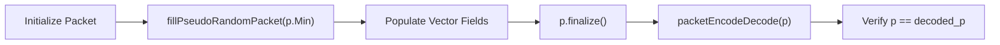
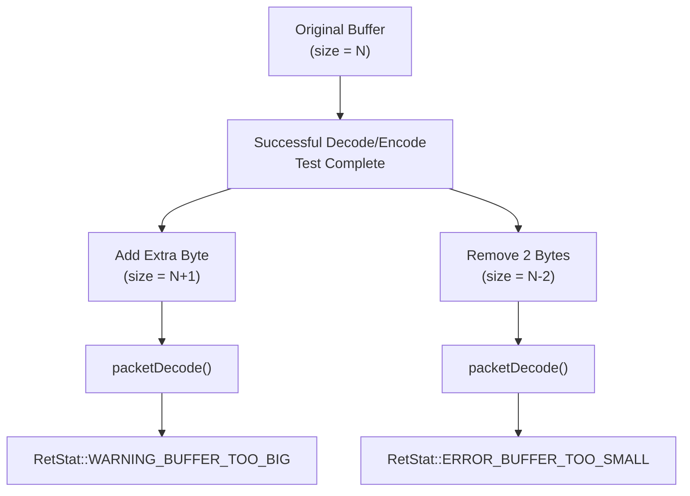
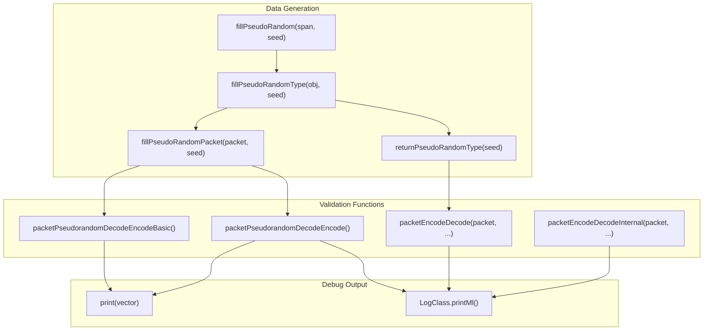

<!-- source: DeepWiki mcp.deepwiki.com · repo NVIDIA/spdm · page 5.2 Packet Testing · fetched 2026-10-26 -->

# Packet Testing

<details>
<summary>Relevant source files</summary>

The following files were used as context for generating this wiki page:

- [libspdmcpp/headers/spdmcpp/helpers.hpp](libspdmcpp/headers/spdmcpp/helpers.hpp)
- [libspdmcpp/headers_public/spdmcpp/packet.hpp](libspdmcpp/headers_public/spdmcpp/packet.hpp)
- [libspdmcpp/tests/hash_test.cpp](libspdmcpp/tests/hash_test.cpp)
- [libspdmcpp/tests/helpers_test.cpp](libspdmcpp/tests/helpers_test.cpp)
- [libspdmcpp/tests/packet_basic_test.cpp](libspdmcpp/tests/packet_basic_test.cpp)
- [libspdmcpp/tests/test_helpers.hpp](libspdmcpp/tests/test_helpers.hpp)

</details>


## Purpose and Scope

This page documents the packet testing infrastructure in `libspdmcpp`, which validates the encoding and decoding of SPDM protocol packets through round-trip tests. The tests ensure that packets can be serialized to byte buffers and deserialized back to identical structures, verifying the correctness of packet serialization logic.

For information about test helper utilities like `fillPseudoRandom()` and `loadFile()`, see [Test Helpers and Utilities](#5.1). For details on packet structure definitions, see [Packet Structures and Serialization](#2.3).

**Sources:** [libspdmcpp/tests/packet_basic_test.cpp:1-510]()

---

## Testing Strategy Overview

The packet testing strategy validates serialization correctness through three complementary approaches:

| Testing Approach | Packet Types | Validation Method |
|-----------------|--------------|-------------------|
| **Pseudorandom Decode-Encode** | Fixed-size packets (Min variants) | Fill buffer with pseudorandom bytes → decode → encode → verify buffer equality |
| **Constructed Encode-Decode** | Variable-size packets (Var variants) | Construct packet with known data → encode → decode → verify packet equality |
| **Buffer Validation** | All packet types | Test with oversized and undersized buffers to verify error handling |

The fundamental principle is bidirectional validation: if encoding and decoding are inverse operations, then `encode(decode(buffer)) == buffer` for fixed-size packets and `decode(encode(packet)) == packet` for all packets.

```mermaid
flowchart TB
    subgraph "Fixed-Size Packet Testing"
        A1["Pseudorandom Buffer"] --> A2["packetDecode()"]
        A2 --> A3["Packet Structure"]
        A3 --> A4["packetEncode()"]
        A4 --> A5["Encoded Buffer"]
        A5 --> A6{"Buffer\nEquality?"}
        A6 -->|Yes| A7["PASS"]
        A6 -->|No| A8["FAIL"]
    end
    
    subgraph "Variable-Size Packet Testing"
        B1["Construct Packet"] --> B2["packetEncode()"]
        B2 --> B3["Buffer"]
        B3 --> B4["packetDecode()"]
        B4 --> B5["Decoded Packet"]
        B5 --> B6{"Packet\nEquality?"}
        B6 -->|Yes| B7["PASS"]
        B6 -->|No| B8["FAIL"]
    end
    
    subgraph "Buffer Size Validation"
        C1["Exact Size"] --> C2["RetStat::OK"]
        C3["Oversized +1 byte"] --> C4["RetStat::WARNING_BUFFER_TOO_BIG"]
        C5["Undersized -1 byte"] --> C6["RetStat::ERROR_BUFFER_TOO_SMALL"]
    end
```



**Sources:** [libspdmcpp/tests/packet_basic_test.cpp:99-188](), [libspdmcpp/tests/packet_basic_test.cpp:190-228]()

---

## Pseudorandom Data Generation

Tests use deterministic pseudorandom data generation to create reproducible test cases. The `fillPseudoRandom()` function uses a Mersenne Twister PRNG with a fixed seed to generate consistent byte sequences across test runs.

### Key Functions

| Function | Purpose | Location |
|----------|---------|----------|
| `fillPseudoRandom(span)` | Fill buffer with pseudorandom bytes using fixed seed | [libspdmcpp/tests/test_helpers.hpp:28-35]() |
| `fillPseudoRandomType<T>()` | Fill structure with pseudorandom bytes via reinterpret_cast | [libspdmcpp/tests/test_helpers.hpp:38-45]() |
| `fillPseudoRandomPacket<T>()` | Fill packet and set correct request/response code | [libspdmcpp/tests/packet_basic_test.cpp:78-88]() |
| `returnPseudoRandomType<T>()` | Return pseudorandomly initialized structure | [libspdmcpp/tests/test_helpers.hpp:48-54]() |

The default seed value is `mt19937DefaultSeed = 13`, ensuring reproducibility.

**Sources:** [libspdmcpp/tests/test_helpers.hpp:25-54](), [libspdmcpp/tests/packet_basic_test.cpp:78-97]()

---

## Fixed-Size Packet Testing

Fixed-size packets use the `Min` suffix (e.g., `PacketVersionResponseMin`) and have `sizeIsConstant = true`. Testing fills a buffer with pseudorandom data, decodes it into a packet structure, re-encodes it, and verifies buffer equality.

### Basic Testing Flow



### Implementation

The `packetPseudorandomDecodeEncode()` template function implements the full validation:

```cpp
template <class T>
bool packetPseudorandomDecodeEncode()
{
    // Fixed-size packet validation
    SPDMCPP_STATIC_ASSERT(T::sizeIsConstant);
    
    // Generate source buffer
    std::vector<uint8_t> src;
    src.resize(sizeof(T));
    fillPseudoRandom(src);
    packetMessageHeaderSetRequestresponsecode(src.data(), 
                                              T::requestResponseCode);
    
    // Decode -> Encode -> Compare
    T packet;
    packetDecode(log, packet, src, offset);
    packetEncode(packet, dst);
    return std::equal(src.begin(), src.end(), dst.begin());
}
```

### Tested Fixed-Size Packets

The following fixed-size packet types are validated in [libspdmcpp/tests/packet_basic_test.cpp:271-293]():

- `PacketMessageHeader` - SPDM message header (4 bytes)
- `PacketVersionNumber` - Version entry (2 bytes)
- `PacketErrorResponseMin` - Error response without extended data
- `PacketCertificateChain` - Certificate chain header
- `PacketMeasurementBlockMin` - Measurement block without variable data
- `PacketVersionResponseMin` - Version response without version list
- `PacketNegotiateAlgorithmsRequestMin` - Algorithm negotiation without algorithms
- `PacketAlgorithmsResponseMin` - Algorithm response without algorithms
- `PacketGetDigestsRequest` - Digest request
- `PacketDigestsResponseMin` - Digest response without digest data
- `PacketGetCertificateRequest` - Certificate request
- `PacketCertificateResponseMin` - Certificate response without certificate data
- `PacketGetMeasurementsRequestMin` - Measurements request without nonce
- `PacketMeasurementsResponseMin` - Measurements response without blocks

**Sources:** [libspdmcpp/tests/packet_basic_test.cpp:99-188](), [libspdmcpp/tests/packet_basic_test.cpp:271-293]()

---

## Variable-Size Packet Testing

Variable-size packets use the `Var` suffix and contain `std::vector` fields for dynamic data. Testing constructs packets with known data, encodes to bytes, decodes back, and verifies packet equality using `operator==`.

### Variable Packet Construction Pattern



### Example: PacketVersionResponseVar

The version response test demonstrates the pattern:

```cpp
TEST(packet_pseudorandom_encode_decode, PacketVersionResponseVar)
{
    PacketVersionResponseVar p;
    fillPseudoRandomPacket(p.Min);  // Fill fixed portion
    
    // Add variable-size version entries
    p.VersionNumberEntries.push_back(
        returnPseudoRandomType<PacketVersionNumber>());
    p.VersionNumberEntries.push_back(
        returnPseudoRandomType<PacketVersionNumber>());
    
    EXPECT_TRUE(packetEncodeDecode(p));
}
```

### Tested Variable-Size Packets

| Packet Type | Variable Fields | Finalization Required | Test Location |
|-------------|----------------|----------------------|---------------|
| `PacketErrorResponseVar` | ExtendedDataVector | No | [packet_basic_test.cpp:295-304]() |
| `PacketVersionResponseVar` | VersionNumberEntries | No | [packet_basic_test.cpp:306-315]() |
| `PacketNegotiateAlgorithmsRequestVar` | PacketReqAlgVector | Yes | [packet_basic_test.cpp:317-334]() |
| `PacketAlgorithmsResponseVar` | PacketReqAlgVector | Yes | [packet_basic_test.cpp:336-353]() |
| `PacketDigestsResponseVar` | Digests[8] arrays | Yes | [packet_basic_test.cpp:355-376]() |
| `PacketCertificateResponseVar` | CertificateVector | Yes | [packet_basic_test.cpp:378-390]() |
| `PacketGetMeasurementsRequestVar` | Nonce, SlotIDParam | No | [packet_basic_test.cpp:392-420]() |
| `PacketMeasurementBlockVar` | MeasurementVector | Yes | [packet_basic_test.cpp:422-434]() |
| `PacketMeasurementFieldVar` | ValueVector | Yes | [packet_basic_test.cpp:436-448]() |
| `PacketMeasurementsResponseVar` | MeasurementBlockVector, SignatureVector | Yes | [packet_basic_test.cpp:450-509]() |

### Finalization

Packets marked "Yes" for finalization require calling `p.finalize()` before encoding. This updates length fields and prepares internal state. For example, `PacketNegotiateAlgorithmsRequestVar::finalize()` computes the total length of all algorithm structures.

**Sources:** [libspdmcpp/tests/packet_basic_test.cpp:295-509]()

---

## Buffer Validation Testing

The `packetPseudorandomDecodeEncode()` function validates buffer size handling by testing three scenarios after successful round-trip encoding:



### Implementation

```cpp
// Test oversized buffer
src.push_back(0xBA);
{
    size_t off = 0;
    auto rs = packetDecode(log, packet, src, off);
    SPDMCPP_TEST_ASSERT_RS(rs, RetStat::WARNING_BUFFER_TOO_BIG);
}

// Test undersized buffer
src.pop_back();
src.pop_back();  // Remove 2 bytes total
{
    size_t off = 0;
    auto rs = packetDecode(log, packet, src, off);
    SPDMCPP_TEST_ASSERT_RS(rs, RetStat::ERROR_BUFFER_TOO_SMALL);
}
```

This ensures decoders properly validate input buffer sizes and return appropriate error codes rather than reading out of bounds.

**Sources:** [libspdmcpp/tests/packet_basic_test.cpp:174-186]()

---

## PacketDecodeInfo Context

Some packets require additional context for decoding, passed via `PacketDecodeInfo`:

```cpp
struct PacketDecodeInfo
{
    uint16_t BaseHashSize = 0;      // Hash algorithm size (32/48/64 bytes)
    uint16_t SignatureSize = 0;     // Signature size from negotiated algorithm
    uint8_t GetMeasurementsParam1 = 0;  // Param1 from request (affects response structure)
};
```

### Usage in Tests

```cpp
TEST(packet_pseudorandom_encode_decode, PacketDigestsResponseVar)
{
    PacketDecodeInfo info;
    info.BaseHashSize = 32;  // SHA-256
    
    PacketDigestsResponseVar p;
    fillPseudoRandomPacket(p.Min);
    
    // Digest size depends on BaseHashSize
    p.Digests[0].resize(info.BaseHashSize);
    fillPseudoRandom(p.Digests[0]);
    
    EXPECT_TRUE(packetEncodeDecode(p, info));  // Pass info as decode context
}
```

Packets requiring `PacketDecodeInfo`:
- `PacketDigestsResponseVar` - needs `BaseHashSize` for digest array sizing
- `PacketMeasurementsResponseVar` - needs all three fields for proper structure decoding

**Sources:** [libspdmcpp/headers_public/spdmcpp/packet.hpp:89-94](), [libspdmcpp/tests/packet_basic_test.cpp:355-376](), [libspdmcpp/tests/packet_basic_test.cpp:450-509]()

---

## Test Helper Functions

### Helper Function Diagram



### Function Signatures

```cpp
// Data generation with Mersenne Twister (seed=13)
void fillPseudoRandom(std::span<uint8_t> buf, 
                     std::mt19937::result_type seed = mt19937DefaultSeed);

template <typename T>
void fillPseudoRandomType(T& dst, std::mt19937::result_type seed = mt19937DefaultSeed);

template <typename T>
void fillPseudoRandomPacket(T& p, std::mt19937::result_type seed = mt19937DefaultSeed)
{
    SPDMCPP_STATIC_ASSERT(T::sizeIsConstant);
    fillPseudoRandomType(p, seed);
    packetMessageHeaderSetRequestresponsecode(
        reinterpret_cast<uint8_t*>(&p), T::requestResponseCode);
}

// Round-trip validation
template <class T>
bool packetPseudorandomDecodeEncodeBasic();  // No header validation

template <class T>
bool packetPseudorandomDecodeEncode();  // Full validation + buffer size tests

template <class T, typename... Targs>
bool packetEncodeDecode(const T& src, Targs... fargs);  // Constructed packet test

template <class T, typename... Targs>
bool packetEncodeDecodeInternal(const T& src, Targs... fargs);  // Internal encode/decode
```

**Sources:** [libspdmcpp/tests/test_helpers.hpp:25-54](), [libspdmcpp/tests/packet_basic_test.cpp:78-269]()

---

## Test Coverage Matrix

The following table summarizes all packet types tested and their validation methods:

| Packet Type | Fixed/Variable | Decode-Encode | Encode-Decode | Buffer Validation |
|-------------|----------------|---------------|---------------|-------------------|
| `PacketMessageHeader` | Fixed | ✓ | - | - |
| `PacketVersionNumber` | Fixed | ✓ | - | - |
| `PacketErrorResponseMin` | Fixed | ✓ | - | ✓ |
| `PacketCertificateChain` | Fixed | ✓ | - | - |
| `PacketMeasurementBlockMin` | Fixed | ✓ | - | - |
| `PacketVersionResponseMin` | Fixed | ✓ | - | ✓ |
| `PacketNegotiateAlgorithmsRequestMin` | Fixed | ✓ | - | ✓ |
| `PacketAlgorithmsResponseMin` | Fixed | ✓ | - | ✓ |
| `PacketGetDigestsRequest` | Fixed | ✓ | - | ✓ |
| `PacketDigestsResponseMin` | Fixed | ✓ | - | ✓ |
| `PacketGetCertificateRequest` | Fixed | ✓ | - | ✓ |
| `PacketCertificateResponseMin` | Fixed | ✓ | - | ✓ |
| `PacketGetMeasurementsRequestMin` | Fixed | ✓ | - | ✓ |
| `PacketMeasurementsResponseMin` | Fixed | ✓ | - | ✓ |
| `PacketErrorResponseVar` | Variable | - | ✓ | - |
| `PacketVersionResponseVar` | Variable | - | ✓ | - |
| `PacketNegotiateAlgorithmsRequestVar` | Variable | - | ✓ | - |
| `PacketAlgorithmsResponseVar` | Variable | - | ✓ | - |
| `PacketDigestsResponseVar` | Variable | - | ✓ (w/ info) | - |
| `PacketCertificateResponseVar` | Variable | - | ✓ | - |
| `PacketGetMeasurementsRequestVar` | Variable | - | ✓ (2 variants) | - |
| `PacketMeasurementBlockVar` | Variable | - | ✓ (internal) | - |
| `PacketMeasurementFieldVar` | Variable | - | ✓ (internal) | - |
| `PacketMeasurementsResponseVar` | Variable | - | ✓ (2 variants, w/ info) | - |

**Legend:**
- **Decode-Encode**: Pseudorandom buffer → decode → encode → compare buffers
- **Encode-Decode**: Construct packet → encode → decode → compare packets
- **Buffer Validation**: Test with oversized/undersized buffers
- **(w/ info)**: Requires `PacketDecodeInfo` context
- **(internal)**: Uses `packetEncodeDecodeInternal()` for nested structures
- **(2 variants)**: Multiple test cases with different configurations

**Sources:** [libspdmcpp/tests/packet_basic_test.cpp:271-509]()

---

