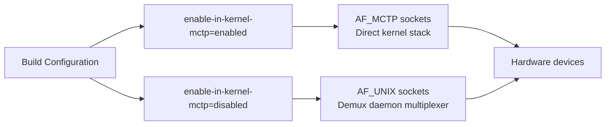
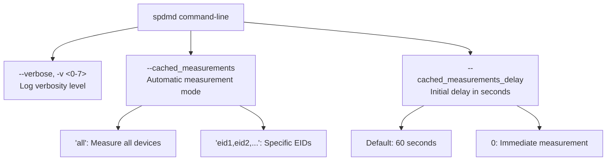
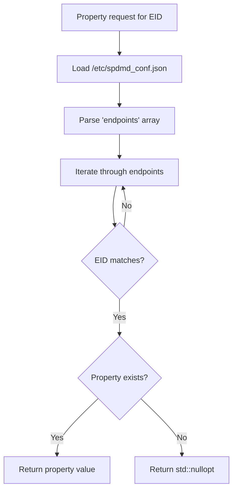
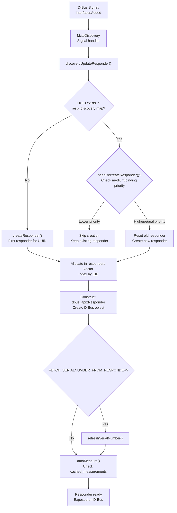
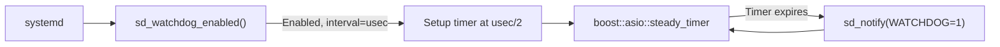
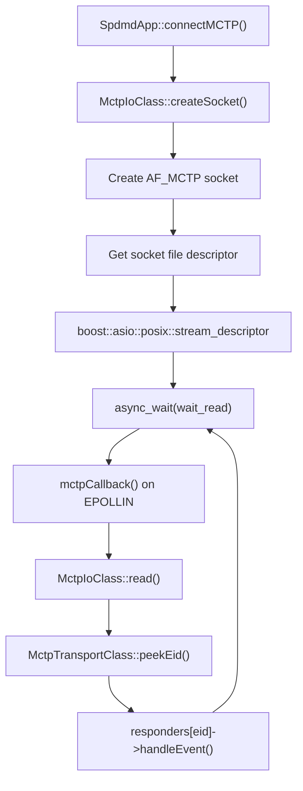
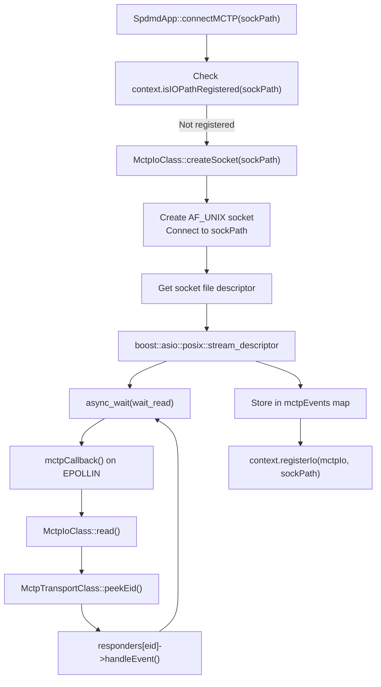

<!-- source: DeepWiki mcp.deepwiki.com · repo NVIDIA/spdm · page 6 Deployment Guide · fetched 2026-10-26 -->

# Deployment Guide

<details>
<summary>Relevant source files</summary>

The following files were used as context for generating this wiki page:

- [config.h.in](config.h.in)
- [meson.build](meson.build)
- [meson_options.txt](meson_options.txt)
- [spdmd/spdmd.cpp](spdmd/spdmd.cpp)
- [spdmd/spdmd_app.hpp](spdmd/spdmd_app.hpp)
- [spdmd/spdmd_app_context.cpp](spdmd/spdmd_app_context.cpp)
- [spdmd/spdmd_app_context.hpp](spdmd/spdmd_app_context.hpp)

</details>


This page provides practical guidance for deploying the SPDM daemon (`spdmd`) in production OpenBMC environments. It covers build-time configuration options, runtime configuration, service integration, and deployment verification.

For architectural details about the build system, see [Build System and Configuration](#1.2). For in-depth configuration file format documentation, see [Configuration](#3.4).

---

## Prerequisites and Dependencies

The SPDM daemon requires the following system components and libraries to be available in the target OpenBMC environment:

### Required System Services

| Service | Purpose | Configuration Impact |
|---------|---------|---------------------|
| D-Bus system bus | IPC for SPDM interfaces | Required for all deployments |
| MCTP Control daemon | Endpoint discovery and management | Required unless `DISCOVERY_ONLY_FROM_MCTP_CONTROL=false` |
| Phosphor Inventory | Device catalog correlation | Required for UUID-based discovery |
| CSM Service | Chassis state management | Optional, controlled by `csm_service_enabled` |

### Library Dependencies

The following dependencies are resolved at build time through Meson:

- **mbedtls** (mbedcrypto, mbedx509): Cryptographic operations and X.509 certificate parsing
- **sdbusplus**: D-Bus C++ bindings for OpenBMC
- **phosphor-dbus-interfaces**: Standard OpenBMC D-Bus interface definitions
- **sdeventplus**: Event loop integration
- **nlohmann_json**: JSON configuration parsing
- **CLI11**: Command-line argument parsing

Sources: [meson.build:1-110](), [meson_options.txt:1-20]()

---

## Build-Time Configuration

The SPDM daemon behavior is controlled by compile-time feature flags defined in `meson_options.txt` and exposed through `config.h`. These flags must be selected before building to match the target deployment environment.

### Critical Build Options

#### MCTP Transport Mode



**Option**: `enable-in-kernel-mctp`
- **Default**: `disabled`
- **Values**: `enabled` | `disabled`
- **Impact**: Sets `MCTP_IN_KERNEL` macro in [config.h.in:26]()
- **Code reference**: [spdmd/spdmd.cpp:524-526]()

When **enabled**, `spdmd` uses the kernel MCTP stack via `AF_MCTP` sockets:
- Direct kernel-mode MCTP communication
- Better performance for high-throughput scenarios
- Requires kernel MCTP support (Linux 5.15+)
- Initialization in [spdmd/spdmd.cpp:177-223]()

When **disabled**, `spdmd` uses the userspace demux daemon via `AF_UNIX` sockets:
- Compatible with older kernels
- More flexible routing and filtering
- Requires `mctp-demux-daemon` running
- Initialization in [spdmd/spdmd.cpp:118-175]()

#### Discovery Strategy

**Option**: `discovery_only_from_mctp_control`
- **Default**: `disabled`
- **Values**: `enabled` | `disabled`
- **Impact**: Sets `DISCOVERY_ONLY_FROM_MCTP_CONTROL` macro in [config.h.in:14]()

When **enabled**:
- Responders discovered only through MCTP Control daemon signals
- D-Bus object paths use EID numbers: `/xyz/openbmc_project/SPDM/{eid}`
- Faster discovery, simpler object naming
- Suitable for environments where inventory service is unavailable

When **disabled** (default):
- Bidirectional discovery: MCTP endpoints correlated with Inventory items via UUID
- D-Bus object paths use inventory names: `/xyz/openbmc_project/SPDM/{device_name}`
- More descriptive object paths, better integration with existing services
- Discovery logic in `MctpDiscovery` class

See [Discovery Modes](#3.3.1) for detailed discovery flow.

#### Serial Number Retrieval

**Option**: `fetch_serialnumber_from_responder`
- **Default**: `0` (disabled)
- **Values**: `0-254` (measurement index)
- **Impact**: Sets `FETCH_SERIALNUMBER_FROM_RESPONDER` macro in [config.h.in:11]()

When set to non-zero value:
- Automatically retrieves serial number from specified measurement index
- Writes serial number to PLDM inventory
- Triggered in [spdmd/spdmd.cpp:383-385]()

#### CSM Service Integration

**Option**: `csm_service_enabled`
- **Default**: `enabled`
- **Values**: `enabled` | `disabled`
- **Impact**: Sets `CSM_SERVICE_ENABLED` macro in [config.h.in:28]()

Controls whether `spdmd` checks for Chassis State Manager (CSM) service state before communicating with responders. Disable on platforms without CSM support.

### Build Options Summary Table

| Option | Default | Purpose | Code Impact |
|--------|---------|---------|-------------|
| `enable-in-kernel-mctp` | `disabled` | Kernel vs userspace MCTP | [spdmd.cpp:524-526]() |
| `discovery_only_from_mctp_control` | `disabled` | Discovery mechanism | Affects `MctpDiscovery` |
| `fetch_serialnumber_from_responder` | `0` | Custom serial number index | [spdmd.cpp:383-385]() |
| `csm_service_enabled` | `enabled` | CSM service dependency | Discovery gating |
| `conf_file_name` | `/etc/spdmd_conf.json` | Config file path | [spdmd_app_context.hpp:48]() |

### Example Build Commands

**For kernel MCTP with full discovery:**
```bash
meson setup builddir \
    -Denable-in-kernel-mctp=enabled \
    -Ddiscovery_only_from_mctp_control=disabled \
    -Dcsm_service_enabled=enabled

meson compile -C builddir
```

**For demux daemon with simple discovery:**
```bash
meson setup builddir \
    -Denable-in-kernel-mctp=disabled \
    -Ddiscovery_only_from_mctp_control=enabled \
    -Dcsm_service_enabled=disabled

meson compile -C builddir
```

Sources: [meson.build:29-52](), [meson_options.txt:1-20](), [config.h.in:1-29](), [spdmd/spdmd.cpp:524-526]()

---

## Runtime Configuration

### Command-Line Options

The `spdmd` daemon accepts the following command-line arguments:



#### Verbosity Levels

| Level | Value | Purpose |
|-------|-------|---------|
| Emergency | 0 | System unusable |
| Alert | 1 | Action required |
| Critical | 2 | Critical conditions |
| Error | 3 | Error conditions (default if not specified) |
| Warning | 4 | Warning conditions |
| Notice | 5 | Normal but significant |
| Informational | 6 | Informational messages |
| Debug | 7 | Debug-level messages |

Code reference: [spdmd/spdmd.cpp:54-89]()

#### Automatic Measurements

The `--cached_measurements` option enables automatic retrieval of measurements upon device discovery:

**Measure all devices:**
```bash
spdmd --cached_measurements all --cached_measurements_delay 30
```

**Measure specific EIDs:**
```bash
spdmd --cached_measurements 10,20,30 --cached_measurements_delay 0
```

Implementation flow:
1. Parse CLI arguments in [spdmd/spdmd.cpp:91-115]()
2. Store configuration in `cachedMeasurements` set [spdmd_app_context.hpp:152]()
3. Setup delay timer in [spdmd/spdmd.cpp:389-421]()
4. Execute measurements in [spdmd/spdmd.cpp:500-509]()

### Configuration File Format

The daemon reads JSON configuration from `/etc/spdmd_conf.json` (or path specified by `conf_file_name` build option).

**File structure:**
```json
{
  "endpoints": [
    {
      "eid": 10,
      "property1": "value1",
      "property2": "value2"
    },
    {
      "eid": 20,
      "custom_setting": true
    }
  ]
}
```

**Property lookup mechanism:**



Code implementation: [spdmd_app_context.hpp:85-124]()

**Example configuration:**
```json
{
  "endpoints": [
    {
      "eid": 10,
      "description": "Primary GPU",
      "auto_refresh": true,
      "refresh_interval": 300
    },
    {
      "eid": 20,
      "description": "Secondary GPU",
      "auto_refresh": false
    }
  ]
}
```

Configuration loading: [spdmd_app_context.cpp:28-40]()

Sources: [spdmd/spdmd.cpp:49-116](), [spdmd_app_context.hpp:48-124](), [spdmd_app_context.cpp:28-40]()

---

## Deployment Lifecycle

### Initialization Sequence

```mermaid
sequenceDiagram
    participant Main as main()
    participant App as SpdmdApp
    participant CLI as setupCli()
    participant DBus as connectDBus()
    participant MCTP as connectMCTP()
    participant Disc as MctpDiscovery
    participant Loop as Event Loop
    
    Main->>App: Create SpdmdApp instance
    Main->>CLI: Parse command-line args
    CLI->>App: Configure verbosity, measurements
    
    Main->>DBus: connectDBus("xyz.openbmc_project.SPDM")
    DBus->>DBus: Request D-Bus service name
    DBus->>DBus: Start systemd watchdog
    
    alt MCTP_IN_KERNEL enabled
        Main->>MCTP: connectMCTP() - kernel mode
        MCTP->>MCTP: Create AF_MCTP socket
        MCTP->>MCTP: Register async read handler
    end
    
    Main->>Disc: Create MctpDiscovery
    Disc->>Disc: Setup D-Bus signal matches
    Disc->>Disc: Begin endpoint discovery
    
    Main->>App: setupMeasurementDelay()
    App->>App: Configure auto-measurement timer
    
    Main->>Loop: io.run() - Enter event loop
    Loop->>Loop: Process D-Bus signals
    Loop->>Loop: Process MCTP packets
    Loop->>Loop: Process timers
```

**Code flow:**
1. **Application instantiation**: [spdmd/spdmd.cpp:519]()
2. **CLI setup**: [spdmd/spdmd.cpp:521]()
3. **D-Bus connection**: [spdmd/spdmd.cpp:523]()
4. **MCTP connection**: [spdmd/spdmd.cpp:524-526]()
5. **Discovery initialization**: [spdmd/spdmd.cpp:528-529]()
6. **Measurement timer**: [spdmd/spdmd.cpp:531]()
7. **D-Bus object manager**: [spdmd/spdmd.cpp:534]()
8. **Event loop**: [spdmd/spdmd.cpp:535]()

### Responder Creation Flow



**Priority evaluation logic** in [spdmd/spdmd.cpp:225-292]():

1. Compare MCTP medium priorities: PCIe (0) > USB (1) > SPI (2) > I3C (3) > KCS (4) > Serial (5) > SMBus (6)
2. If mediums equal, compare binding type priorities (same order)
3. Higher priority (lower number) triggers responder recreation

**Medium priority table**: [spdmd_app.hpp:54-61]()
**Binding priority table**: [spdmd_app.hpp:66-73]()

Sources: [spdmd/spdmd.cpp:513-544](), [spdmd/spdmd.cpp:225-292](), [spdmd/spdmd.cpp:294-334](), [spdmd/spdmd.cpp:336-387]()

---

## Systemd Integration

### Service Unit Configuration

The daemon integrates with systemd for process management and watchdog monitoring. A typical service unit file:

```ini
[Unit]
Description=SPDM Daemon
After=network.target
Requires=xyz.openbmc_project.Logging.service
Wants=xyz.openbmc_project.ObjectMapper.service

[Service]
Type=notify
ExecStart=/usr/sbin/spdmd --verbose 5 --cached_measurements all
Restart=on-failure
WatchdogSec=30s

[Install]
WantedBy=multi-user.target
```

### Watchdog Implementation



**Watchdog initialization**: [spdmd_app_context.cpp:166-175]()
- Calls `sd_watchdog_enabled()` to get configured interval
- Creates `boost::asio::steady_timer` with half the watchdog interval
- Schedules periodic refresh

**Watchdog refresh**: [spdmd_app_context.cpp:177-188]()
- Calls `sd_notify(0, "WATCHDOG=1")` before timeout
- Re-schedules next refresh
- Integrated with main event loop

### Service Dependencies

The daemon requires the following D-Bus services to be available:

| Service | Purpose | Optional? |
|---------|---------|-----------|
| `xyz.openbmc_project.MCTP.Control` | MCTP endpoint management | No (unless DISCOVERY_ONLY_FROM_MCTP_CONTROL=false) |
| `xyz.openbmc_project.Inventory.Manager` | Device catalog | No (unless DISCOVERY_ONLY_FROM_MCTP_CONTROL=true) |
| `xyz.openbmc_project.Logging` | Phosphor logging | Yes (graceful degradation) |
| `xyz.openbmc_project.ObjectMapper` | D-Bus object lookup | Yes |
| CSM service | Chassis state | Yes (if csm_service_enabled=disabled) |

Sources: [spdmd_app_context.cpp:122-137](), [spdmd_app_context.cpp:166-188]()

---

## MCTP Socket Management

### Kernel Mode (AF_MCTP)

When `MCTP_IN_KERNEL` is enabled:



Implementation: [spdmd/spdmd.cpp:177-223]()

**Key aspects:**
- Single socket for all MCTP communication
- Asynchronous I/O via `boost::asio::posix::stream_descriptor`
- EID extracted from packet headers using `peekEid()` [spdmd/spdmd.cpp:447]()
- Events dispatched to appropriate `Responder` instance [spdmd/spdmd.cpp:482-485]()

### Demux Mode (AF_UNIX)

When `MCTP_IN_KERNEL` is disabled:



Implementation: [spdmd/spdmd.cpp:118-175]()

**Key aspects:**
- Multiple sockets possible (one per demux endpoint)
- Socket paths provided by discovery mechanism
- Path-indexed socket management in `mctpEvents` map [spdmd_app.hpp:158-160]()
- I/O objects registered in `context` for lifecycle management

**Packet reception flow**: [spdmd/spdmd.cpp:423-486]()
1. Asynchronous read triggered on socket activity
2. `MctpIoClass::read()` populates `packetBuffer`
3. `peekEid()` extracts EID from MCTP header
4. Event dispatched to `responders[eid]`

Sources: [spdmd/spdmd.cpp:118-223](), [spdmd/spdmd.cpp:423-486](), [spdmd_app.hpp:158-164]()

---

## Deployment Verification

### Checking Daemon Status

**Verify service is running:**
```bash
systemctl status spdmd
```

**Check D-Bus service presence:**
```bash
busctl list | grep xyz.openbmc_project.SPDM
```

**List discovered responders:**
```bash
busctl tree xyz.openbmc_project.SPDM
```

Expected output:
```
/xyz/openbmc_project/SPDM
├─/xyz/openbmc_project/SPDM/device1
├─/xyz/openbmc_project/SPDM/device2
└─/xyz/openbmc_project/SPDM/device3
```

### Verifying Responder Properties

**Check responder status:**
```bash
busctl get-property xyz.openbmc_project.SPDM \
    /xyz/openbmc_project/SPDM/device1 \
    xyz.openbmc_project.SPDM.Responder \
    status
```

**Inspect version:**
```bash
busctl get-property xyz.openbmc_project.SPDM \
    /xyz/openbmc_project/SPDM/device1 \
    xyz.openbmc_project.SPDM.Responder \
    version
```

### Using spdmutil for Testing

The `spdmutil` command-line tool can verify SPDM communication independently of the daemon. See [spdmutil Command-Line Tool](#4) for detailed usage.

**Example: Retrieve version from EID 10:**
```bash
spdmutil get-version 10 -o version.json
```

**Example: Get measurements:**
```bash
spdmutil get-meas 10 --slot 0 -o measurements.json
```

### Common Issues

#### Issue: Responder not discovered

**Symptoms:**
- No D-Bus objects created under `/xyz/openbmc_project/SPDM/`
- Log messages: "Unable to connect to socket"

**Troubleshooting:**
1. Verify MCTP Control daemon is running: `systemctl status xyz.openbmc_project.MCTP.Control`
2. Check MCTP endpoints exist: `busctl tree xyz.openbmc_project.MCTP`
3. Verify inventory items present: `busctl tree xyz.openbmc_project.Inventory`
4. Enable debug logging: `spdmd --verbose 7`

**Discovery mode specific:**
- If `DISCOVERY_ONLY_FROM_MCTP_CONTROL=true`: Check MCTP Control signals
- If `DISCOVERY_ONLY_FROM_MCTP_CONTROL=false`: Verify UUID matches between MCTP and Inventory

#### Issue: MCTP connection failed

**Symptoms:**
- Log messages: "Unable to connect to socket"
- Exception: "Couldn't connect to any MCTP endpoint"

**Resolution for kernel mode:**
- Verify kernel MCTP support: `lsmod | grep mctp`
- Check socket availability: `ls -l /sys/class/mctp/`

**Resolution for demux mode:**
- Verify demux daemon running: `ps aux | grep mctp-demux`
- Check socket paths: `ls -l /run/mctp/`

#### Issue: Automatic measurements not running

**Symptoms:**
- Responders discovered but measurements not retrieved
- `status` property remains in initial state

**Troubleshooting:**
1. Verify `--cached_measurements` specified on command line
2. Check delay has expired: `--cached_measurements_delay`
3. Verify EID in allowed list (if not using "all")
4. Check log for measurement errors: `journalctl -u spdmd | grep measurement`

Implementation reference: [spdmd/spdmd.cpp:488-509](), [spdmd_app_context.cpp:42-58]()

Sources: Various troubleshooting flows derived from [spdmd/spdmd.cpp:513-544](), [spdmd/spdmd.cpp:118-223](), [spdmd/spdmd.cpp:488-509]()

---

## Example Deployment Scenarios

### Scenario 1: High-Performance PCIe GPUs (Kernel MCTP)

**Environment:**
- OpenBMC on x86 BMC with Linux 5.15+
- Multiple PCIe-attached SPDM responders
- High measurement frequency required

**Build configuration:**
```bash
meson setup builddir \
    -Denable-in-kernel-mctp=enabled \
    -Ddiscovery_only_from_mctp_control=disabled \
    -Dcsm_service_enabled=enabled \
    -Dfetch_serialnumber_from_responder=1
```

**Runtime configuration (`/etc/spdmd_conf.json`):**
```json
{
  "endpoints": [
    {
      "eid": 10,
      "description": "GPU0",
      "auto_refresh_interval": 300
    },
    {
      "eid": 11,
      "description": "GPU1",
      "auto_refresh_interval": 300
    }
  ]
}
```

**Service invocation:**
```bash
spdmd --verbose 5 --cached_measurements all --cached_measurements_delay 30
```

### Scenario 2: Legacy System (Demux Daemon)

**Environment:**
- ARM BMC with older kernel (< 5.15)
- I2C/SMBus MCTP transport
- Inventory service available

**Build configuration:**
```bash
meson setup builddir \
    -Denable-in-kernel-mctp=disabled \
    -Ddiscovery_only_from_mctp_control=disabled \
    -Dcsm_service_enabled=enabled
```

**Runtime:**
- Ensure `mctp-demux-daemon` running and creating sockets in `/run/mctp/`
- Discovery correlates MCTP endpoints with inventory via UUID

**Service invocation:**
```bash
spdmd --verbose 4 --cached_measurements 10,20,30
```

### Scenario 3: Minimal Embedded System

**Environment:**
- Resource-constrained BMC
- No inventory service
- Simple EID-based addressing

**Build configuration:**
```bash
meson setup builddir \
    -Denable-in-kernel-mctp=enabled \
    -Ddiscovery_only_from_mctp_control=enabled \
    -Dcsm_service_enabled=disabled
```

**Runtime:**
- Responders discovered only via MCTP Control
- D-Bus paths: `/xyz/openbmc_project/SPDM/{eid}`
- No UUID correlation overhead

**Service invocation:**
```bash
spdmd --verbose 3 --cached_measurements all --cached_measurements_delay 0
```

Sources: Deployment scenarios synthesized from [meson_options.txt:1-20](), [spdmd/spdmd.cpp:49-116](), build configuration in [meson.build:29-52]()

---

