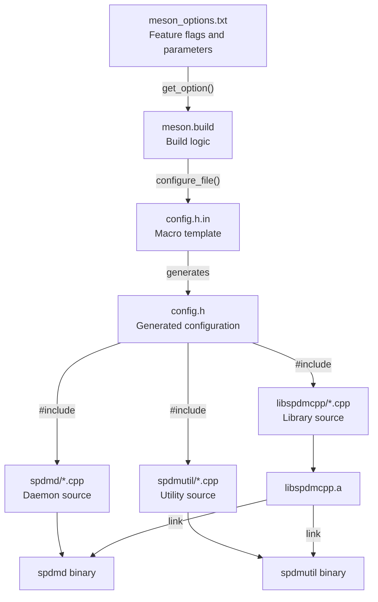
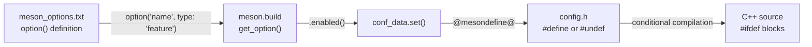
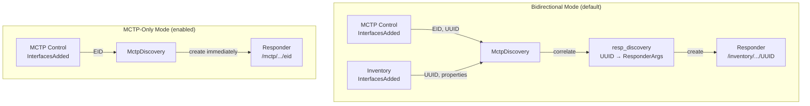
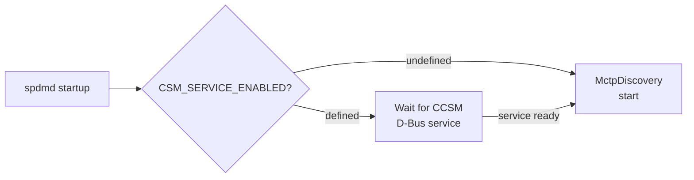
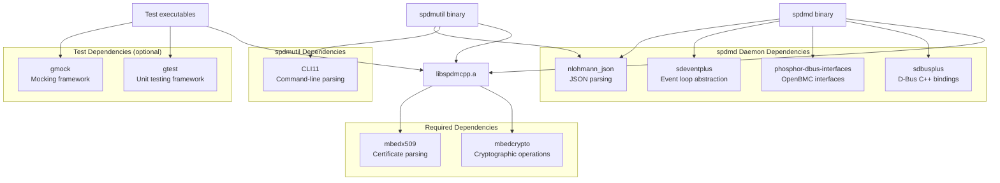
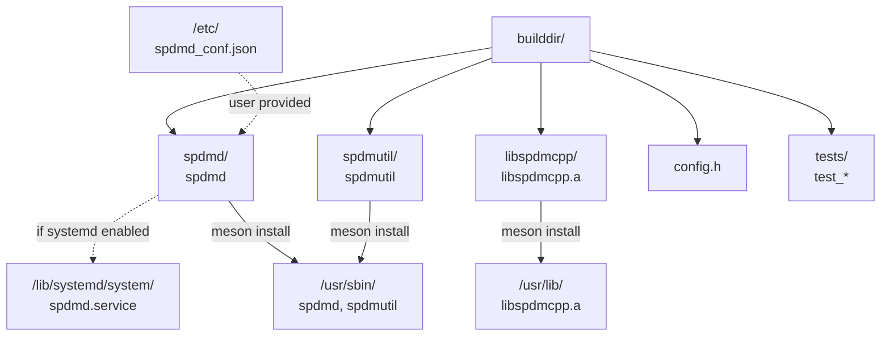

<!-- source: DeepWiki mcp.deepwiki.com · repo NVIDIA/spdm · page 6.1 Build Options and Compilation · fetched 2026-10-26 -->

# Build Options and Compilation

<details>
<summary>Relevant source files</summary>

The following files were used as context for generating this wiki page:

- [config.h.in](config.h.in)
- [meson.build](meson.build)
- [meson_options.txt](meson_options.txt)

</details>


## Purpose and Scope

This document provides a comprehensive guide to configuring and building the NVIDIA SPDM project using the Meson build system. It covers all compile-time options available through `meson_options.txt`, their effects on the generated `config.h` macros, and how to select appropriate options for different deployment scenarios.

For runtime configuration of the `spdmd` daemon, see [Runtime Configuration](#6.2). For overall system architecture context, see [System Architecture](#1.1).

---

## Build System Overview

The project uses Meson as its build system with a primary build definition at [meson.build:1-110](). The build system compiles three main artifacts:

| Artifact | Description | Build Control |
|----------|-------------|---------------|
| `libspdmcpp.a` | Core SPDM protocol library | Always built |
| `spdmd` | SPDM daemon service | Controlled by `spdmd` option |
| `spdmutil` | Command-line utility | Always built |
| Test executables | Unit and integration tests | Controlled by `tests` option |

The build process follows this flow:

**Build Configuration Flow**



Sources: [meson.build:1-110](), [meson_options.txt:1-20](), [config.h.in:1-29]()

---

## Compile-Time Options Reference

All build options are defined in [meson_options.txt:1-20](). The following sections detail each option, its effect on the build, and when to use it.

### Feature Toggles

**Feature Option Processing**



Sources: [meson.build:29-43](), [config.h.in:1-29]()

#### `tests`

| Property | Value |
|----------|-------|
| Type | Feature |
| Default | `enabled` |
| Config Macro | None (used at build time only) |
| Effect | Enables building of test executables |

Controls whether test executables are built and whether test dependencies (`gtest`, `gmock`) are required.

**Implementation**: [meson.build:12-15]()
```cpp
if get_option('tests').enabled()
    gtest = dependency('gtest', main: true, disabler: true, required: false)
    gmock = dependency('gmock', disabler: true, required: false)
endif
```

**When to use**: Disable in production builds where tests are not needed. Enable for development and CI/CD environments.

#### `spdmd`

| Property | Value |
|----------|-------|
| Type | Feature |
| Default | `enabled` |
| Config Macro | None (used at build time only) |
| Effect | Controls whether the `spdmd` daemon is built |

Determines if the daemon component is included in the build. When disabled, only the library and CLI utility are built.

**When to use**: Disable if only the library or `spdmutil` is needed. Enable for full OpenBMC integration.

#### `systemd`

| Property | Value |
|----------|-------|
| Type | Feature |
| Default | `enabled` |
| Config Macro | None |
| Effect | Includes systemd service file installation |

Controls installation of `spdmd.service` systemd unit file.

**When to use**: Enable for systemd-based systems (most OpenBMC deployments). Disable for non-systemd environments.

---

### Transport Configuration

#### `enable-in-kernel-mctp`

| Property | Value |
|----------|-------|
| Type | Feature |
| Default | `disabled` |
| Config Macro | `MCTP_IN_KERNEL` |
| Effect | Selects MCTP transport implementation |

**Critical Option**: Determines which MCTP transport backend is used.

**Values and Effects**:

| Value | Macro State | Transport Mode | Socket Type |
|-------|-------------|----------------|-------------|
| `disabled` | `MCTP_IN_KERNEL` undefined | Userspace demux daemon | `AF_UNIX` |
| `enabled` | `MCTP_IN_KERNEL` defined | Kernel MCTP stack | `AF_MCTP` |

**Implementation**: [meson.build:43]()
```cpp
conf_data.set('MCTP_IN_KERNEL', get_option('enable-in-kernel-mctp').enabled())
```

**Code Usage**: [config.h.in:26]()
```cpp
#mesondefine MCTP_IN_KERNEL
```

This macro is checked throughout `libspdmcpp/mctp_io.cpp` to select between kernel and userspace I/O paths.

**When to use**:
- **Enable**: For systems with kernel MCTP support (Linux 5.15+), provides better performance and direct hardware access
- **Disable**: For systems using the userspace MCTP demux daemon, typical in older OpenBMC deployments

**Transport Mode Comparison**

```mermaid
graph TB
    subgraph Kernel["Kernel Mode (MCTP_IN_KERNEL)"]
        K_APP["spdmd/spdmutil"]
        K_LIB["libspdmcpp<br/>MctpIoClass"]
        K_SOCK["AF_MCTP socket"]
        K_STACK["Kernel MCTP stack"]
        K_HW["Hardware"]
        
        K_APP --> K_LIB
        K_LIB --> K_SOCK
        K_SOCK --> K_STACK
        K_STACK --> K_HW
    end
    
    subgraph Userspace["Userspace Mode (default)"]
        U_APP["spdmd/spdmutil"]
        U_LIB["libspdmcpp<br/>MctpIoClass"]
        U_SOCK["AF_UNIX socket"]
        U_DEMUX["mctpd demux daemon"]
        U_HW["Hardware"]
        
        U_APP --> U_LIB
        U_LIB --> U_SOCK
        U_SOCK --> U_DEMUX
        U_DEMUX --> U_HW
    end
```



Sources: [meson_options.txt:17](), [meson.build:43](), [config.h.in:26]()

---

### Discovery Configuration

#### `discovery_only_from_mctp_control`

| Property | Value |
|----------|-------|
| Type | Feature |
| Default | `disabled` |
| Config Macro | `DISCOVERY_ONLY_FROM_MCTP_CONTROL` |
| Effect | Changes discovery mechanism and D-Bus path strategy |

Controls how SPDM responders are discovered and identified.

**Values and Effects**:

| Value | Macro State | Discovery Strategy | D-Bus Path Format |
|-------|-------------|--------------------|--------------------|
| `disabled` | Undefined | Bidirectional: MCTP + Inventory | `/xyz/openbmc_project/inventory/...<UUID>` |
| `enabled` | Defined | MCTP Control only | `/xyz/openbmc_project/mctp/.../eid<EID>` |

**Implementation**: [meson.build:37-40]()
```cpp
conf_data.set(
    'DISCOVERY_ONLY_FROM_MCTP_CONTROL',
    get_option('discovery_only_from_mctp_control').enabled(),
)
```

**Code Usage**: [config.h.in:14]()
```cpp
#mesondefine DISCOVERY_ONLY_FROM_MCTP_CONTROL
```

**When to use**:
- **Enable**: For systems where the MCTP Control daemon is the authoritative source of endpoint information. Simpler discovery logic, uses EID-based naming.
- **Disable**: For OpenBMC systems with full inventory integration. Allows UUID-based correlation between MCTP endpoints and inventory items. More flexible but requires both services.

**Discovery Mode Comparison**



Sources: [meson_options.txt:5](), [meson.build:37-40](), [config.h.in:14]()

---

### Measurement Configuration

#### `fetch_serialnumber_from_responder`

| Property | Value |
|----------|-------|
| Type | Integer (0-254) |
| Default | `0` |
| Config Macro | `FETCH_SERIALNUMBER_FROM_RESPONDER` |
| Effect | Enables serial number extraction from specific measurement index |

When set to a non-zero value, enables custom code to extract a serial number from the specified DMTF measurement index and write it to the PLDM inventory.

**Implementation**: [meson.build:32-35]()
```cpp
conf_data.set(
    'FETCH_SERIALNUMBER_FROM_RESPONDER',
    get_option('fetch_serialnumber_from_responder'),
)
```

**Code Usage**: [config.h.in:11]()
```cpp
#mesondefine FETCH_SERIALNUMBER_FROM_RESPONDER
```

**When to use**:
- **0 (default)**: Disable serial number extraction
- **1-254**: Set to the DMTF measurement index containing the device serial number. For example, if the SPDM responder provides serial number in measurement index 5, set this to `5`.

**Measurement Index Specification**:

The value must correspond to a valid DMTF measurement index as defined in the DSP0274 SPDM specification. Common indices:
- Index 1-254: Device-specific measurements
- Index 0: Reserved (invalid)
- Index 255: All measurements (invalid for single extraction)

Sources: [meson_options.txt:7](), [meson.build:32-35](), [config.h.in:11]()

---

### Service Dependencies

#### `csm_service_enabled`

| Property | Value |
|----------|-------|
| Type | Feature |
| Default | `enabled` |
| Config Macro | `CSM_SERVICE_ENABLED` |
| Effect | Controls CSM service readiness check |

Determines whether `spdmd` checks for the CCSM (Component Command Service Manager) service before initializing SPDM responders.

**Implementation**: [meson.build:36]()
```cpp
conf_data.set('CSM_SERVICE_ENABLED', get_option('csm_service_enabled').enabled())
```

**Code Usage**: [config.h.in:28]()
```cpp
#mesondefine CSM_SERVICE_ENABLED
```

**When to use**:
- **Enable**: For platforms with CCSM service. `spdmd` will wait for CSM readiness before discovering endpoints.
- **Disable**: For platforms without CCSM support. Discovery proceeds immediately.

**Service Dependency Flow**



Sources: [meson_options.txt:19](), [meson.build:36](), [config.h.in:28]()

---

### Development and Testing Options

#### `use_default_dbus`

| Property | Value |
|----------|-------|
| Type | Feature |
| Default | `disabled` |
| Config Macro | `USE_DEFAULT_DBUS` |
| Effect | Uses system D-Bus instead of session bus for testing |

Controls which D-Bus bus is used in test environments on x86 development systems.

**Implementation**: [meson.build:42]()
```cpp
conf_data.set('USE_DEFAULT_DBUS', get_option('use_default_dbus').enabled())
```

**When to use**: Enable only for x86 development/testing where access to system D-Bus is available. Never enable in production.

#### `use_fuzz`

| Property | Value |
|----------|-------|
| Type | Feature |
| Default | `disabled` |
| Config Macro | `USE_FUZZ` |
| Effect | Enables fuzzing instrumentation |

Enables fuzzing support for security testing.

**When to use**: Enable only when building fuzzing targets with AFL or libFuzzer. Disable for all normal builds.

#### `emu`

| Property | Value |
|----------|-------|
| Type | Feature |
| Default | `enabled` |
| Config Macro | None |
| Effect | Builds `spdmcpp_emu` test binary |

Controls building of the emulation/testing binary.

**When to use**: Enable for development. Disable before production release.

Sources: [meson_options.txt:9-16](), [meson.build:42](), [config.h.in:20-24]()

---

### Configuration File Path

#### `conf_file_name`

| Property | Value |
|----------|-------|
| Type | String |
| Default | `"/etc/spdmd_conf.json"` |
| Config Macro | `SPDM_JSON_CONF_FILE_NAME` |
| Effect | Sets the path to the daemon configuration file |

Defines the absolute path where `spdmd` will look for its JSON configuration file at runtime.

**Implementation**: [meson.build:41]()
```cpp
conf_data.set('SPDM_JSON_CONF_FILE_NAME', get_option('conf_file_name'))
```

**Code Usage**: [config.h.in:17]()
```cpp
#mesondefine SPDM_JSON_CONF_FILE_NAME
```

**When to use**: Override the default path for custom deployment layouts or testing environments. Must be an absolute path enclosed in quotes.

Sources: [meson_options.txt:11](), [meson.build:41](), [config.h.in:17]()

---

## Dependencies

The build system requires and automatically resolves the following dependencies:

**Core Dependencies**



Sources: [meson.build:56-102]()

### Dependency Resolution Strategy

**mbedTLS Libraries** ([meson.build:56-76]()):
```cpp
# Try system libraries first, fall back to subproject
mbedcrypto_dep = dependency('mbedcrypto', required: false,
    fallback: ['mbedtls', 'mbedcrypto_dep'])
if not mbedcrypto_dep.found()
    mbedcrypto_dep = comp.find_library('mbedcrypto')
endif
```

**D-Bus and OpenBMC Libraries** ([meson.build:78-87]()):
```cpp
sdbusplus = dependency('sdbusplus', fallback: ['sdbusplus', 'sdbusplus_dep'])
phosphor_dbus_interfaces = dependency('phosphor-dbus-interfaces',
    fallback: ['phosphor-dbus-interfaces', 'phosphor_dbus_interfaces_dep'])
```

**Header-Only Libraries** ([meson.build:89-102]()):
```cpp
# Check for system header first, use dependency fallback if not found
if comp.has_header('CLI/CLI.hpp')
    CLI11_dep = declare_dependency()
else
    CLI11_dep = dependency('CLI11', fallback: ['CLI11', 'CLI11_dep'])
endif
```

Sources: [meson.build:56-102]()

---

## Build Commands and Examples

### Basic Build

```bash
# Configure build with defaults
meson setup builddir

# Compile
meson compile -C builddir

# Install
meson install -C builddir
```

### Common Configuration Scenarios

#### Scenario 1: Production Build with Kernel MCTP

For modern OpenBMC systems with kernel MCTP support:

```bash
meson setup builddir \
    -Denable-in-kernel-mctp=enabled \
    -Dtests=disabled \
    -Demu=disabled
```

**Generated macros**:
- `MCTP_IN_KERNEL` → defined
- Test infrastructure disabled

#### Scenario 2: Legacy Build with Demux

For systems using the userspace MCTP demux daemon:

```bash
meson setup builddir \
    -Denable-in-kernel-mctp=disabled \
    -Ddiscovery_only_from_mctp_control=disabled
```

**Generated macros**:
- `MCTP_IN_KERNEL` → undefined
- `DISCOVERY_ONLY_FROM_MCTP_CONTROL` → undefined
- Full bidirectional discovery enabled

#### Scenario 3: Development Build

For development with all testing capabilities:

```bash
meson setup builddir \
    -Dtests=enabled \
    -Demu=enabled \
    -Duse_default_dbus=enabled
```

**Generated macros**:
- `USE_DEFAULT_DBUS` → defined
- Test dependencies required

#### Scenario 4: Simplified Discovery

For systems where MCTP Control is authoritative:

```bash
meson setup builddir \
    -Ddiscovery_only_from_mctp_control=enabled \
    -Dcsm_service_enabled=disabled
```

**Generated macros**:
- `DISCOVERY_ONLY_FROM_MCTP_CONTROL` → defined
- `CSM_SERVICE_ENABLED` → undefined

#### Scenario 5: Serial Number Extraction

For devices with serial number in measurement index 5:

```bash
meson setup builddir \
    -Dfetch_serialnumber_from_responder=5
```

**Generated macros**:
- `FETCH_SERIALNUMBER_FROM_RESPONDER` → 5

Sources: [meson.build:1-110](), [meson_options.txt:1-20]()

---

## Configuration Macro Reference

The following table maps build options to their generated macros in `config.h`:

| Build Option | Macro Name | Type | Checked In |
|-------------|------------|------|------------|
| `enable-in-kernel-mctp` | `MCTP_IN_KERNEL` | Boolean | `libspdmcpp/mctp_io.cpp` |
| `discovery_only_from_mctp_control` | `DISCOVERY_ONLY_FROM_MCTP_CONTROL` | Boolean | `spdmd/discovery.cpp` |
| `fetch_serialnumber_from_responder` | `FETCH_SERIALNUMBER_FROM_RESPONDER` | Integer | `spdmd/responder.cpp` |
| `csm_service_enabled` | `CSM_SERVICE_ENABLED` | Boolean | `spdmd/discovery.cpp` |
| `use_default_dbus` | `USE_DEFAULT_DBUS` | Boolean | Test files |
| `use_fuzz` | `USE_FUZZ` | Boolean | Fuzzer targets |
| N/A | `SPDMD_VERSION` | String | Version display |
| N/A | `SPDM_WRAPPER_VERSION` | String | Version display |
| `conf_file_name` | `SPDM_JSON_CONF_FILE_NAME` | String | `spdmd/context.cpp` |

**Version Macros** ([meson.build:30-31](), [config.h.in:5-8]()):
```cpp
conf_data.set_quoted('SPDMD_VERSION', meson.project_version())
conf_data.set_quoted('SPDM_WRAPPER_VERSION', meson.project_version())
```

Both are set to the project version defined in [meson.build:5]() (`'0.1.0'`).

Sources: [meson.build:29-43](), [config.h.in:1-29]()

---

## Build Artifacts and Installation

**Build Output Structure**



### Installation Paths

The default installation follows standard FHS conventions:

| Artifact | Default Path | Controlled By |
|----------|--------------|---------------|
| `spdmd` | `/usr/sbin/spdmd` | `--prefix` |
| `spdmutil` | `/usr/sbin/spdmutil` | `--prefix` |
| `libspdmcpp.a` | `/usr/lib/libspdmcpp.a` | `--libdir` |
| `spdmd.service` | `/lib/systemd/system/spdmd.service` | `systemd` option |
| Configuration | `/etc/spdmd_conf.json` | `conf_file_name` option |

**Custom Installation**:
```bash
meson setup builddir --prefix=/opt/spdm --libdir=lib64
meson install -C builddir
```

Sources: [meson.build:104-110]()

---

## Compiler Flags and Standards

The build enforces strict compilation standards:

**Language Standard** ([meson.build:7]()):
- C++23 (`cpp_std=c++23`)

**Warning Level** ([meson.build:7]()):
- Level 3 (`warning_level=3`)

**Additional Flags** ([meson.build:18-27]()):
```cpp
add_project_arguments(
    ['-Werror', '-fno-sanitize=alignment'],
    language: ['c', 'cpp'],
)
add_project_arguments('-Wno-psabi', language: 'cpp')
```

| Flag | Purpose |
|------|---------|
| `-Werror` | Treat warnings as errors |
| `-fno-sanitize=alignment` | Disable alignment sanitizer |
| `-Wno-psabi` | Suppress ABI compatibility notes (ARM cross-compilation) |

The `-Wno-psabi` flag is specifically added for ARM cross-compilation to suppress informational notes about ABI compatibility between GCC 6 and GCC 7, which are safe to ignore when the entire OpenBMC project uses the same compiler.

Sources: [meson.build:7](), [meson.build:18-27]()

---

## Verification

After building, verify the configuration by checking the generated `config.h`:

```bash
cat builddir/config.h
```

**Expected Output Example** (with kernel MCTP enabled):
```cpp
#pragma once

#define SPDMD_VERSION "0.1.0"
#define SPDM_WRAPPER_VERSION "0.1.0"
#define FETCH_SERIALNUMBER_FROM_RESPONDER 0
/* #undef DISCOVERY_ONLY_FROM_MCTP_CONTROL */
#define SPDM_JSON_CONF_FILE_NAME "/etc/spdmd_conf.json"
/* #undef USE_DEFAULT_DBUS */
/* #undef USE_FUZZ */
#define MCTP_IN_KERNEL
#define CSM_SERVICE_ENABLED
```

**Check Binary Configuration**:
```bash
# Verify binary was built with correct options
strings builddir/spdmd/spdmd | grep "SPDMD_VERSION"

# Check linked libraries
ldd builddir/spdmd/spdmd
```

Sources: [config.h.in:1-29]()

---

