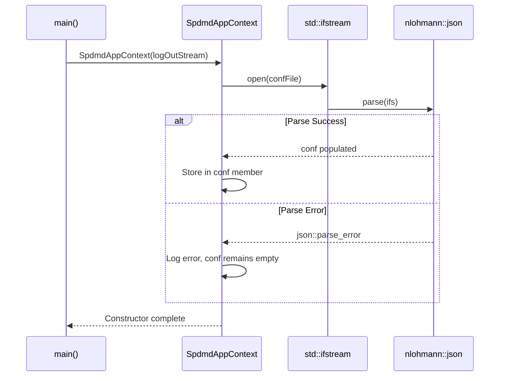
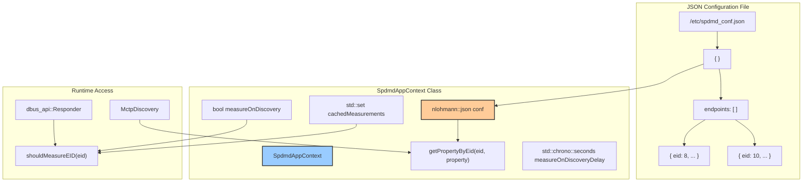
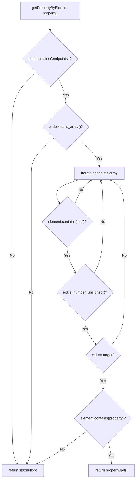
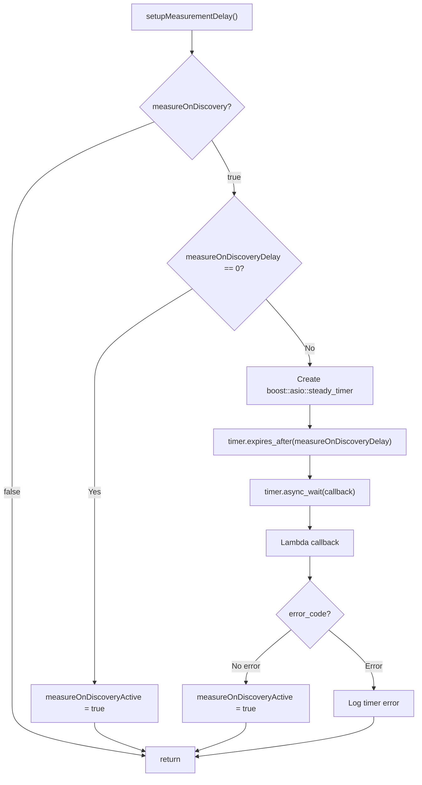
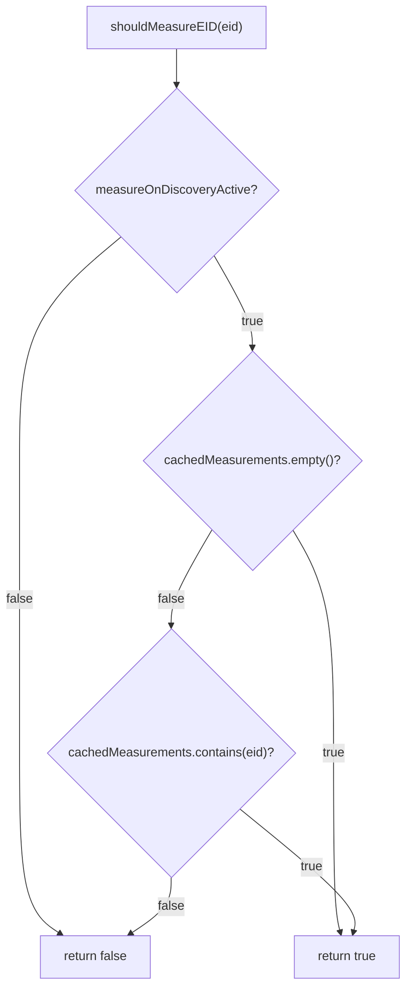
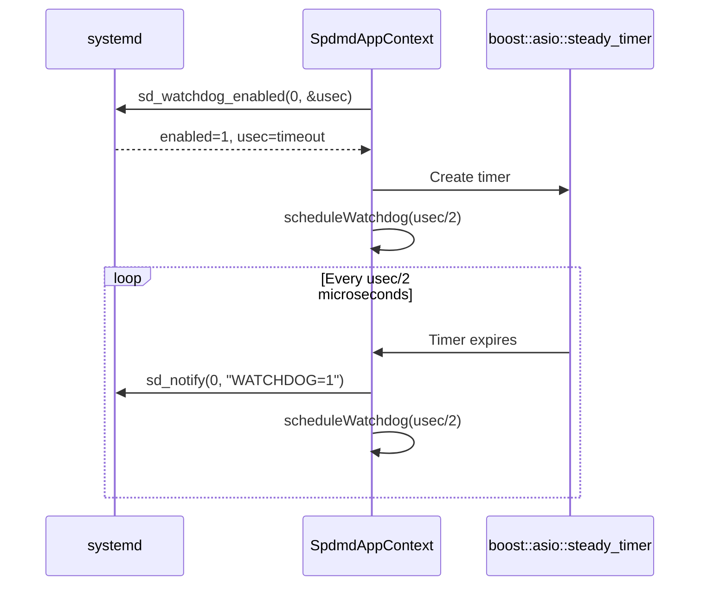

<!-- source: DeepWiki mcp.deepwiki.com · repo NVIDIA/spdm · page 6.2 Runtime Configuration · fetched 2026-10-26 -->

# Runtime Configuration

<details>
<summary>Relevant source files</summary>

The following files were used as context for generating this wiki page:

- [spdmd/spdmd_app_context.cpp](spdmd/spdmd_app_context.cpp)
- [spdmd/spdmd_app_context.hpp](spdmd/spdmd_app_context.hpp)

</details>


This page documents the runtime configuration system for the `spdmd` daemon, focusing on the `/etc/spdmd_conf.json` configuration file format, per-endpoint (EID) property customization, and automatic measurement settings. For compile-time build options that affect daemon behavior, see [Build Options and Compilation](#6.1). For the daemon's application architecture and context management, see [Application Context](#3.1.1).

## Overview

The `spdmd` daemon reads its runtime configuration from a JSON file during startup. The `SpdmdAppContext` class [spdmd/spdmd_app_context.hpp:46-199]() is responsible for loading, parsing, and providing access to this configuration throughout the daemon's lifetime. Configuration includes per-endpoint properties, automatic measurement settings, and timing parameters.

**Sources:** [spdmd/spdmd_app_context.hpp:46-199](), [spdmd/spdmd_app_context.cpp:28-40]()

## Configuration File Location and Loading

### File Path

The configuration file path is determined at compile time via the `SPDM_JSON_CONF_FILE_NAME` preprocessor definition [spdmd/spdmd_app_context.hpp:48](). By default, this is `/etc/spdmd_conf.json`.

### Loading Process

Configuration loading occurs in the `SpdmdAppContext` constructor [spdmd/spdmd_app_context.cpp:28-40]():



**Sources:** [spdmd/spdmd_app_context.cpp:28-40]()

The loading process is fault-tolerant: if the configuration file is missing or contains invalid JSON, the daemon logs an error but continues operation with default settings.

## JSON Configuration Structure

### Top-Level Schema

The configuration file is a JSON object with the following top-level structure:

| Field | Type | Required | Description |
|-------|------|----------|-------------|
| `endpoints` | Array | No | Array of per-EID configuration objects |

### Endpoints Array Structure

Each element in the `endpoints` array represents configuration for a specific MCTP Endpoint ID (EID):

| Field | Type | Required | Description |
|-------|------|----------|-------------|
| `eid` | Unsigned Integer | Yes | MCTP Endpoint ID (0-255) |
| *(custom)* | Any | No | Application-defined properties |

The configuration system supports arbitrary per-EID properties that can be queried at runtime using the `getPropertyByEid<T>()` template method.

**Sources:** [spdmd/spdmd_app_context.hpp:86-124]()

### Configuration-to-Code Mapping



**Sources:** [spdmd/spdmd_app_context.hpp:46-199](), [spdmd/spdmd_app_context.cpp:1-190]()

## Per-Endpoint Property Access

### getPropertyByEid Template Method

The `getPropertyByEid<T>()` method [spdmd/spdmd_app_context.hpp:86-124]() provides type-safe access to endpoint-specific configuration properties:

```cpp
template <typename T>
std::optional<T> getPropertyByEid(uint8_t eid, const std::string& property) const
```

**Parameters:**
- `eid`: The MCTP Endpoint ID to query
- `property`: The property name as a string
- `T`: The expected type of the property value

**Return Value:**
- `std::optional<T>` containing the property value if found, or `std::nullopt` if:
  - The `endpoints` array doesn't exist
  - No endpoint with matching EID is found
  - The property doesn't exist for that endpoint
  - Type conversion fails

### Property Lookup Algorithm



**Sources:** [spdmd/spdmd_app_context.hpp:86-124]()

## Automatic Measurement Configuration

The daemon supports automatic SPDM measurement collection for newly discovered endpoints. This behavior is controlled by several configuration parameters and internal state variables.

### Configuration Members

| Member | Type | Default | Description |
|--------|------|---------|-------------|
| `measureOnDiscovery` | `bool` | `false` | Enable automatic measurements on endpoint discovery |
| `measureOnDiscoveryDelay` | `std::chrono::seconds` | `60` | Delay after daemon start before automatic measurements begin |
| `cachedMeasurements` | `std::set<uint8_t>` | empty | Set of EIDs to measure; empty means measure all endpoints |
| `measureOnDiscoveryActive` | `bool` | `false` | Internal flag indicating delay has elapsed |

**Sources:** [spdmd/spdmd_app_context.hpp:150-163]()

### Measurement Delay Timer

The `setupMeasurementDelay()` method [spdmd/spdmd_app_context.cpp:139-164]() configures the automatic measurement timer:



**Sources:** [spdmd/spdmd_app_context.cpp:139-164]()

### shouldMeasureEID Decision Logic

The `shouldMeasureEID(uint8_t eid)` method [spdmd/spdmd_app_context.cpp:42-58]() determines whether a given endpoint should be automatically measured:



**Logic Summary:**
1. If `measureOnDiscoveryActive` is `false`, return `false` (delay not elapsed or feature disabled)
2. If `cachedMeasurements` is empty, return `true` (measure all endpoints)
3. If `cachedMeasurements` contains the EID, return `true` (measure this specific endpoint)
4. Otherwise, return `false`

**Sources:** [spdmd/spdmd_app_context.cpp:42-58]()

## Configuration Examples

### Minimal Configuration

Empty configuration file (uses all defaults):

```json
{}
```

### Per-Endpoint Properties

Configuration with custom properties for specific endpoints:

```json
{
  "endpoints": [
    {
      "eid": 8,
      "description": "GPU 0",
      "custom_timeout": 5000
    },
    {
      "eid": 10,
      "description": "GPU 1",
      "custom_timeout": 3000
    }
  ]
}
```

Accessing these properties from code:

```cpp
auto timeout = appContext.getPropertyByEid<int>(8, "custom_timeout");
if (timeout) {
    // Use timeout.value()
}
```

### Automatic Measurement Configuration

Example showing measurement configuration (note: these properties would need to be read during daemon initialization via custom code, as they're not automatically parsed):

```json
{
  "measureOnDiscovery": true,
  "measureOnDiscoveryDelay": 120,
  "cachedMeasurements": [8, 10, 12],
  "endpoints": [
    {
      "eid": 8,
      "name": "Primary GPU"
    },
    {
      "eid": 10,
      "name": "Secondary GPU"
    }
  ]
}
```

**Sources:** [spdmd/spdmd_app_context.hpp:150-163](), [spdmd/spdmd_app_context.cpp:42-58]()

## D-Bus Connection and Watchdog Integration

The `SpdmdAppContext` also manages D-Bus connection initialization and systemd watchdog integration through the `connectDBus()` method [spdmd/spdmd_app_context.cpp:122-137]().

### D-Bus Connection

The `connectDBus(busName)` method:
1. Starts the systemd watchdog timer via `startWatchdog()` [spdmd/spdmd_app_context.cpp:166-175]()
2. Creates either a default or system bus connection (controlled by `USE_DEFAULT_DBUS` compile-time flag)
3. Requests the specified bus name
4. Stores the connection in the `conn` member variable

### Watchdog Timer

The watchdog mechanism [spdmd/spdmd_app_context.cpp:166-188]() integrates with systemd's service supervision:



**Watchdog Logic:**
- Checks if systemd watchdog is enabled via `sd_watchdog_enabled()`
- If enabled, creates a recurring timer at half the watchdog interval
- Periodically sends `WATCHDOG=1` notification to systemd via `sd_notify()`
- Uses `boost::asio::steady_timer` for asynchronous scheduling

**Sources:** [spdmd/spdmd_app_context.cpp:122-188]()

## Runtime Access Patterns

### From Discovery Subsystem

The `MctpDiscovery` class uses `getPropertyByEid()` to retrieve endpoint-specific configuration when creating or updating responder instances.

### From Responder Management

The daemon's responder lifecycle management checks `shouldMeasureEID()` when a new endpoint is discovered to determine whether to automatically trigger an SPDM measurement refresh cycle.

**Sources:** [spdmd/spdmd_app_context.hpp:86-124](), [spdmd/spdmd_app_context.cpp:42-58]()

## Summary Table: Configuration Access Methods

| Method | Purpose | Defined In |
|--------|---------|------------|
| `getPropertyByEid<T>(eid, property)` | Retrieve typed property for specific EID | [spdmd/spdmd_app_context.hpp:86-124]() |
| `shouldMeasureEID(eid)` | Check if EID should be auto-measured | [spdmd/spdmd_app_context.cpp:42-58]() |
| `setupMeasurementDelay()` | Configure measurement delay timer | [spdmd/spdmd_app_context.cpp:139-164]() |
| `connectDBus(busName)` | Initialize D-Bus connection and watchdog | [spdmd/spdmd_app_context.cpp:122-137]() |
| `getLog()` | Access logging interface | [spdmd/spdmd_app_context.hpp:78-81]() |
| `getConn()` | Access D-Bus connection | [spdmd/spdmd_app_context.hpp:127-130]() |
| `getIo()` | Access boost::asio::io_context | [spdmd/spdmd_app_context.hpp:133-136]() |
| `loop()` | Enter main event loop | [spdmd/spdmd_app_context.hpp:139-142]() |

**Sources:** [spdmd/spdmd_app_context.hpp:46-199]()