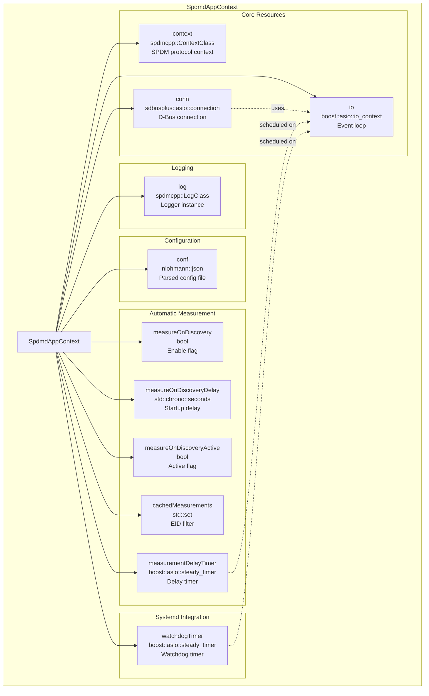
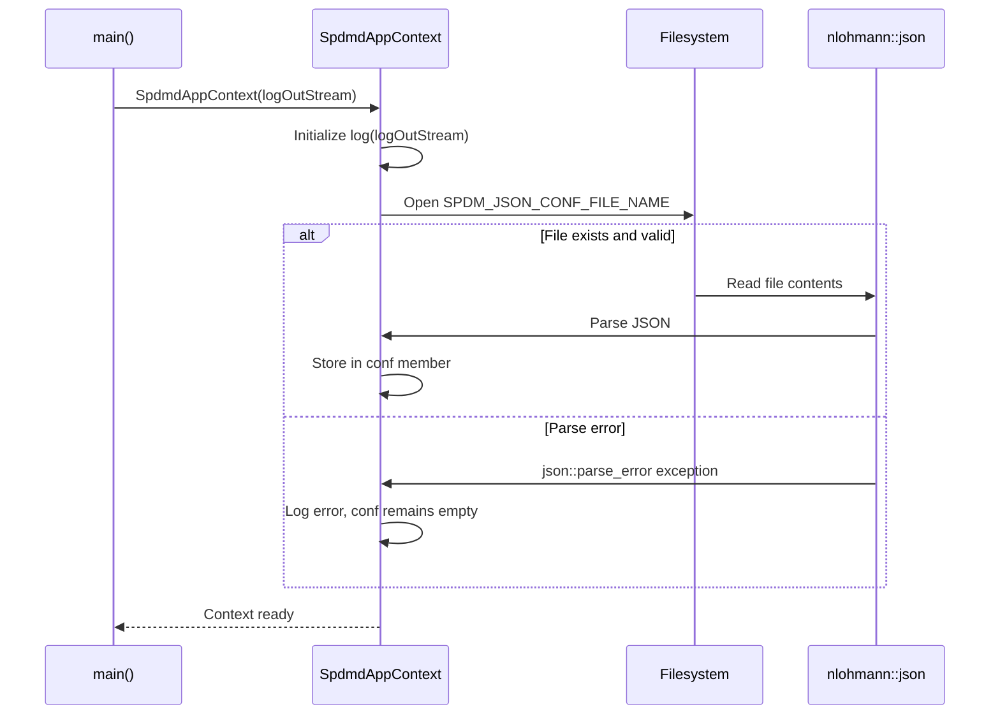
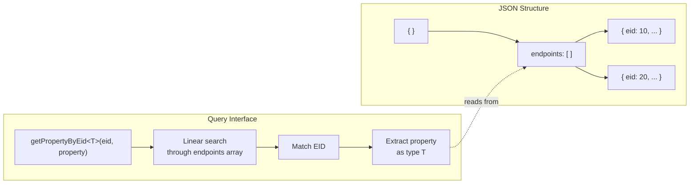
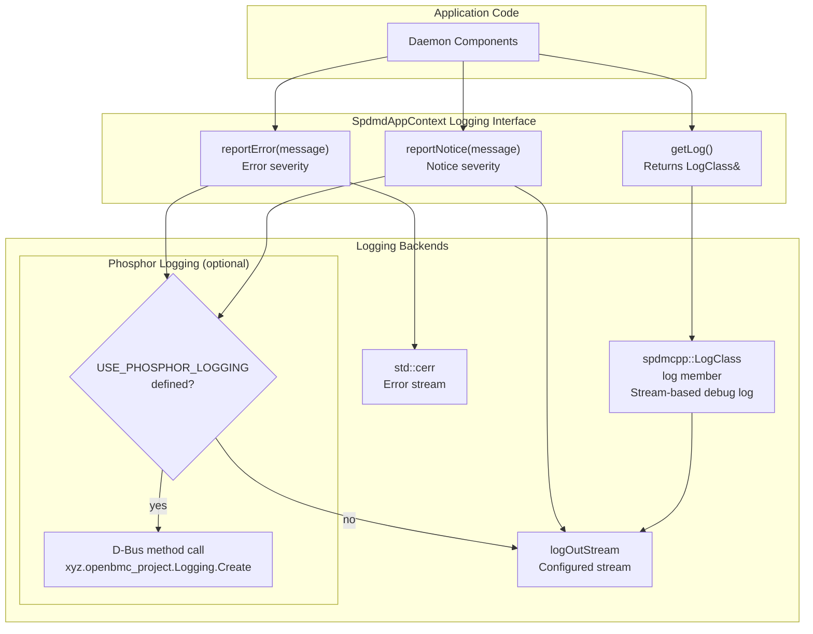
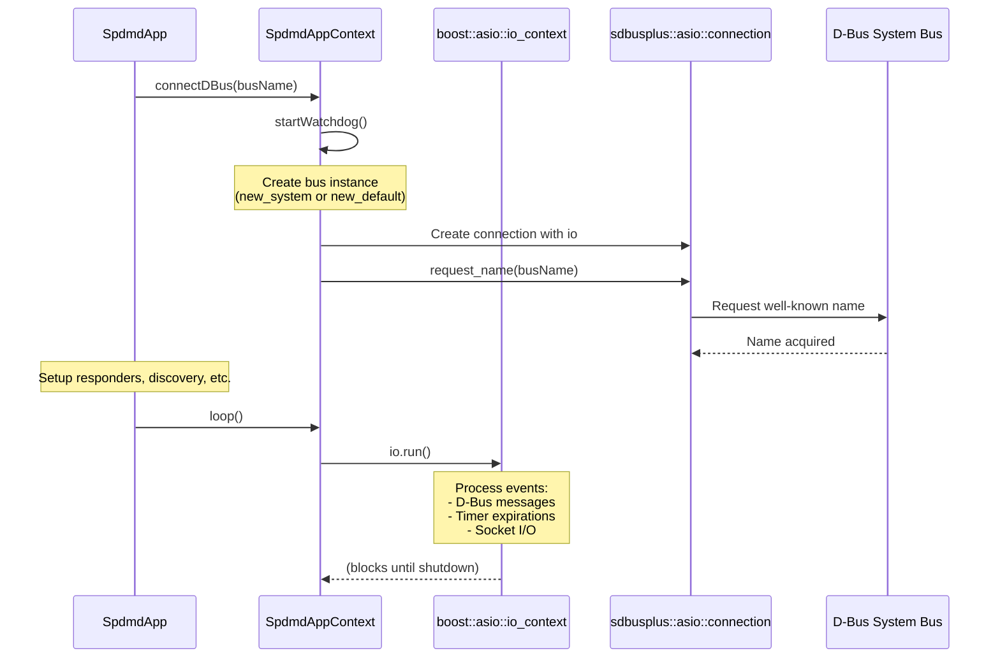
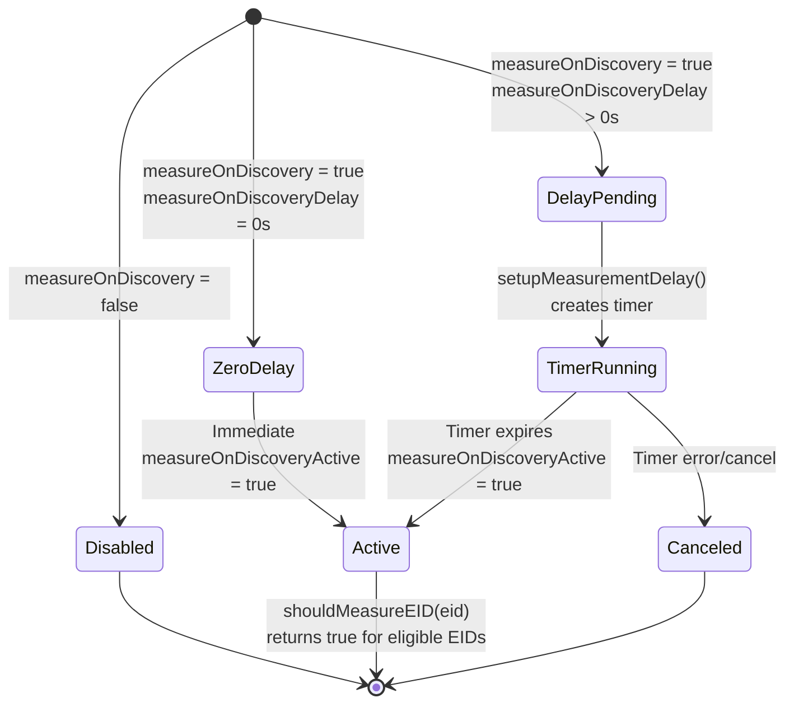
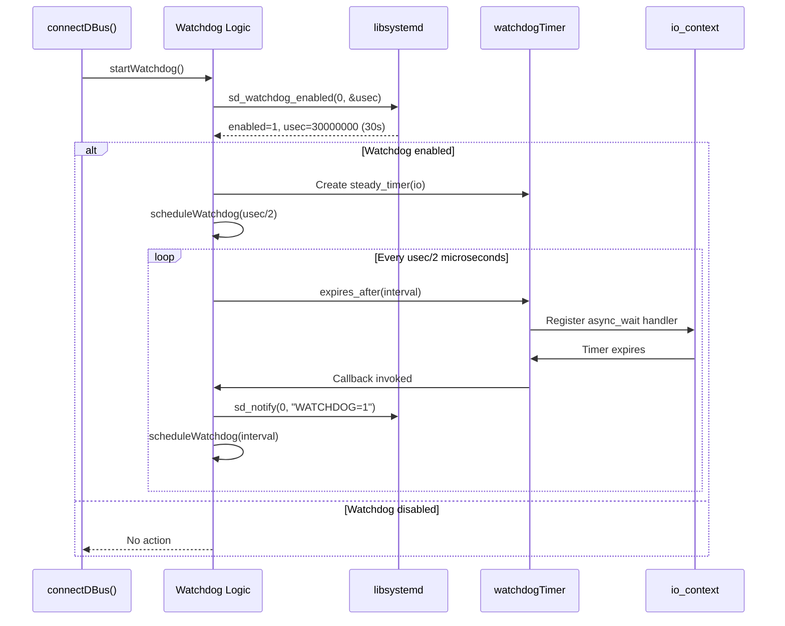

<!-- source: DeepWiki mcp.deepwiki.com · repo NVIDIA/spdm · extra page Application Context · fetched 2026-10-26 -->

# Application Context

<details>
<summary>Relevant source files</summary>

The following files were used as context for generating this wiki page:

- [spdmd/spdmd_app_context.cpp](spdmd/spdmd_app_context.cpp)
- [spdmd/spdmd_app_context.hpp](spdmd/spdmd_app_context.hpp)

</details>


## Purpose and Scope

The `SpdmdAppContext` class serves as the central resource manager and configuration holder for the spdmd daemon. It owns critical infrastructure components including the asio event loop, D-Bus connection, SPDM protocol context, logging system, and configuration data. This page documents the initialization, resource management, and service coordination provided by this context object.

For information about how SpdmdApp uses this context to manage responder lifecycles, see [Responder Lifecycle Management](#3.1.2). For details on the D-Bus interfaces exposed through this context's connection, see [D-Bus Responder Interface](#3.2).

---

## Class Structure and Ownership

The `SpdmdAppContext` class consolidates all global daemon resources into a single object that is constructed early in the daemon's lifecycle and passed to other components.



**Resource Ownership Model**

| Member | Type | Ownership | Purpose |
|--------|------|-----------|---------|
| `context` | `spdmcpp::ContextClass` | Owned | SPDM protocol configuration and IO registry |
| `io` | `boost::asio::io_context` | Owned | Asio event loop for async operations |
| `conn` | `std::unique_ptr<sdbusplus::asio::connection>` | Owned | D-Bus system bus connection |
| `log` | `spdmcpp::LogClass` | Owned | Logging backend for debug output |
| `conf` | `nlohmann::json` | Owned | Parsed configuration from JSON file |
| `measurementDelayTimer` | `std::unique_ptr<boost::asio::steady_timer>` | Owned | Timer for measurement startup delay |
| `watchdogTimer` | `std::unique_ptr<boost::asio::steady_timer>` | Owned | Timer for systemd watchdog notifications |

The class explicitly deletes copy and move operations [spdmd/spdmd_app_context.hpp:55-58](), ensuring singleton-like behavior where only one context exists per daemon instance.

**Sources:** [spdmd/spdmd_app_context.hpp:46-199]()

---

## Initialization and Construction

The `SpdmdAppContext` constructor performs early initialization of logging and configuration loading.



**Constructor Sequence** [spdmd/spdmd_app_context.cpp:28-40]():

1. **Logging Initialization**: The `log` member is initialized with the provided `logOutStream`, typically `std::cout` for the daemon
2. **Configuration Loading**: The JSON configuration file path is read from the `SPDM_JSON_CONF_FILE_NAME` macro (defined in `config.h`)
3. **Error Handling**: If the file cannot be parsed, an error is logged but the constructor succeeds with an empty `conf` object

The configuration file path is compile-time configurable via the Meson build option `json-conf-file-name` [spdmd/spdmd_app_context.hpp:48]().

**Sources:** [spdmd/spdmd_app_context.cpp:28-40](), [spdmd/spdmd_app_context.hpp:54]()

---

## JSON Configuration System

The context provides a type-safe templated interface for querying per-endpoint configuration properties.



**Configuration Query Method** [spdmd/spdmd_app_context.hpp:86-124]():

The `getPropertyByEid<T>()` template method implements the following algorithm:

1. **Validate Structure**: Check that the root object contains an `"endpoints"` key and it is an array
2. **Iterate Endpoints**: Loop through each endpoint object in the array
3. **Match EID**: For each endpoint, verify it has an `"eid"` key that is an unsigned number matching the requested EID
4. **Extract Property**: If a match is found and the property exists, extract it as type `T` using `json::get<T>()`
5. **Return Optional**: Return `std::optional<T>` - containing the value if found, or `std::nullopt` if not

**Example Configuration Structure**:

```json
{
  "endpoints": [
    {
      "eid": 10,
      "autoRefreshInterval": 3600,
      "enableCaching": true
    },
    {
      "eid": 20,
      "autoRefreshInterval": 7200
    }
  ]
}
```

**Usage Pattern**:

```cpp
auto interval = appContext.getPropertyByEid<int>(eid, "autoRefreshInterval");
if (interval.has_value()) {
    // Use interval.value()
}
```

**Sources:** [spdmd/spdmd_app_context.hpp:86-124]()

---

## Logging System Integration

The context provides a dual logging strategy: local debug logging via `LogClass` and optional phosphor-logging integration for system-level events.



**Logging Methods**:

| Method | Severity | Local Output | Phosphor Integration |
|--------|----------|--------------|---------------------|
| `getLog()` | All levels | Returns `LogClass&` for direct usage | N/A |
| `reportError()` | Error | `std::cerr` if `log.logLevel >= Error` | Creates Error-level log entry |
| `reportNotice()` | Notice | `log.getOstream()` if `log.logLevel >= Notice` | Creates Notice-level log entry |

**Phosphor Logging Details** [spdmd/spdmd_app_context.cpp:60-120]():

When `USE_PHOSPHOR_LOGGING` is defined (note: currently disabled at [spdmd/spdmd_app_context.hpp:39]()), the `reportLog()` method creates D-Bus log entries with:
- Message text
- Severity level (Error, Notice, etc.)
- Additional metadata: resolution text ("Contact NVIDIA Support" for errors), timestamp, namespace ("spdmd")
- D-Bus method call to `xyz.openbmc_project.Logging.Create`

The logging integration allows spdmd to participate in the broader OpenBMC event logging infrastructure for production deployments while maintaining human-readable console output for development.

**Sources:** [spdmd/spdmd_app_context.hpp:61-81](), [spdmd/spdmd_app_context.cpp:60-120]()

---

## Event Loop and D-Bus Connection Management

The context manages the asio event loop and D-Bus connection lifecycle.



**Connection Initialization** [spdmd/spdmd_app_context.cpp:122-137]():

The `connectDBus()` method:
1. Calls `startWatchdog()` to initialize systemd watchdog if enabled
2. Creates either a default bus (`sdbusplus::bus::new_default()`) or system bus (`sdbusplus::bus::new_system()`) based on compile-time configuration
3. Constructs the asio-integrated connection: `sdbusplus::asio::connection(io)`
4. Requests the provided well-known bus name (typically `"com.nvidia.spdm"`)

**Event Loop Execution** [spdmd/spdmd_app_context.hpp:139-142]():

The `loop()` method simply delegates to `io.run()`, which blocks and processes:
- Asynchronous D-Bus method calls and signals
- Timer expirations (measurement delay, watchdog)
- MCTP socket I/O events (via registered handlers)

All asynchronous operations in the daemon share this single event loop, ensuring single-threaded execution without explicit locking in most cases.

**Sources:** [spdmd/spdmd_app_context.cpp:122-137](), [spdmd/spdmd_app_context.hpp:126-142]()

---

## Automatic Measurement Delay Mechanism

The context implements a configurable delay before enabling automatic measurements, allowing the system to stabilize after boot.



**Delay Configuration** [spdmd/spdmd_app_context.hpp:150-163]():

The automatic measurement system uses four state variables:
- `measureOnDiscovery`: Master enable flag
- `measureOnDiscoveryDelay`: Startup delay duration (default 60 seconds)
- `measureOnDiscoveryActive`: Indicates delay has passed and measurements are enabled
- `cachedMeasurements`: Set of EIDs to measure (empty means "all EIDs")

**Timer Setup** [spdmd/spdmd_app_context.cpp:139-164]():

The `setupMeasurementDelay()` method implements the following logic:

1. **Early Exit**: If `measureOnDiscovery` is false, return immediately
2. **Zero Delay**: If `measureOnDiscoveryDelay` is zero, immediately set `measureOnDiscoveryActive = true`
3. **Timer Creation**: Otherwise, create a `boost::asio::steady_timer` on the io_context
4. **Expiration Setup**: Set the timer to expire after `measureOnDiscoveryDelay`
5. **Completion Handler**: On expiration, set `measureOnDiscoveryActive = true`

**EID Filtering** [spdmd/spdmd_app_context.cpp:42-58]():

The `shouldMeasureEID()` method determines if a specific endpoint should be measured:
- Returns `false` if `measureOnDiscoveryActive` is false
- Returns `true` if `cachedMeasurements` is empty (meaning "all" was selected)
- Returns `true` if the EID exists in `cachedMeasurements`
- Returns `false` otherwise

This mechanism allows the daemon to defer expensive SPDM measurement operations until the system has fully booted, reducing startup time and avoiding potential race conditions with other services.

**Sources:** [spdmd/spdmd_app_context.cpp:42-58](), [spdmd/spdmd_app_context.cpp:139-164](), [spdmd/spdmd_app_context.hpp:150-169]()

---

## Systemd Watchdog Integration

The context implements systemd watchdog support to enable automatic recovery from daemon hangs.



**Watchdog Initialization** [spdmd/spdmd_app_context.cpp:166-175]():

The `startWatchdog()` method:
1. Calls `sd_watchdog_enabled(0, &usec)` to query systemd watchdog configuration
2. If enabled (`returned value > 0`) and timeout is specified (`usec > 0`):
   - Creates a `boost::asio::steady_timer` on the io_context
   - Schedules the first notification at `usec/2` (half the watchdog timeout)

**Watchdog Notification Loop** [spdmd/spdmd_app_context.cpp:177-188]():

The `scheduleWatchdog()` method implements a self-rescheduling timer:
1. Sets timer expiration to the provided interval
2. Registers an async_wait handler
3. On expiration:
   - Calls `sd_notify(0, "WATCHDOG=1")` to notify systemd that the daemon is alive
   - Recursively calls `scheduleWatchdog(interval)` to reschedule
4. If the timer is canceled or an error occurs, the loop terminates

**Watchdog Timing Strategy**:
- Systemd typically configures watchdog timeout via `WatchdogSec=` in the service unit file
- The daemon notifies at half the timeout interval to provide safety margin
- Example: If `WatchdogSec=30s`, the daemon notifies every 15 seconds
- If notifications stop (daemon hangs), systemd automatically restarts the service after 30 seconds

This mechanism ensures daemon reliability in production deployments, particularly in embedded BMC environments where manual intervention is costly.

**Sources:** [spdmd/spdmd_app_context.cpp:166-188]()

---

## Public Interface Summary

The `SpdmdAppContext` class exposes the following public interface for use by `SpdmdApp` and other daemon components:

**Resource Access Methods**:
- `getLog()`: Returns reference to `spdmcpp::LogClass` for debug logging [spdmd/spdmd_app_context.hpp:78-81]()
- `getConn()`: Returns reference to D-Bus connection [spdmd/spdmd_app_context.hpp:126-130]()
- `getIo()`: Returns reference to asio io_context [spdmd/spdmd_app_context.hpp:132-136]()

**Configuration Methods**:
- `getPropertyByEid<T>(eid, property)`: Query per-endpoint configuration [spdmd/spdmd_app_context.hpp:86-124]()

**Logging Methods**:
- `reportError(message)`: Log error-level message [spdmd/spdmd_app_context.hpp:62-66]()
- `reportNotice(message)`: Log notice-level message [spdmd/spdmd_app_context.hpp:68-73]()

**Lifecycle Methods**:
- `connectDBus(busName)`: Initialize D-Bus connection and request name [spdmd/spdmd_app_context.cpp:122-137]()
- `loop()`: Run the asio event loop (blocks) [spdmd/spdmd_app_context.hpp:139-142]()

**Protected Methods** (used by derived classes or SpdmdApp):
- `shouldMeasureEID(eid)`: Check if automatic measurement should occur for an EID [spdmd/spdmd_app_context.cpp:42-58]()
- `setupMeasurementDelay()`: Initialize measurement delay timer [spdmd/spdmd_app_context.cpp:139-164]()

**Public Members**:
- `context`: The `spdmcpp::ContextClass` instance containing SPDM protocol configuration and IO registry [spdmd/spdmd_app_context.hpp:52]()

**Sources:** [spdmd/spdmd_app_context.hpp:46-199]()

---

