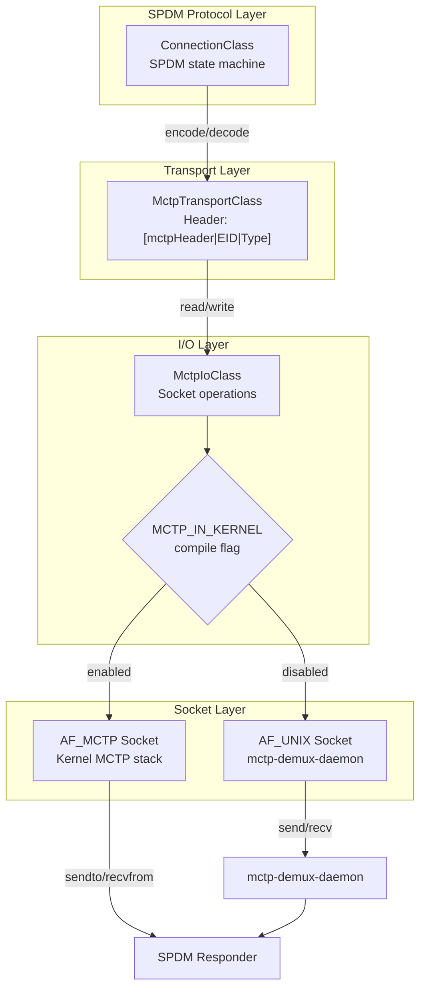
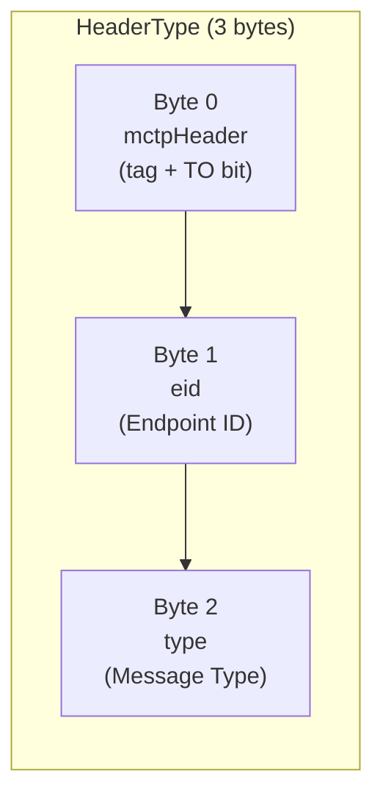
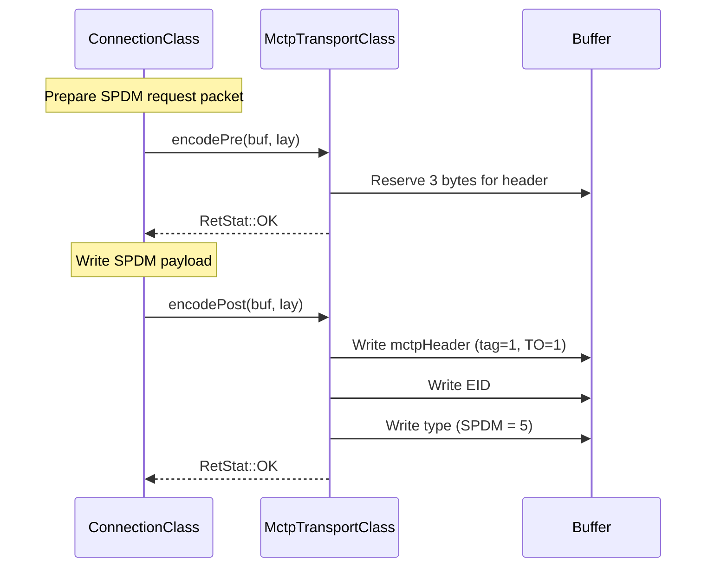
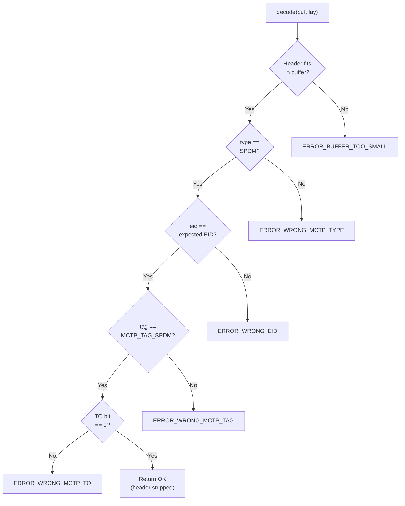
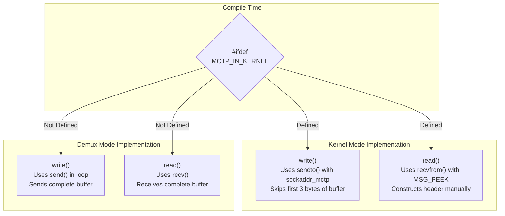
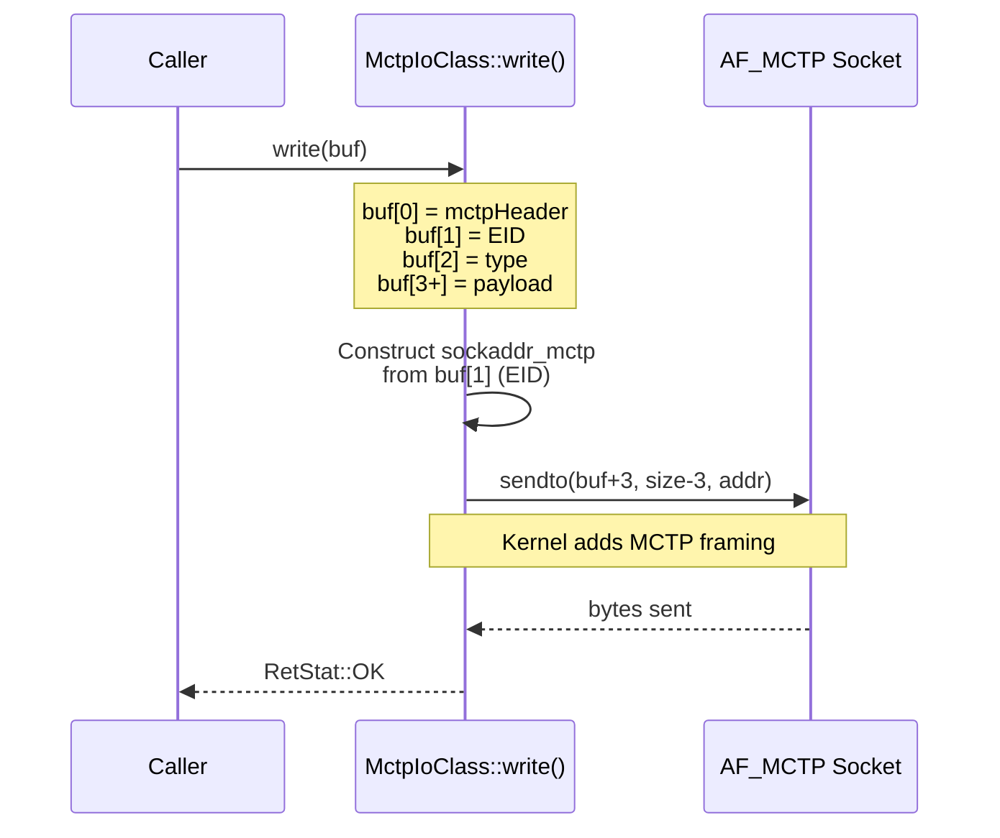
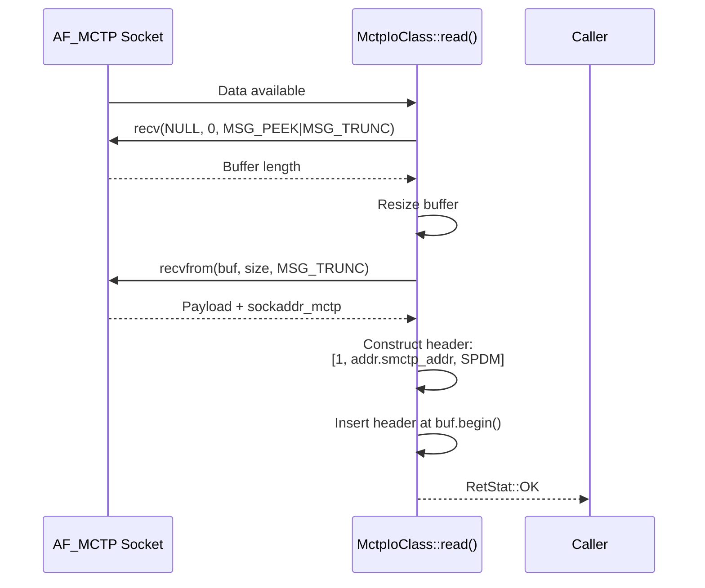
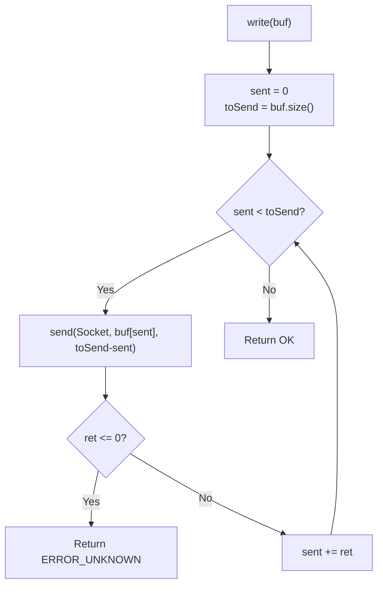

<!-- source: DeepWiki mcp.deepwiki.com · repo NVIDIA/spdm · extra page MCTP Transport Implementation · fetched 2026-10-26 -->

# MCTP Transport Implementation

<details>
<summary>Relevant source files</summary>

The following files were used as context for generating this wiki page:

- [libspdmcpp/headers_public/spdmcpp/log.hpp](libspdmcpp/headers_public/spdmcpp/log.hpp)
- [libspdmcpp/headers_public/spdmcpp/mctp_support.hpp](libspdmcpp/headers_public/spdmcpp/mctp_support.hpp)

</details>


## Purpose and Scope

This document details the MCTP (Management Component Transport Protocol) transport layer implementation in libspdmcpp, specifically the `MctpTransportClass` and `MctpIoClass` components. These classes provide SPDM message framing and socket-based I/O for communication with SPDM responder devices over MCTP.

For higher-level transport abstraction interfaces, see [Transport Layer Abstraction](#2.2). For the complete SPDM protocol flow that uses this transport, see [ConnectionClass and Protocol Flow](#2.1).

**Sources:** [libspdmcpp/headers_public/spdmcpp/mctp_support.hpp:1-539]()

---

## Architecture Overview

The MCTP transport implementation consists of two primary classes that implement abstract interfaces defined in the transport layer:

| Class | Base Interface | Responsibility |
|-------|---------------|----------------|
| `MctpTransportClass` | `TransportClass` | MCTP message framing (header encode/decode) |
| `MctpIoClass` | `IOClass` | Socket operations (read/write with timeout support) |

Both classes work together in the protocol stack:



**Sources:** [libspdmcpp/headers_public/spdmcpp/mctp_support.hpp:56-365]()

---

## MctpTransportClass

The `MctpTransportClass` implements MCTP message framing by managing a 3-byte header that precedes SPDM payload data.

### MCTP Header Structure

The `HeaderType` structure defines the MCTP transport header:



| Field | Offset | Size | Description |
|-------|--------|------|-------------|
| `mctpHeader` | 0 | 1 byte | Bits [2:0]: MCTP tag (set to `MCTP_TAG_SPDM` = 1)<br/>Bit [3]: TO (Tag Owner) bit (set to 1) |
| `eid` | 1 | 1 byte | MCTP Endpoint ID of the target responder |
| `type` | 2 | 1 byte | MCTP message type (set to `MCTPMessageTypeEnum::SPDM` = 5) |

**Sources:** [libspdmcpp/headers_public/spdmcpp/mctp_support.hpp:153-190]()

### Encoding Flow

The encoding process occurs in two phases coordinated by the `ConnectionClass`:



**`encodePre()`** [libspdmcpp/headers_public/spdmcpp/mctp_support.hpp:66-70]()
- Reserves space for the 3-byte header by setting `lay.Size = sizeof(HeaderType)`
- Called before the SPDM payload is written

**`encodePost()`** [libspdmcpp/headers_public/spdmcpp/mctp_support.hpp:71-78]()
- Fills in the header fields:
  - `mctpTag()` sets tag to `MCTP_TAG_SPDM` (1) and TO bit (0x08)
  - `eid` set to the target endpoint ID from constructor
  - `type` set to `MCTPMessageTypeEnum::SPDM`

**Sources:** [libspdmcpp/headers_public/spdmcpp/mctp_support.hpp:66-78]()

### Decoding Flow

The `decode()` method validates and strips the MCTP header from received messages:



Validation errors return specific `RetStat` codes:
- `ERROR_BUFFER_TOO_SMALL`: Buffer doesn't contain full header
- `ERROR_WRONG_MCTP_TYPE`: Message type is not SPDM
- `ERROR_WRONG_EID`: EID doesn't match the expected endpoint
- `ERROR_WRONG_MCTP_TAG`: Tag is not `MCTP_TAG_SPDM`
- `ERROR_WRONG_MCTP_TO`: TO bit is set (expected cleared for received messages)

**Sources:** [libspdmcpp/headers_public/spdmcpp/mctp_support.hpp:80-105]()

### EID Peeking for Routing

The static `peekEid()` method allows extracting the endpoint ID from a buffer without full validation, enabling packet routing to the correct `Responder` instance:


This is used by `spdmd` to determine which `Responder` object should handle an incoming MCTP message.

**Sources:** [libspdmcpp/headers_public/spdmcpp/mctp_support.hpp:117-140]()

---

## MctpIoClass

The `MctpIoClass` handles socket creation and I/O operations, supporting two distinct transport modes selected at compile time.

### Socket Creation

`MctpIoClass` provides two `createSocket()` overloads:

**Kernel Mode (no arguments)** [libspdmcpp/headers_public/spdmcpp/mctp_support.hpp:224-266]()

```cpp
bool createSocket()
```

Creates an `AF_MCTP` socket and binds it:
1. Creates socket with `socket(AF_MCTP, SOCK_DGRAM, 0)`
2. Binds to `sockaddr_mctp` with:
   - `smctp_network = MCTP_NET_ANY`
   - `smctp_addr = MCTP_ADDR_ANY`
   - `smctp_type = MCTP_TYPE_SPDM` (5)
   - `smctp_tag = MCTP_TAG_OWNER`

**Demux Daemon Mode (with path)** [libspdmcpp/headers_public/spdmcpp/mctp_support.hpp:280-335]()

```cpp
bool createSocket(const std::string& path)
```

Creates an `AF_UNIX` socket and connects to mctp-demux-daemon:
1. Creates socket with `socket(AF_UNIX, SOCK_SEQPACKET, 0)`
2. Connects to UNIX domain socket at `path` (typically abstract namespace)
3. Writes message type (`MCTPMessageTypeEnum::SPDM`) to register with daemon

**Sources:** [libspdmcpp/headers_public/spdmcpp/mctp_support.hpp:224-335]()

### Dual-Mode Architecture

The `MCTP_IN_KERNEL` compile-time flag determines which implementation of `write()` and `read()` is compiled:



**Sources:** [libspdmcpp/headers_public/spdmcpp/mctp_support.hpp:367-536]()

---

## Transport Modes

### Kernel Mode (AF_MCTP)

When `MCTP_IN_KERNEL` is defined, the implementation uses the Linux kernel's MCTP socket interface.

**`write()` Implementation** [libspdmcpp/headers_public/spdmcpp/mctp_support.hpp:382-407]()



Key details:
- Skips first 3 bytes (`buf.data() + 3, buf.size() - 3`) as kernel handles MCTP framing
- Extracts EID from `buf[1]` to populate `sockaddr_mctp.smctp_addr.s_addr`
- Sets `smctp_tag = MCTP_TAG_OWNER`

**`read()` Implementation** [libspdmcpp/headers_public/spdmcpp/mctp_support.hpp:425-459]()



Key details:
- First peeks message size with `MSG_PEEK | MSG_TRUNC`
- Receives payload without MCTP header (kernel strips it)
- Manually constructs 3-byte header from `sockaddr_mctp` and inserts at beginning

**Sources:** [libspdmcpp/headers_public/spdmcpp/mctp_support.hpp:367-459]()

### Demux Daemon Mode (AF_UNIX)

When `MCTP_IN_KERNEL` is not defined, communication goes through the mctp-demux-daemon userspace service.

**`write()` Implementation** [libspdmcpp/headers_public/spdmcpp/mctp_support.hpp:477-500]()



Key details:
- Sends complete buffer including 3-byte MCTP header
- Loops to handle partial sends (socket may accept fewer bytes than requested)
- Daemon forwards message to appropriate MCTP endpoint

**`read()` Implementation** [libspdmcpp/headers_public/spdmcpp/mctp_support.hpp:517-535]()

Simple implementation:
1. Resizes buffer to `mctpMaxMessageSize` (4096 bytes)
2. Calls `recv(Socket, buf.data(), buf.size(), 0)`
3. Resizes buffer to actual received size
4. Returns complete message with MCTP header intact

**Sources:** [libspdmcpp/headers_public/spdmcpp/mctp_support.hpp:461-536]()

### Mode Comparison

| Aspect | Kernel Mode (AF_MCTP) | Demux Daemon Mode (AF_UNIX) |
|--------|----------------------|----------------------------|
| Socket Family | `AF_MCTP` | `AF_UNIX` (SOCK_SEQPACKET) |
| Socket Creation | `createSocket()` with bind | `createSocket(path)` with connect |
| Header Handling (TX) | Kernel adds header, skip 3 bytes | Include full header in send |
| Header Handling (RX) | Kernel strips header, reconstruct it | Receive full header |
| Routing | Kernel routes by EID in sockaddr | Daemon routes by connection |
| Message Integrity | SOCK_DGRAM (datagram) | SOCK_SEQPACKET (sequenced packets) |
| Partial Sends | Single `sendto()` | Loop until complete |
| Size Discovery | `MSG_PEEK` before receive | Buffer to max size, resize after |
| Configuration Flag | `MCTP_IN_KERNEL` defined | `MCTP_IN_KERNEL` not defined |

**Sources:** [libspdmcpp/headers_public/spdmcpp/mctp_support.hpp:224-536]()

---

## Error Handling and Return Codes

Both `MctpTransportClass` and `MctpIoClass` use the `RetStat` enumeration to indicate operation results.

### Transport-Specific Errors

| Error Code | Condition | Source |
|------------|-----------|--------|
| `ERROR_BUFFER_TOO_SMALL` | Buffer doesn't contain full 3-byte header | `decode()`, `peekEid()` |
| `ERROR_WRONG_MCTP_TYPE` | Message type ≠ `MCTPMessageTypeEnum::SPDM` | `decode()`, `peekEid()` |
| `ERROR_WRONG_EID` | Endpoint ID doesn't match expected value | `decode()` |
| `ERROR_WRONG_MCTP_TAG` | MCTP tag ≠ `MCTP_TAG_SPDM` (1) | `decode()`, `peekEid()` |
| `ERROR_WRONG_MCTP_TO` | TO (Tag Owner) bit is set in received message | `decode()`, `peekEid()` |

### I/O-Specific Errors

| Error Code | Condition | Source |
|------------|-----------|--------|
| `ERROR_UNKNOWN` | Socket send/receive failure (errno logged) | `write()`, `read()` |

All socket errors are logged with the `LogClass` instance, including the errno value and error string from `strerror()`.

**Sources:** [libspdmcpp/headers_public/spdmcpp/mctp_support.hpp:80-105](), [libspdmcpp/headers_public/spdmcpp/mctp_support.hpp:382-535]()

---

## Constants and Configuration

| Constant | Value | Purpose |
|----------|-------|---------|
| `MCTP_TAG_SPDM` | 1 | MCTP tag for SPDM messages |
| `MCTP_TYPE_SPDM` | 5 | MCTP message type for SPDM |
| `mctpMaxMessageSize` | 4096 | Maximum MCTP message size (demux mode) |
| `MCTP_TAG_OWNER` | 0x08 | Tag owner bit (from linux/mctp.h) |

The `MCTPMessageTypeEnum::SPDM` enumeration value equals 5, matching the DMTF MCTP specification for SPDM message types.

**Sources:** [libspdmcpp/headers_public/spdmcpp/mctp_support.hpp:39-49]()

---

