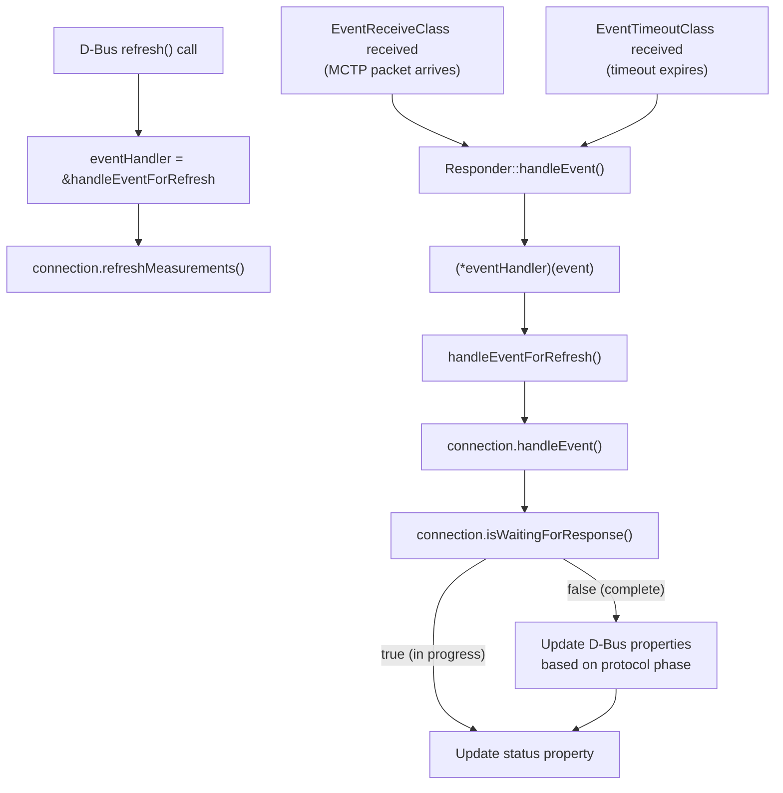
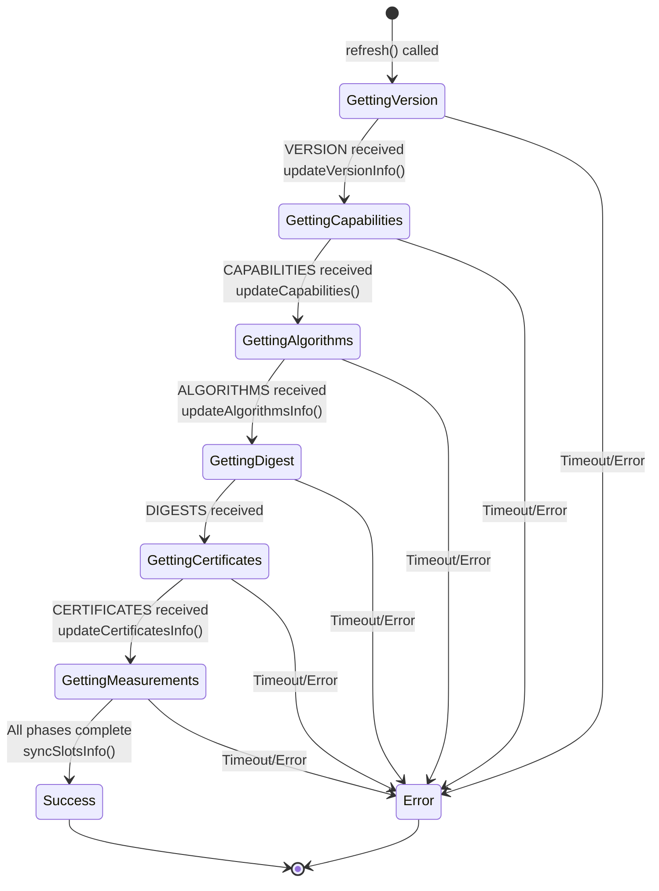
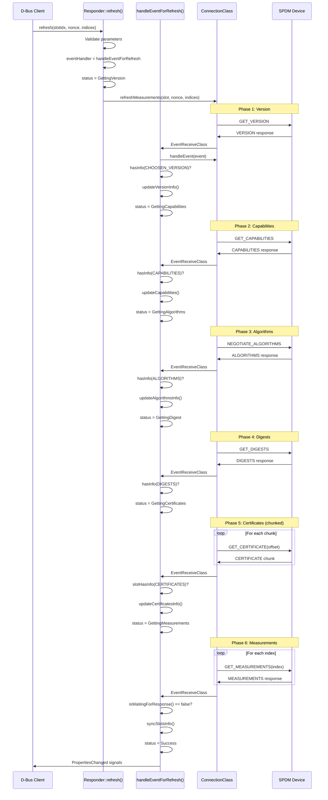
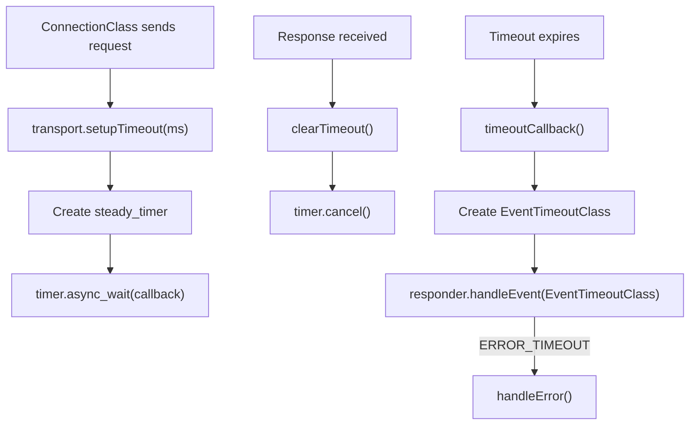

<!-- source: DeepWiki mcp.deepwiki.com · repo NVIDIA/spdm · extra page Refresh Method and Event Handling · fetched 2026-10-26 -->

# Refresh Method and Event Handling

<details>
<summary>Relevant source files</summary>

The following files were used as context for generating this wiki page:

- [spdmd/dbus_impl_responder.cpp](spdmd/dbus_impl_responder.cpp)
- [spdmd/dbus_impl_responder.hpp](spdmd/dbus_impl_responder.hpp)

</details>


## Purpose and Scope

This document explains the `refresh()` D-Bus method implementation in the `dbus_api::Responder` class and the associated event handling mechanism that drives SPDM protocol execution. The `refresh()` method initiates a complete SPDM handshake sequence to retrieve version, capabilities, algorithms, certificates, and measurements from an SPDM responder device. This page focuses on the asynchronous event-driven architecture that coordinates the multi-phase protocol flow.

For details on the D-Bus interfaces and properties exposed by the Responder, see [D-Bus Interfaces and Properties](#3.2.1). For information on how certificates and measurements are processed and stored, see [Certificate and Measurement Data Processing](#3.2.3).

## Refresh Method Overview

The `refresh()` method is the primary D-Bus API for initiating SPDM communication. It is invoked by external clients (such as `spdmutil` or system management services) to trigger a complete SPDM protocol exchange sequence.

### Method Signature and Parameters

The `refresh()` method accepts four parameters:

| Parameter | Type | Description | Validation |
|-----------|------|-------------|------------|
| `slotIndex` | `uint8_t` | Certificate slot index (0-7) | Must be < `ConnectionClass::slotNum` (8) |
| `nonc` | `std::vector<uint8_t>` | Optional 32-byte nonce for measurement signature | Must be empty or exactly 32 bytes |
| `measurementIndices` | `std::vector<uint8_t>` | Measurement indices to retrieve | Empty/[255] means all measurements; individual indices must be < 255 and unique |
| `sessionId` | `uint32_t` | Session identifier (currently unsupported) | Warning logged if non-zero |

The method performs comprehensive parameter validation before initiating the SPDM protocol sequence:

```
Parameter Validation Flow:
1. Check if connection is already busy (isWaitingForResponse)
2. Validate slotIndex < 8
3. Validate nonce is empty or exactly 32 bytes
4. Process measurement indices into bitset<256>
   - Handle special case: empty or [255] → request all measurements
   - Validate individual indices < 255
   - Check for duplicate indices
5. Set status to GettingVersion
6. Call connection.refreshMeasurements()
```

**Sources:** [spdmd/dbus_impl_responder.cpp:386-481]()

### Busy State Handling

The method includes concurrency protection. If a previous `refresh()` operation is still in progress (`connection.isWaitingForResponse()` returns true), the new request is ignored with a warning logged:

[spdmd/dbus_impl_responder.cpp:390-405]()

This prevents multiple simultaneous SPDM transactions on the same connection, which could corrupt the protocol state machine.

**Sources:** [spdmd/dbus_impl_responder.cpp:390-405]()

## Event Handler Architecture

The `Responder` class uses a function pointer-based event handler pattern to manage asynchronous SPDM protocol execution. This design allows different operations (refresh, serial number retrieval) to register different callback handlers.

### Event Handler Function Pointer

The class maintains a member function pointer that is invoked for all incoming events:

[spdmd/dbus_impl_responder.hpp:196-197]()

When `refresh()` is called, it sets this pointer to `handleEventForRefresh`:

[spdmd/dbus_impl_responder.cpp:457]()

The public `handleEvent()` method delegates to the registered handler:

[spdmd/dbus_impl_responder.hpp:166-170]()



**Sources:** [spdmd/dbus_impl_responder.hpp:166-170](), [spdmd/dbus_impl_responder.cpp:330-384](), [spdmd/dbus_impl_responder.cpp:457]()

## Status Progression and Property Updates

The `handleEventForRefresh()` callback coordinates the multi-phase SPDM protocol by tracking protocol state through `ConnectionClass` info flags and updating the D-Bus `status` property to reflect progress.

### SPDM Protocol Phase Detection

The method uses `connection.hasInfo()` and `connection.slotHasInfo()` to detect which protocol phase has just completed, then updates the appropriate D-Bus properties and advances the status:



### Status Update Logic

The status progression is implemented through a series of conditional checks in reverse order of the protocol sequence. This ensures that as the protocol advances, the most recently completed phase is detected first:

[spdmd/dbus_impl_responder.cpp:330-384]()

The logic structure is:

```
if (!connection.isWaitingForResponse()) {
    // Protocol complete
    syncSlotsInfo();
    status = Success;
}
else if (slotHasInfo(CERTIFICATES)) {
    updateCertificatesInfo();
    status = GettingMeasurements;
}
else if (hasInfo(DIGESTS)) {
    status = GettingCertificates;
}
else if (hasInfo(ALGORITHMS)) {
    updateAlgorithmsInfo();
    status = GettingDigest;
}
else if (hasInfo(CAPABILITIES)) {
    updateCapabilities();
    status = GettingAlgorithms;
}
else if (hasInfo(CHOOSEN_VERSION)) {
    updateVersionInfo();
    status = GettingCapabilities;
}
```

**Sources:** [spdmd/dbus_impl_responder.cpp:353-383]()

### Property Update Methods

Each phase calls a specific update method to populate D-Bus properties with newly retrieved data:

| Method | Properties Updated | Source Data |
|--------|-------------------|-------------|
| `updateVersionInfo()` | `version`, `typeVersion` | `connection.getMessageVersion()` |
| `updateCapabilities()` | `capabilities` | `connection.getCapabilitiesFlags()` |
| `updateAlgorithmsInfo()` | `hashingAlgorithm`, `signingAlgorithm` | `connection.getMeasurementHashEnum()`, `connection.getSignatureEnum()` |
| `updateCertificatesInfo()` | `certificate` (array of slot/PEM pairs) | `connection.getCertificatesPEM()` for each slot |
| `syncSlotsInfo()` | `measurements`, `measurementsHash`, `signedMeasurements`, `measurementsSignature`, `nonce` | `connection.getDMTFMeasurements()`, `connection.getSignedMeasurementsHash()`, etc. |

**Sources:** [spdmd/dbus_impl_responder.cpp:110-266]()

### Complete Protocol Sequence



**Sources:** [spdmd/dbus_impl_responder.cpp:330-384]()

## Error Handling

The `handleEventForRefresh()` method checks for errors after delegating to `connection.handleEvent()`. If an error is detected, it calls `handleError()` which maps `RetStat` error codes to appropriate `SPDMStatus` enum values and logs diagnostic information.

### Error Detection and Handling Flow

[spdmd/dbus_impl_responder.cpp:330-344]()

The method first invokes `connection.handleEvent()`, which returns a `RetStat` value. If `isError(rs)` is true, it delegates to `handleError()` and returns immediately.

### Error Status Mapping

The `handleError()` method maps specific error conditions to user-visible status codes:

| RetStat Error | SPDMStatus | Description |
|---------------|------------|-------------|
| `ERROR_BUFFER_TOO_SMALL`, `ERROR_WRONG_REQUEST_RESPONSE_CODE`, `ERROR_UNKNOWN_REQUEST_RESPONSE_CODE` | `Error_RequesterCommunication` | Requester-side communication failure |
| `ERROR_RESPONSE` | `Error_Responder` | Device returned an ERROR response |
| `ERROR_CERTIFICATE_CHAIN_DIGEST_INVALID`, `ERROR_ROOT_CERTIFICATE_HASH_INVALID`, `ERROR_CERTIFICATE_CHAIN_VERIFIY_FAILED`, `ERROR_CERTIFICATE_PARSING_ERROR`, `ERROR_CERTIFICATE_CHAIN_SIZE_INVALID` | `Error_CertificateValidation` | Certificate validation failed |
| `ERROR_AUTHENTICATION_FAILED` | `Error_AuthenticationFailed` | Device authentication failed |
| `ERROR_MEASUREMENT_SIGNATURE_VERIFIY_FAILED` | `Error_MeasurementsSignatureVerificationFailed` | Measurement signature verification failed |
| `ERROR_TIMEOUT` | `Error_ConnectionTimeout` | Communication timeout occurred |
| Other errors | `Error_Other` | Unclassified error |

[spdmd/dbus_impl_responder.cpp:268-328]()

For timeout errors, additional diagnostic information is logged including the waiting state and timeout value:

[spdmd/dbus_impl_responder.cpp:306-315]()

### Error Reporting

All errors are reported through `appContext.reportError()`, which integrates with the phosphor-logging system to create system event logs visible through BMC management interfaces.

**Sources:** [spdmd/dbus_impl_responder.cpp:268-328]()

## Timeout Management

Timeouts are handled through the `MctpTransportClass`, which bridges between the synchronous `ConnectionClass` and the asynchronous boost::asio event loop used by the daemon.

### Timeout Setup

When `ConnectionClass` needs to wait for a response with a timeout, it calls `setupTimeout()` on the registered transport:

[spdmd/dbus_impl_responder.cpp:543-558]()

The transport creates a `boost::asio::steady_timer` and schedules a callback. The timer is tied to the daemon's `io_context`, allowing it to integrate with the event loop.

### Timeout Callback Invocation

When the timer expires, it invokes `timeoutCallback()`, which constructs an `EventTimeoutClass` and delivers it to the responder:

[spdmd/dbus_impl_responder.cpp:560-568]()

The responder's `handleEvent()` method dispatches this to the current event handler (e.g., `handleEventForRefresh()`), which forwards it to `connection.handleEvent()`. The `ConnectionClass` then returns `ERROR_TIMEOUT`, triggering error handling.

### Timeout Cancellation

When a response is successfully received before the timeout expires, `ConnectionClass` calls `clearTimeout()` to cancel the pending timer:

[spdmd/dbus_impl_responder.cpp:570-586]()



**Sources:** [spdmd/dbus_impl_responder.cpp:543-586](), [spdmd/dbus_impl_responder.hpp:64-94]()

## Special Case: Serial Number Refresh

The system includes an optional feature (controlled by `FETCH_SERIALNUMBER_FROM_RESPONDER` compile flag) for automatically retrieving a device serial number from a specific measurement index and updating the inventory.

When enabled, the responder registers a different event handler:

[spdmd/dbus_impl_responder.cpp:494]()

The `handleEventForSerialNumber()` method wraps `handleEventForRefresh()` and adds additional logic to extract the serial number measurement and asynchronously update the D-Bus inventory service:

[spdmd/dbus_impl_responder.cpp:503-527]()

The serial number update is performed asynchronously using D-Bus method calls to the ObjectMapper service, which locates the appropriate inventory service, followed by a property update call:

[spdmd/dbus_impl_responder.cpp:625-722]()

**Sources:** [spdmd/dbus_impl_responder.cpp:485-527](), [spdmd/dbus_impl_responder.cpp:625-722]()

## Event Processing Summary

The event-driven architecture enables the daemon to manage multiple SPDM responders concurrently while maintaining clean separation between the transport layer (MCTP I/O), protocol layer (SPDM state machine), and application layer (D-Bus interface).

Key design principles:
- **Function pointer indirection**: Allows different operations to register different handlers
- **Status property tracking**: Provides visibility into protocol progress for external clients
- **Incremental property updates**: Properties are updated as each protocol phase completes
- **Asynchronous timeout handling**: Integrates with boost::asio event loop
- **Comprehensive error mapping**: Translates low-level protocol errors to user-visible status codes

**Sources:** [spdmd/dbus_impl_responder.cpp:330-481](), [spdmd/dbus_impl_responder.hpp:166-210]()

---

