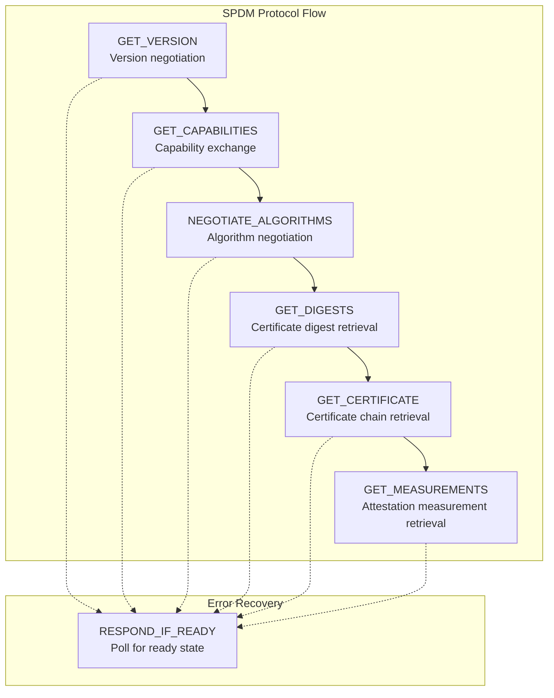
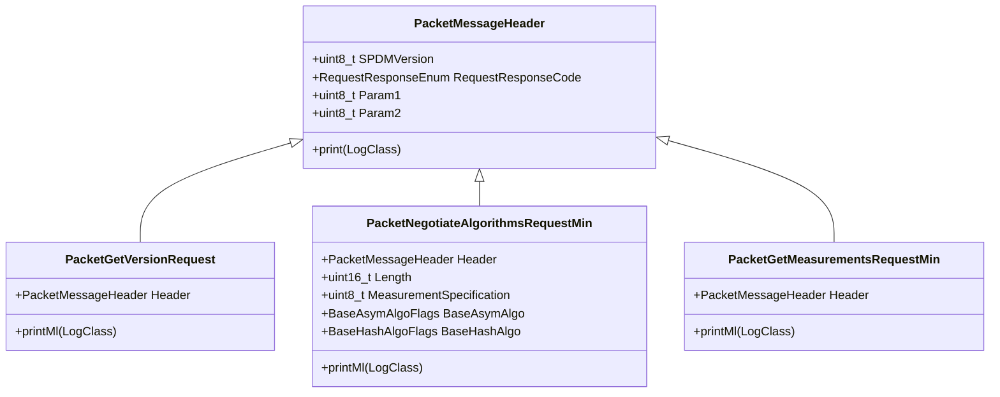
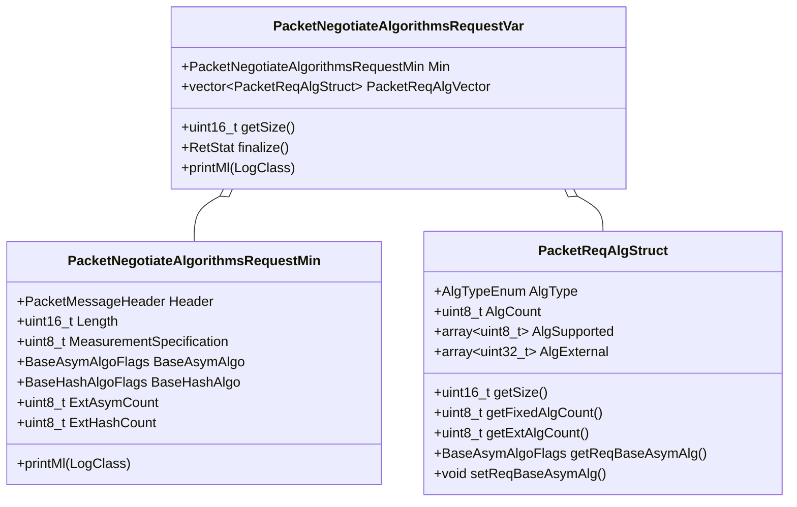
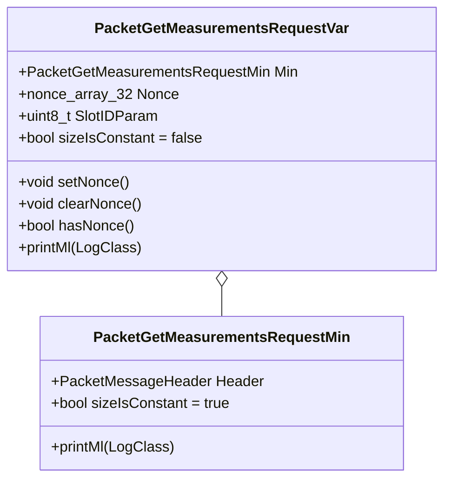
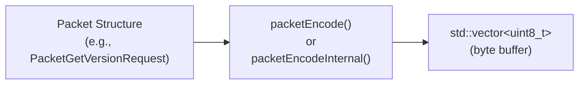

<!-- source: DeepWiki mcp.deepwiki.com · repo NVIDIA/spdm · extra page Request Packets · fetched 2026-10-26 -->

# Request Packets

<details>
<summary>Relevant source files</summary>

The following files were used as context for generating this wiki page:

- [libspdmcpp/headers_public/spdmcpp/internal/request/packet_negotiate_algorithms_request.hpp](libspdmcpp/headers_public/spdmcpp/internal/request/packet_negotiate_algorithms_request.hpp)
- [libspdmcpp/headers_public/spdmcpp/internal/response/packet_algorithms_response.hpp](libspdmcpp/headers_public/spdmcpp/internal/response/packet_algorithms_response.hpp)
- [libspdmcpp/headers_public/spdmcpp/internal/response/packet_error_response.hpp](libspdmcpp/headers_public/spdmcpp/internal/response/packet_error_response.hpp)
- [libspdmcpp/headers_public/spdmcpp/internal/response/packet_version_response.hpp](libspdmcpp/headers_public/spdmcpp/internal/response/packet_version_response.hpp)
- [libspdmcpp/headers_public/spdmcpp/packet.hpp](libspdmcpp/headers_public/spdmcpp/packet.hpp)
- [libspdmcpp/tests/packet_basic_test.cpp](libspdmcpp/tests/packet_basic_test.cpp)

</details>


## Purpose and Scope

This document describes the SPDM request packet structures defined in `libspdmcpp`. Request packets are sent by the SPDM requester (typically the BMC) to an SPDM responder device to initiate protocol operations such as version negotiation, capability exchange, algorithm negotiation, certificate retrieval, and measurement collection.

For information about response packets sent by SPDM responder devices, see [Response Packets](#2.3.2). For the overall packet serialization framework and common structures, see [Packet Structures and Serialization](#2.3).

---

## Request Packet Types

The SPDM protocol defines several request message types, each corresponding to a specific protocol operation. All request packet structures are defined in header files under [libspdmcpp/headers_public/spdmcpp/internal/request/]().



**Sources:** [libspdmcpp/headers_public/spdmcpp/packet.hpp:119-126]()

---

## Common Packet Structure

All SPDM request packets begin with a `PacketMessageHeader` that identifies the message type and contains protocol-specific parameters.



The `PacketMessageHeader` contains:
- **SPDMVersion**: SPDM protocol version (e.g., 0x10 for SPDM 1.0, 0x12 for SPDM 1.2)
- **RequestResponseCode**: Enum identifying the message type (e.g., `REQUEST_GET_VERSION`, `REQUEST_NEGOTIATE_ALGORITHMS`)
- **Param1, Param2**: Request-specific parameters

**Sources:** [libspdmcpp/headers_public/spdmcpp/internal/packet_message_header.hpp]()

---

## Min/Var Pattern

Request packets follow a **Min/Var pattern** to handle variable-length data:

| Pattern | Description | `sizeIsConstant` |
|---------|-------------|------------------|
| **Min** | Fixed-size structure containing mandatory fields | `true` |
| **Var** | Variable-size structure containing Min + dynamic arrays | `false` |

For packets with no variable data, only the Min structure exists and is used directly. For packets with variable data (e.g., algorithm negotiation), the Var structure contains the Min structure plus variable-length vectors.

**Example:** `PacketNegotiateAlgorithmsRequestMin` vs. `PacketNegotiateAlgorithmsRequestVar`

**Sources:** [libspdmcpp/headers_public/spdmcpp/internal/request/packet_negotiate_algorithms_request.hpp:197-268]()

---

## GET_VERSION Request

The `GET_VERSION` request is the first message in the SPDM protocol flow, used to negotiate the SPDM specification version between requester and responder.

### Structure

```cpp
struct PacketGetVersionRequest
{
    static constexpr RequestResponseEnum requestResponseCode =
        RequestResponseEnum::REQUEST_GET_VERSION;
    static constexpr bool sizeIsConstant = true;

    PacketMessageHeader Header = PacketMessageHeader(requestResponseCode);
};
```

This is the simplest SPDM request, consisting only of the header. The responder replies with a list of supported SPDM versions.

**Sources:** [libspdmcpp/headers_public/spdmcpp/internal/request/packet_get_version_request.hpp]()

---

## GET_CAPABILITIES Request

The `GET_CAPABILITIES` request retrieves the capabilities supported by the responder. Two versions exist to support SPDM 1.0 and SPDM 1.1+.

### SPDM 1.0 Structure

```cpp
struct PacketGetCapabilities10Request
{
    static constexpr RequestResponseEnum requestResponseCode =
        RequestResponseEnum::REQUEST_GET_CAPABILITIES;
    static constexpr bool sizeIsConstant = true;

    PacketMessageHeader Header = PacketMessageHeader(requestResponseCode);
};
```

### SPDM 1.1+ Structure

```cpp
struct PacketGetCapabilitiesRequest
{
    static constexpr RequestResponseEnum requestResponseCode =
        RequestResponseEnum::REQUEST_GET_CAPABILITIES;
    static constexpr bool sizeIsConstant = true;

    PacketMessageHeader Header = PacketMessageHeader(requestResponseCode);
    uint8_t Reserved = 0;
    uint8_t CTExponent = 0;
    uint16_t Reserved2 = 0;
    RequesterCapabilitiesFlags Flags = RequesterCapabilitiesFlags::NIL;
};
```

The SPDM 1.1+ version includes:
- **CTExponent**: Timing exponent for timeout calculations
- **Flags**: Requester capability flags (e.g., certificate support, measurement support)

**Sources:** [libspdmcpp/headers_public/spdmcpp/internal/request/packet_get_capabilities_1_0_request.hpp](), [libspdmcpp/headers_public/spdmcpp/internal/request/packet_get_capabilities_request.hpp]()

---

## NEGOTIATE_ALGORITHMS Request

The `NEGOTIATE_ALGORITHMS` request is the most complex request packet, used to negotiate cryptographic algorithms between requester and responder.



### Fixed Fields (Min structure)

| Field | Type | Description |
|-------|------|-------------|
| `Length` | `uint16_t` | Total packet length including variable data |
| `MeasurementSpecification` | `uint8_t` | DMTF measurement specification |
| `BaseAsymAlgo` | `BaseAsymAlgoFlags` | Base asymmetric algorithm flags (RSA, ECDSA) |
| `BaseHashAlgo` | `BaseHashAlgoFlags` | Base hash algorithm flags (SHA-256, SHA-384, SHA-512) |
| `ExtAsymCount` | `uint8_t` | Number of extended asymmetric algorithms |
| `ExtHashCount` | `uint8_t` | Number of extended hash algorithms |

### Variable Fields (PacketReqAlgStruct)

The `PacketReqAlgVector` contains algorithm structures for additional algorithm types:

```cpp
struct PacketReqAlgStruct
{
    AlgTypeEnum AlgType;        // DHE, AEADCipherSuite, ReqBaseAsymAlg, etc.
    uint8_t AlgCount;           // Fixed and extended algorithm counts
    std::array<uint8_t, 14> AlgSupported;   // Algorithm support bits
    std::array<uint32_t, 15> AlgExternal;   // External algorithm IDs
};
```

The `AlgCount` field encodes two values:
- **Upper nibble (bits 7-4)**: Fixed algorithm count
- **Lower nibble (bits 3-0)**: Extended algorithm count

### Example Construction

```cpp
PacketNegotiateAlgorithmsRequestVar request;
request.Min.BaseHashAlgo = BaseHashAlgoFlags::SHA_256 | BaseHashAlgoFlags::SHA_384;
request.Min.BaseAsymAlgo = BaseAsymAlgoFlags::ECDSA_ECC_NIST_P256;

// Add DHE algorithm
request.PacketReqAlgVector.push_back(
    PacketReqAlgStruct::buildAlgSupported(AlgTypeEnum::DHE, 0x1b, 0x00));

// Add AEAD cipher suite
request.PacketReqAlgVector.push_back(
    PacketReqAlgStruct::buildAlgSupported(AlgTypeEnum::AEADCipherSuite, 0x06, 0x00));

request.finalize();  // Sets Length and Param1
```

**Sources:** [libspdmcpp/headers_public/spdmcpp/internal/request/packet_negotiate_algorithms_request.hpp:24-365](), [libspdmcpp/tests/packet_basic_test.cpp:317-334]()

---

## GET_DIGESTS Request

The `GET_DIGESTS` request retrieves cryptographic digests of certificate chains stored in the responder's certificate slots.

```cpp
struct PacketGetDigestsRequest
{
    static constexpr RequestResponseEnum requestResponseCode =
        RequestResponseEnum::REQUEST_GET_DIGESTS;
    static constexpr bool sizeIsConstant = true;

    PacketMessageHeader Header = PacketMessageHeader(requestResponseCode);
};
```

The responder replies with digests for all populated certificate slots (up to 8 slots per SPDM specification).

**Sources:** [libspdmcpp/headers_public/spdmcpp/internal/request/packet_get_digests_request.hpp]()

---

## GET_CERTIFICATE Request

The `GET_CERTIFICATE` request retrieves a certificate chain from a specific slot. Due to message size limits, large certificate chains are retrieved in multiple chunks.

```cpp
struct PacketGetCertificateRequest
{
    static constexpr RequestResponseEnum requestResponseCode =
        RequestResponseEnum::REQUEST_GET_CERTIFICATE;
    static constexpr bool sizeIsConstant = true;

    PacketMessageHeader Header = PacketMessageHeader(requestResponseCode);
    uint16_t Offset = 0;
    uint16_t Length = 0;
};
```

| Field | Description |
|-------|-------------|
| `Header.Param1` | Slot index (0-7) |
| `Offset` | Byte offset into the certificate chain |
| `Length` | Number of bytes to retrieve in this chunk |

### Chunking Example

For a 2048-byte certificate chain with a 1024-byte maximum message size:
1. Request 1: `Offset=0, Length=1024` → receives bytes 0-1023
2. Request 2: `Offset=1024, Length=1024` → receives bytes 1024-2047

**Sources:** [libspdmcpp/headers_public/spdmcpp/internal/request/packet_get_certificate_request.hpp]()

---

## GET_MEASUREMENTS Request

The `GET_MEASUREMENTS` request retrieves attestation measurements from the responder device. This can request individual measurements or all measurements at once.



### Header Parameters

| Parameter | Location | Description |
|-----------|----------|-------------|
| **Param1** | `Header.Param1` | Bit 0: Signature requested flag<br/>Bit 1: Raw bit stream requested |
| **Param2** | `Header.Param2` | Measurement operation:<br/>0: Total number of measurements<br/>1-254: Specific measurement index<br/>255: All measurements |

### Variable Fields

When signature is requested (`Param1 & 0x01`), the variable structure includes:
- **Nonce**: 32-byte random nonce for signature freshness
- **SlotIDParam**: Certificate slot to use for signature verification

### Example Usage

```cpp
// Request all measurements with signature
PacketGetMeasurementsRequestVar request;
request.Min.Header.Param1 = 0x01;  // Request signature
request.Min.Header.Param2 = 0xFF;  // All measurements
request.setNonce();
fillPseudoRandom(request.Nonce);   // Fill with random data
request.SlotIDParam = 0;           // Use slot 0 certificate
```

**Sources:** [libspdmcpp/headers_public/spdmcpp/internal/request/packet_get_measurements_request.hpp](), [libspdmcpp/tests/packet_basic_test.cpp:407-420]()

---

## RESPOND_IF_READY Request

The `RESPOND_IF_READY` request is used to poll the responder after receiving a `ResponseNotReady` error. This allows the requester to check if the responder is ready to process the original request.

```cpp
struct PacketRespondIfReadyRequest
{
    static constexpr RequestResponseEnum requestResponseCode =
        RequestResponseEnum::REQUEST_RESPOND_IF_READY;
    static constexpr bool sizeIsConstant = true;

    PacketMessageHeader Header = PacketMessageHeader(requestResponseCode);
};
```

The header parameters contain information from the original `ResponseNotReady` error:
- **Param1**: Original request code that received `ResponseNotReady`
- **Param2**: Token from the error response for request correlation

**Sources:** [libspdmcpp/headers_public/spdmcpp/internal/request/packet_respond_if_ready.hpp]()

---

## Packet Encoding and Decoding

All request packets support encoding (structure → bytes) and decoding (bytes → structure) through template functions.

### Encoding Functions



For fixed-size packets:
```cpp
std::vector<uint8_t> buffer;
auto rs = packetEncode(request, buffer);
```

For variable-size packets, call `finalize()` first:
```cpp
PacketNegotiateAlgorithmsRequestVar request;
// ... populate fields and PacketReqAlgVector ...
request.finalize();  // Updates Length and Param1

std::vector<uint8_t> buffer;
auto rs = packetEncode(request, buffer);
```

### Decoding Functions

```cpp
PacketGetVersionRequest request;
size_t offset = 0;
auto rs = packetDecode(log, request, buffer, offset);
```

For variable-size packets that require context:
```cpp
PacketGetMeasurementsRequestVar request;
PacketDecodeInfo info;
info.GetMeasurementsParam1 = buffer[1];  // From header
size_t offset = 0;
auto rs = packetDecode(log, request, buffer, offset, info);
```

### Endianness Handling

All multi-byte fields are automatically converted between host and SPDM (little-endian) byte order:

```cpp
inline void endianHostSpdmCopy(const PacketNegotiateAlgorithmsRequestMin& src,
                               PacketNegotiateAlgorithmsRequestMin& dst)
{
    endianHostSpdmCopy(src.Header, dst.Header);
    endianHostSpdmCopy(src.Length, dst.Length);
    endianHostSpdmCopy(src.BaseAsymAlgo, dst.BaseAsymAlgo);
    endianHostSpdmCopy(src.BaseHashAlgo, dst.BaseHashAlgo);
    // ... other fields
}
```

**Sources:** [libspdmcpp/headers_public/spdmcpp/internal/request/packet_negotiate_algorithms_request.hpp:136-195](), [libspdmcpp/headers_public/spdmcpp/internal/request/packet_negotiate_algorithms_request.hpp:242-258](), [libspdmcpp/tests/packet_basic_test.cpp:100-188]()

---

## Testing and Validation

Request packet encoding and decoding is extensively tested using pseudorandom data to ensure round-trip correctness.

### Test Pattern

```cpp
template <class T>
bool packetEncodeDecode(const T& src)
{
    // 1. Encode structure to buffer
    std::vector<uint8_t> buf;
    auto rs = packetEncode(src, buf);
    
    // 2. Decode buffer back to structure
    T dst;
    size_t off = 0;
    rs = packetDecode(log, dst, buf, off);
    
    // 3. Verify roundtrip: src == dst
    return src == dst;
}
```

### Example Tests

| Test Case | Packet Type | Description |
|-----------|-------------|-------------|
| `packet_pseudorandom_encode_decode` | `PacketNegotiateAlgorithmsRequestVar` | Tests algorithm negotiation with multiple PacketReqAlgStruct entries |
| `packet_pseudorandom_encode_decode` | `PacketGetMeasurementsRequestVar` | Tests measurement request with and without nonce |
| `packet_pseudorandom_decode_encode` | All Min structures | Tests fixed-size packet encoding/decoding |

**Sources:** [libspdmcpp/tests/packet_basic_test.cpp:271-509]()

---

## Summary Table

| Request Type | Structure Name | Variable Size | Primary Use |
|--------------|----------------|---------------|-------------|
| GET_VERSION | `PacketGetVersionRequest` | No | Version negotiation |
| GET_CAPABILITIES (1.0) | `PacketGetCapabilities10Request` | No | Capability exchange (SPDM 1.0) |
| GET_CAPABILITIES (1.1+) | `PacketGetCapabilitiesRequest` | No | Capability exchange (SPDM 1.1+) |
| NEGOTIATE_ALGORITHMS | `PacketNegotiateAlgorithmsRequestVar` | Yes | Algorithm negotiation |
| GET_DIGESTS | `PacketGetDigestsRequest` | No | Certificate digest retrieval |
| GET_CERTIFICATE | `PacketGetCertificateRequest` | No | Certificate chain retrieval |
| GET_MEASUREMENTS | `PacketGetMeasurementsRequestVar` | Yes | Measurement retrieval |
| RESPOND_IF_READY | `PacketRespondIfReadyRequest` | No | Error recovery polling |

**Sources:** [libspdmcpp/headers_public/spdmcpp/packet.hpp:119-126]()

---

