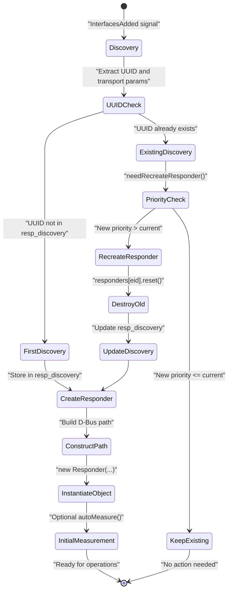
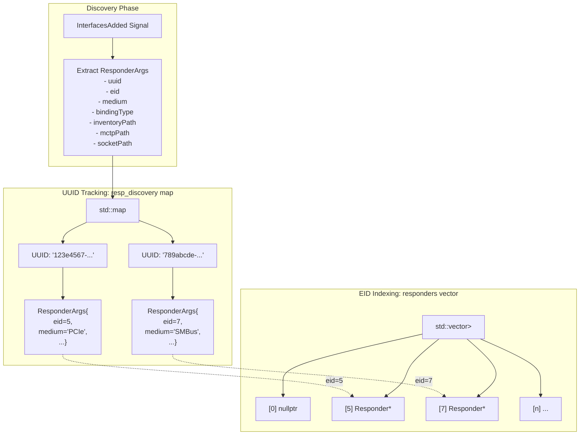
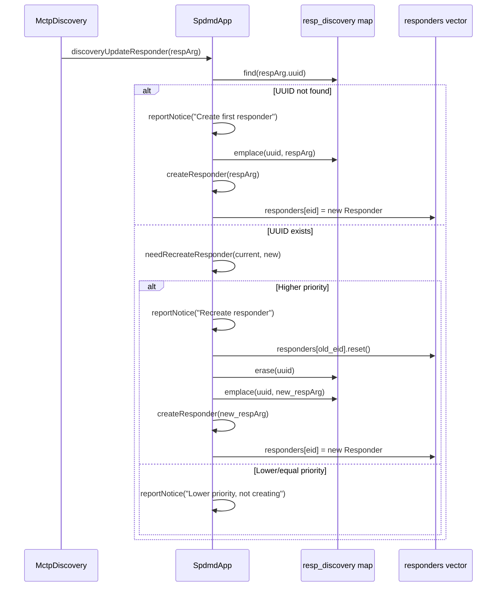
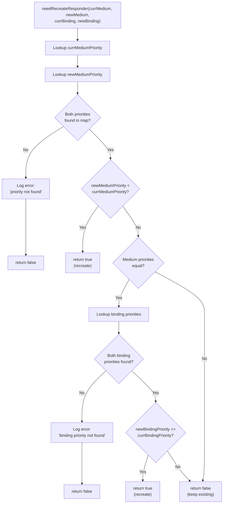
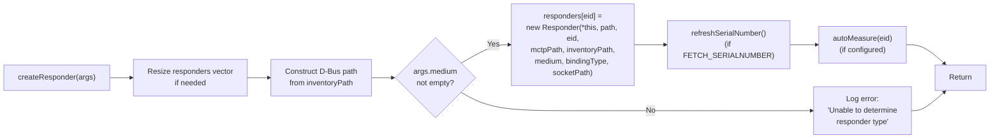
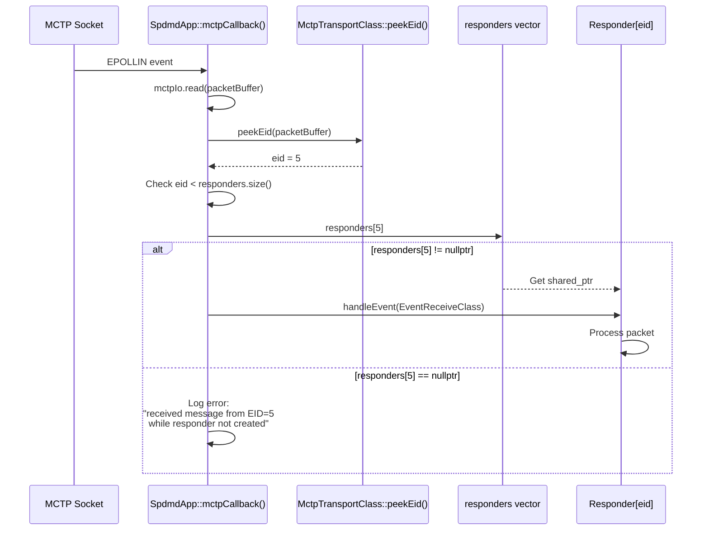
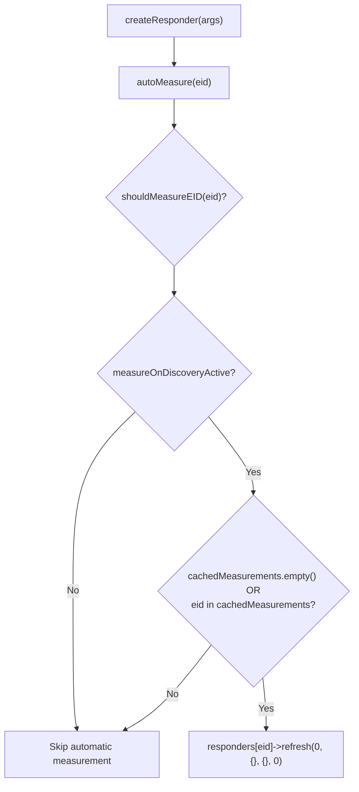

<!-- source: DeepWiki mcp.deepwiki.com · repo NVIDIA/spdm · extra page Responder Lifecycle Management · fetched 2026-10-26 -->

# Responder Lifecycle Management

<details>
<summary>Relevant source files</summary>

The following files were used as context for generating this wiki page:

- [spdmd/spdmd.cpp](spdmd/spdmd.cpp)
- [spdmd/spdmd_app.hpp](spdmd/spdmd_app.hpp)

</details>


## Purpose and Scope

This page documents how the `spdmd` daemon manages the lifecycle of SPDM responder objects, from initial discovery through creation, priority-based replacement, and EID-based indexing. The lifecycle management ensures that the daemon maintains one active `Responder` object per discovered SPDM device, selecting the highest-priority transport path when multiple MCTP connections exist to the same device.

For information about how responders are discovered via MCTP and inventory correlation, see [MCTP Endpoint Discovery](#3.3). For details about the `Responder` class's D-Bus interfaces and SPDM protocol operations, see [D-Bus Responder Interface](#3.2).

---

## Lifecycle Overview

The responder lifecycle consists of four main stages:

| Stage | Trigger | Action | Key Method |
|-------|---------|--------|-----------|
| **Discovery** | MCTP endpoint or inventory signal | UUID and transport parameters recorded | `discoveryUpdateResponder()` |
| **Priority Evaluation** | New transport path discovered | Compare medium/binding priorities | `needRecreateResponder()` |
| **Creation/Recreation** | First discovery or higher priority path | Instantiate `Responder` object | `createResponder()` |
| **Initialization** | After creation | Optional serial number and measurements | `autoMeasure()` |



**Diagram: Responder Lifecycle State Machine**

Sources: [spdmd/spdmd.cpp:294-387]()

---

## Discovery and UUID Tracking

The daemon maintains two primary data structures for managing responder lifecycle:

| Data Structure | Type | Purpose | Key |
|----------------|------|---------|-----|
| `resp_discovery` | `std::map<std::string, ResponderArgs>` | Tracks discovered devices by UUID | Device UUID |
| `responders` | `std::vector<std::shared_ptr<Responder>>` | Active responder objects | EID (index) |

The `resp_discovery` map serves as the source of truth for which transport path is currently selected for each device, while `responders` provides EID-based access for packet routing.



**Diagram: Discovery Data Structures**

The `discoveryUpdateResponder()` method is the entry point for all lifecycle management:



**Diagram: discoveryUpdateResponder() Flow**

Sources: [spdmd/spdmd.cpp:294-334](), [spdmd/spdmd_app.hpp:166-169]()

---

## Priority-Based Selection Mechanism

When multiple transport paths connect to the same device (identified by UUID), the daemon selects the highest-priority path using a two-tier priority system:

### Priority Tables

The daemon uses two static priority maps defined in [spdmd/spdmd_app.hpp:54-73]():

**Medium Type Priorities (Primary):**
```
PCIe   = 0 (highest)
USB    = 1
SPI    = 2
I3C    = 3
KCS    = 4
Serial = 5
SMBus  = 6 (lowest)
```

**Binding Type Priorities (Secondary):**
```
PCIe   = 0 (highest)
USB    = 1
SPI    = 2
I3C    = 3
KCS    = 4
Serial = 5
SMBus  = 6 (lowest)
```

These priorities are based on expected bandwidth characteristics, with PCIe providing the highest throughput and lowest latency.

### Priority Comparison Algorithm

The `needRecreateResponder()` method implements the priority comparison logic:



**Diagram: needRecreateResponder() Decision Logic**

### Priority Evaluation Examples

| Current | New | Decision | Reason |
|---------|-----|----------|--------|
| PCIe/PCIe (0/0) | USB/USB (1/1) | Keep existing | Lower medium priority |
| SMBus/SMBus (6/6) | PCIe/PCIe (0/0) | Recreate | Higher medium priority |
| PCIe/PCIe (0/0) | PCIe/USB (0/1) | Keep existing | Same medium, lower binding priority |
| PCIe/USB (0/1) | PCIe/PCIe (0/0) | Recreate | Same medium, higher binding priority |
| USB/SMBus (1/6) | USB/SMBus (1/6) | Recreate | Equal priority (inventory recreated) |

The last case (equal priority) triggers recreation to refresh the responder when inventory objects are recreated, as noted in [spdmd/spdmd.cpp:288-291]().

Sources: [spdmd/spdmd.cpp:225-292](), [spdmd/spdmd_app.hpp:54-73](), [spdmd/spdmd_app.hpp:128-151]()

---

## Responder Creation Process

The `createResponder()` method instantiates a new `Responder` object and registers it in the `responders` vector:

### EID-Based Array Sizing

The `responders` vector is dynamically resized to accommodate the EID:

```cpp
if (args.eid >= responders.size())
{
    responders.resize(args.eid + 1);
}
```

This ensures EID-based indexing works correctly, with sparse arrays for non-contiguous EIDs. Entries for unused EIDs remain as `nullptr`.

### D-Bus Object Path Construction

The D-Bus object path is constructed from the inventory path:

```
/xyz/openbmc_project/SPDM/{inventory_filename}
```

For example, if `inventoryPath = /xyz/openbmc_project/inventory/system/chassis/GPU0`, the SPDM object path becomes `/xyz/openbmc_project/SPDM/GPU0`. If the inventory path is empty (during local testing), the EID is used as a fallback.

### Responder Instantiation



**Diagram: createResponder() Execution Flow**

The `Responder` constructor receives:
- `*this` - Reference to `SpdmdApp` for context access
- `path` - D-Bus object path
- `eid` - MCTP Endpoint ID
- `mctpPath` - D-Bus path to MCTP endpoint object
- `inventoryPath` - D-Bus path to inventory object
- `medium` - Transport medium type (e.g., "xyz.openbmc_project.MCTP.Endpoint.MediaTypes.PCIe")
- `bindingType` - MCTP binding type
- `socketPath` - Unix socket path (for non-kernel MCTP)

Sources: [spdmd/spdmd.cpp:336-387]()

---

## EID-Based Indexing and Packet Routing

The `responders` vector provides O(1) lookup for routing incoming MCTP packets to the correct responder:



**Diagram: EID-Based Packet Routing**

The `mctpCallback()` method extracts the EID from the packet header using `MctpTransportClass::peekEid()`, then dispatches the packet to the appropriate responder. If the EID is out of bounds or the responder slot is `nullptr`, the packet is logged and dropped.

Sources: [spdmd/spdmd.cpp:423-486]()

---

## Automatic Initialization

After a responder is created, two optional initialization steps may occur:

### Serial Number Retrieval

If the `FETCH_SERIALNUMBER_FROM_RESPONDER` compile-time option is enabled and set to a non-zero measurement index, the daemon automatically requests that measurement to populate the serial number property:

```cpp
#if FETCH_SERIALNUMBER_FROM_RESPONDER != 0
    responders[args.eid]->refreshSerialNumber();
#endif
```

This is implemented at [spdmd/spdmd.cpp:383-385]().

### Automatic Measurements

The `autoMeasure()` method is called immediately after responder creation if:
1. The `--cached_measurements` CLI option is enabled
2. The measurement delay has expired (or is zero)
3. The EID matches the configured filter (or "all" is specified)



**Diagram: Automatic Measurement Decision Logic**

The measurement delay is controlled by the `--cached_measurements_delay` option (default 60 seconds) and uses a `boost::asio::steady_timer` to trigger `measurementDelayCallback()`, which sets `measureOnDiscoveryActive = true` and calls `autoMeasure()` for all existing responders.

Sources: [spdmd/spdmd.cpp:386-387](), [spdmd/spdmd.cpp:500-509](), [spdmd/spdmd.cpp:389-421](), [spdmd/spdmd.cpp:488-498]()

---

## Responder Destruction

When a responder is recreated due to a higher-priority transport path, the old responder is destroyed by resetting its `shared_ptr`:

```cpp
responders[it->second.eid].reset();
```

This occurs at [spdmd/spdmd.cpp:317](). The `Responder` destructor automatically:
1. Closes the D-Bus interfaces
2. Cancels any pending timers
3. Releases the `ConnectionClass` and associated transport resources

The EID slot in the vector becomes `nullptr`, ready for a new responder to be assigned.

---

## Key Data Structures Summary

| Structure | Location | Type | Purpose |
|-----------|----------|------|---------|
| `resp_discovery` | `SpdmdApp` | `std::map<std::string, ResponderArgs>` | UUID-indexed discovery state |
| `responders` | `SpdmdApp` | `std::vector<std::shared_ptr<Responder>>` | EID-indexed active responders |
| `mediumPriority` | `spdmd_app.hpp` | `std::unordered_map<std::string, int>` | MCTP medium priority mapping |
| `bindingPriority` | `spdmd_app.hpp` | `std::unordered_map<std::string, int>` | MCTP binding priority mapping |
| `ResponderArgs` | `dbus_impl_responder.hpp` | struct | Discovery parameters (uuid, eid, paths, etc.) |

Sources: [spdmd/spdmd_app.hpp:166-169](), [spdmd/spdmd_app.hpp:54-73]()

---

